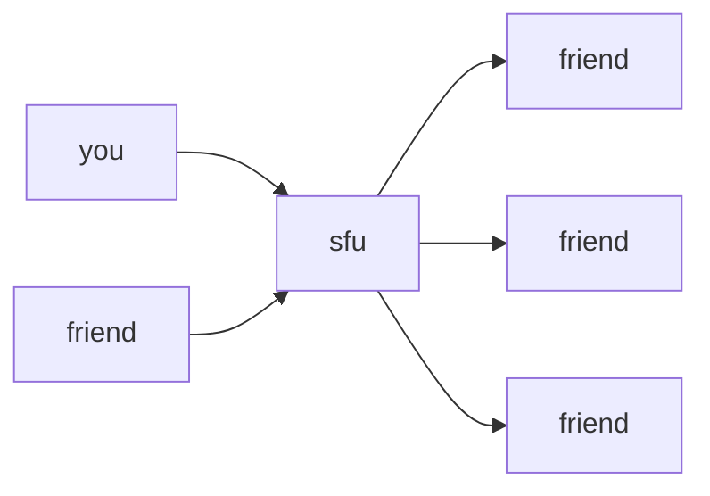
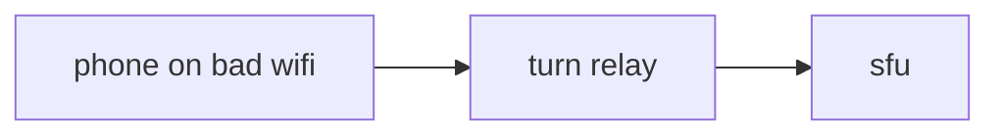
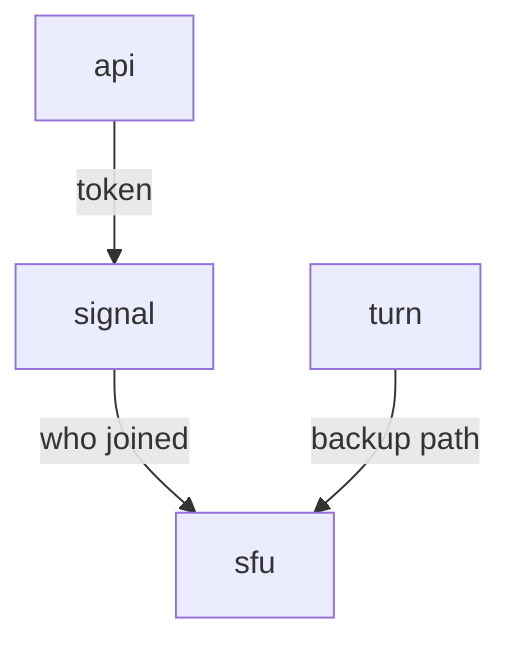
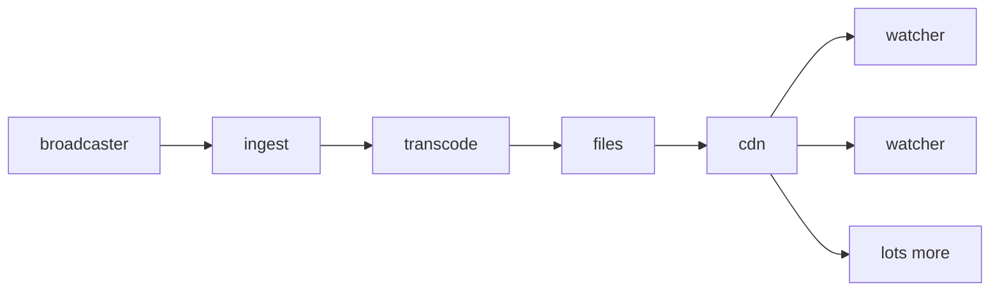
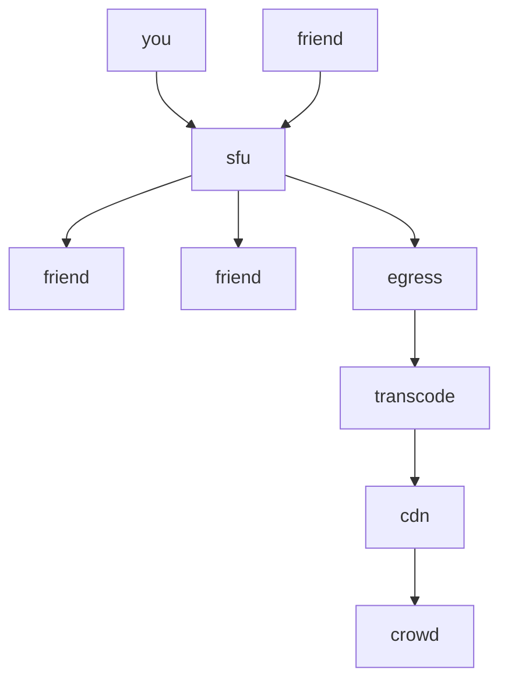
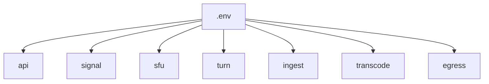

# streams

background from before the build. the real layout is in `new-plan-human.md` and `new-plan-llm.md`. the boxes below are the big-picture idea, not the repo.

upload once. a server copies it out.

two ways to copy.

```mermaid
flowchart TB
  you[you upload once]

  you --> call[call]
  you --> live[stream]

  call --> friends[a few friends get the packets]
  live --> cdn[a cdn serves the crowd]
```

| | call | stream |
|---|---|---|
| like | discord cam | twitch |
| sends | everyone | one person |
| watches | the room | the crowd |
| delay | ~0.2s | a few seconds |
| server | copies packets | makes files |

---

## call

each person uploads once. the server copies packets. it does not decode.



a room stays on one machine.

bad wifi goes through a relay:



boxes:



- **api** — login, room, token
- **signal** — join, leave, mute
- **sfu** — copy the packets
- **turn** — backup for bad networks

---

## stream

one upload. a few sizes. files. the cdn copies those files to everyone.



- **ingest** — take the one upload
- **transcode** — 1080, 720, 480
- **files** — short clips
- **cdn** — serve the crowd

6000 watchers is too big for your box. the cdn holds that.

---

## call and stream together

friends stay on the call. one extra watcher writes the public stream.



the crowd never connects to the sfu.

---

## one repo

same code. `.env` picks which program boots.



```text
cmd/api
cmd/signal
cmd/sfu
cmd/ingest
cmd/transcode
cmd/egress
```

`.env` holds addresses, ports, keys, limits.

shared: users, rooms, tokens, the app.
split: anything holding live video.
