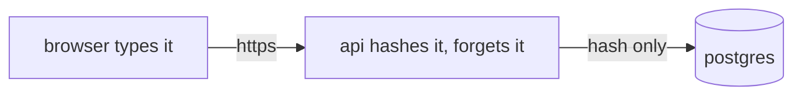
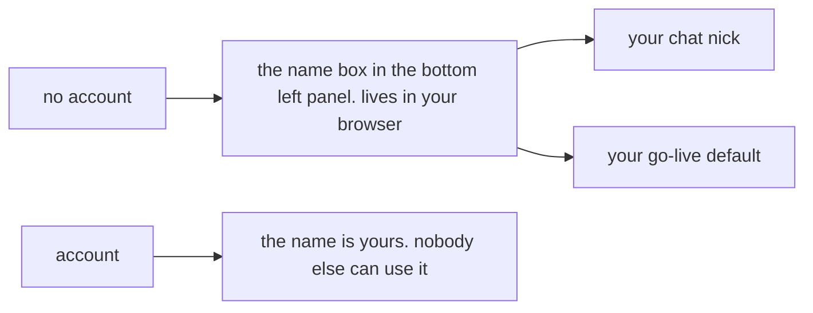
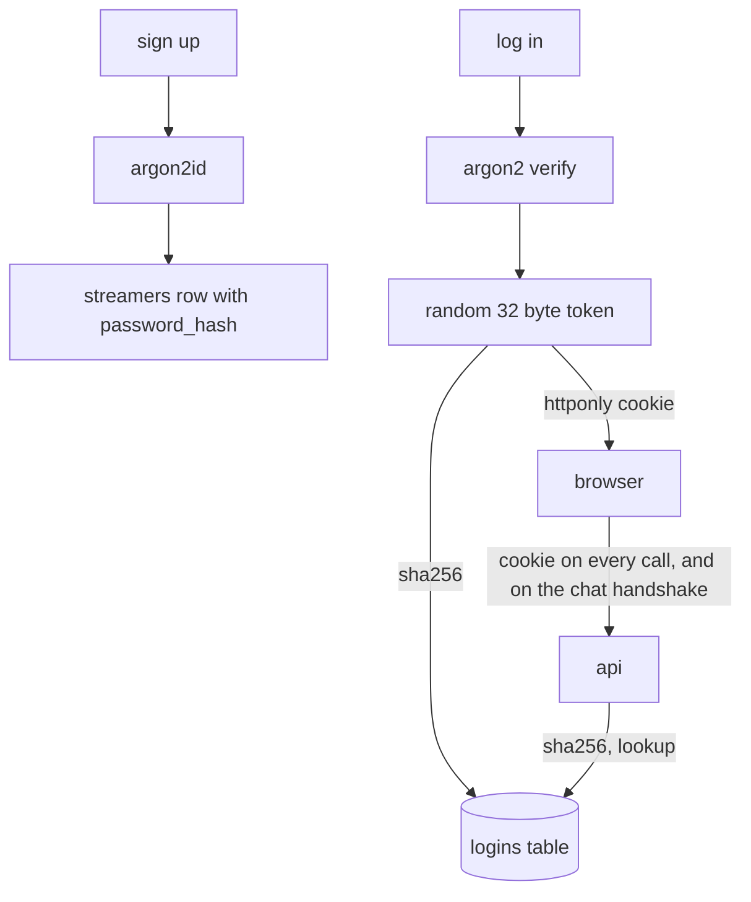

# accounts

username + password, in postgres. optional: nobody has to log in.

## the short answer

- the browser does **not** encrypt or hash the password. https already encrypts the trip.
- the api hashes it with **argon2id** and forgets the original. the database only ever sees the hash.
- a stolen database gives names, bios and argon2 hashes. argon2 is built to make those slow to crack.



## who you are



- **without an account** you are the name in the bottom left panel. it is in localstorage. any name nobody owns is free: go live as it, chat as it, save its bio.
- **with an account** the name is claimed. only your login can go live as it, change its bio, or talk as it in chat. an anonymous nick equal to a claimed name is refused. a `✓` next to a name on home, on watch and in chat means a login is behind it.
- a name someone used without an account (a `streamers` row with no hash) is claimed by the first signup. the bio stays.

## why not hash in the browser

it feels safer. it is not.

- whatever the browser sends **is** the password. if it sends a hash, a thief with the database logs in with the hash. nothing gained.
- the browser would have to ask for the salt first. that tells anyone which names exist.
- browsers are slow at argon2, so you would pick weak settings. the server picks strong ones.
- it only protects against the api logging its own request bodies. so: the api never logs bodies.

if the server must truly never see the password, that is a pake (opaque). a bank thing, not a test stream thing.

## what a breach gets

| they steal | they get | because |
|---|---|---|
| the database | names, bios, argon2 hashes, sha256 of login tokens | hashes are slow to crack. the token hashes are useless on their own |
| the wire | nothing | https |
| a laptop with the site open | that one login, until it is logged out | the cookie is httponly. scripts cannot read it. `logout-all` kills it |
| the vps | everything live | same as before accounts. no plan fixes that one |

## the pieces



- **argon2id**, rust `argon2` crate. 19 mib, 2 passes, 1 lane (owasp's numbers). the stored string carries salt and settings, so settings can change later. ~50 ms each, in `spawn_blocking`, at most 4 at a time (a semaphore): a burst of logins waits its turn instead of taking 19 mib each at once.
- **salt**: 16 random bytes from the os, made at signup and at every password change, stored inside the hash string. not a secret; it makes every hash unique so one cracking run cannot cover two people.
- **login token**: 32 random bytes, hex, in a cookie. the database stores its sha256. no secret key anywhere, nothing to rotate, nothing to leak.
- **cookie**: `login=<token>; Path=/; Max-Age=2592000; HttpOnly; Secure; SameSite=Lax` (30 days, fixed). one origin for pages, api, chat and video, so no cors and no cookie domain. `Secure` still sets on `http://localhost`, so `npm run dev` works.
- **csrf**: `SameSite=Lax`. a form on another site cannot post with the cookie. the one route that acts without it is `logout` (it clears the cookie), so that one also reads the browser's `Sec-Fetch-Site`: `cross-site` or `same-site` is 403. no header (curl, the tests) passes.
- **many devices**: a new login does not end the old ones; a phone and a laptop are both you. `logout-all` and a password change are what end them. a name's expired rows are swept when it logs in again; `last_seen` moves at most once an hour, so a logged-in page is reads, not a write per request.
- **no jwt**. same origin, one database, and a row can be deleted. a jwt cannot be logged out.

## rules

- name: what it is everywhere. `a-z 0-9 _ -`, 1 to 32. already lowercase, so no two spellings of one name. behind it a uuid that never changes (`ids.md`), so a login can change its name once a month and keep its logins, groups and pictures; the old name is held for it 30 days.
- reserved: `dummy-*` stays with the dummy box.
- password: 8 to 128 characters, anything in them. no complexity rules, they make passwords worse. unicode normalised (nfkc) first, then measured, the same way at signup, login and password change, so a phone and a laptop type the same thing and what signup took can log in.
- same error for wrong name and wrong password: `wrong name or password`, and a verify against a fixed decoy hash when the name does not exist, so the timing matches too. that hides *which* of the two was wrong, nothing more: whether a name has an account is public (`GET /api/streamers/<name>` says `verified`, home and watch show the `✓`, an anonymous chat nick on a claimed name is told so). it has to be, the `✓` is the point.
- rate limits in redis, counted *before* the password is checked, so a burst of parallel tries cannot all slip past a zero: 10 tries per name from one ip per 15 min (a right one clears it; wrong `old` passwords on `/api/password` count on the same key), 100 tries per ip per 15 min, 20 signups per ip per hour. the ip is caddy's `X-Forwarded-For`. per name *and* ip, not per name: a stranger's ten wrong guesses lock the stranger out of your name, not you. the cost: an attacker with many ips gets ten guesses from each; argon2 at ~50 ms and 4 at a time is the wall then.
- the api never logs the body of `/api/login` or `/api/signup`.
- no email, so no password reset. `./deploy.sh passwd <name>` (`docker compose exec api api passwd <name>` underneath) prints a new random one, once, and logs every login of that name out. that is the reset.

## database

```sql
ALTER TABLE streamers ADD COLUMN IF NOT EXISTS password_hash text;     -- null = no account
ALTER TABLE streamers ADD COLUMN IF NOT EXISTS created_at timestamptz NOT NULL DEFAULT now();

CREATE TABLE IF NOT EXISTS logins (
  token_hash bytea PRIMARY KEY,                     -- sha256(token). never the token
  name text NOT NULL REFERENCES streamers(name) ON DELETE CASCADE,
  created_at timestamptz NOT NULL DEFAULT now(),
  last_seen timestamptz NOT NULL DEFAULT now(),
  expires_at timestamptz NOT NULL
);
CREATE INDEX IF NOT EXISTS logins_name_idx ON logins (name);

-- since ids.md: the row has a uuid that never changes, and the login points at it, so the
-- name can change. `logins.name` stays one release (ON UPDATE CASCADE), then goes.
ALTER TABLE streamers ADD COLUMN IF NOT EXISTS id uuid NOT NULL DEFAULT gen_random_uuid();
ALTER TABLE logins ADD COLUMN IF NOT EXISTS user_id uuid REFERENCES streamers(id) ON DELETE CASCADE;
CREATE TABLE IF NOT EXISTS held_names (name text PRIMARY KEY, user_id uuid NOT NULL REFERENCES streamers(id) ON DELETE CASCADE, until timestamptz NOT NULL);
```

`sessions` keeps meaning a stream, so the login rows are `logins`.

## api

| | route | does |
|---|---|---|
| POST | `/api/signup` | `{name, password}` → 201 `{id, name}` + cookie. 400, 403 `reserved name`, 409 `name taken` (another account's, or held after a rename), 429 |
| POST | `/api/login` | `{name, password}` → 200 `{id, name}` + cookie. 401 `wrong name or password`. 429 `too many tries. wait 15 minutes` |
| POST | `/api/logout` | 204. deletes the row, clears the cookie. 403 when the browser says it came from another site |
| POST | `/api/logout-all` | 204. deletes every row for the account. 401 without a login |
| GET | `/api/me` | `{id, name, renamed_at}`; every field `null` for nobody |
| POST | `/api/password` | `{old, new}` → 204. kills every other login. 401 without a login, 403 `wrong password`, 429 on the login counter |
| POST | `/api/name` | `{name, password}` → 200 `{id, name, renamed_at}`: the account's name changes, every login of it stays. once in 30 days, not while live; the old name is held 30 days. `ids.md` has the rules and the errors |

changed:

| | route | now |
|---|---|---|
| POST | `/api/streams/:name/go-live` | 403 `that name has an account. log in as it` when claimed and the cookie is not its owner. free names: like before. the dummy `?password=` path is untouched |
| PUT | `/api/streamers/:name` | the same 403, and the same `reserved name` 403 as go-live for a `dummy-` name without `?password=` (the picture's PUT and DELETE too: a reserved name is never claimed, so without the gate it would be anyone's) |
| GET | `/api/streams`, POST `.../watch` | carry `verified` |
| ws | `/chat/:name` | the cookie names you; `hello` needs no nick then. an anonymous nick that is a claimed name gets `that name has an account. log in as it, or pick another` and the socket closes; a `dummy-` nick `that nick belongs to the fake streams. pick another`, the same way. lines carry `verified` |
| ws | `/ws` (video) | a publish frame carries the go-live `session` and `token`; video asks the api (`heartbeat`) that they are open for that name, else `not your stream`. so skipping go-live skips nothing |
| ws | `/events` (the gateway, `status.md`) | the cookie names the browser; `hello` needs no nick then. a guest's hello carries the nick, lowercased to a name; a claimed one gets `that name has an account. log in as it, or pick another` and the socket closes, like the chat's. only the name's own sockets are ever told its choice (`appear offline`); everyone else gets the derived word |
| PUT | `/api/streamers/:name/presence` | the bio's gate: a free name is anyone's, a claimed name its login's |

`stop` and `heartbeat` still take the session token: that is what an anonymous streamer has.

## pages

- `/login`, `/signup`: name, password, one button, a show toggle instead of a repeat box. `?next=` says where to land. the inputs carry `autocomplete="username"`, `"current-password"`, `"new-password"`, which is what makes password managers offer to save; they do more for the breach story than any code here.
- the panel pinned to the bottom left of every page, discord style: a picture made from the name (a coloured square with the first letter; no uploads yet), then the name box with `sign up · log in` under it, or your name + `✓` with `log out` under it, and the `go live` button on the right (not on `/live` itself).
- go live: a login has the name box filled and locked.
- chat: a login has no nick box; its lines show `✓`, and the badges of its groups (`groups.md`).
- atoms: `meAtom` (`/api/me` once per page load; `undefined` until it answers; a failed ask is nobody for now and asked again on the next page, never remembered as "nobody"), actions `login`, `signup`, `logout`, `forgetMe` (the cookie died elsewhere: back to nobody). fetch sends the cookie on its own. nothing about the login is ever in localstorage.

## code

- `api/src/auth.rs`: hash, verify, token, cookie, the `Me` extractor (cookie → `Account { id, name }`), `may_act_as` (the one rule), rate limits, the seven routes (`/api/name` is the rename, `ids.md`), `api passwd`.
- `api/src/main.rs`: schema, the two guards, `verified` on the lists, the `passwd` dispatch.
- `api/src/chat.rs`: `Me` on the handshake, claimed nicks refused, `verified` on lines.
- `frontend`: `AuthPage`, `UserPanel` (mounted once by the router's `Shell`), `auth-atoms.ts`, the go-live seed, the chat changes, the `✓`s.
- `test/auth.js`: twenty steps, see `spec.md`.
- `video/src/main.rs`: `owns_stream`, the one call to the api's heartbeat that makes the socket honour the gate. the api decides; video checks that it did. (no signing: one http round trip on the same box is simpler than a second secret.)

## not here

- email, reset links, 2fa
- oauth (github, discord). it fits later: same `logins` table, one more way to make a row
- display names with capitals. the stream name is the login name (it can change, `ids.md`, but it is still the one word)
- admin pages
