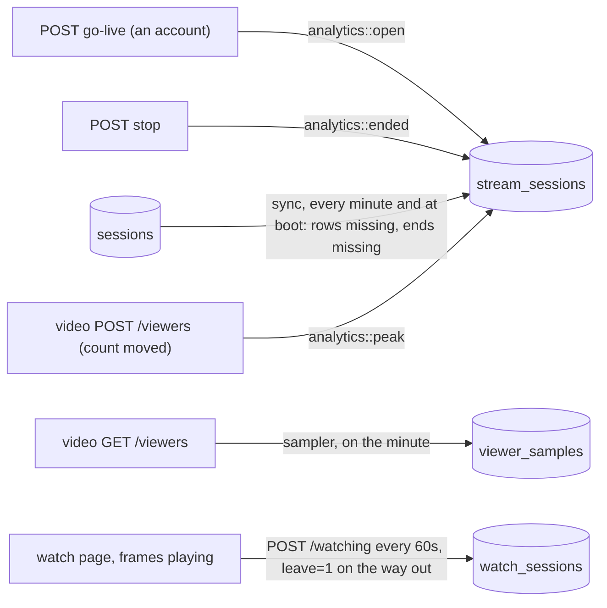

# analytics

built, first version. a streamer with an account sees what their streams did: viewers over time, peak and average, how long they were live, watch time, unique viewers (logins and anonymous browsers), follows that came while live, and chat lines. the **stats** tab of the user modal (the gear), for the logged-in account only. nobody else can read it, not even an admin; there are no group stats.

a stream with no account behind it (a free name, the dummy streams) is not recorded. the stats tab still shows for a guest, with one line saying to make an account and a **create account** button that opens the security tab's sign up. the api refuses a guest too (401).

## tables

migration `api/migrations/0014-stream-analytics.sql`. kept forever: nothing deletes from them, there is no cleanup job. the only way a row goes is its account being deleted (cascade).

| table | one row per | columns |
|---|---|---|
| `stream_sessions` | stream an account made | `id` (= `sessions.id`, the go-live grant's session), `streamer` (account uuid), `started_at`, `ended_at`, `peak_viewers` |
| `viewer_samples` | live stream per minute | `session_id`, `ts` (the minute), `viewers` int. primary key `(session_id, ts)` is the graph's index |
| `watch_sessions` | stretch of one viewer watching one stream | `session_id`, `viewer` (login id, or the browser's anonymous id), `joined_at`, `left_at`, `anon` |

sizes: a sample is ~48 bytes on disk with its index entry. an 8 hour stream is 480 samples, ~23 kB. a stream nobody watches still gets its samples (zeros), which is what draws its graph.

## writes

- **opening and closing.** go-live writes the stream's row when an account went live. the end is copied from the `sessions` row, which already ends every way a stream can (stop, `by=video`, the sweeper, a go-live clearing a stale one): stop copies it at once, and the sampler's `sync` copies any other end within the minute. `sync` also makes the row for an account's open session that has none (a go-live taken by an older api mid-deploy).
- **restarts.** at boot the sampler runs `sync` first: every stream that ended while the api was down gets its end, from `sessions` (whose sweeper ends a dead tab's row at its last heartbeat). the samples of the minutes the api was down are missing, and the graph draws straight across them; nothing is invented.
- **the sampler.** a second past every minute, `video_viewers` (the same `GET /viewers` home.rs heals its table from), one insert for every open stream video lists. `ts` is truncated to the minute and the key is `(session_id, ts)`, so two api processes, or two ticks in one minute, write one row (`ON CONFLICT DO NOTHING`). video down: no samples that minute. a stream video does not list yet (seconds old) gets none rather than a zero.
- **the peak.** video's push when a count moves (≤1/s, docs/viewers.md) raises `peak_viewers` when it is higher: a peak between two samples is kept. a write only when it is a new peak.
- **watch sessions.** the viewer's browser talks to video, not the api, and video was left alone. so the watch page beats instead (`frontend/src/infra/watch-beat.ts`): while frames play (`watching`, and `reconnecting` through a blip), `POST /api/streams/<name>/watching?anon=<id>` at once and every 60s, and one `&leave=1` beacon when it stops (left the page, stream ended, tab closed). the api extends the viewer's latest stretch to now, or starts a new one when the last beat is older than 150s. a login is counted by its cookie; anyone else by `anon`, a random uuid kept in `localStorage['analytics.anonId.v1']` (one for the page's life when storage is refused). two tabs of one viewer extend the same stretch. the streamer on their own page is not counted. home's muted previews never beat. `left_at` is always the last beat, so a row is never left open, by a dead tab or an api restart.

## reads

| route | what |
|---|---|
| `GET /api/stats?days=7\|30` | `summary` (streams started in the range, live seconds, avg viewers over all their samples, peak, watch seconds, unique viewers across them, follows in the range live or not), `streams` (the range's, newest first, at most 50, each with duration, peak, avg, watch seconds, unique viewers) and `last` (the last stream in full, whenever it was; null if never live) |
| `GET /api/stats/streams/:id` | one stream in full: the list's fields plus `points` (`[unix ms, viewers]` per minute), `account_viewers`, `anon_viewers`, `new_follows` (follows that came while it was live and are still there), `chat_messages` and `chatters` (lines from anyone but the streamer in the stream's room while it was live; 0 where `CHAT_PERSIST` is off). 404 for a stream that is not the asker's |

both are the cookie's account's own streams (`streamer = me`), so a rename keeps them. nobody logged in: 401 `make an account to see your stream stats`. rate limits: the reads are `read`, the beat is `write` (ratelimit.rs).

averages are computed when asked, from the samples and watch rows of the streams in question (indexed by `(session_id, ...)`). fine for a first version; a streamer with thousands of streams in 30 days would want them stored per stream at its end.

## the tab

`frontend/src/shared-components/user-modal/StatsTab.tsx`. the 7 / 30 days chips, the range's tiles, the graph of one stream (the last, or the one picked from the list under it) and that stream's tiles. the graph is inline svg, no chart library: one line in the theme's blue, recessive grid, a crosshair and its count on hover or touch, the same points as a table for a screen reader.

## not here

- **anti-spoofing.** nothing checks the `anon` id or the beats: a script can make up viewers in `watch_sessions` (unique viewers, watch time). it cannot touch the viewer counts, samples or peak, which are video's (docs/viewers.md). the fix is the signed watch ticket viewers.md describes, checked on the beat too.
- live updates in the tab (it reads once per open and per range change).
- exports, per-country or per-device numbers, group stats.
