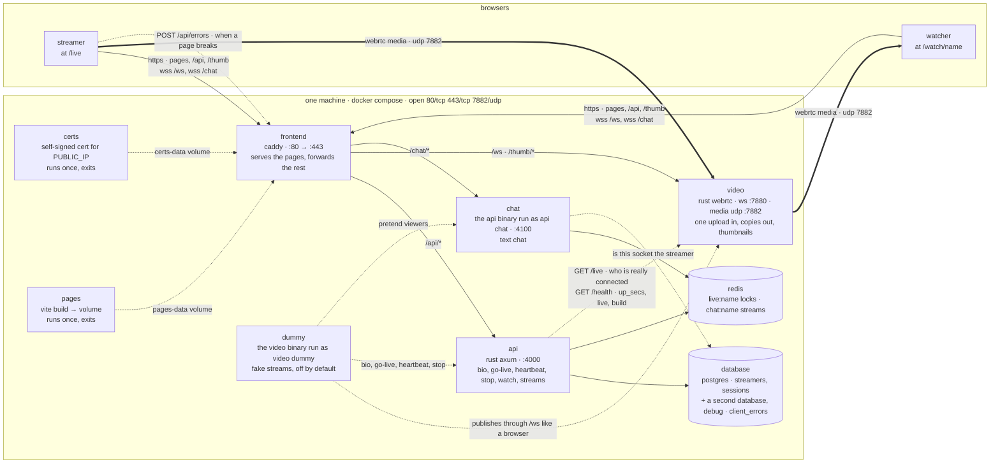
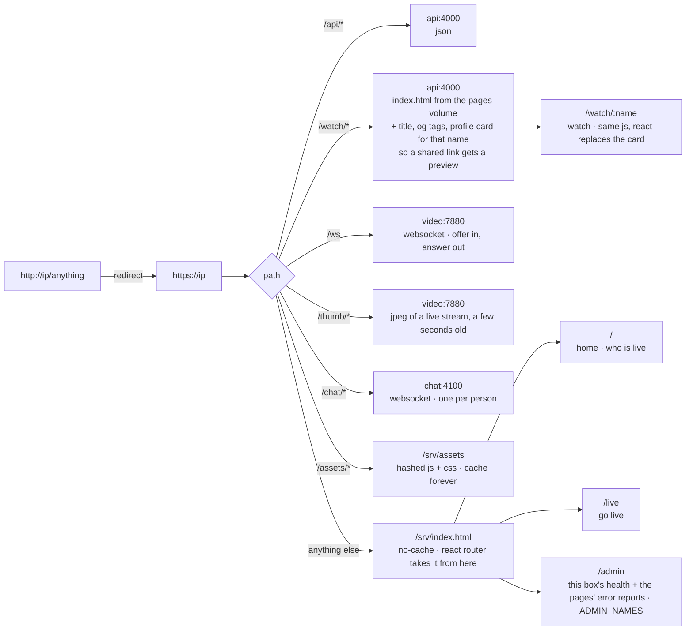
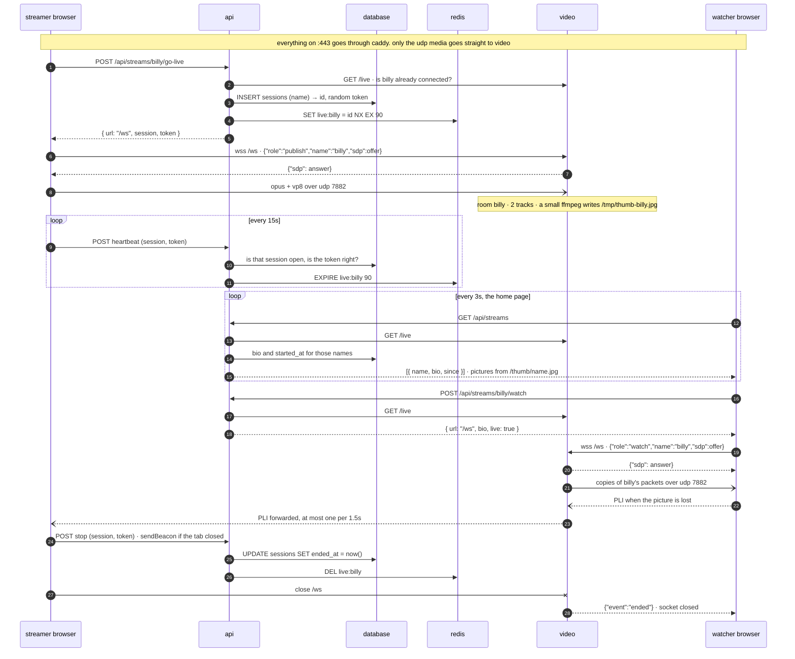
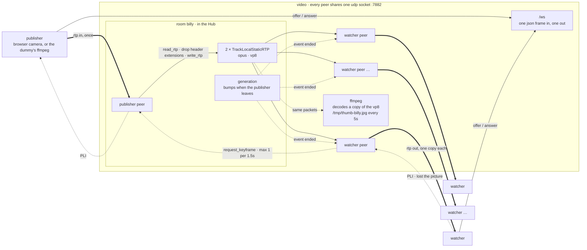
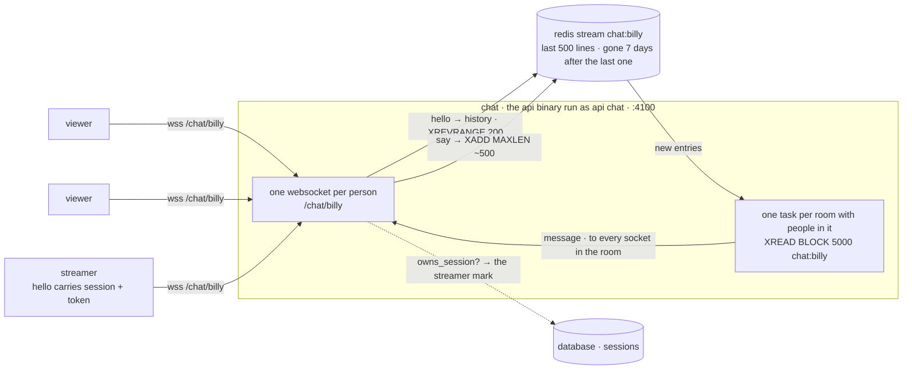
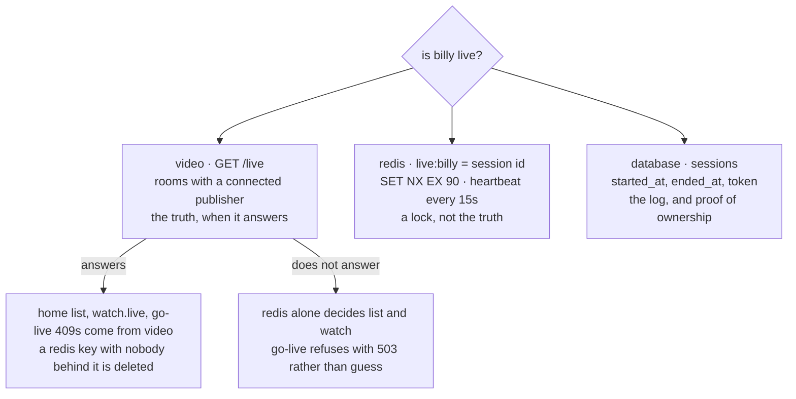
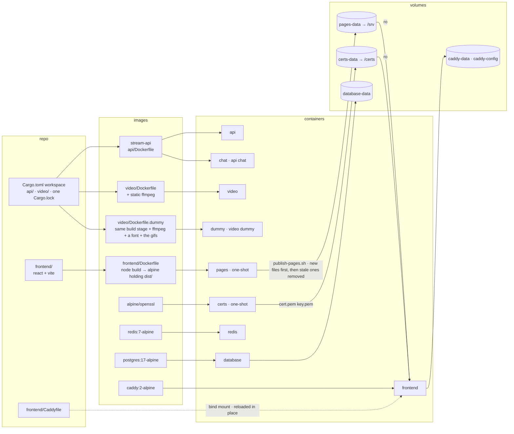
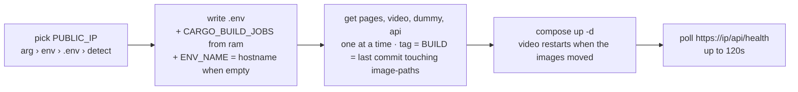
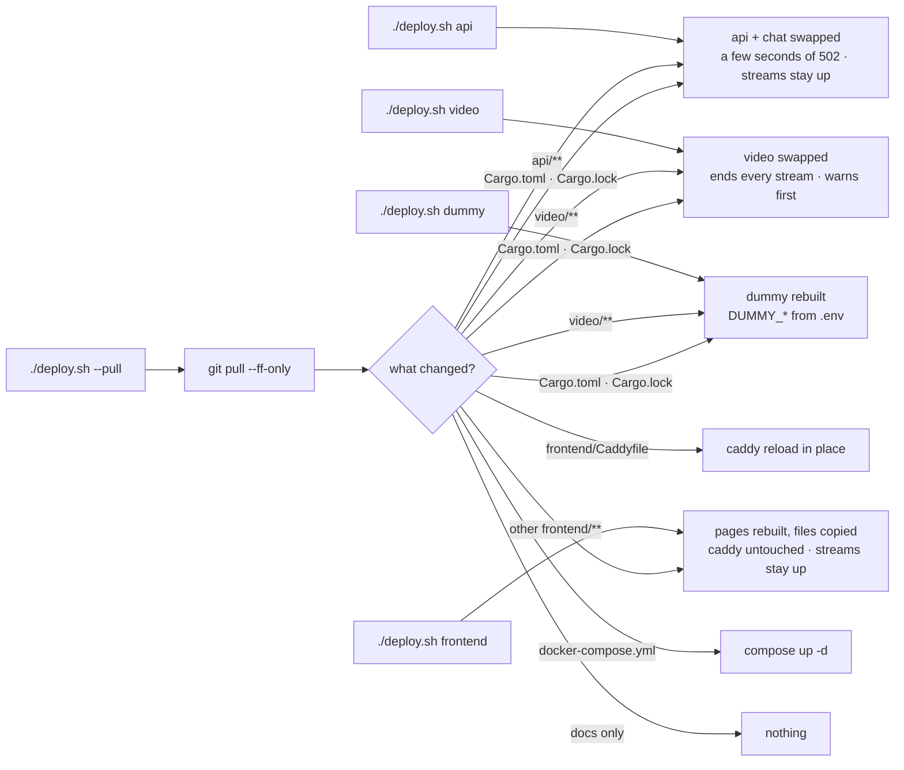
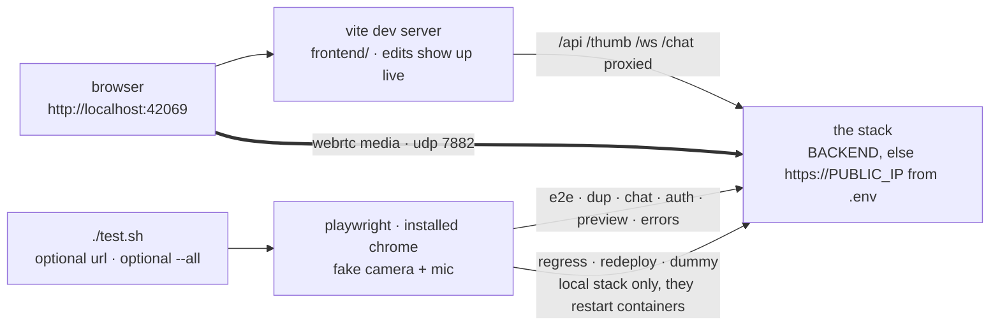

# the repo, in pictures

what runs, what talks to what, what builds into what. the words are in `overview.md` and `spec.md`.

## one machine



the frontend never touches video packets. the api serves one html page, `/watch/name`, and it is the pages' own index.html with a different head. video never serves pages.

## what the frontend does with a url



## one stream, start to end



## inside video



no decode on the media path. no redis, no database. `GET /live` is the room list. sigterm ends every room at once.

## inside chat



the sender sees its own line come back through the stream like everyone else, so order is the same on every screen.

## who is live



## what builds into what



redis has no volume. who is live clears when it restarts. the database keeps the bio and the log.

## the repo, folder by folder

```text
docker-compose.yml       the services above, their env, ports, volumes
deploy.sh                one command: pick PUBLIC_IP, write .env, build, up, wait for /api/health
test.sh  test/           playwright + chrome with a fake camera: e2e, dup, chat, auth, preview, errors, regress, redeploy, dummy
.env  .env.example       PUBLIC_IP, CARGO_BUILD_JOBS, ENV_NAME, ADMIN_NAMES, OPS_TOKEN, DUMMY_STREAMS, DUMMY_PASSWORD, DUMMY_NAMES
Cargo.toml  Cargo.lock   one rust workspace, two members

api/                     → containers api, chat
  src/main.rs              axum on :4000. bios, go-live, heartbeat, stop, watch, streams, health
  src/chat.rs              `api chat` on :4100. websocket chat on redis streams
  src/debug.rs             POST/GET /api/errors, the debug database. see docs/debugging.md
  Dockerfile               rust:1-bookworm build → debian-slim, one binary

video/                   → containers video, dummy
  src/main.rs              ws :7880 · /ws /live /thumb /health. udp 7882 mux. Hub → rooms → tracks
  src/media.rs             opus + vp8 only, nack, twcc for the publisher
  src/thumbs.rs            one ffmpeg per publisher → /tmp/thumb-<name>.jpg
  src/dummy.rs             `video dummy`: ffmpeg bouncing gifs published through /ws
  gifs/                    the gifs it bounces. shrunk at image build time
  Dockerfile               + static ffmpeg
  Dockerfile.dummy         + static ffmpeg + a font + the gifs, entrypoint `video dummy`

frontend/                → containers pages (build), frontend (caddy)
  Caddyfile                /api /ws /chat /thumb, spa fallback, cache headers
  Dockerfile               node build → alpine with dist/ + publish-pages.sh
  vite.config.mts          dev on :42069, proxies /api /ws /chat /thumb to BACKEND
  src/router.tsx           /  /live  /watch/:name  /admin  *   (CrashPage as the error boundary)
  src/app/                 HomePage  LivePage  WatchPage  AdminPage  CrashPage  NotFoundPage
  src/infra/api.ts         fetch wrappers for /api
  src/infra/report.ts      the pages' own failures → POST /api/errors (sendBeacon)
  src/infra/relay.ts       the /ws one-frame protocol + RTCPeerConnection
  src/infra/atoms/         publish, watch, chat, auth session state (jotai)
  src/shared-components/   Avatar  Button  ChatPanel  GeneratedAvatar  PageFrame  StatusLine  TestBadge  UserPanel  VideoFrame

monitor/                 docker-compose.yml for the monitor droplet: uptime kuma polling every box. docs/debugging.md
docs/                    overview, spec, chat, architecture, accounts, kubernetes, debugging, this file
```

## deploy





## from a laptop


