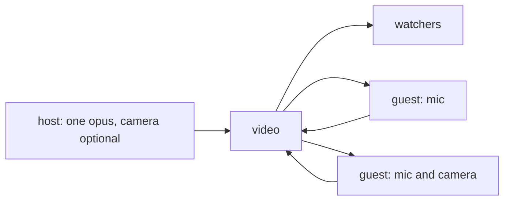

# audio

a plan, partly built. two things on the stream that already exists. the mix in the page is built (`screen.md`, `infra/mixer.ts`): the mic and each shared tab's sound through faders into one opus, the audio section always offered so a sound can join later; the rest of this file is still the plan.

you can go live with no camera: a mic, or the sound of a tab. and while you are live you can open a few spots, a number you pick, so other people on the watch page come on with a mic, or with a mic and a camera. off unless you turn it on. `idea.md` still holds: a stream is one person, and a room where everyone sends is a different product. the spots are a small number on your stream, not that room.

## today

one publisher per name. `video` claims the room from the sections that offer sends, and copies the packets. opus and vp8 are separate; a room does not have to contain a video section for the copy to work (`video/src/main.rs`, `offer_slots`). a second publish of the same name is `someone is already live`.

the page is what demands a camera. go live asks for a camera and a mic, then a camera with no mic, and stops at `no camera` (`publish-atoms.ts`, `startCamera`). the spec's fallback is that one way: no mic, video only. `screen or window` asks for a picture and sets `audio: false`; `tab with its sound` asks for the tab's sound too, and gets it on chromium (`screen.md`).

watch stays on `connected, waiting for video` until the `<video>` fires `playing`, which is picture frames (`watch-atoms.ts`). the speaker shows after that. home's card and the thumbnail are a frame of the camera; the thumbnail tap runs on the first video slot only (`thumbs.rs`).

sound is one opus section, on the big video. a screen is an empty video section offered up front (`SCREEN_SLOTS` = 3), filled later with `replaceTrack`, so nobody renegotiates. a watcher offer is one audio and four video, recvonly. `MAX_MEDIA_LINES` is 6.

## go live with no camera

start can be the camera, as now, or the mic alone.

mic alone: `getUserMedia({ audio: true, video: false })`. the offer still has the camera section and the three screen sections, sendonly, with nothing in the camera section. slot 0 stays the camera and stays quiet, the same way an unused screen slot stays quiet. watchers, tiles and the slots frame do not grow a new shape for this.

the watch page hears that opus. with no picture coming, the big area is the avatar, else the still, and the word goes to `watching` once the audio is arriving, not once a frame is decoded. the speaker and the dial show then. a camera that starts later (they turn it on mid-stream, `replaceTrack` into slot 0) becomes the picture the page already knows.

home shows the avatar, else the still. there is no camera to preview on hover, and no thumbnail for ffmpeg to write. the card does not try.

the sound of a tab or a screen is the same one opus. browsers will not hand that sound over without the picture (`getDisplayMedia` wants a video track), so that path is a screen share with audio, into a screen slot that already exists, and the page sends one opus: the mic, or the share, or the two mixed in the page before they are sent. built: `infra/mixer.ts` is that mix, with a fader and a mute per source and a master, and the share's picture is a layer of the scene. one host audio section, as today, offered even with nothing in it yet. the camera section can still be empty.

no mic and no camera is still not a start.

## spots

while live, the go-live page has a number, 0 to 4. 0 is off, and it is the default. 4 is the hard ceiling, the same for every stream. raising it opens that many spots. lowering it is allowed down to however many people are already on; to go lower, drop someone first. turning it back to 0 drops everyone who was on. they stay on the page as watchers. the stream does not end.

a spot is one person from the watch page. they pick mic, or camera. camera means a camera and a mic; if the mic is refused they still come on, picture only, the same fallback the host has. first come fills the number. past it the button says the spots are full. one person, one spot. leaving the page, or closing the laptop, frees it. the host can drop one person, and that person can leave on their own. nobody approves a name in advance: the number is the permission, the drop is the way back.

a person on a spot is a peer of their own, on the same room. they do not take the name, the heartbeat, or the stop. the host is still the only publisher. `video` binds the guest to the next free guest section. their packets are copied the way the host's are. the box does not mix and does not decode.

each guest is one audio section and one video section. the video section sends only when they brought a camera. a mic-only guest is a name on the page, with a level, and no tile. a camera guest is a tile under the video, muted the way a screen tile is, click to make it big. every mic plays for everyone the whole time, host included, including the person who is on: their own preview stays muted so they do not hear themselves. the host's opus stays the host's. guests do not get screen slots.

the name on the tile is the login when they are logged in as that name, otherwise the nick already in the header. a nick equal to someone else's claimed name is refused, the same rule as chat.

the watcher offer carries the guest sections from the start, empty until someone is in them, the way the screen sections already are. a person coming on mid-stream fills a section the crowd is already receiving. no renegotiation.

that offer gets bigger. host stays one audio, the camera and three screens. four guests add four audio and four video. thirteen sections, and `MAX_MEDIA_LINES` is 6 today, so the cap moves to fit the offer and no further. a stream that has not opened spots still has the empty sections: the cost is transceivers, not packets, until someone sends.

## what it costs

a camera is the expensive copy. the host's camera is capped at 2.5 Mbps, and every watcher gets those bytes (`viewers.md`). a guest camera is another copy of that size, out to the whole room. four cameras on a crowded stream is about four times the video leaving the box, on top of the host. a mic is opus and is small beside that, which is why a spot can be mic-only and still be cheap, and why the ceiling is 4 rather than a room full of faces.

a guest is also a viewer: they receive the host and the other guests, and they count in `N watching`. the watcher caps stay (`MAX_WATCHERS_PER_IP_ROOM` = 4, `MAX_WATCHERS_PER_IP` = 16). separately, one address holds one guest in a room, so four tabs on one laptop cannot fill the spots.

home and the thumbnail stay the host's picture, or the avatar when the host has none. a guest's camera is not a card on home.

## pages

go live:

- next to the camera start, a mic start. no camera prompt on that path. status `mic ready`, then `live`
- screen share can include the tab's sound. one opus leaves the page
- while live, the spots control: the number, who is on, drop on each. picture in picture keeps it, the same as the rest of the broadcast

watch:

- no picture from the host: the avatar or the still in the frame, sound on the same element, `watching` once audio arrives. `no video. udp blocked?` stays the failure for a connection that never comes up
- `come on` while a spot is open: mic, or camera. full shows full. on, you are a tile or a name, and `leave` frees the spot. drop, the host closing the spots, or the stream ending, puts you back to watching

## not here

- everyone in the room sending. the ceiling is 4, the host opens them, and `idea.md` is the rest.
- the host picking who may ask. the number fills in order, and drop is the refusal.
- a guest sharing a screen, or sending a second audio.
- the box mixing the mics into one opus. each person is their own section; the browser plays them together.
- guests as their own stream, their own name, their own thumbnail.
- locking everyone's playback to the same moment of a song. one source is the idea (`idea.md`); the clock is its own build.
- a spot while the host is not live. the spots are on a live stream.
