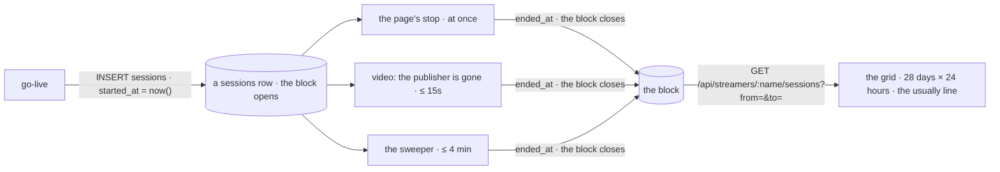
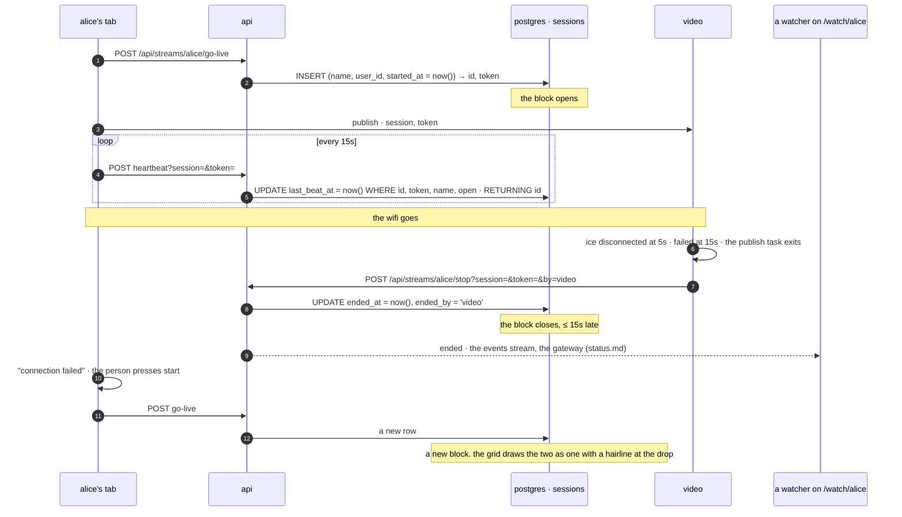

# calendar

built, the first half: a calendar on a person's page of when they stream: one block per stream, on the day and at the hour it ran, and a line read off the blocks, `usually tuesdays and thursdays around 8pm`. the blocks already existed. `sessions` is one row per go-live with `started_at` and `ended_at`, filling since the first deploy, and a dropped connection is already what closes a row. what was missing, and is in the repo now: a range on the route that reads them, two columns so a block whose tab vanished ends where the stream did and not where the sweeper found it and says who closed it, and the strip, on the watch page's `calendar` tab beside `about` (`about.md`). `api/migrations/migrate-8.sql`, `main.rs` (`heartbeat`, `stop`, `sweep_once`, `list_sessions`), `video/src/main.rs` (`by=video`), `frontend/src/infra/calendar.ts`, `atoms/calendar-atoms.ts`, `shared-components/Calendar.tsx`, `WatchPage.tsx`, `test/calendar.js`. still a plan: the totals on the profile tab, `show everything`, the schedule under *later*.



## the short answer

**a block is a session row.** `sessions(id, name, user_id, verified, started_at, ended_at, token)` (`api/migrations/migrate-1.sql:14`, `user_id` from `migrate-3.sql:20`). go-live inserts the row with `started_at = now()` and `ended_at` null (`api/src/main.rs:606`): the block opens. the block closes when `ended_at` is set, and three things set it, whichever gets there first:

| closer | when | how late `ended_at` is |
|---|---|---|
| the page's `stop` (`main.rs:677`): the button, `×` on the corner player, the tab closing (`stopOnLeave`'s beacon, `publish-atoms.ts:539`) | at once | exact |
| video's `end_session` (`video/src/main.rs:705`): the publisher's peer or socket went. ice says disconnected at 5s and failed at 15s (`main.rs:963`), the publish task exits and posts the api's own `stop` with the grant it was given (`:727`) | 5–15s after the last packet | ≤ 15s |
| the sweeper (`main.rs:350`): once a minute, every open row older than 180s whose name has no live key and that video does not list | when video was not there to say so (the api or video down past the key's 90s ttl) | up to 4 minutes (`ZOMBIE_AFTER_SECS` + `SWEEP_EVERY`), and `ended_at = now()` is the sweep's time, not the drop's |

so "a connection gets dropped, we create a block" is right with one word moved: the block was created at go-live, the drop *closes* it. and the page does not reconnect on its own: a lost peer is `connection failed` (`publish-atoms.ts:353`), a lost socket is `connection lost` (`:330`), a heartbeat answered 403 after video ended the row is `session lost. press start again` (`:346`). the person presses start, go-live inserts a new row, and that is a new block. two blocks a minute apart are two rows in the table; the grid may draw them as one, below.

the data, then, is there and has been. what is not: a route that returns a month of it (`GET /api/streamers/:name/sessions` is the last 20, `main.rs:505`), an end that is honest in the sweeper's case, and the grid.

## what for

- **a watcher on `/watch/alice` while she is off.** today the page says `not streaming right now` and whatever she typed as her `offline_note` (`back tuesday at 8`, `WatchPage.tsx:208`). the calendar answers from the record: the last four weeks of blocks, and the line derived from them. the note stays; it is what she *says*, the calendar is what she *did*.
- **alice herself.** how many hours this month, the longest one, the night the connection dropped three times. the profile tab, with the totals.
- **later, the other half.** a block in the future is a schedule, and followers can be told before it starts. not in the first cut; under *later*.

## the rules

- **a block is a session, and the calendar never invents one.** one row, one block. the calendar reads; the three closers write, as they do today.
- **whose blocks.** a claimed name's calendar is its account's: `user_id = streamers.id`, set at go-live when the session is the account's own (`ids.md`: so a rename keeps the history as one list). a stranger who streamed anonymously under the name before it was claimed is not on it, the same line `verified` draws. a free name's calendar is the name's: `name = $1`, like its bio is anyone's.
- **the open block.** `ended_at` null and the name live now: the block runs to now and grows while you look. `ended_at` null and the name not live (a row waiting for the sweep): drawn to the last heartbeat, marked as uncertain.
- **instants on the wire, days on the screen.** `started_at` and `ended_at` are `timestamptz`, iso 8601 with `Z` in the json as today. days, weeks and "8pm" are the viewer's (`Intl.DateTimeFormat().resolvedOptions().timeZone`): a block crossing the viewer's midnight is split across two day rows by the page. the api knows nothing about days.
- **short blocks.** a go-live whose negotiation failed is a row of a few seconds: the key is claimed and the row opened before video has the publisher. they stay in the table (the log is the log) and the grid hides blocks under 60s unless the owner asks (`show everything`).
- **gaps.** two blocks with under 5 minutes between them are one stream that dropped. drawn as one block with a hairline at the drop; the detail lists the pieces. a rule for the eye, in the page, never in the table.
- **a block starts at go-live**, a few seconds before the first frame reaches anyone (`status.md`: `GET /live` lists a name from the claim, before negotiation). accepted; nobody reads a calendar to the second.
- **public.** who is streaming is on home for anyone while it happens; the record of it is as public as the bio. the token never leaves the api (`spec.md:213`'s rule for the route today).

## the dropped connection



the one case that is not in the picture is video being down too (a deploy of video, a box that lost both): then nothing says the publisher left, the key lapses at 90s, and the sweeper ends the row on the first tick past 180s. that row's `ended_at` is today up to four minutes after the stream died, which on a calendar is a block that is a little too long. the column below is for exactly that row.

## the table, in postgres

```sql
-- api/migrations/migrate-8.sql (the next number when this is built; posts.md wants the same one)
-- the last heartbeat. a block whose tab vanished ends where the stream really ended, within
-- one beat, not where the sweep found it. written by the heartbeat's own check, no extra query.
ALTER TABLE sessions ADD COLUMN last_beat_at timestamptz;
UPDATE sessions SET last_beat_at = COALESCE(ended_at, started_at) WHERE last_beat_at IS NULL;

-- how the block closed: stop | video | sweep. null while open. the hairline, and the owner's log.
ALTER TABLE sessions ADD COLUMN ended_by text;

-- a month of one account's blocks. the free name's range is the index that exists,
-- sessions_name_started_idx (name, started_at DESC).
CREATE INDEX sessions_user_started_idx ON sessions (user_id, started_at DESC) WHERE user_id IS NOT NULL;
```

three writes change, each by a few words:

| where | today | then |
|---|---|---|
| `heartbeat` (`main.rs:646`): `owns_session`, a `SELECT id … WHERE id, token, name, ended_at IS NULL` | the check | `UPDATE sessions SET last_beat_at = now() WHERE id = $1 AND token = $2 AND name = $3 AND ended_at IS NULL RETURNING id`: the same check, and the beat written, in the one round trip the heartbeat already makes |
| `stop` (`main.rs:683`) | `SET ended_at = now()` | `SET ended_at = now(), ended_by = $4`, where `$4` is `?by=video` from video's call and `stop` otherwise. anything else in `by` is `stop`: it is a word for the log, not a right. video says `stop` itself when the page closed its socket with a close frame (a deliberate stop, whose own call is still on its way and loses the race on a fast box) and `video` when the socket or the peer just went: so `video` means a drop, not a press |
| `sweep_once` (`main.rs:358`) | `SET ended_at = now()` | `SET ended_at = COALESCE(last_beat_at, started_at), ended_by = 'sweep'`: the stream ended within 15s of its last beat, so that is where the block ends. the `RETURNING name, id` and the `ended` fact stay |

`go_live`'s own cleanup (`main.rs:623`, "anything older that still looks open is over") sets `ended_by = 'sweep'` too: it is the same judgement, a row nobody holds.

the range, the one query the calendar is for. an account's:

```sql
SELECT id, started_at, ended_at, last_beat_at, ended_by
FROM sessions
WHERE user_id = $1
  AND started_at < $3                                  -- began before the range ends
  AND (ended_at IS NULL OR ended_at > $2)              -- and had not ended when it began
ORDER BY started_at
LIMIT 1000;
```

a free name's is the same with `name = $1` on the other index. postgres walks the index from `$3` down and stops at the first row that cannot match; a person who streamed every night for three years is a thousand rows, which is nothing. the range is capped at 93 days a request (a quarter, 400 past it) and the answer at 1000 rows, so no request reads the table.

## api

| | route | does |
|---|---|---|
| GET | `/api/streamers/:name/sessions?from=&to=` | with `from` and `to` (iso 8601, `to` after `from`, at most 93 days apart, else 400 `bad range`): every block of the name overlapping `[from, to)`, oldest first, at most 1000. without them: the last 20, newest first, as today (`spec.md:213`, so nothing that reads it breaks). each `{ id, name, started_at, ended_at, last_beat_at, ended_by }`, never the token. `ended_at` null is a block still open: the page draws it to now if the name's word is `streaming`, and to `last_beat_at`, marked, if not. for anybody. a name with no row is `[]` |
| POST | `/api/streams/:name/stop?session=&token=&by=` | `by` is new and optional: `video` from video's `end_session`, anything else or absent is `stop`. the grant is still what is checked |

nothing else. `GET /api/streamers/:name` does not gain a count or a usual line; the page has the blocks and does the arithmetic, below. the api speaks instants and rows.

## pages

**the grid.** 28 day rows, oldest at the top and today at the bottom, each row 24 hours wide. a block is a bar on its row from its start hour to its end hour (`left` and `width` as percentages of the row, two spans for a block that crosses midnight, one on each row). days as rows and hours as columns is the point: every 8pm is the same column, so a person who streams at 8 is a vertical stripe you see before you read anything. a thin hour scale along the bottom in the viewer's clock (`12am · 6am · 12pm · 6pm`), the weekday short name and the date down the side in the viewer's locale, the week lines heavier. the live block ends at a line that moves: a 60s tick re-renders the one row. blocks are the accent (`primaryBlue`); a block that ended by `sweep`, or is open under a name that is not live, is `textTertiary` with its end hatched; the hairline at a drop is `decrease`. never a colour alone: the detail says it.

**the detail.** pointer or focus on a block (`Tooltip.tsx`, the sidebar's shape): `tue oct 14 · 7:58pm – 11:12pm · 3h 14m`, and for a merged one `dropped 9:03pm, back 9:05pm`. `data-start`, `data-end`, `data-by` on the bar for the tests.

**the line.** `#usually`, from the four weeks on screen, in the page: the weekdays with a block in at least two of the four weeks, and the median start rounded to the half hour. `usually tuesdays and thursdays around 8pm` (the viewer's clock, so a watcher in another zone reads their own 8pm). fewer than three blocks in the four weeks: `streamed 2 times in the last month`, no pattern claimed. none: `has not streamed in the last month`. no rows at all: nothing, no calendar.

**where.**

- `/watch/<name>` while not live (`WatchPage.tsx:190`, the `waiting` branch): under the word and the note, above the bio. the strip and the line. the page already gets `live` and `ended` for the name on screen (`watch-atoms.ts`, `status.md`), so on either it re-fetches the current range: the block appears when she starts and closes when she stops, with no reload.
- `/watch/<name>` while live: the line only, under the bio. the player does not get shorter (`posts.md`'s rule).
- the profile tab, your own: the strip, the line, and the totals under it: `12h 40m this month · 9 streams · longest 4h 12m · 2 dropped`. `‹ ›` steps a month at a time (one request each), `today` comes back, `show everything` shows the blocks under 60s.
- the person card (`PersonCard.tsx`): nothing. it said `last live 3 hr ago` once, from the profile read it makes when it shows (`last_live` is still on `GET /api/streamers/:name`, `follows.md`), and is the face, the name and the status now. not the strip, and not the usual line: open question 5.

**atoms.** `calendar-atoms.ts`: `calendarAtom` (`{ name, from, to, rows, phase }`), `loadCalendar(name, monthsBack)`, `blocksAtom` derived (the rows merged by the 5-minute rule and split by the viewer's midnight, memoised on rows and zone), `usuallyAtom` derived. `api.ts`: `sessions(name, from, to)`. the 60s tick is a module interval while a live block is on screen, not an atom. no library: bars on rows are a hundred lines of tsx and css, and the frontend has none.

## cost

one column written per heartbeat, inside the round trip the heartbeat already makes: zero new queries. one index, partial, on the rows that have an account. a calendar open is one index range of at most 1000 rows, ~80 bytes each on the wire, once per month shown; the pushed `live`/`ended` re-fetch is the same request. the dummy streams go live at boot and stop on shutdown, so a deploy of video makes one block per fake stream: true, and drawn as such. nothing new runs.

## tests

`test/calendar.js`, after `presence` (it goes live and stops) and before `regress`. a login `cal<run>`, a free name `r8` where the presence tests leave it, and a second context as a watcher. the browser contexts get `timezoneId: 'America/Chicago'` so "8pm" and "midnight" mean something.

1. `GET /api/streamers/cal/sessions?from=&to=` with 93 days is `[]`; 94 days 400; `to` before `from` 400; `from` alone 400; no params is the last 20 as before (`regress` keeps its check).
2. go live as `cal`, 3s, stop: the range of today has one row with `started_at`, `ended_at`, `ended_by: 'stop'`, `last_beat_at` between them; `/watch/cal` as the watcher shows `#calendar` with one `.block` on the bottom row whose detail has today's date and a duration; `#usually` reads `streamed 1 time in the last month`.
3. the drop: go live, `page.route('**/stop**', abort)` so the page cannot say stop, close the tab. within 25s the row has `ended_at`, `ended_by: 'video'`, and `ended_at − last_beat_at` under 20s. the watcher's block closed with no reload.
4. the sweep's end: a row straight into postgres (`follows.md`'s step 8, `docker compose exec database psql`; off-box `SKIP`) open since 10 minutes ago with `last_beat_at` 6 minutes ago, under a free name with no key: after the next sweep (≤ 60s) `ended_at = last_beat_at`, `ended_by = 'sweep'`.
5. midnight: a row inserted from 11:30pm to 12:30am in the context's zone is two spans, one on each of two rows, with one detail.
6. the gap: two rows two minutes apart are one `.block` with a `.drop` hairline and a detail that says `dropped … back …`; two rows ten minutes apart are two blocks.
7. the floor: a 20s row is not drawn; `show everything` on the owner's profile tab draws it.
8. live: the watcher on `/watch/cal` offline; `cal` goes live in the first context: a `.block[data-live]` appears within 3s and its width grows across a 60s wait (two measurements); stop: `data-live` goes and `ended_by` is `stop`.
9. whose: a stranger streams as a free name, then that name signs up and streams once: the account's calendar has one block, the free name's history (`?from&to` before the signup) has the stranger's. a rename (`ids.md`): the same list under the new name.
10. cleanup: stop whatever is live; the inserted rows are under throwaway names and stay (the log is the log).

## code

built:

- `api/migrations/migrate-8.sql`, the three statements above, and its entry in `migrate.rs`.
- `api/src/main.rs`: `heartbeat`'s check is the update; `stop` reads `by` (`StopQuery`); `sweep_once` and `go_live`'s cleanup set the two columns; `list_sessions` has the range (`RangeQuery`, 93 days, 1000 rows, the account's rows by `user_id` for a claimed name, a held name answers for the one it became) and the two fields, and the last 20 without one.
- `video/src/main.rs`: `&by=` on the stop it posts: `stop` after a close frame from the page, `video` after a socket or a peer that just went (`end_session`). a `./scripts/deploy.sh video` (ends every stream, warns first): until it is deployed video's rows read `stop`, which is true enough.
- `frontend/src/infra/calendar.ts` (the arithmetic, pure: blocks, spans, rows, the usually line, the detail), `atoms/calendar-atoms.ts` (the rows for a name and a page; asked again when the stream on screen starts or ends, and once more 3s after an end, since `ended` reaches the watcher a beat before the api has written the row), `shared-components/Calendar.tsx` (the strip), `api.ts` (`sessions`), `WatchPage.tsx` (the tabs; the strip is in the page only while its tab is open, so a page nobody looks at the calendar of makes no request).
- `test/calendar.js`, in `scripts/test.sh` after `presence`.

not yet: `user-modal/ProfileTab.tsx` (the totals, `show everything`), `spec.md`'s route row and database row.

## later

- **the schedule.** blocks in the future, put in by the streamer: `plans(id, user_id, starts_at, ends_at, note)`, a login's (a plan needs a person, `follows.md`'s rule for the follower), drawn in outline on the same grid. the `offline_note` typed as a time instead of a sentence. `alice goes live in ten minutes` to her followers is `follows.md`'s push plus a timer; `she is late` is an outline with no bar at its start. its own migration, its own routes, none of which touch `sessions`.
- **the line on the card and on home.** `usually tue, thu ~8pm` beside a name in the sidebar wants the four weeks on `GET /api/streamers/:name` or on the list: the api would compute it from the last 28 days, in utc hours the page shifts, once a minute per name in redis. a second place the arithmetic lives; only when a card wants it.
- **a month view.** seven columns of day cells with the hours per day in each: the "how much" picture beside the strip's "what time". the same rows, another layout.
- **an ics.** `GET /api/streamers/:name/calendar.ics` from `plans`, so a calendar app can subscribe to someone's schedule.

## not this

- **a `blocks` table written at the drop.** the first thought: on `ended`, insert a block. that is a copy of `sessions` kept right by three closers, each of which already writes `ended_at`. the session *is* the block.
- **the calendar in redis.** redis forgets on restart (`status.md`); `sessions` is the record since the first deploy.
- **merging gaps in the database.** which gap is "the same stream" is a rule for the eye and will move; the rows stay what happened.
- **`ended_at = now()` from the sweep.** the one lie in the table today. one column and a `COALESCE` make it true within a heartbeat.
- **a calendar library.** fullcalendar and its kind are editable event calendars with drag and views; this is bars on rows. a hundred lines, no dependency.
- **the api computing `usually`.** the page has the blocks and the viewer's zone; the api has neither and no reason to. `later` has the one case it would.
- **days in the api.** `?day=2026-10-14` would need a zone on the request. the api speaks instants; `[from, to)` is a range of instants.
- **a count on the profile read.** `9 streams this month` is nine rows the page already has.

## not here

- editing a block, hiding one, deleting the record. the log is the log; `./scripts/manage.sh --db` is for the day one has to go.
- titles, categories or games on a stream. a stream has a name and a bio.
- a leaderboard of hours on home.
- reminders and notifications. the schedule's, under *later*, and `follows.md`'s push.
- viewer counts on the blocks (`viewers.md`'s `N watching` is live only; nothing keeps the number).
- the dummy streams' calendar. they have one; it is a bar from the last deploy to now. fine.

## open questions

1. **the shape.** the 28-day strip with hours across (the time of day lines up; the pattern is visible) or a month grid of day cells (how much per day). (recommendation: the strip. the question a watcher asks is "what time".)
2. **the gap.** a dropped connection is back in under two minutes when the person is at the keyboard; a dinner break is thirty. (recommendation: 5 minutes, drawn as one block with the hairline. the detail always lists the pieces.)
3. **the floor.** hide the failed go-lives, or draw them as ticks. (recommendation: hide under 60s by default; `show everything` on the owner's tab.)
4. **while live.** the line under the bio, the strip under the bio, or nothing while the player is up. (recommendation: the line. the strip is a click away in the profile tab.)
5. **the card.** `usually tue, thu ~8pm` on the person card. it makes one profile read now (`follows.md`), which says when the last stream ended but not the blocks; the line wants a month of rows, a second request. (recommendation: not now; `last live` says most of it. `later` has the shape if it is wanted.)
6. **weeks start.** monday, or the viewer's locale's. (recommendation: monday; the labels are the locale's. `Intl.Locale.prototype.getWeekInfo` is not everywhere yet.)
7. **free names.** the one rule (`accounts.md`) says a free name's calendar is anyone's streams under it. (recommendation: yes, by name, as its bio is; the account's by id, as its history is.)
8. **how far back.** four weeks on the page, `‹` for older, forever in the table. (recommendation: as said. the table is small and the index makes any month one range.)
