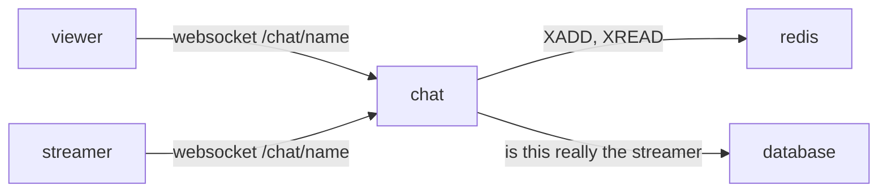

# chat

text chat next to a stream. short lines, newest at the bottom, the last 500 kept per stream. nothing kept beyond that.



## why this shape

**websocket + redis, yes.** a message has to reach everyone in the room right now, and a late joiner wants the last few hundred lines. that is two things: fan-out and a short memory. one websocket connection per viewer does the fan-out to browsers. redis does the memory and the fan-out between chat machines.

**redis streams, not pub/sub + a list.** the first idea is usually pub/sub for live messages and a capped list for history. that is two structures that can disagree: a client that reconnects between the history read and the subscribe misses lines. a redis stream is one structure that is both: `XADD chat:<name> MAXLEN ~ 500 * …` appends and trims, `XREVRANGE … COUNT 200` is the history, `XREAD BLOCK … chat:<name> <last id>` is the live tail. every message has an id, so a reconnecting client resumes from the last id it saw with no gap. memory is bounded by `MAXLEN`. one key per stream, deleted a week after the last message.

**not kafka.** kafka is a durable, replicated log for many independent consumers, replay from days ago, and throughput that needs partitions across machines. this chat needs none of that: one small memory per room, no replay beyond 500 lines, a few thousand messages a minute at most. kafka would add a cluster, a jvm, a schema, and nothing a viewer could notice. the same goes for nats jetstream or rabbitmq here. if this ever needs more than one chat machine, redis streams already carry the messages between them. if it ever needs messages kept forever, that is a database table written from the same `XADD` path, not a different transport.

**not the database.** postgres can hold chat, but then every message is a write plus a `LISTEN/NOTIFY` or a poll, and the "last 500" trim is a job. the owner does not want chat kept, so there is nothing for a database to do. the database is only asked two questions at hello: is this socket really the streamer (session id + token, the same proof the heartbeat uses), and who does its login cookie say it is (`accounts.md`). when it cannot answer, the socket is a plain viewer: it gets the room, the history and the lines (those need only redis), and the two questions are asked again on its first `say`, which gets `chat is busy, try again` until they are answered. nothing is let through unchecked, and nobody is locked out of reading by a database that is down.

## the service

`chat` is its own container, the `api` binary run as `api chat` (same image, no extra build), listening on `:4100`. caddy forwards `/chat/*` to it, and `/events`: the same process is the gateway of `status.md` (one socket per browser, presence and pushes), on the same listener, with the websocket plumbing the two share in `api/src/socket.rs`. it reads redis and the database, nothing else. it keeps no state that matters: if it restarts, browsers reconnect and reload history from redis (and the gateway's sockets re-mark their names). on sigterm every socket gets a close frame (1001) and up to 2s to leave before the process ends; the panel reconnects in 3s.

one task per room with at least one viewer runs `XREAD BLOCK 5000 STREAMS chat:<name> <last id>` and pushes every new entry to that room's sockets. the first viewer's join takes the start id (`XREVRANGE … COUNT 1`) before it loads history, so a line between the two is in both and dropped by id, never in neither. the task keeps retrying redis while the room has viewers, and ends when the last one leaves. sending a message is `XADD`, nothing else; the sender sees its own line come back through the stream like everyone else, so order is the same on every screen.

## protocol

one websocket per viewer at `wss://<host>/chat/<stream name>`. json text frames.

client → server

```json
{"type":"hello","nick":"bob"}
{"type":"hello"}
{"type":"hello","nick":"ignored","session":12,"token":987654}
{"type":"hello","nick":"pixelfan","bot":true}
{"type":"say","text":"hi"}
```

the first frame must be `hello`, within 10s. `session` + `token` are the streamer's own grant from go-live; when they check out, the socket speaks as the stream's name and its lines are marked `streamer`. a login needs no nick: the browser sends the login cookie with the handshake and the server names the socket after the account (`verified`); if the account is the room's name, that is the streamer too. anyone else picks a nick, as long as it is not somebody's account name. `bot: true` says the socket is a program: its lines wear the `bot` badge, and the panel can hide them (`groups.md`). the fake streams' chatters say it.

server → client

```json
{"type":"history","messages":[{"id":"1729...-0","from":"bob","text":"hi","streamer":false,"verified":false,"groups":[],"at":1729000000000}]}
{"type":"message","id":"1729...-1","from":"billy","text":"yo","streamer":true,"verified":true,"groups":[{"name":"vip","badge":"vip","color":"#f2cc60"}],"at":1729000000500}
{"type":"message","id":"1729...-2","from":"pixelfan","text":"hi chat","streamer":false,"verified":false,"groups":[{"name":"bot","badge":"BOT","color":"#5865f2"}],"at":1729000000900}
{"type":"count","count":12}
{"type":"error","error":"too long"}
{"type":"error","error":"that name has an account. log in as it, or pick another"}
{"type":"error","error":"too many tabs"}
{"type":"error","error":"missed 12 lines"}
```

`history` comes once, right after `hello`, with up to 200 lines oldest first. `count` is how many sockets this chat machine has in the room; it changes on join and leave. the errors: `say hello first`, `bad nick…`, `that name has an account…`, `that nick belongs to the fake streams…` and `too many tabs` close the socket; `too long`, `slow down`, `chat is busy, try again` (the database has not answered who this socket is yet; reading goes on), `chat is down, try again` and `missed N lines` (this socket fell behind the room; the lines are gone for it) do not.

## rules

- text: 1 to 500 characters after cleaning. longer is `too long`, empty is dropped. cleaning: trim; control characters other than newline are stripped; so are the invisible format characters (soft hyphen, zero-width space, bidi marks, embeddings, overrides and isolates, word joiner, byte order mark; not the zero-width joiners, emoji and some scripts need them); at most two newlines between visible characters; a run of combining marks is cut at four.
- nick: 1 to 24 characters, letters digits `_ -`, case kept. any nick that is not a claimed name (lowercased) is free; the socket is closed otherwise and the panel goes back to the nick box. the `streamer` and `verified` marks are the only things that mean anything.
- groups: a login's groups ride on its lines as badges (`groups`, see `groups.md`), read once at the hello, and only when the line is really the account's (`verified`). a hello with `bot: true` adds the `bot` badge, whoever it is. the badges are kept with the line in the stream (`g`, json), so a room is drawn from its lines alone.
- rate: 5 lines at once, then 1 per second per socket. over that is `slow down` and the line is dropped. one ip may hold 8 sockets in a room; the ninth gets `too many tabs` and is closed, so tabs do not multiply the rate or the count.
- frame size: 8 kb. a bigger frame closes the socket.
- liveness: the server pings every 30s; a socket that sent nothing (pong, text, anything) for 90s is dropped and leaves the count.
- history: 200 lines sent on join, 500 kept in redis, a room's key expires 7 days after its last line.
- the stream does not have to be live. people can talk in an empty room while they wait.

## the panel

on the watch page the chat sits to the right of the video on wide screens, under it on phones. on the go-live page the streamer sees the same panel and speaks as themselves. the panel: the lines, a nick box (remembered in the browser), a text box with a `500` countdown, a send button. the streamer's lines get a mark; a line wears its speaker's group badges after the name. the viewer count sits in the panel header, next to a robot button: `hide bots` takes the bots' lines off the screen and then reads `N hidden`. that choice is this browser's (localstorage, the settings tab has it too), so it holds from room to room.

## later, not now

- more than one chat machine: already works through redis streams; put them behind caddy with sticky-less round robin, counts become per-machine. the gateway was built for it: presence is a sorted set per name with a member per socket, and the facts go through one `events` stream every process tails (`status.md`). the viewer count could move to a `ZCARD` the same way.
- moderation: a `deleted` entry type in the stream, or a per-room block list in redis. (badges mean nothing to the server: a `mod` group is a word, not a power.)
- keeping chat: write each line to a table from the same place that does `XADD`.
- emotes, links, mentions: client side.
