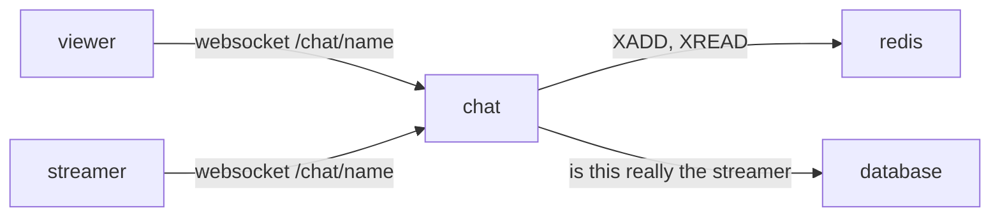

# chat

text chat next to a stream. short lines, newest at the bottom. the last 500 live in redis. with `CHAT_PERSIST` the older ones stay in postgres, and a room can be searched and scrolled to one line.



## why this shape

**websocket + redis, yes.** a message has to reach everyone in the room right now, and a late joiner wants the last few hundred lines. that is two things: fan-out and a short memory. one websocket connection per viewer does the fan-out to browsers. redis does the memory and the fan-out between chat machines.

**redis streams, not pub/sub + a list.** the first idea is usually pub/sub for live messages and a capped list for history. that is two structures that can disagree: a client that reconnects between the history read and the subscribe misses lines. a redis stream is one structure that is both: `XADD chat:<name> MAXLEN ~ 500 * …` appends and trims, `XREVRANGE … COUNT 200` is the history, `XREAD BLOCK … chat:<name> <last id>` is the live tail. every message has an id, so a reconnecting client resumes from the last id it saw with no gap. memory is bounded by `MAXLEN`. one key per stream, deleted a week after the last message.

**not kafka.** kafka is a durable, replicated log for many independent consumers, replay from days ago, and throughput that needs partitions across machines. this chat needs none of that: one small memory per room, no replay beyond 500 lines, a few thousand messages a minute at most. kafka would add a cluster, a jvm, a schema, and nothing a viewer could notice. the same goes for nats jetstream or rabbitmq here. if this ever needs more than one chat machine, redis streams already carry the messages between them. if it ever needs messages kept forever, that is a database table written from the same `XADD` path, not a different transport.

**not the database.** postgres can hold chat, but then every message is a write plus a `LISTEN/NOTIFY` or a poll, and the "last 500" trim is a job. the owner does not want chat kept, so there is nothing for a database to do. the database is only asked two questions at hello: is this socket really the streamer (session id + token, the same proof the heartbeat uses), and who does its login cookie say it is (`accounts.md`). when it cannot answer, the socket is a plain viewer: it gets the room, the history and the lines (those need only redis), and the two questions are asked again on its first `say`, which gets `chat is busy, try again` until they are answered. nothing is let through unchecked, and nobody is locked out of reading by a database that is down.

## the service

`chat` is its own container, the `api` binary run as `api chat` (same image, no extra build), listening on `:4100`. caddy forwards `/chat/*` to it. the chat only: the gateway of `status.md` (`/events`, one socket per browser, presence and pushes) is the `events` container, the same binary run as `api events`, and the two share nothing but the websocket plumbing in `api/src/socket.rs` and redis. it reads redis and the database, nothing else. it keeps no state that matters: if it restarts, browsers reconnect and reload history from redis. on sigterm every socket gets a close frame (1001) and up to 2s to leave before the process ends; the panel reconnects in 3s.

one task per room with at least one viewer runs `XREAD BLOCK 5000 STREAMS chat:<name> <last id>` and pushes every new entry to that room's sockets. the first viewer's join takes the start id (`XREVRANGE … COUNT 1`) before it loads history, so a line between the two is in both and dropped by id, never in neither. the task keeps retrying redis while the room has viewers, and ends when the last one leaves. sending a message is `XADD`, nothing else; the sender sees its own line come back through the stream like everyone else, so order is the same on every screen.

## protocol

one websocket per viewer at `wss://<host>/chat/<stream name>`. a server's channel is the same socket at `wss://<host>/chat/<server>/<channel>` (`groups.md`): the room key is `server/channel`, redis `chat:server/channel`. anyone can read it, including the history below. a line is accepted only from a login that has joined that server; anyone else hears `join the server first` and the line is not kept. a channel that is not there says `no such channel` and the panel stops. json text frames.

client → server

```json
{"type":"hello","nick":"bob"}
{"type":"hello"}
{"type":"hello","nick":"ignored","session":12,"token":987654}
{"type":"hello","nick":"pixelfan","bot":true}
{"type":"say","text":"hi"}
{"type":"say","text":"","image":"6b1e0c3a-7c2d-4e5f-9a10-11b12c13d14e"}
{"type":"say","text":"look","image":"6b1e0c3a-7c2d-4e5f-9a10-11b12c13d14e","images":["6b1e0c3a-7c2d-4e5f-9a10-11b12c13d14e","7c2d0c3a-7c2d-4e5f-9a10-11b12c13d14e"]}
```

a line can carry pictures, ten at most. the page shrinks each first, to about five lines tall, as webp (jpeg when the browser cannot write webp), and `POST /api/chat-images` keeps it for a login. the say names every id in `images`, and the first again in `image`, so a chat that only knows one picture still keeps that one. the words can be empty. the panel draws one picture as it is, at most five lines tall (`max-h-[7.5rem]`); two sit side by side, and more make two rows, the first with the odd one out, the pictures of a row sharing its width and cropped to fill their cells (three are two over one across the whole row, five three over two, eight four over four). pointing at one lays a faint grey over it. a click on one puts it over the whole page (`#chat-picture-view`): the page dimmed dark grey behind it, the picture as tall or as wide as the window allows less 3% at the two edges it reaches, and a little blue in the grey under the picture. escape, the × (`#chat-picture-close`) or a click on the grey beside the picture closes it. a line with several has arrows at the edges (`#chat-picture-prev`, `#chat-picture-next`), and the arrow keys, to move through them. profile pictures, group pictures, thumbnails and the offline picture stay jpeg. a say whose id is not one of those hears `no such picture` or `bad picture`. more than ten is `too many pictures`.

the first frame must be `hello`, within 10s. `session` + `token` are the streamer's own grant from go-live; when they check out, the socket speaks as the stream's name and its lines are marked `streamer`. a login needs no nick: the browser sends the login cookie with the handshake and the server names the socket after the account (`verified`); if the account is the room's name, that is the streamer too. anyone else picks a nick, as long as it is not somebody's account name. `bot: true` says the socket is a program: its lines wear the `bot` badge, and the panel can hide them (`groups.md`). the fake streams' chatters say it.

server → client

```json
{"type":"history","messages":[{"id":"1729...-0","from":"bob","text":"hi","streamer":false,"verified":false,"groups":[],"avatar":null,"at":1729000000000}]}
{"type":"message","id":"1729...-1","from":"billy","text":"yo","streamer":true,"verified":true,"groups":[{"name":"vip","badge":"vip","color":"#f2cc60"}],"avatar":1700000000,"at":1729000000500}
{"type":"message","id":"1729...-2","from":"pixelfan","text":"hi chat","streamer":false,"verified":false,"groups":[{"name":"bot","badge":"BOT","color":"#5865f2"}],"avatar":null,"at":1729000000900}
{"type":"count","count":12}
{"type":"error","error":"too long"}
{"type":"error","error":"slow down","wait":27000}
{"type":"error","error":"that name has an account. log in as it, or pick another"}
{"type":"error","error":"too many tabs"}
{"type":"error","error":"missed 12 lines"}
```

`history` comes once, right after `hello`, with up to 200 lines oldest first. `count` is how many sockets this chat machine has in the room; it changes on join and leave. the errors: `say hello first`, `bad nick…`, `that name has an account…`, `that nick belongs to the fake streams…` and `too many tabs` close the socket; `too long`, `slow down` (with `wait`, the ms until the next line may go: the rate, below), `chat is busy, try again` (the database has not answered who this socket is yet; reading goes on), `chat is down, try again` and `missed N lines` (this socket fell behind the room; the lines are gone for it) do not.

### a whole server on one socket

the room page (`groups.md`) opens `wss://<host>/chat/<server>/*` instead of one socket per channel: every channel of the server on the one socket, so changing channels on the page opens nothing. `*` is not a name, so no channel can be called it. the same `hello`; nobody is the streamer of a server, so a grant in it means nothing. no `history`: the page drew every channel from `GET /api/groups/:group/messages` (the last 100 of each), and tells the socket the newest id it has per channel; the socket sends what came after each, so nothing falls between the api's answer and the socket, and nothing across a drop either (the panel says it again on the reconnect). a channel added while the socket is open is followed after `join` (the events socket says one was added). what differs:

```json
{"type":"since","since":{"general":"1729000000000-4","clips":"1728999990000-0"}}
{"type":"join","channel":"clips"}
{"type":"say","text":"hi","channel":"general"}
```

```json
{"type":"message","channel":"general","id":"1729...-5","from":"billy","text":"yo","streamer":false,"verified":true,"groups":[],"avatar":null,"at":1729000000500}
{"type":"count","channel":"general","count":3}
{"type":"error","error":"say which channel"}
```

every `message` and `count` carries `channel`. a `say` must name a channel the socket follows, or hears `say which channel`. `since` sends up to 100 lines after each id, oldest first, and may be sent again at any time (the page does, when the api's lines land after the socket opened); a line already sent is not sent twice. `not a server` closes the socket, like `no such channel`. everything else (the limits, the badges, the pictures, `join the server first`, the count per ip per room) is as above, per channel: the socket counts as one in every channel's room.

a line accepted into a server's channel (on either socket shape) is also a row under the other members' bells (`notifications.md`, the `chat` kind): this process writes it once redis has the line, on a task of its own with a 5s bound, so the inbox never holds the room. a member who muted the channel, or switched the kind off, gets none; the speaker never does. a stream's room writes nothing: it has no members.

## rules

- text: 1 to 500 characters after cleaning. longer is `too long`, empty is dropped unless the line has a picture. cleaning: trim; control characters other than newline are stripped; so are the invisible format characters (soft hyphen, zero-width space, bidi marks, embeddings, overrides and isolates, word joiner, byte order mark; not the zero-width joiners, emoji and some scripts need them); at most two newlines between visible characters; a run of combining marks is cut at four.
- nick: 1 to 24 characters, letters digits `_ -`, case kept. any nick that is not a claimed name (lowercased) is free; the socket is closed otherwise and the panel goes back to the nick box. the `streamer` and `verified` marks are the only things that mean anything.
- groups: a login's groups ride on its lines as badges (`groups`, see `groups.md`), read once at the hello, and only when the line is really the account's (`verified`). a hello with `bot: true` adds the `bot` badge, whoever it is. the badges are kept with the line in the stream (`g`, json), so a room is drawn from its lines alone.
- pictures: a line may name up to ten (`images`, the ids; the first is also `image`, so an older page still draws one). kept as `img` for the first and `imgs` for the rest in the stream, left out when there are none. in postgres the row's `image` is the ids joined by commas. the bytes are not in the frame. `bad picture`, `no such picture` and `too many pictures` do not close the socket.
- faces: the speaker's picture rides along the same way (`avatar`: its upload time, the `?v=` the pages fetch `/api/streamers/<name>/avatar` by, as on every other answer of the api; `null` for none), and only when the line is really that name's: a login's (`verified`), or the room's for the streamer. an anonymous nick is nobody's picture, whoever's name it happens to be. the picture is the one the row has *now*, not the one it had when the line was said: read at each say (so the line fanned out wears the current one), and read again, in one query for the batch, whenever lines come back out of redis (the history frame, `since`, `before`, `around`, a server's `messages`), the way a line from postgres joins `streamers` for it. a login's line keeps its account in the stream (`uid`) and is looked up by that, so a rename keeps its face; the streamer's by the room's name. the stream also keeps the version as written (`a`): what a line wears when the database does not answer on the way out. every login's line in every stream has its `uid`: `scripts/migrate-scripts/migrate-1.sh` filled in the ones said before it (the account by the name, through `held_names` for a name since renamed away). the tab that changed the picture redraws its own lines on the spot (`refaceLines`).
- rate: a token bucket per speaker per room (`Limiter` in chat.rs), in two sizes. without an account, 2 lines at once and then one every 30 seconds (2 a minute); a login, or the one who went live (the grant is as good as a name in their own room), 3 at once and then one every 3⅓ seconds (3 in ten). a bucket, not a sliding window: three said at once are three gone, and the next goes when one token is back, not when the oldest of the three is ten seconds old. over it is `slow down` with `wait`, the ms until a token is back, and the line is dropped. the bucket is the speaker's, not the socket's: a login's by account (a rename keeps it), the streamer's by the room, a nick's by the ip and the nick lowercased (one browser's tabs share the nick, and a household its ip, so two nicks behind one router are two buckets); another tab, or a reconnect, is not a fresh burst. a socket the database has not named yet pays from the hello's nick's bucket until its first accepted line. the buckets live in the chat process, and the ones that have refilled are forgotten once a minute (a full bucket is the same as none). a `join` on a server socket costs a token too, since it asks the database. one ip may hold 8 sockets in a room; the ninth gets `too many tabs` and is closed, so tabs do not multiply the count either. the fake streams' pretend viewer says a line about twice a minute, the nick's rate.
- frame size: 8 kb. a bigger frame closes the socket.
- liveness: the server pings every 30s; a socket that sent nothing (pong, text, anything) for 90s is dropped and leaves the count.
- history: 200 lines sent on join, 500 kept in redis, a room's key expires 7 days after its last line. past that, with `CHAT_PERSIST`, the lines are in postgres (below).
- the stream does not have to be live. people can talk in an empty room while they wait.

## kept lines

off unless `CHAT_PERSIST=1` on the chat process (`.env`, then a deploy of the api image so the chat container picks it up). the api process creates the table and never serves it. off, a room is the redis stream alone, and search says `history is not kept`.

on, every accepted line is still `XADD`'d first. the insert into `chat_lines` follows on its own, so a slow database does not hold the socket. redis stays the live tail and the recent page. scrolling past the oldest id redis still has reads postgres, strictly older than the id the panel sends, so a line kept in both is not drawn twice.

- `GET /chat/<name>/before?id=` older lines, oldest first. one page. a short page is the end.
- `GET /chat/<name>/search?q=` matches in this room, newest first. the words as written (`simple`, not stems).
- `GET /chat/<name>/by/<account>` that account's verified lines in this room, newest first. a nick with no account is not one.
- `GET /chat/<name>/around/<id>` the window a hit opens on. redis when that id is still in the stream, otherwise postgres. the panel scrolls to it. `latest` comes back to the live tail.

a server channel has the same four, with the room in two segments: `/chat/<server>/<channel>/before`, `/search`, `/by/<account>`, `/around/<id>`. the room stored is `server/channel`.

a row is the redis id, the room, the time, who said it, the account id when the line is verified (otherwise null), the text, the streamer and verified flags, the badges as they were on the line, and `image` (the picture ids joined by commas, null when the line has none). the bytes are in the bucket (`chat/<id>.webp` or `.jpg`), not in the row. search is a generated `tsvector` on the text. the picture is not a column: a read joins `streamers` for the speaker's picture as it is now, by account id for a verified line (so a rename keeps it) and by name for the streamer's; a nick's line joins nothing, whoever holds that name later.

## the panel

on the watch page and the go-live page the chat sits in a column to the right of the video (or the left, or in a window you can drag: a setting of this browser, and the settings tab shows a picture of each). the chat button on the video closes it and opens it again: a column slides out to its side, a window fades. on a narrow screen a column sits under the video. the streamer on the go-live page sees the same panel and speaks as themselves. on the corner player it opens under the picture, or in a column to the picture's left or right: a setting of this browser, and the settings tab shows a picture of each. the panel: the lines, a nick box (remembered in the browser), then one row (`#chat-picture`, the text box, send) and a search box under the header. pictures chosen for the next line sit above that row (`#chat-picture-preview`), each with a way to take it off, ten at most, and the add mark stays put so another can be picked. a line is still at most 500 characters; the box does not count them down. on the corner player it is the lines and the text box alone, no header and no search box, the chat there being too small for them; the player's footer has the viewer count, and the hide-bots choice still holds. the same panel is the chat of a server channel, on `/explore/<server>/<channel>`, reached from `/groups`, which home's list opens, and on the group's own page beside whoever in it is live (`groups.md`). a verified name opens that account's lines. the pointer resting on a name (300ms: a pause, not a pass over the names while reading), or the focus landing on it, puts the speaker's card beside the chat, `#chat-peek-<name>`, the sidebar's (`PersonCard.tsx`, `follows.md`): the face with the presence square on its corner, the name, their status, the last two from one `GET /api/streamers/:name` since the line carries neither; only when the line is really that name's (a login's, or the streamer's), since an anonymous nick is nobody. a hit scrolls the room to that line, and `latest` returns to the live tail. the streamer's lines get a mark; a line wears its speaker's group badges after the name. a line starts with its speaker's face (`Face.tsx`, one line tall, inline, so a long line wraps under it): the picture when the line carries `avatar`, else the letter the name makes, the stand-in every list uses. `faces in chat` in the settings tab turns the faces off for this browser (`settings.chatFaces`, on unless turned off; `#chat-lines` says `data-faces` while they show); off, a line is the name and the words. the viewer count sits in the panel header, next to a robot button: `hide bots` takes the bots' lines off the screen and then reads `N hidden`. that choice is this browser's (localstorage, the settings tab has it too), so it holds from room to room. the page keeps the chat's bucket for this speaker in this room (`TIERS` in chat-atoms.ts, the same two numbers; a new room or a new name is a new, full one, a reconnect keeps it), so a line sent over the rate never leaves the page: it stays in the box, and the send button turns red and counts down the seconds until the next may go (`#chat-send[data-wait]`, its title the rule in words), shaking once at each try meanwhile; at zero it reads `send` again. the chat's bucket is shared by every socket of the speaker and has the last word: when it says `slow down` where the page's bucket said yes (another tab spent the tokens, or the page was just reloaded), the page's bucket is set to its `wait`, the line goes back into the box and the button counts down the same.

## later, not now

- more than one chat machine: already works through redis streams; put them behind caddy with sticky-less round robin, counts become per-machine. the gateway was built for it: presence is a sorted set per name with a member per socket, and the facts go through one `events` stream every process tails (`status.md`). the viewer count could move to a `ZCARD` the same way. the token buckets are per machine too (each process has its own `Limiter`), so two machines would be two bursts; a redis lua script holding the tokens and the time per speaker (one round trip per line) makes them one.
- moderation: a `deleted` entry type in the stream, or a per-room block list in redis. (badges mean nothing to the server: a `mod` group is a word, not a power.)
- emotes, links, mentions: client side.
