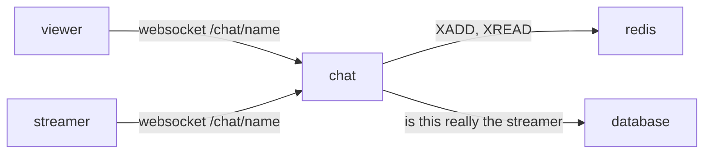

# chat

text chat next to a stream. short lines, newest at the bottom. the last 500 live in redis. with `CHAT_PERSIST` the older ones stay in postgres, and a room can be searched and scrolled to one line.



## why this shape

**websocket + redis, yes.** a message has to reach everyone in the room right now, and a late joiner wants the last few hundred lines. that is two things: fan-out and a short memory. one websocket connection per viewer does the fan-out to browsers. redis does the memory and the fan-out between chat machines.

**redis streams, not pub/sub + a list.** the first idea is usually pub/sub for live messages and a capped list for history. that is two structures that can disagree: a client that reconnects between the history read and the subscribe misses lines. a redis stream is one structure that is both: `XADD chat:<name> MAXLEN ~ 500 * …` appends and trims, `XREVRANGE … COUNT 200` is the history, `XREAD BLOCK … chat:<name> <last id>` is the live tail. every message has an id, so a reconnecting client resumes from the last id it saw with no gap. memory is bounded by `MAXLEN`. one key per stream, deleted a week after the last message.

**not kafka.** kafka is a durable, replicated log for many independent consumers, replay from days ago, and throughput that needs partitions across machines. this chat needs none of that: one small memory per room, no replay beyond 500 lines, a few thousand messages a minute at most. kafka would add a cluster, a jvm, a schema, and nothing a viewer could notice. the same goes for nats jetstream or rabbitmq here. if this ever needs more than one chat machine, redis streams already carry the messages between them. if it ever needs messages kept forever, that is a database table written from the same `XADD` path, not a different transport.

**not the database.** postgres can hold chat, but then every message is a write plus a `LISTEN/NOTIFY` or a poll, and the "last 500" trim is a job. the owner does not want chat kept, so there is nothing for a database to do. the database is only asked two questions at hello: is this socket really the streamer (session id + token, the same proof the heartbeat uses), and who does its login cookie say it is (`accounts.md`). when it cannot answer, the socket is a plain viewer: it gets the room, the history and the lines (those need only redis), and the two questions are asked again on its first `say`, which gets `chat is busy, try again` until they are answered. nothing is let through unchecked, and nobody is locked out of reading by a database that is down.

## the service

`chat` is its own container, the `api` binary run as `api chat` (same image, no extra build), listening on `:4100`. caddy forwards `/chat/*` to it. the chat only: the gateway of `status.md` (`/events`, one socket per browser, presence and pushes) is the `events` container, the same binary run as `api events`, and the two share nothing but the websocket plumbing in `api/src/socket.rs` and redis. it reads redis and the database, nothing else. it keeps no state that matters: if it restarts, browsers reconnect and reload history from redis. on sigterm every socket gets a close frame (1001) and up to 2s to leave before the process ends; the panel reconnects in 3s.

one task per room with at least one viewer runs `XREAD BLOCK 5000 STREAMS chat:<name> <last id>` and pushes every new entry to that room's sockets. the first viewer's join takes the start id (`XREVRANGE … COUNT 1`) before it loads history, so a line between the two is in both and dropped by id, never in neither. the task keeps retrying redis while the room has viewers, and ends when the last one leaves. sending a message is `XADD`, nothing else; the sender sees its own line come back through the stream like everyone else, so order is the same on every screen.

## protocol

one websocket per viewer at `wss://<host>/chat/<stream name>`. a server's channel is the same socket at `wss://<host>/chat/<server>/<channel>` (`groups.md`): the room key is `server/channel`, redis `chat:server/channel`. anyone can read it, including the history below. a line is accepted only from a login that has joined that server; anyone else hears `join the server first` and the line is not kept. a channel that is not there says `no such channel` and the panel stops. json text frames.

client → server

```json
{"type":"hello","nick":"bob"}
{"type":"hello"}
{"type":"hello","nick":"ignored","session":12,"token":987654}
{"type":"hello","nick":"pixelfan","bot":true}
{"type":"say","text":"hi"}
{"type":"say","text":"","image":"6b1e0c3a-7c2d-4e5f-9a10-11b12c13d14e"}
{"type":"say","text":"look","image":"6b1e0c3a-7c2d-4e5f-9a10-11b12c13d14e","images":["6b1e0c3a-7c2d-4e5f-9a10-11b12c13d14e","7c2d0c3a-7c2d-4e5f-9a10-11b12c13d14e"]}
{"type":"say","text":"agreed","reply":"1729000000000-1"}
{"type":"react","id":"1729000000000-1","emoji":"🔥","on":true}
{"type":"react","id":"1729000000000-1","emoji":"🔥","on":false}
```

a line can carry pictures, ten at most. the page shrinks each first, to about five lines tall, as webp (jpeg when the browser cannot write webp), and `POST /api/chat-images` keeps it for a login. the say names every id in `images`, and the first again in `image`, so a chat that only knows one picture still keeps that one. the words can be empty. the panel draws one picture as it is, at most five lines tall (`max-h-[7.5rem]`); two sit side by side, and more make two rows, the first with the odd one out, the pictures of a row sharing its width and cropped to fill their cells (three are two over one across the whole row, five three over two, eight four over four). pointing at one lays a faint grey over it. a click on one puts it over the whole page (`#chat-picture-view`): the page dimmed dark grey behind it, the picture as tall or as wide as the window allows less 3% at the two edges it reaches, and a little blue in the grey under the picture. escape, the × (`#chat-picture-close`) or a click on the grey beside the picture closes it. a line with several has arrows at the edges (`#chat-picture-prev`, `#chat-picture-next`), and the arrow keys, to move through them. profile pictures, group pictures, thumbnails and the offline picture stay jpeg. a say whose id is not one of those hears `no such picture` or `bad picture`. more than ten is `too many pictures`. a direct message (`dms.md`) carries pictures the same way: the same upload, the same ids on `POST /api/dm/:name`, the same cap and refusals, and the window draws them with the same `ChatImages`.

the first frame must be `hello`, within 10s. `session` + `token` are the streamer's own grant from go-live; when they check out, the socket speaks as the stream's name and its lines are marked `streamer`. a login needs no nick: the browser sends the login cookie with the handshake and the server names the socket after the account (`verified`); if the account is the room's name, that is the streamer too. anyone else picks a nick, as long as it is not somebody's account name. `bot: true` says the socket is a program: its lines wear the `bot` badge, and the panel can hide them (`groups.md`). the fake streams' chatters say it.

server → client

```json
{"type":"history","messages":[{"id":"1729...-0","from":"bob","text":"hi","streamer":false,"verified":false,"groups":[],"avatar":null,"at":1729000000000}]}
{"type":"history","messages":[{"id":"1729...-1","from":"ann","text":"yo","streamer":false,"verified":true,"groups":[{"name":"vip-0042","badge":"VIP","color":"#ff00aa","icon":1700000000,"about":"the vips","members":12,"banner":1700000001}],"avatar":null,"at":1729000000500}]}
{"type":"message","id":"1729...-1","from":"billy","text":"yo","streamer":true,"verified":true,"groups":[{"name":"vip","badge":"vip","color":"#f2cc60"}],"avatar":1700000000,"at":1729000000500}
{"type":"message","id":"1729...-2","from":"pixelfan","text":"hi chat","streamer":false,"verified":false,"groups":[{"name":"bot","badge":"BOT","color":"#5865f2"}],"avatar":null,"at":1729000000900}
{"type":"message","id":"1729...-3","from":"bob","text":"agreed","streamer":false,"verified":true,"groups":[],"avatar":null,"at":1729000001200,"reply":{"id":"1729...-1","from":"ann","text":"yo","streamer":false,"verified":true,"avatar":1700000000,"images":0}}
{"type":"message","id":"1729...-1","from":"ann","text":"yo","streamer":false,"verified":true,"groups":[],"avatar":null,"at":1729000000500,"reactions":[{"emoji":"🔥","count":2,"who":["bob","cleo"]}]}
{"type":"react","id":"1729...-1","emoji":"🔥","who":"dan","on":true}
{"type":"count","count":12}
{"type":"error","error":"too long"}
{"type":"error","error":"slow down","wait":27000}
{"type":"error","error":"that name has an account. log in as it, or pick another"}
{"type":"error","error":"too many tabs"}
{"type":"error","error":"missed 12 lines"}
{"type":"error","error":"log in to react","react":"1729...-1"}
```

`history` comes once, right after `hello`, with up to 200 lines oldest first. `count` is how many sockets this chat machine has in the room; it changes on join and leave. the errors: `say hello first`, `bad nick…`, `that name has an account…`, `that nick belongs to the fake streams…` and `too many tabs` close the socket; `too long`, `slow down` (with `wait`, the ms until the next line may go: the rate, below), `no such line` (a reply to a line not in this room, below), a refused reaction (an `error` with `react`, the line it was for: below), `chat is busy, try again` (the database has not answered who this socket is yet; reading goes on), `chat is down, try again` and `missed N lines` (this socket fell behind the room; the lines are gone for it) do not.

### a whole server on one socket

the room page (`groups.md`) opens `wss://<host>/chat/<server>/*` instead of one socket per channel: every channel of the server on the one socket, so changing channels on the page opens nothing. `*` is not a name, so no channel can be called it. the same `hello`; nobody is the streamer of a server, so a grant in it means nothing. no `history`: the page drew every channel from `GET /api/groups/:group/messages` (the last 100 of each), and tells the socket the newest id it has per channel; the socket sends what came after each, so nothing falls between the api's answer and the socket, and nothing across a drop either (the panel says it again on the reconnect). a channel added while the socket is open is followed after `join` (the events socket says one was added). the channels followed are the ones the login sees (`groups.md`: a channel kept to roles is its holders', the owners', the channels power's and a site admin's; `ADMIN_NAMES` is read here too), read as the socket opens; `join` asks the same of a channel, and a say in one not followed is `say which channel`. a single channel's socket (`/chat/<server>/<channel>`) and the history routes under it say `no such channel` for one the login does not see, like one that is not there. what differs:

```json
{"type":"since","since":{"general":"1729000000000-4","clips":"1728999990000-0"}}
{"type":"join","channel":"clips"}
{"type":"say","text":"hi","channel":"general"}
```

```json
{"type":"message","channel":"general","id":"1729...-5","from":"billy","text":"yo","streamer":false,"verified":true,"groups":[],"avatar":null,"at":1729000000500}
{"type":"count","channel":"general","count":3}
{"type":"error","error":"say which channel"}
```

every `message` and `count` carries `channel`. a `say` must name a channel the socket follows, or hears `say which channel`. `since` sends up to 100 lines after each id, oldest first, and may be sent again at any time (the page does, when the api's lines land after the socket opened); a line already sent is not sent twice. `not a server` closes the socket, like `no such channel`. everything else (the limits, the badges, the pictures, `join the server first`, the count per ip per room) is as above, per channel: the socket counts as one in every channel's room.

a line accepted into a server's channel (on either socket shape) is also a row under the other members' bells (`notifications.md`, the `chat` kind): this process writes it once redis has the line, on a task of its own with a 5s bound, so the inbox never holds the room. a member who muted the channel, or switched the kind off, gets none; the speaker never does. a stream's room writes nothing: it has no members.

## rules

- text: 1 to 500 characters after cleaning. longer is `too long`, empty is dropped unless the line has a picture. cleaning: trim; control characters other than newline are stripped; so are the invisible format characters (soft hyphen, zero-width space, bidi marks, embeddings, overrides and isolates, word joiner, byte order mark; not the zero-width joiners, emoji and some scripts need them); at most two newlines between visible characters; a run of combining marks is cut at four.
- nick: 1 to 24 characters, letters digits `_ -`, case kept. any nick that is not a claimed name (lowercased) is free; the socket is closed otherwise and the panel goes back to the nick box. the `streamer` and `verified` marks are the only things that mean anything.
- groups: a login's groups ride on its lines as badges (`groups`, see `groups.md`), read once at the hello, and only when the line is really the account's (`verified`). a hello with `bot: true` adds the `bot` badge, whoever it is. the badges are kept with the line in the stream (`g`, json), so a room is drawn from its lines alone.
- pictures: a line may name up to ten (`images`, the ids; the first is also `image`, so an older page still draws one). kept as `img` for the first and `imgs` for the rest in the stream, left out when there are none. in postgres the row's `image` is the ids joined by commas. the bytes are not in the frame. `bad picture`, `no such picture` and `too many pictures` do not close the socket.
- faces: the speaker's picture rides along the same way (`avatar`: its upload time, the `?v=` the pages fetch `/api/streamers/<name>/avatar` by, as on every other answer of the api; `null` for none), and only when the line is really that name's: a login's (`verified`), or the room's for the streamer. an anonymous nick is nobody's picture, whoever's name it happens to be. the picture is the one the row has *now*, not the one it had when the line was said: read at each say (so the line fanned out wears the current one), and read again, in one query for the batch, whenever lines come back out of redis (the history frame, `since`, `before`, `around`, a server's `messages`), the way a line from postgres joins `streamers` for it. a login's line keeps its account in the stream (`uid`) and is looked up by that, so a rename keeps its face; the streamer's by the room's name. the stream also keeps the version as written (`a`): what a line wears when the database does not answer on the way out. every login's line in every stream has its `uid`: `scripts/migrate-scripts/schema.sql.sh` filled in the ones said before it (the account by the name, through `held_names` for a name since renamed away). the tab that changed the picture redraws its own lines on the spot (`refaceLines`).
- rate: a token bucket per speaker per room (`Limiter` in chat.rs), in two sizes. without an account, 2 lines at once and then one every 30 seconds (2 a minute); a login, or the one who went live (the grant is as good as a name in their own room), 3 at once and then one every 3⅓ seconds (3 in ten). a bucket, not a sliding window: three said at once are three gone, and the next goes when one token is back, not when the oldest of the three is ten seconds old. over it is `slow down` with `wait`, the ms until a token is back, and the line is dropped. in a server's channel two more gates read the same way (`groups.md`), words and `wait`: `timed out`, for a member the kick power has timed out (the ms until it ends), `cooldown`, for one whose roles carry a cooldown and whose last line in the server was within it (the ms left), and `channel cooldown`, for a channel with a cooldown of its own and a last line in it within it; a line waits for whichever is longer. the owners and a site admin have none; the channels power has no channel's, only its roles'. the panel counts any of the three down on the send button and puts the line back in the box; a wait the chat set is kept until it passes, so a try meanwhile only shakes the button. the bucket is the speaker's, not the socket's: a login's by account (a rename keeps it), the streamer's by the room, a nick's by the ip and the nick lowercased (one browser's tabs share the nick, and a household its ip, so two nicks behind one router are two buckets); another tab, or a reconnect, is not a fresh burst. a socket the database has not named yet pays from the hello's nick's bucket until its first accepted line. the buckets live in the chat process, and the ones that have refilled are forgotten once a minute (a full bucket is the same as none). a `join` on a server socket costs a token too, since it asks the database. one ip may hold 8 sockets in a room; the ninth gets `too many tabs` and is closed, so tabs do not multiply the count either. the fake streams' pretend viewer says a line about twice a minute, the nick's rate.
- frame size: 8 kb. a bigger frame closes the socket.
- liveness: the server pings every 30s; a socket that sent nothing (pong, text, anything) for 90s is dropped and leaves the count.
- history: 200 lines sent on join, 500 kept in redis, a room's key expires 7 days after its last line. past that, with `CHAT_PERSIST`, the lines are in postgres (below).
- the stream does not have to be live. people can talk in an empty room while they wait.

## replies

a line may answer another line of the same room, discord's way, on every chat: a stream's, a group's channel (either socket shape) and a direct message (`dms.md`, the same idea over http). the say names the line by its id (`reply`); the chat looks for it in this room alone (`history::line_at`: redis while the stream has it, else the kept rows), so another room's line, a junk id or a line long gone with nothing kept is `no such line` and the reply is not kept (the panel puts the words back in the box). the check comes after the rate's token, like the pictures', so a reply costs what a line costs. a socket only ever says into rooms it may see (`may_see`, `visible_channels`), so the line answered is one the speaker could read.

the reply keeps a quote of the line it answers (`Reply` in chat.rs): the id, who said it with the `streamer` and `verified` marks and the face as it was then (`avatar`), the first 120 characters of its words and how many pictures it had (`images`, a count). the quote is written once, at the say, beside the line: `r` (json) in the redis entry and the `reply` column (jsonb, migration `0002-replies`) on the kept row, and every way a line comes back (the history frame, `since`, `before`, `around`, a server's messages, a pin) carries it as `reply`. so a quote outlives its line being trimmed out of redis, and draws with no second lookup. a quote of a reply is the line alone, not its quote too. a line that answers nothing has no `reply` key.

the panel (`ChatLine.tsx`, the one line component of every chat): every line has an **action bar** at its top right, floating over the line's top edge: `add reaction` (the smiley, the picker: "reactions" below), `reply` (`[data-line-action=reply]`), the caller's own buttons (a group line's pin and unpin for the channels power, `groups.md`; the pin sheet's `go to it` and unpin) and `more` (`[data-line-action=more]`), a small menu of `reply` and `copy text`. it is up while the pointer is on the line or the keyboard's focus is in the bar, and on a screen with no hover after a long press on the line (450ms, a finger held still; a press anywhere else puts it away; the click the lifted finger makes is swallowed, so it does not land on the bar that just came up under it), its buttons 44px there. the panel's list stays at its newest line when the `replying to` bar or the pictures' strip comes up over the box and shrinks it. a reply begun puts a bar over the box (`#chat-replying`, `#friend-chat-replying` in a direct message): `replying to <name>` and an × (`#chat-reply-cancel`); escape in the box lets go of the reply first. the box takes the focus. a send carries `reply` and lets go of it; a line sent back into the box by the chat (`slow down`, a cooldown) brings its reply back with it, unless the chat could not find that line. a server's reply is the channel on screen's: a change of channel lets go of it.

a reply draws its quote over itself (`ReplyQuote`, `[data-reply-quote]`; the line says `data-reply-to`): in `log` and `blocks` a thin spine curls from the column at the left up into the quote, the speaker's tiny face, their name in bold and one line of the words cut to fit (`a picture` or `N pictures` when it had none); `blocks` makes the reply the head of a run of its own, as discord does. in `bubbles` the quote is at the top of the box with a stroke at its left. a click on the quote goes to the line (`ChatRoom.jumpToReply`: scrolled to when it is loaded, the window around it asked for when not, the way a search hit opens) and lights it up for a moment (`data-flash`); a line the room has lost says `that line is not here any more` under the box.

## reactions

a line wears emoji, discord's way, on every chat: a stream's, a group's channel (either socket shape) and a direct message (`dms.md`, the same over http). an emoji is one of a short list (reactions.rs `EMOJIS`, 32 of them; the pages draw the same list from `reaction-list.ts`, and a test reads one against the other), never free text: anything else is `not a reaction`. a login reacts, a nick does not (`log in to react`): a reaction is an account's. one person puts one emoji on one line once; a line holds 20 different emoji at most (`too many reactions` for a new one past that; one already there may still be added to).

the socket says `react` with the line's `id`, the `emoji` and `on` (put it on, or take it off; on a server socket `channel` too, one it follows, else `say which channel`). the id and the emoji are checked first, at no cost; then a token from the reactions' own bucket (`REACT_TIER`: ten at once, then one a second, per speaker per room, apart from the lines', so reacting never costs a line); then who the socket is when the database was down at the hello; in a server's channel, that they are a member and not timed out (`join the server first`, `timed out`), the say's rule; to put one on, that the line is this room's (`history::line_at`, a reply's check: redis, then the kept rows; else `no such line`). the row goes in or out (`reactions::set_line`: the cap is read in the insert itself, under a transaction-scoped advisory lock on the line, so two new emoji at once cannot both pass it). a change is `XADD`ed to the room's reactions stream, `chatr:<room>` (`l` the line, `e` the emoji, `w` who, `on`; about 200 kept, the room's ttl), which the room's reader tails in the same `XREAD` as its lines, so every chat process's sockets in the room get the `react` frame (`who` the reactor's name; a server socket's says its `channel`). putting on one already there, or taking off one that is not, is no change and says nothing. a refusal is an `error` frame with `react` (the line's id) beside `error` (and `wait` with `slow down`), so the panel does not take it for a line of its that went astray.

reactions are not kept with a line: `chat_reactions` (migration `0003-reactions`: the room, the line's id, the emoji, the account, when; its key is the once-per-emoji rule; no foreign key, since a room's line may be in redis alone) is read whenever lines go out (`reactions::with_reactions`, one query for the batch, 2 s at most, like the faces: the history frame, `since`, `before`, `around`, `by`, a search, a server's messages), each line's `reactions` the emoji in the order they first came, each `{ emoji, count, who, me? }` with the first 25 names (as each account is named now), absent for none. `me: true` says the login reading is one of the count, named among the 25 or not: the history frame and `since` know the socket's login, the http reads the cookie's (a stream's room reads it only for this; anyone may read). without it a 26th reactor's chip would be unlit and could not be taken off. a pin's copy of a line wears none.

the panel: the action bar's smiley (`[data-line-action=react]`) opens the picker (`ReactionPicker` in `Reactions.tsx`, `[data-reaction-picker]`, drawn into the body like `more`'s menu): a quick row of the first six, then the grid of all 32, each with its name as its tooltip, the arrows walking them and escape closing it; one already yours is lit, and picking it takes it off; with 20 on the line the ones not there are out of reach and it says why. a nick's smiley stands dimmed, `log in to react`. under the words and the pictures (under the box in `bubbles`) stand the chips (`ReactionChips`, `[data-reaction]`, `data-count`, `data-mine`): the emoji and the count, a small `Button`, in the blue when yours. a click puts yours on or takes it off; the tooltip says who (`you, bob and 3 others reacted with 🔥`). after the chips, the picker again (`[data-line-action=react-more]`), up while the line is pointed at (always on a screen with no hover). nothing moves until the room's `react` frame comes back, so every screen agrees; `ChatRoom.applyReact` puts it on the line wherever it is held (on screen, behind a jump, a channel's shelf, the hits), adding a name it has already being no change (your own known by `me` too, past the 25). a server socket back after a drop asks `GET /api/groups/:group/messages` again and puts each line's reactions onto the lines it holds (`refreshReactions`): `since` brings the lines that came meanwhile, not the reactions on the old ones. a stream's socket gets a whole new history frame anyway.

## kept lines

off unless `CHAT_PERSIST=1` on the chat process (`.env`, then a deploy of the api image so the chat container picks it up). the api process creates the table and never serves it. off, a room is the redis stream alone, and search says `history is not kept`.

on, every accepted line is still `XADD`'d first. the insert into `chat_lines` follows on its own, so a slow database does not hold the socket. redis stays the live tail and the recent page. scrolling past the oldest id redis still has reads postgres, strictly older than the id the panel sends, so a line kept in both is not drawn twice.

- `GET /chat/<name>/before?id=` older lines, oldest first. one page. a short page is the end.
- `GET /chat/<name>/search?q=` matches in this room, newest first, 50 at most. the words as written (`simple`, not stems; websearch, so a quoted phrase stays a phrase). filters go among the words, discord's way, and are taken out before the words are looked for (`parse_search`): `from:<name>` (lines said under that name, a nick as typed in any case, and that name's account's lines under any name it had, so a rename keeps them), `has:image` (or `picture`: a picture on the line), `has:link` (or `url`: `http(s)://` or `www.` at the start of a word, the shape the panel draws as a link), `has:video` (or `clip`: a link to youtube, twitch, a clip, vimeo, streamable, kick, tiktok, or an mp4/webm/mov/m3u8; the chat keeps no videos of its own, so this is the pasted kind; the hosts are `VIDEO_LINK` in history.rs), `before:2026-10-30` and `after:2026-10-01` (utc days; after a day is from the next day on, so the day itself is out). filters alone are a search (`has:image` lists the room's pictures). `channel:<name>` (or `in:`, a leading `#` dropped) is a group's: the rooms searched are that channel's, where a server's search spans every channel the caller sees (below); it is not a search on its own (`say what to look for`), and a stream's room refuses it (400 `channel: is for a group's chat`). the box is read by `read_search`, which a direct message thread's search uses as well (`dms.md`: `GET /api/dm/:name/search`, the same words and filters over the thread's own rows; it refuses `channel:` the same way). a `key:value` word with a key this does not know (`https://…`) is a word. a filter it cannot read is a 400 that says what the key wants: `has: wants image, link or video`. 200 characters at most, filters and all.
- `GET /chat/<name>/by/<account>` that account's verified lines in this room, newest first. a nick with no account is not one.
- `GET /chat/<name>/around/<id>` the window a hit opens on. redis when that id is still in the stream, otherwise postgres. the panel scrolls to it. `latest` comes back to the live tail.

a server channel has the same four, with the room in two segments: `/chat/<server>/<channel>/before`, `/search`, `/by/<account>`, `/around/<id>`. the room stored is `server/channel`. its `/search` is the server's: the channel in the path is the one on screen (it must be one the caller sees, as for every read of it), and the rooms searched are every channel the caller sees (`groups.rs` `visible_channels`, so a channel kept to roles they do not hold is never searched), as one `l.room = ANY($1)`, or the one `channel:<name>` names (`no such channel` for one they do not see); each hit carries `channel`, the part of its room after the server (`Hit` in history.rs, the line's fields flattened beside it; a stream's hits carry none).

a row is the redis id, the room, the time, who said it, the account id when the line is verified (otherwise null), the text, the streamer and verified flags, the badges as they were on the line, `image` (the picture ids joined by commas, null when the line has none), and `reply` (the quote of the line it answers, the stream's `r`, null for none; above). the bytes are in the bucket (`chat/<id>.webp` or `.jpg`), not in the row. search is a generated `tsvector` on the text; `has_link` is a generated boolean on it (schema.sql, the link shape above), and `has:image` and `has:link` read the room through partial indexes on it and on `image`, so a room is not scanned for its few pictures or links. the picture is not a column: a read joins `streamers` for the speaker's picture as it is now, by account id for a verified line (so a rename keeps it) and by name for the streamer's; a nick's line joins nothing, whoever holds that name later.

## jannies

a stream's chat has jannies (`jannies.md`): the streamer, the stream jannies they name, the site jannies and the admins. a janny's delete takes a line out of redis and postgres and every socket in the room hears `{"type":"delete","id"}`; a banned login's line and reaction are refused with `you are banned from this chat`, a timed out one's with `timed out` and `wait`. a group's channels have none of this: their owners and roles moderate them (`groups.md`).

## the panel

on the watch page and the go-live page the chat sits in a column to the right of the video (or the left, or in a window you can drag: a setting of this browser, and the chat tab of the user modal shows a picture of each). the chat button on the video closes it and opens it again: a column slides out to its side, a window fades. on a narrow screen a column sits under the video. the streamer on the go-live page sees the same panel and speaks as themselves. on the corner player it opens under the picture, or in a column to the picture's left or right: a setting of this browser, and the chat tab shows a picture of each. every room is its own (`ChatRoom` in `chat-atoms.ts`, kept by key: the stream's name, or `<server>/*`): its socket, its lines, its box and its scroll, so two panels on two rooms at once (the corner player's stream over a group's channel, your own stream's chat in the player while you watch someone else) each show their own lines and send to their own room, and the player's chat is always the stream in the player (docs/chat-audit.md). panels join a room and leave it; two panels on one room share its one socket and its one list, so no line comes twice. the room goes with the stream from one panel to the next without a reconnect: a panel that takes the room within a beat of the last one leaving it (the player going out into a window of its own and coming back) gets the same socket, the same lines and a half typed line still in the box (the close waits 100ms for a taker, and closes that room alone). the room says hello as the streamer while any panel in it holds the streamer's grant. over the go-live page, whose chat is the player's own room, the player's window draws that room as a guest of the page's panel, which keeps the socket and draws nothing meanwhile (`ChatPanel` `guest`). the panel: the lines, a nick box (remembered in the browser), then one row (`#chat-picture`, the text box, send). a stream's chat has no search box: the search is a group's and a direct message thread's. the panel has no box of its own: in a group the box is the roster's first row, for a member and a guest alike (`groups.md`); the words and the filter words are `ChatSearch.tsx`, which the direct message window's box under its header uses too (`dms.md`, asking `/api/dm/:name/search` with the same filters), and the hits are the panel's (`#chat-results`): a pane where the lines were, the whole of their place (`SearchResults` in `ChatSearch.tsx`; the direct message window's is the same pane), what the hits are for and how many on its first row with `close` (`#chat-results-close`), then a row a hit (`SearchHit`: the short clock, the time for a line said today and the day for an older one, then the name and the words in full), or `nothing` (`#chat-results-empty`). the lines stay under the pane unseen (`visibility`, not unmounted), their scroll kept and a line that comes meanwhile landing at the bottom, and a hit picked or `close` brings them back. a stream's pane still shows a speaker's lines (a verified name opens that account's, below). until the room's past has landed (a stream's with the socket's `history`, a server's with the api's last lines) the lines' place is grey lines in their shape (`#chat-loading`, clipped to the panel, no `p` among them), not `nothing yet`: the room says it has nothing only once that is known. the nick box waits on nobody, so a room not joined yet is as empty as it says. pictures chosen for the next line sit above that row (`#chat-picture-preview`), each with a way to take it off, ten at most, and the add mark stays put so another can be picked. a line is still at most 500 characters; the box does not count them down. on the corner player it is the lines and the text box alone, no header, the chat there being too small for one; the player's footer has the viewer count, and the hide-bots choice still holds. the same panel is the chat of a server channel, on `/explore/<server>/<channel>`, reached from `/groups`, which home's list opens, and on the group's own page beside whoever in it is live (`groups.md`). under a search box the filters stand as words (the roster's `#group-search-filters`, the window's `#friend-chat-search-filters`; `from:` `has:image` `has:link` `has:video` `before:` `after:`, and a group's box has `channel:` too): a click puts one in the box (one that wants a value leaves the cursor after its colon) or takes it out, and a word in the box is blue. **what a filter's word could be** is offered as it is typed (`useChatSearch` in `ChatSearch.tsx`, the list `SearchSuggestions` under the box, `#group-search-list`, `#friend-chat-search-list`; the box is a combobox for a reader, `aria-activedescendant` on the row the keys rest on): the word under the caret, when it is a filter with a value, `from:` offering the people (the roster's box: the members; the window's: the two), each row wearing their face before the name (`Face.tsx`: the picture, or the letter), `has:` its three kinds, `channel:` (or `in:`) a group's channels as this viewer sees them, narrowed by what is typed after the colon; the arrows walk the list, enter or tab (or a click) puts the whole word in the typed one's place with a space after it (`from:bo` becomes `from:bob `), escape takes the list down for that word, and a word already whole offers nothing. **a group's search is the group's**: every channel this viewer sees at once (`GET /chat/<server>/<channel>/search` from the channel on screen, `visible_channels` in groups.rs), each hit carrying `channel`, which the pane says before the name when it is not the channel on screen (`#chat-results button[data-channel]`); a hit from another channel clicked moves the lines to that channel first (`ChatRoom.openLine(id, channel)` in chat-atoms, `showChannel`) and the page's address with them (the panel's `onChannel`, the room page's `navigate`), and the pane goes with the pick, so the line is seen; a change of channel from the list leaves the pane up, since the hits are the server's (a room's hits go with the room). `channel:<name>` among the words searches that one channel (`no such channel` for one this viewer does not see, like one that is not there), and is no search on its own (`say what to look for`); a stream's room and a friend's thread refuse it (`channel: is for a group's chat`). a hit for its pictures may have no words, so a hit with pictures wears the picture mark and their count. a link in a line (`http(s)://…` or `www.…` at the start of a word, the sentence's punctuation after it left out) is drawn as one (`LinkedText.tsx`): a link on this origin is a router link; any other is an `ExternalLink` (`ExternalLink.tsx`, the one way every link leaves the site): it opens in a new tab with `rel="noopener noreferrer nofollow"` and, first, a word that you are leaving this site for that one, a cmd/ctrl click and a middle click too (`#leave-site`, the host in its title and the whole address under it; `#leave-site-go` is the link itself dressed as the button, `#leave-site-stay` has the focus). `don't ask again` on the word (`#leave-site-dont-ask`) turns the links setting off as it goes through; the chat tab has the same switch as two cards, ask before leaving or open at once (`settings.linkWarning`, on unless turned off), for every link on the site that leaves it: every room and direct messages, whose lines are drawn through the same, and every other link out (`spec.md`'s links setting). a click on a name that is really theirs (a login's, or the streamer's) shows them over the page, the profile popup (`#profile-popup`, `follows.md`: who they are, their stream while they are live, their page, and the button that goes there), which has that account's lines as `their messages` (`#profile-popup-lines`); where this browser turned the popup off (`settings.profilePopup`, the chat tab's `people` cards), and in the popped out player's window, a verified name opens that account's lines itself, as it did before the popup. the pointer resting on a name (300ms: a pause, not a pass over the names while reading), or the keyboard's focus landing on it, puts the speaker's card beside the chat, `#chat-peek-<name>`, the sidebar's (`PersonCard.tsx`, `follows.md`): the face with the presence square on its corner, the name, their status, the last two from one `GET /api/streamers/:name` since the line carries neither; only when the line is really that name's (a login's, or the streamer's), since an anonymous nick is nobody. a hit scrolls the room to that line, and `latest` returns to the live tail. a line of your own going out takes the view to the newest line at once, wherever you had scrolled: out of a hit's or a pin's window first (back to the live tail, as `latest`), and to the bottom again when the line comes back. someone else's line leaves a reader who scrolled up where they are. the streamer's lines get a mark; a line wears its speaker's group badges after the name. the name's colour says who the line is really from: the streamer green, a login blue, an anonymous nick red (its `title` says `not logged in`; no `✓` in chat, the colour is the mark). **the shape of the lines** is this browser's, one setting for every chat (`settings.chatStyle`, the chat tab's `the lines` cards, `#chat-style-<log|bubbles|blocks>`; `#chat-lines` carries the pick as `data-style`): a stream's chat, a group channel's and a chat with a friend (`dms.md`) are drawn by one component (`ChatLine.tsx`), so the three shapes are the same three everywhere. the time stands at the left in every shape, one column, `HH:MM` (the full stamp in the browser's own words is the line's title). `log`: one line each, the time, the name with its marks, then the words, which wrap under the name and not under the time; the most lines on screen, and no faces. `bubbles`, the default: each line in a box of its own (a stroke and a fill, no shadow), yours on the right in the blue stroke and everyone else's on the left in the grey; a box that is not yours wears the speaker's name and marks over the words on the first line of a run (one speaker's lines within five minutes of each other), and the name is there for a reader on the rest; one person's lines in one minute stand close with the time at the left once (the others show theirs while pointed at), a new minute or another speaker stands apart. `blocks`: the first line of a run wears the speaker's face (`Face.tsx`: the picture when the line carries `avatar`, else the letter the name makes, the stand-in every list uses; a nick with no account always gets the letter), their name with its marks and the time over the words, and the run's later lines stand under, the time in the gutter as the minute turns. a line is the same `<p>` in every shape (`data-id`, `data-streamer`, `data-verified`, `data-bot`, `data-groups`, `data-mine`); the faces have no switch of their own: they are the blocks'. the viewer count is in the panel header for screen readers only (`#chat-count`, `sr-only`): the header shows just `chat`, or `#channel` in a group. `hide bots` in the settings' chat tab takes the bots' lines off the screen. that choice is this browser's (localstorage), so it holds from room to room. the page keeps the chat's bucket for this speaker in this room (`TIERS` in chat-atoms.ts, the same two numbers; a new room or a new name is a new, full one, a reconnect keeps it), so a line sent over the rate never leaves the page: it stays in the box, and the send button turns red and counts down the seconds until the next may go (`#chat-send[data-wait]`, its title the rule in words), shaking once at each try meanwhile; at zero it reads `send` again. the chat's bucket is shared by every socket of the speaker and has the last word: when it says `slow down` where the page's bucket said yes (another tab spent the tokens, or the page was just reloaded), the page's bucket is set to its `wait`, the line goes back into the box and the button counts down the same.

## the welcome

when a viewer opens a stream's chat, the bot `Eques` says the streamer's welcome at the top of the lines (`#chat-welcome`, `data-bot`, `data-welcome`; `WelcomeLine` in `ChatPanel.tsx`, `welcome-atoms.ts`): in the shape the lines take, wearing the `BOT` badge, stamped when the chat opened. it is drawn on that viewer's screen alone and is not a line of the room: never sent, never in redis or postgres or the history, never counted as unread or a mention, never searched, no action bar. links in it go through `ExternalLink`, the leave-site word with them. the watch page's chat and the go live page's have it; a group's channel and the corner player's do not.

- **the streamer's**: two columns on `streamers` (`api/migrations/0009-chat-welcome.sql`): `welcome_on boolean NOT NULL DEFAULT true`, `welcome text NOT NULL DEFAULT 'welcome to the chat!'`. both on `GET /api/streamers/:name` and the watch grant as `welcome_on` and `welcome`. `PUT /api/streamers/:name/welcome[?password=]`, body `{ on, message }`, through the bio's gate and upsert → `{ name, welcome_on, welcome }` as kept: a chat line's cleaning (`clean_text`), trimmed, 300 characters at most, cut not refused; empty is the default words. the profile tab's `welcome message` block: `eques welcome` (saves at once) and the words with `save`.
- **the viewer's**: the chat tab's `show welcome messages` (`settings.showWelcomes`, this browser's, on unless turned off) takes it off every stream's chat; `hide bots` takes it off too, it being a bot's line.

## later, not now

- more than one chat machine: already works through redis streams; put them behind caddy with sticky-less round robin, counts become per-machine. the gateway was built for it: presence is a sorted set per name with a member per socket, and the facts go through one `events` stream every process tails (`status.md`). the viewer count could move to a `ZCARD` the same way. the token buckets are per machine too (each process has its own `Limiter`), so two machines would be two bursts; a redis lua script holding the tokens and the time per speaker (one round trip per line) makes them one.
- emotes, links, mentions: client side.
