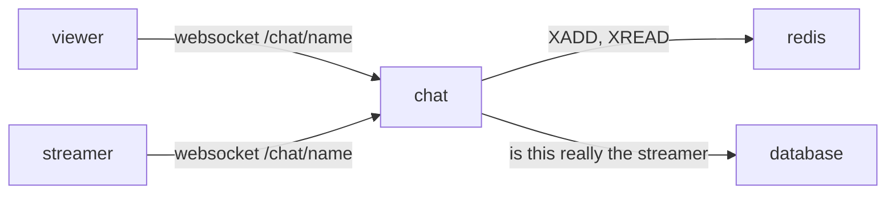

# chat

text chat next to a stream. short lines, newest at the bottom, the last 500 kept per stream. no accounts, no database.



## why this shape

**websocket + redis, yes.** a message has to reach everyone in the room right now, and a late joiner wants the last few hundred lines. that is two things: fan-out and a short memory. one websocket connection per viewer does the fan-out to browsers. redis does the memory and the fan-out between chat machines.

**redis streams, not pub/sub + a list.** the first idea is usually pub/sub for live messages and a capped list for history. that is two structures that can disagree: a client that reconnects between the history read and the subscribe misses lines. a redis stream is one structure that is both: `XADD chat:<name> MAXLEN ~ 500 * …` appends and trims, `XREVRANGE … COUNT 200` is the history, `XREAD BLOCK … chat:<name> <last id>` is the live tail. every message has an id, so a reconnecting client resumes from the last id it saw with no gap. memory is bounded by `MAXLEN`. one key per stream, deleted a week after the last message.

**not kafka.** kafka is a durable, replicated log for many independent consumers, replay from days ago, and throughput that needs partitions across machines. this chat needs none of that: one small memory per room, no replay beyond 500 lines, a few thousand messages a minute at most. kafka would add a cluster, a jvm, a schema, and nothing a viewer could notice. the same goes for nats jetstream or rabbitmq here. if this ever needs more than one chat machine, redis streams already carry the messages between them. if it ever needs messages kept forever, that is a database table written from the same `XADD` path, not a different transport.

**not the database.** postgres can hold chat, but then every message is a write plus a `LISTEN/NOTIFY` or a poll, and the "last 500" trim is a job. the owner does not want chat kept, so there is nothing for a database to do. the database is only asked one question: is this socket really the streamer (session id + token, the same proof the heartbeat uses).

## the service

`chat` is its own container, the `api` binary run as `api chat` (same image, no extra build), listening on `:4100`. caddy forwards `/chat/*` to it. it reads redis and the database, nothing else. it keeps no state that matters: if it restarts, browsers reconnect and reload history from redis.

one task per room with at least one viewer runs `XREAD BLOCK 5000 STREAMS chat:<name> <last id>` and pushes every new entry to that room's sockets. the task ends when the last viewer leaves. sending a message is `XADD`, nothing else; the sender sees its own line come back through the stream like everyone else, so order is the same on every screen.

## protocol

one websocket per viewer at `wss://<host>/chat/<stream name>`. json text frames.

client → server

```json
{"type":"hello","nick":"bob"}
{"type":"hello","nick":"ignored","session":12,"token":987654}
{"type":"say","text":"hi"}
```

the first frame must be `hello`, within 10s. `session` + `token` are the streamer's own grant from go-live; when they check out, the socket speaks as the stream's name and its lines are marked `streamer`. anyone else picks a nick.

server → client

```json
{"type":"history","messages":[{"id":"1729...-0","from":"bob","text":"hi","streamer":false,"at":1729000000000}]}
{"type":"message","id":"1729...-1","from":"billy","text":"yo","streamer":true,"at":1729000000500}
{"type":"count","count":12}
{"type":"error","error":"too long"}
```

`history` comes once, right after `hello`, with up to 200 lines oldest first. `count` is how many sockets this chat machine has in the room; it changes on join and leave.

## rules

- text: 1 to 500 characters after trimming. longer is `too long`, empty is dropped. control characters other than newline are stripped.
- nick: 1 to 24 characters, letters digits `_ -`, case kept. anyone can use any nick; only the `streamer` mark means anything.
- rate: 5 lines at once, then 1 per second per socket. over that is `slow down` and the line is dropped.
- frame size: 8 kb. a bigger frame closes the socket.
- history: 200 lines sent on join, 500 kept in redis, a room's key expires 7 days after its last line.
- the stream does not have to be live. people can talk in an empty room while they wait.

## the panel

on the watch page the chat sits to the right of the video on wide screens, under it on phones. on the go-live page the streamer sees the same panel and speaks as themselves. the panel: the lines, a nick box (remembered in the browser), a text box with a `500` countdown, a send button. the streamer's lines get a mark. the viewer count sits in the panel header.

## later, not now

- more than one chat machine: already works through redis streams; put them behind caddy with sticky-less round robin, counts become per-machine.
- moderation: a `deleted` entry type in the stream, or a per-room block list in redis.
- keeping chat: write each line to a table from the same place that does `XADD`.
- emotes, links, mentions: client side.
