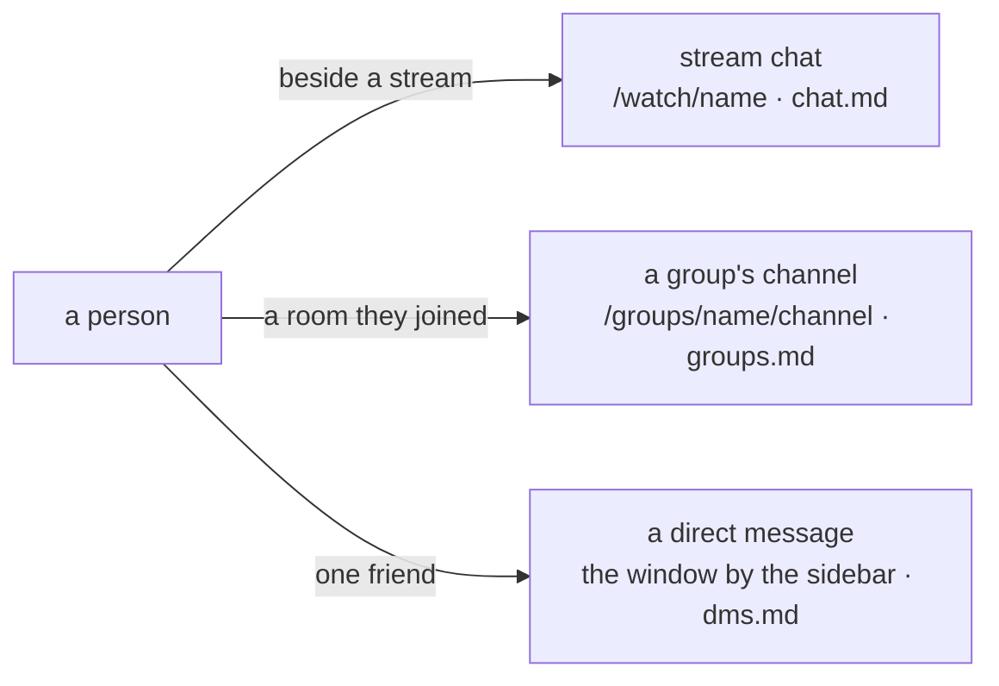

# chats

three ways a person writes to other people. this file is the map: which chat is which, where it shows up, who may write, and what is kept. the rules of each one live in its own file.

| | stream | a group's channel | a direct message |
|---|---|---|---|
| what it is | the room of one name | one channel inside a group | one thread between two friends |
| where | the watch page, go live, the corner player | `/groups/<name>`, and each channel under it | the window beside the sidebar, on every page |
| who may read | anyone | anyone, including the history | the two of them |
| who may write | anyone: a login, or a nick | a login that has joined the group | a login, and only a friend (each follows the other) |
| how a line goes out | a websocket for that room | the same websocket, a different room | `POST`, then the events socket tells both sides |
| kept | the last 500 in redis; older ones in postgres only with `CHAT_PERSIST` | the same, its own room | every line, in postgres |
| what is new | nothing counted | nothing counted; the header says how many sockets are in the room | a count per thread, on the sidebar, and a row under the bell |
| the deep file | `chat.md` | `groups.md`, and `chat.md` for the socket | `dms.md` |

## stream chat

built. the text next to a stream. one room per name, `wss://<host>/chat/<name>`, whether or not that name is live. the watch page and the go-live page put it in a column beside the video (or the other side, or a window you drag: a setting of this browser). on a narrow screen the column sits under the video. the corner player has the same room, smaller: the lines and the box, no search.

anyone can talk. a login speaks as the account. anyone else picks a nick, as long as it is not somebody's account name. the streamer's own lines are marked. a login's groups ride on its lines as badges. a socket that says it is a bot wears `bot`, and the panel can hide those lines.

the last 500 lines live in a redis stream, one key per room, gone a week after the last line. with `CHAT_PERSIST` the older ones stay in postgres and the room can be searched and scrolled to one line. off, search says `history is not kept`.

a line is 1 to 500 characters after cleaning, 5 at once and then 1 a second, 8 sockets from one ip. the whole of it is `chat.md`.

## a group's channel

built. a group other than `bot` is a server (`groups.md`). it starts with one channel, `general`. a member can add more, 20 at most, and `general` cannot be deleted. each channel is its own room of the stream chat: the same panel, the same redis key shape, the same limits, the same badges. the room is `server/channel`, the socket `wss://<host>/chat/<server>/<channel>`.

reading is open. a guest, and a login that has not joined, sees the lines and the history. a line is accepted only from a login that has joined that server; anyone else hears `join the server first` and the line is not kept. a channel that is not there says `no such channel` and the panel stops. the words `before`, `search`, `by` and `around` are not channel names, because those are the history routes.

home shows them under recently offline as squares. a square opens that group; the heading opens `/groups`, which searches yours and the public ones and creates from a modal beside the search (`name`, `badge`, a colour, `about`, public or private). the same name can be made twice: four digits tell them apart, and the address is the name plus those digits. on the group, the owner switches public and private in the header. that page is a server: a banner and a picture, a channel list, and a chat of blocks (the face, the name, then the text) with the channel in the header. members who are live show as tiles of the stream they already have (four playing at most, muted, and not counted as viewers). other channels are `/groups/<name>/<channel>`. adding a channel takes the channels power; who made the channel, or someone with that power, deletes one, after a yes or no. deleting the group asks the same way. the maker is the owner. on the room and on a channel, a person who has not joined is told they can read it, with `join` (or `log in to join`). `/explore` still opens `/groups`.

making the group, joining it, the badge and the colour are the groups api (`POST /api/groups`, `join`, `leave`, `DELETE`). the channels are three more routes on the same groups (`GET /api/explore`, `POST /api/groups/:group/channels`, `DELETE` one). `bot` is a badge, not a server: nobody joins it and it is not on the list.

what a channel is not: a second copy of a stream's chat, and not a thread. there is no streamer mark that means the room, no unread count, and no friends check. leaving the group stops you writing; the lines stay, and you can still read them.

the room uses the streams people already have. a camera that exists only inside the group, and home leading with groups instead of the stream wall, are still `idea.md`.

## a direct message

built. a line from a login to one friend: someone it follows who follows it back. the lines are kept. the window beside the sidebar (`FriendChat.tsx`) is a tab per friend, a grid to pick one, dragged and resized. the sidebar counts what is new, and so does the friends icon when the sidebar is closed. the newest line from a friend is also a row under the bell (`notifications.md`); reading the thread reads that row.

a write is `POST /api/dm/:name`. the row is in postgres. redis only carries the fact, and the events socket (`status.md`) pushes the line to every open tab of both people. a thread still reads after an unfollow; a new line is refused until both follows are back. a stranger, yourself, and a name with no account are refused.

there is no websocket per friend. a thread is a few lines an hour, and one socket per browser already knows which login it is. the whole of it is `dms.md`.

## what they share, and what they do not

stream chat and a channel are one machine. `chat` is its own container (`api chat` on `:4100`). caddy sends `/chat/*` there. one task per room tails that room's redis stream and pushes to the sockets in it. a direct message never goes through that container: the api writes the table, and `events` (`/events`, one socket per browser, already open on every page) delivers the line.

the cleaning is one function. a channel line and a direct message both go through `chat::clean_text`: trim, control characters and the invisible format characters out, at most two newlines between visible ones, a run of combining marks cut at four, 1 to 500 characters left.

badges (`groups.md`) are a stream and channel thing. a verified line wears the speaker's groups, read once when the socket says hello, kept on the line. a direct message has no badges. `hide bots` is this browser's, and it holds from a stream's room to a channel and back.

a logout drops the direct-message window. a stream or a channel keeps going: the next hello is a nick, or the new login.

## not a chat

- **the bell.** an inbox of the last 30 things (`notifications.md`): someone you follow went live, a new follower, a friend's line. the line is a copy for the list. the thread is still the direct message.
- **posts.** a plan (`posts.md`). a short post on a feed, not a room and not a thread.
- **a camera that exists only in the group.** the room shows the streams people already have. a face that is not also their own stream, and one shared audio, are still `idea.md`.
