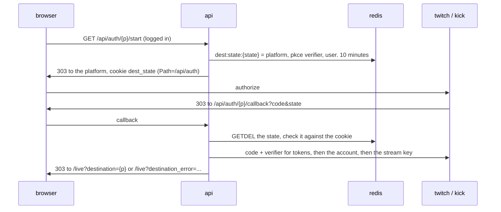

# destinations

send one stream to slop, and slop sends it on to twitch, kick or any rtmp server. this is the
first slice: connecting the accounts and keeping their keys. the relay that pushes video to them
is phase 1. `scripts/multistream-phase0/` tests the relay on one box.

## off until it is set up

every route answers 404 and the go-live page shows nothing new until the api has all of:

- `STREAM_KEY_ENC`: 32 random bytes, base64 (`openssl rand -base64 32`). tokens, urls and keys are sealed with it
- `PUBLIC_URL`: already set for google and discord. the callbacks are `{PUBLIC_URL}/api/auth/{twitch,kick}/callback`
- `TWITCH_CLIENT_ID` + `TWITCH_CLIENT_SECRET`, `KICK_CLIENT_ID` + `KICK_CLIENT_SECRET`: one pair is enough. a platform without its pair stays off

losing `STREAM_KEY_ENC` loses every stored token and key: each person connects again. changing it does the same.

## what is stored

`stream_destinations` (migration `0024`), one row per connected account or custom server:

| column | what |
| --- | --- |
| `platform` | `twitch`, `kick` or `custom` |
| `external_id`, `external_name` | the account on that platform. null for custom |
| `access_token`, `refresh_token` | sealed |
| `stream_url`, `stream_key` | sealed. twitch is always `rtmps://live.twitch.tv:443/app` |
| `token_expires_at`, `scopes` | from the token answer |
| `enabled` | off means the relay skips it |

sealed is aes-256-gcm with a fresh 12 byte nonce, stored as nonce then ciphertext. the associated
data is `{user_id}:{platform}:{field}`, so a value moved to another row or column does not open.
no route ever returns a token, url or key: the list says `has_key` and nothing more. logs name the
platform and the step, never a value, and http errors drop their url.

## connecting



- pkce s256 on both. kick requires it; twitch ignores it, the state cookie is what protects twitch
- twitch asks `user:read:email channel:read:stream_key channel:manage:broadcast user:read:chat user:write:chat` and always shows its consent page (`force_verify`)
- kick asks `user:read channel:read channel:write streamkey:read chat:write events:subscribe`
- connecting the same account again updates its row. ten destinations each at most
- disconnecting deletes the row and revokes the token with the platform

## routes

| route | what |
| --- | --- |
| `GET /api/destinations` | `{ platforms, destinations: [{ id, platform, name, enabled, has_key, connected_at }] }` |
| `POST /api/destinations/custom` | `{ url, key, name? }`. `rtmp://` or `rtmps://`, no login in the url |
| `DELETE /api/destinations/{id}` | disconnect |
| `POST /api/destinations/{id}/enabled` | `{ enabled }` |
| `POST /api/destinations/{id}/refresh` | a new token, then a fresh stream key |
| `POST /api/destinations/live` | `{ title, category? }`: sets the title and category on every enabled account. 10 a minute |
| `GET /api/auth/{twitch,kick}/start`, `/callback` | the connect flow above |

all of them need a login (401 without one). tokens refresh on their own two minutes before they expire.

## the go-live page

a `destinations` fold in the studio rail, under presets: the connected places, `twitch` and
`kick` to connect, `rtmp` for any server. it is hidden when the list answers 404 or 401. it is a
rail fold and not a dock module because every dock layout's grid is full.

## phase 0: the relay on one box

`scripts/multistream-phase0/run.sh` publishes a canvas and a tone from headless chromium over whip
in h.264, mediamtx takes it, and ffmpeg copies the video and turns the opus into aac on the way to
an rtmps server (mediamtx again, self-signed). then it records ten seconds from the far end.

```sh
FFMPEG=/path/to/static-ffmpeg MEDIAMTX=/path/to/mediamtx ./scripts/multistream-phase0/run.sh
```

what it showed on 2026-11-27:

- `mwader/static-ffmpeg:7.1` (the one `video/Dockerfile` copies) lists `rtmps` for output, built with openssl. it does not check the server's certificate by default
- the far end got h.264 constrained baseline + aac lc 48 khz stereo, 29 to 30 fps, a keyframe every 2 s
- chrome's own bandwidth guess dropped 1280x720 to 960x540 on one run. the relay copies what it gets, so the browser's sending bitrate is the ceiling
- headless chrome on a box needs `WebRtcHideLocalIpsWithMdns` off to offer an ip mediamtx can reach

## what billy adds in prod

`TWITCH_CLIENT_ID`, `TWITCH_CLIENT_SECRET`, `KICK_CLIENT_ID`, `KICK_CLIENT_SECRET`, `STREAM_KEY_ENC`
in `.env`. `docker-compose.yml` already passes them to the api. the migration runs when the api starts.
