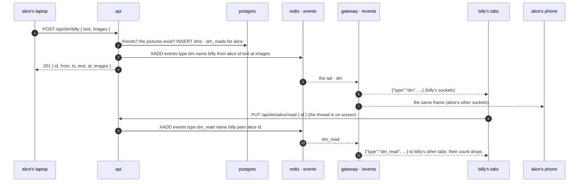

# dms

built. a login writes a line to a friend, someone it follows who follows it back (`follows.md`), and every device of either sees it at once. the lines are kept, and a thread is searched with the room chat's box (`chat.md`: the words, a quoted phrase, the filter words). a line may carry pictures, the room chat's (`chat.md`: shrunk by the page, kept by `POST /api/chat-images`, named by id). the window beside the sidebar (`FriendChat.tsx`: a tab per friend down its side, the grid of friends to pick one, dragged and resized, the glass on its header for the search) is where they are read and written; the sidebar counts what is new.



## why this shape

**http writes, the socket tells.** `status.md`'s rule, and `follows.md`'s: one writer of the table, a failure story on the request, and the gateway as the one road to every open tab of a login. a direct message is exactly a fact about two names, so it rides the `events` stream like `live` and `follow` were designed to. the chat's websocket per room (`chat.md`) would have been a socket per thread per tab, a hello and a reconnect each, for a thing that is a few lines an hour.

**postgres, not redis.** the room chat keeps 500 lines in a redis stream and lets them go, because nobody wants a stream's chat kept. a conversation between two people is the opposite: the whole point is that it is there tomorrow, on the other device. so a row per line, and redis carries only the fact that a line happened (the stream is `MAXLEN ~ 1000`; the text rides in the fact so every gateway can push it, and is gone from redis a thousand facts later).

**ids, not names.** both sides are the account id of `ids.md`, so a rename keeps every thread, and a line is shown under whatever name its writer has now (one join at read time). the frames and the routes speak names, like everything else.

**friends only.** a line goes only where both follows are. that is the one thing standing between a login and a stranger's inbox, and it is already a two-probe query. an unfollow does not take the thread away: it still reads, and a new line is 403 until the follow is back.

**read marks on the server.** a count of what is new that lives in one tab is wrong on the next reload and on every other device. one row per (reader, peer) with the last line id seen, written by the window when a thread is on screen and by the api for a writer's own lines, and the count is a `count(*)` past it. a read on one device is a `dm_read` fact to the others.

**the chat's pictures, not a second kind.** a picture on a line is the same thing in a room and in a thread: shrunk by the page to about five lines tall, put up once as webp (jpeg when the browser cannot write it) to `POST /api/chat-images`, and named by id on the line. so the upload, the bucket key (`chat/<id>`), the `chat_images` row, the cap of ten, the id check before a line is kept and the grid the page draws (`ChatImages`) are the room chat's, and a thread's row keeps the ids joined by commas in `image` the way `chat_lines` does. `GET /api/chat-images/<id>` is public and cached a day, as it is for the rooms: a picture is as private as its uuid, which only the two of them are handed.

## the table

```sql
CREATE TABLE dms (
  id bigserial PRIMARY KEY,
  from_id uuid NOT NULL REFERENCES streamers(id) ON DELETE CASCADE,
  to_id uuid NOT NULL REFERENCES streamers(id) ON DELETE CASCADE,
  text text NOT NULL,
  sent_at timestamptz NOT NULL DEFAULT now(),
  image text,  -- migrate-31.sql: the pictures' ids joined by commas, null for none
  CHECK (from_id <> to_id)
);
CREATE INDEX dms_thread_idx ON dms (LEAST(from_id, to_id), GREATEST(from_id, to_id), id DESC);  -- one thread, newest first
CREATE INDEX dms_from_idx ON dms (from_id, id DESC);
CREATE INDEX dms_to_idx ON dms (to_id, id DESC);

CREATE TABLE dm_reads (
  reader_id uuid NOT NULL REFERENCES streamers(id) ON DELETE CASCADE,
  peer_id uuid NOT NULL REFERENCES streamers(id) ON DELETE CASCADE,
  last_read_id bigint NOT NULL,
  read_at timestamptz NOT NULL DEFAULT now(),
  PRIMARY KEY (reader_id, peer_id)
);
```

`api/migrations/migrate-10.sql`, run by the api at boot like the rest; `image` came with `migrate-31.sql`. a thread is the pair whichever way each line went, so the thread index puts the two ids in one order (`LEAST`, `GREATEST`); a page is one range on it. the two one-sided indexes are the list of threads (`from_id = me OR to_id = me`, grouped by the other side) and the count of what is new (`from_id = peer AND to_id = me AND id > last_read_id`). the pictures' bytes are in the bucket under `chat/<id>` (`chat_images.rs`), not in the row. nothing is indexed for the search: the rooms keep a `tsvector` and a `has_link` column with indexes (`chat.md`) because a room runs to hundreds of thousands of lines, while the pair bounds a thread to a few thousand at most, so a search is the thread index's range with the words (`to_tsvector('simple', text)`), the rooms' link regex (`history::LINK`) and the days read off each row.

## api

| | route | does |
|---|---|---|
| GET | `/api/dms` | the login's threads, the one with the newest line first, 100 at most: `[{ name, verified, avatar, bio, live, presence, last: { id, from, text, at, images }, unread }]`. the other side as `/api/following` has people (the same `words` call, one round trip for every face), `unread` their lines past the login's read mark. 401 nobody |
| GET | `/api/dm/:name[?before=<id>]` | `{ name, friends, lines: [{ id, from, text, at, images }] }`: one page of 50, oldest first; the newest page, or the one before line `before`. a short page is the start of the thread. `images` are the pictures on the line, the ids `POST /api/chat-images` handed back, `[]` for none. `friends`: a line may be sent now. 401 nobody, 400 `that is you`, 403 `not friends…` for a name with no account (a free name is nobody's). a held name answers for the account that left it |
| POST | `/api/dm/:name` | `{ text, images? }` → 201 `{ id, from, to, text, at, images }`. the text is cleaned the chat's way (`chat::clean_text`: trimmed, control and invisible characters out, at most two newlines between visible ones) and is at most 500 characters: 400 `too long`; empty is 400 `nothing to say` unless the line has a picture. `images`, the say's shape (`chat.md`: the ids, ten at most; `image` alone for one is read too), each a uuid the upload handed out: 400 `bad picture`, `too many pictures`, `no such picture`. 403 `not friends. a chat is with someone you follow who follows you back` unless both follows are there. 429 `slow down` past 60 a minute per login (`rl:dm:name:<name>`, `auth::bump`). the row, the writer's read mark to it, then the `dm` fact |
| PUT | `/api/dm/:name/read` | `{ id }` → 204. the read mark forward to `id`, never back (two devices reading at once settle on the further one); moved, a `dm_read` fact |
| GET | `/api/dm/:name/search?q=` | `{ lines: [{ id, from, text, at, images }] }`: the thread's lines that match, newest first, 50 at most, a line as the thread has it. the box is the room chat's, read by the same code (`history.rs` `read_search`, `chat.md`): the words as `websearch_to_tsquery('simple')` (so a quoted phrase is a phrase), and among them `from:<name>` (one of the two, by the name they have now or one held for them after a rename; anyone else finds nothing), `has:image`, `has:link`, `has:video`, `before:<day>`, `after:<day>`. 400 `say what to look for` for an empty box, `too long` past 200 characters, and a filter's own words when its value will not read (`has: wants image, link or video`); 401 nobody; 400 `that is you` and 403 for a name with no account, as the thread. reads whether or not the two are still friends, as the thread does |

`at` is unix milliseconds, `id` the row's, so a page's `before`, a hit's place in the thread and the dedupe of a frame against the api's own answer are the same number.

## the facts, the frames

| fact on `events` | the gateway | the frame |
|---|---|---|
| `type dm name <to> from <from> id text at [images]` | to every socket that *is* `to` and every socket that *is* `from` (`Gateway::tell`, the own-name index, not the watchers'). `images` is the ids joined by commas, left out of the fact and the frame when the line has none | `{"type":"dm","id":12,"from":"alice","to":"billy","text":"hi","at":1729…,"images":["6b1e…"]}` |
| `type dm_read name <reader> peer <peer> id` | to every socket that is `reader` | `{"type":"dm_read","name":"billy","peer":"alice","id":12}` |

the writer's own devices get the `dm` frame too: the page that sent it already has the line from the 201 and drops the frame by id; its other tabs learn it from the frame alone. a socket that is nobody (a guest) is never one of the two names and hears nothing. the inbox row a line makes (`notifications.md`, `notify::messaged`) carries the words as before; a line of pictures alone is a row with none, and the list says `a picture` for it.

## the pages

`dm-atoms.ts`: `dmsAtom` (the tabs: from `GET /api/dms` when the login is known, newest thread first, plus any opened from the grid with nothing said yet), `dmActiveAtom` (the shown one; `null` is the grid), `dmOpenAtom` (the window), `dmThreadsAtom` (each thread's lines, `loaded`, `start`), `dmNoticeAtom` (the api's words under the box, `showDmNotice`), `dmUnreadAtom` (the sum, for the sidebar), `dmResultsAtom` (a search's hits, with the thread and the words they are for; `null` when the list is closed), `dmJumpAtom` (a line to put in view). `loadDms`, `loadThread` (the newest page, once), `loadOlderDm` (the page before the oldest line, as the log is scrolled to the top), `sendDm` (`POST` with the words and the pictures' ids, the answer into the thread at once, the frame later dropped by id), `markRead` (when a thread is on screen: the count to 0 and `PUT read`), `searchDm` (`GET search`, the hits into `dmResultsAtom`; a refusal is the api's words under the box), `clearDmResults`, `openDmLine` (a hit clicked: a thread's lines are one run from the newest back, so the pages before the oldest on screen are asked for one after another until the line is among them or the thread's start is, then `dmJumpAtom` names it and the window centres it), `openDm` / `selectDm` / `removeDm` / `showDms` / `hideDms` / `pickDm` / `closeAllDms`. a line from the api or a frame goes through `lineOf`: `images` left off (an older api) is none. the `dm` frame goes into its thread (a tab for a new peer, filled in by `loadDms`), and counts as new unless the thread is on screen in a visible tab; the `dm_read` frame recounts from the loaded lines. the socket coming back after a drop asks the list again and marks every thread for a fresh newest page, the shown one at once.

the window opens from the sidebar (the `chat` button, a friend's chat button, a pick from the grid), from a friend's line in the inbox under the bell (`notifications.md`), and from a friend's own page: beside the chat button on the watch page, wherever that stands (on the player, on the grey box while the stream is awaited, on the profile while they are not live), a friend gets `#dm-open`, an envelope in the same chip, named `message <name>`. it opens the window on their thread (or shows the tab they have), is lit and `aria-pressed` while that thread is the one on screen, and then hides the window, the chat button's way. friends alone, read off the sidebar's list (`mutual`): a line goes nowhere else, so nobody else's page has it.

the window (`FriendChat.tsx`, the ids in `follows.md`): a tab shown loads its thread and reads it, `loading` until the page is in, `nothing yet. say hi…` for an empty one. the log sticks to the newest line unless scrolled up, and keeps its pixels when an older page is put above (the scroll's, or the pages a hit loads back to). **the header** is the name with its ✓, then the glass (`#friend-chat-search-open`, `aria-pressed` while the box is up, blue then) and the × (`#friend-chat-close`); how they are is not said there, the presence square on their face in the column has it. **the search**: the glass puts a box under the header (`#friend-chat-search`, the focus in it; the glass again, or escape in the box, takes it down with its words and the hits, and the focus goes back to the text box), `search` beside it (`#friend-chat-search-go`) and the room chat's filter words under it (`#friend-chat-search-filters`, `ChatSearch.tsx`: a click puts one in the box or takes it out, a word in the box is blue; no `channel:`, a thread has none). what a filter's word could be is offered as it is typed (`#friend-chat-search-list`, `chat.md`): `from:` the two of you, `has:` its kinds; enter, tab or a click puts the whole word in the typed one's place, escape takes the list down before it takes the box down. enter asks the thread on screen (`searchDm`), and the hits take the lines' whole place (`#friend-chat-results`, `SearchResults` in `ChatSearch.tsx`, the same pane as the room chat's: the words and how many on its first row with `close`, `#friend-chat-results-close`; `#friend-chat-results-empty` reading `nothing`): newest first, each the short clock (the time for a line said today, the day for an older one), the name (yours in blue) and the words in full, the picture mark and a count for pictures, the full stamp as its title, `data-id` the line's. the log stays under the pane unseen (`visibility`, not unmounted), so its scroll holds and a line that comes meanwhile lands at the bottom. a hit clicked takes the pane down and puts the line in view (`openDmLine`): the window loads the pages back to it and centres it by the log's own scroll, and the view stays there as one scrolled up to read does, a line coming meanwhile not pulling it down. `close` takes the pane down with the lines as they were, and puts the focus in the box for the next words. one box for the window: its words stay through a change of tab, and the hits are shown while the thread they were asked of is the one on screen. the grid (no tab shown) has no glass. **the shape of the lines** is this browser's, the one setting every chat shares (`settings.chatStyle`, the chat tab's `the lines` cards, `#chat-style-<log|bubbles|blocks>`; `#friend-chat-log` carries the pick as `data-style`, as the rooms' `#chat-lines` does): a thread's lines and a room's are drawn by one component (`ChatLine.tsx`, the shapes in full in `chat.md`), so a friend's chat is not a special case of the chat. the time stands at the left in every shape, one column, `HH:MM` (the hours of the day, a log's way, so every time is five characters wide; the full stamp in the browser's own words is the line's title). `log`: one line each, the time, the name (yours in blue), then the words, which wrap under the name and not under the time; nothing offset, the most lines on screen. `bubbles`, the default: each line in a box of its own (a stroke and a fill, no shadow, like every box here), yours on the right in the blue stroke and theirs on the left in the grey, no names on screen since in a thread the sides say who (the name is there for a reader; a room's boxes wear the speaker's name, since its left side is everyone else); one person's lines in one minute are a bucket, standing close together with the time at the left on the first of them alone (the others show theirs while pointed at), and a new minute, or the other person, stands apart. `blocks`: the writer's face, their name and the time over the words, and one person's lines within five minutes of each other standing together under one head; a later line in the run shows its time in the gutter where the face was when the minute has turned, and while pointed at otherwise. a line is the same `<p>` in every shape (`data-id`, `data-mine`, the full stamp as its title). **pictures** stand under a line's words in every shape (inside the box in `bubbles`), drawn by the room chat's `ChatImages` (`chat.md`: one as it is, at most five lines tall; two side by side; more in two rows; a click puts one over the whole page, `#chat-picture-view`, with the arrows for several); a line of pictures alone has no words drawn. beside the box, the picture button (`#friend-chat-picture`, the hidden `#friend-chat-picture-file` behind it, `image/*`, several at once): each file picked is shrunk and put up at once (`compressChatImage`, `POST /api/chat-images`) and waits in a strip over the box (`#friend-chat-picture-preview`, an × on each) until the line goes; the strip and the draft are the thread's, kept while another tab is shown. ten at most (`MAX_CHAT_IMAGES`, the chat's cap); past it the rest are left with `10 pictures at most` under the box, and a picture that will not go up puts the reason there. while a picture is going up the button and send wait, so a line does not go without the picture meant for it. send is on with words or a picture; the box's placeholder says a picture may go alone. enter sends; the box and the strip empty on a 201 and keep their text and pictures on a refusal, with the api's words under it (`#friend-chat-notice`) and a countdown from 50 characters left. a face wears how many of its lines are new (`#friend-chat-unread-<name>`), the `chat` button the sum (`#chats-unread`), the friends icon the same whether the sidebar is open or closed (`#friends-unread`). the `×` on a face takes that chat off the column for the visit: the thread is the api's and is back on the next load, and at once when a line comes. a logout, or a change of login, drops everything.

## cost

a row of about a hundred bytes per line, with three indexes, and 37 more per picture named (the id; the bytes are the bucket's, under the upload's own cap and rate). one `XADD` per line and one per read mark, read by every gateway process, applied to the two names' sockets by one map lookup each. no postgres read on the gateway's path. a line with pictures costs one `EXISTS` per picture before the row, the say's price. the list is one query with a grouped subselect over the two one-sided indexes and one `count(*)` per thread, then `follows::words` for the faces (video once, one pipelined `ZCOUNT` per name). a page is one range on the thread index. a search is that same range with the words and the filters read off each row (`to_tsvector`, a regex), a few thousand rows at the most, and one `held_names` lookup first when `from:` is asked.

## tests

`test/dms.js`, after `follows` in `./scripts/test.sh`. two logins and nobody: the 401s; a stranger, a one-way follow, yourself and a name with no account refused; a friend's line kept and cleaned, the thread both ways, the list with its counts, the limits; read marks, a writer's own mark, paging at 50; the search: the words find a line, `from:` one of the two (25 of ben's, 29 of ann's, newest first, a third name nothing), the days, the cap of 50, nobody 401, an empty box, a bad filter and no `q` 400, a name with no account 403, and once the thread has pictures and links, `has:image`, `has:link`, `has:video` and the three together with a word; in a browser the count on the sidebar before the window opens, the newest page shown and read, a pushed line, a sent line; the window's search: the glass left of the × and no presence word on the header, the box taking the focus with the six filter words under it, `from:` typed offering the two names and a pick putting the whole word in, a phrase finding the thread's first line on the older page and the hit clicked paging back to it and putting it in view, a filter word clicked into the box, `nothing` for no hits, escape taking the box down with the window up and the focus back in the text box; a hidden window counting on the face and the sidebar with a second tab agreeing and reading once for both; a friend's watch page has `#dm-open` beside the chat button, which opens their thread, is lit while it shows and hides it again; the lines are bubbles to start, yours right of theirs, and the chat tab's cards (one set, no cards of the window's own and no faces switch) make them a log or blocks with the open window and the room's lines behind it following and the pick kept in the browser; pictures: a line of a picture alone is kept with `images` and no words, an id that is not a uuid, one the upload never handed out and eleven of them are refused with the words, a pushed picture line draws its `` in the open window, and a file picked from the window's picture button waits in the strip and goes with the line, the api's row naming it; an unfollow leaves the thread readable and refuses a line with the words under the box, and their page has no `#dm-open` any more.

## not this

- **a socket per thread, the room chat's shape.** a thread is not a room: nobody joins it, nobody needs the last 200 lines the moment it opens, and there are as many as a login has friends. one socket per browser already exists and knows which login it is.
- **the text through the chat service's redis streams.** the rooms are a short memory on purpose; a conversation is kept, so it is a table, and redis carries the fact.
- **a counter column for unread.** `count(*)` past a mark on `(to_id, id)` is an index range; a counter is a second thing to keep right on every write and every read.
- **anyone writing to anyone.** a stranger's inbox is the one place a site like this gets abused first. friends only, and the follow is already the consent.

## later, not now

- typing, delivered, seen: more facts of the same shape (`dm_typing` to the peer's sockets, nothing stored).
- deleting a line, blocking a name (`follows.md` leaves blocks as a sibling edge table; the friends check would read it too).
- a picture of a thread's own, fetched only by the two of them: today a direct message's picture is a chat picture, public by its uuid like the rooms'.
- a thread taken off the column for good (a hidden flag per reader), not just for the visit.
- a notification outside the page (the browser's `Notification`): the sign is the number on the sidebar, and since `notifications.md` the newest line from each friend is a row of the inbox under the bell too, read with the thread.
