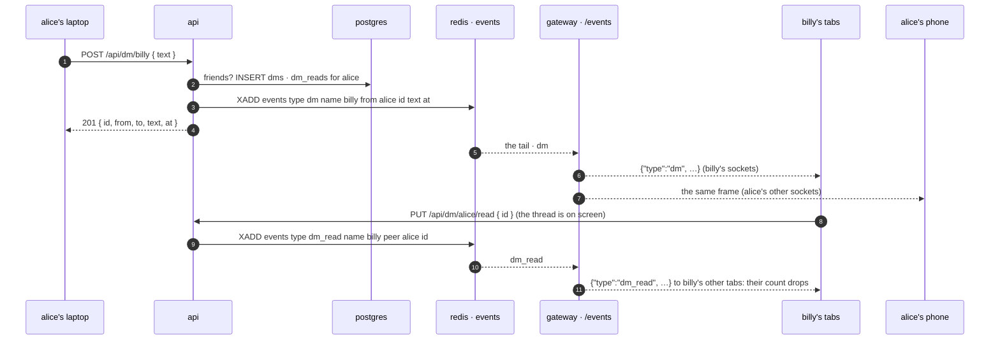

# dms

built. a login writes a line to a friend, someone it follows who follows it back (`follows.md`), and every device of either sees it at once. the lines are kept. the window beside the sidebar (`FriendChat.tsx`: a tab per friend down its side, the grid of friends to pick one, dragged and resized) is where they are read and written; the sidebar counts what is new.



## why this shape

**http writes, the socket tells.** `status.md`'s rule, and `follows.md`'s: one writer of the table, a failure story on the request, and the gateway as the one road to every open tab of a login. a direct message is exactly a fact about two names, so it rides the `events` stream like `live` and `follow` were designed to. the chat's websocket per room (`chat.md`) would have been a socket per thread per tab, a hello and a reconnect each, for a thing that is a few lines an hour.

**postgres, not redis.** the room chat keeps 500 lines in a redis stream and lets them go, because nobody wants a stream's chat kept. a conversation between two people is the opposite: the whole point is that it is there tomorrow, on the other device. so a row per line, and redis carries only the fact that a line happened (the stream is `MAXLEN ~ 1000`; the text rides in the fact so every gateway can push it, and is gone from redis a thousand facts later).

**ids, not names.** both sides are the account id of `ids.md`, so a rename keeps every thread, and a line is shown under whatever name its writer has now (one join at read time). the frames and the routes speak names, like everything else.

**friends only.** a line goes only where both follows are. that is the one thing standing between a login and a stranger's inbox, and it is already a two-probe query. an unfollow does not take the thread away: it still reads, and a new line is 403 until the follow is back.

**read marks on the server.** a count of what is new that lives in one tab is wrong on the next reload and on every other device. one row per (reader, peer) with the last line id seen, written by the window when a thread is on screen and by the api for a writer's own lines, and the count is a `count(*)` past it. a read on one device is a `dm_read` fact to the others.

## the table

```sql
CREATE TABLE dms (
  id bigserial PRIMARY KEY,
  from_id uuid NOT NULL REFERENCES streamers(id) ON DELETE CASCADE,
  to_id uuid NOT NULL REFERENCES streamers(id) ON DELETE CASCADE,
  text text NOT NULL,
  sent_at timestamptz NOT NULL DEFAULT now(),
  CHECK (from_id <> to_id)
);
CREATE INDEX dms_thread_idx ON dms (LEAST(from_id, to_id), GREATEST(from_id, to_id), id DESC);  -- one thread, newest first
CREATE INDEX dms_from_idx ON dms (from_id, id DESC);
CREATE INDEX dms_to_idx ON dms (to_id, id DESC);

CREATE TABLE dm_reads (
  reader_id uuid NOT NULL REFERENCES streamers(id) ON DELETE CASCADE,
  peer_id uuid NOT NULL REFERENCES streamers(id) ON DELETE CASCADE,
  last_read_id bigint NOT NULL,
  read_at timestamptz NOT NULL DEFAULT now(),
  PRIMARY KEY (reader_id, peer_id)
);
```

`api/migrations/migrate-10.sql`, run by the api at boot like the rest. a thread is the pair whichever way each line went, so the thread index puts the two ids in one order (`LEAST`, `GREATEST`); a page is one range on it. the two one-sided indexes are the list of threads (`from_id = me OR to_id = me`, grouped by the other side) and the count of what is new (`from_id = peer AND to_id = me AND id > last_read_id`).

## api

| | route | does |
|---|---|---|
| GET | `/api/dms` | the login's threads, the one with the newest line first, 100 at most: `[{ name, verified, avatar, bio, live, presence, last: { id, from, text, at }, unread }]`. the other side as `/api/following` has people (the same `words` call, one round trip for every face), `unread` their lines past the login's read mark. 401 nobody |
| GET | `/api/dm/:name[?before=<id>]` | `{ name, friends, lines: [{ id, from, text, at }] }`: one page of 50, oldest first; the newest page, or the one before line `before`. a short page is the start of the thread. `friends`: a line may be sent now. 401 nobody, 400 `that is you`, 403 `not friends…` for a name with no account (a free name is nobody's). a held name answers for the account that left it |
| POST | `/api/dm/:name` | `{ text }` → 201 `{ id, from, to, text, at }`. the text is cleaned the chat's way (`chat::clean_text`: trimmed, control and invisible characters out, at most two newlines between visible ones) and must be 1 to 500 characters: 400 `nothing to say`, `too long`. 403 `not friends. a chat is with someone you follow who follows you back` unless both follows are there. 429 `slow down` past 60 a minute per login (`rl:dm:name:<name>`, `auth::bump`). the row, the writer's read mark to it, then the `dm` fact |
| PUT | `/api/dm/:name/read` | `{ id }` → 204. the read mark forward to `id`, never back (two devices reading at once settle on the further one); moved, a `dm_read` fact |

`at` is unix milliseconds, `id` the row's, so a page's `before` and the dedupe of a frame against the api's own answer are the same number.

## the facts, the frames

| fact on `events` | the gateway | the frame |
|---|---|---|
| `type dm name <to> from <from> id text at` | to every socket that *is* `to` and every socket that *is* `from` (`Gateway::tell`, the own-name index, not the watchers') | `{"type":"dm","id":12,"from":"alice","to":"billy","text":"hi","at":1729…}` |
| `type dm_read name <reader> peer <peer> id` | to every socket that is `reader` | `{"type":"dm_read","name":"billy","peer":"alice","id":12}` |

the writer's own devices get the `dm` frame too: the page that sent it already has the line from the 201 and drops the frame by id; its other tabs learn it from the frame alone. a socket that is nobody (a guest) is never one of the two names and hears nothing.

## the pages

`dm-atoms.ts`: `dmsAtom` (the tabs: from `GET /api/dms` when the login is known, newest thread first, plus any opened from the grid with nothing said yet), `dmActiveAtom` (the shown one; `null` is the grid), `dmOpenAtom` (the window), `dmThreadsAtom` (each thread's lines, `loaded`, `start`), `dmNoticeAtom` (the api's words under the box), `dmUnreadAtom` (the sum, for the sidebar). `loadDms`, `loadThread` (the newest page, once), `loadOlderDm` (the page before the oldest line, as the log is scrolled to the top), `sendDm` (`POST`, the answer into the thread at once, the frame later dropped by id), `markRead` (when a thread is on screen: the count to 0 and `PUT read`), `openDm` / `selectDm` / `removeDm` / `showDms` / `hideDms` / `pickDm` / `closeAllDms`. the `dm` frame goes into its thread (a tab for a new peer, filled in by `loadDms`), and counts as new unless the thread is on screen in a visible tab; the `dm_read` frame recounts from the loaded lines. the socket coming back after a drop asks the list again and marks every thread for a fresh newest page, the shown one at once.

the window (`FriendChat.tsx`, the ids in `follows.md`): a tab shown loads its thread and reads it, `loading` until the page is in, `nothing yet. say hi…` for an empty one. the log sticks to the newest line unless scrolled up, and keeps its pixels when an older page is put above. enter sends; the box empties on a 201 and keeps its text on a refusal, with the api's words under it (`#friend-chat-notice`) and a countdown from 50 characters left. a face wears how many of its lines are new (`#friend-chat-unread-<name>`), the `chat` button the sum (`#chats-unread`), the friends icon the same whether the sidebar is open or closed (`#friends-unread`). the `×` on a face takes that chat off the column for the visit: the thread is the api's and is back on the next load, and at once when a line comes. a logout, or a change of login, drops everything.

## cost

a row of about a hundred bytes per line, with three indexes. one `XADD` per line and one per read mark, read by every gateway process, applied to the two names' sockets by one map lookup each. no postgres read on the gateway's path. the list is one query with a grouped subselect over the two one-sided indexes and one `count(*)` per thread, then `follows::words` for the faces (video once, one pipelined `ZCOUNT` per name). a page is one range on the thread index.

## tests

`test/dms.js`, after `follows` in `./scripts/test.sh`. two logins and nobody: the 401s; a stranger, a one-way follow, yourself and a name with no account refused; a friend's line kept and cleaned, the thread both ways, the list with its counts, the limits; read marks, a writer's own mark, paging at 50; in a browser the count on the sidebar before the window opens, the newest page shown and read, a pushed line, a sent line, a hidden window counting on the face and the sidebar with a second tab agreeing and reading once for both; an unfollow leaves the thread readable and refuses a line with the words under the box.

## not this

- **a socket per thread, the room chat's shape.** a thread is not a room: nobody joins it, nobody needs the last 200 lines the moment it opens, and there are as many as a login has friends. one socket per browser already exists and knows which login it is.
- **the text through the chat service's redis streams.** the rooms are a short memory on purpose; a conversation is kept, so it is a table, and redis carries the fact.
- **a counter column for unread.** `count(*)` past a mark on `(to_id, id)` is an index range; a counter is a second thing to keep right on every write and every read.
- **anyone writing to anyone.** a stranger's inbox is the one place a site like this gets abused first. friends only, and the follow is already the consent.

## later, not now

- typing, delivered, seen: more facts of the same shape (`dm_typing` to the peer's sockets, nothing stored).
- deleting a line, blocking a name (`follows.md` leaves blocks as a sibling edge table; the friends check would read it too).
- pictures in a line; the bucket (`s3.rs`) and a `dm_assets` row are the obvious shape.
- a thread taken off the column for good (a hidden flag per reader), not just for the visit.
- a notification outside the page (the toast `follows.md` planned for `went live`, the browser's `Notification`): today the sign is the number on the sidebar.
