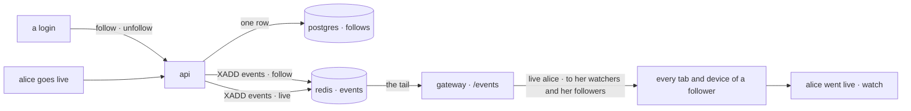
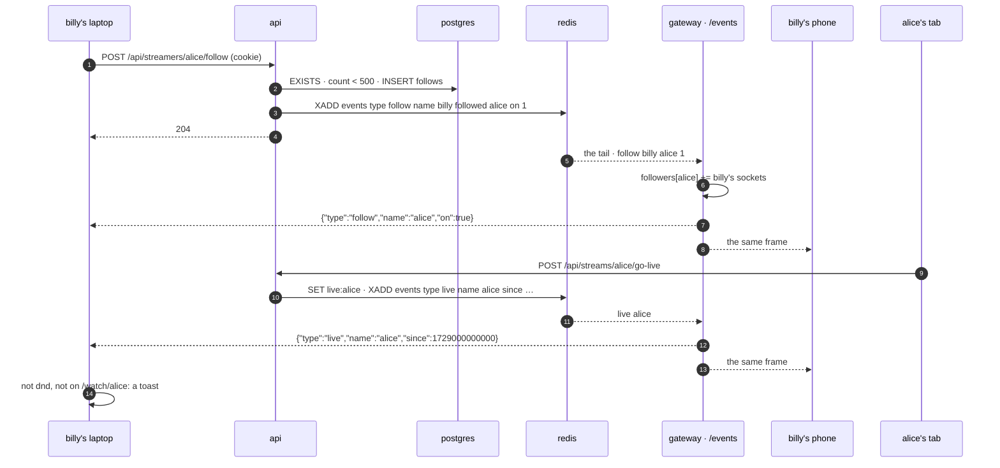

# follows

built, the first half. a login follows a name. the box over the corner panel (hover it, or its `following` button) says which of them are streaming, first, and how the rest are, and has a search box to find more; the watch page has the button and `N followers`. a follow is one way, nobody approves it, anyone may be followed. **not yet**: the push (every tab and device told the moment someone you follow goes live, the toast, gated by `do not disturb`: the notification `status.md` left for later), the followed streams first on home, the modal tab with the followers list. the sections below are the whole design; "## built" says which parts are in the repo and how they differ.

## built

- `api/src/follows.rs`: the table (ids, below), `POST /api/streamers/:name/follow` and `/unfollow`, `GET /api/following` (the words in three round trips), `GET /api/search?q=` (new: names holding the letters, the exact one first, then the ones that start with them, accounts before free names, 20 at most; `following` for the login), `follows::stats` for the two fields on `GET /api/streamers/:name` and the watch grant. the churn counter. no `follow` fact on the stream yet: nothing reads it until the push is built.
- the pages: `Friends.tsx`, the box over the corner panel (`#friends`: `#friends-search`, `#friends-list` with `#friend-<name>` rows and `#friend-unfollow-<name>`, `#friends-results` with `#result-<name>` and `#result-follow-<name>`, `#friends-count`), opened by hovering or focusing `#user-panel`, pinned by `#friends-open` (`following`, with `#friends-streaming` the number streaming, in blue) and closed by Escape, a click elsewhere, or a page change. every open asks `/api/following` again, so the words are now. `FollowButton.tsx` (`#follow` on the watch page, with `#followers`; the small one in the results), `follow-atoms.ts` (`followingAtom`, `followingNamesAtom`, `streamingFriendsAtom`, `follow`, `unfollow`, `search`, debounced 200 ms by the box). nobody sees the search and a pointer to an account; the follow button opens the security tab for them.
- **home** (new, not in the plan below): the search box at the top, in the middle (`SearchBox.tsx`, `#search` with `#search-results`: `#search-<name>` rows and `#search-follow-<name>`; the exact name first, then whoever is here, then the api's order), and under the live cards the **people**: everyone with a row who is not live right now, as a rectangle each (`#people`, `#person-<name>` with `data-presence`, `#person-link-<name>`, `#person-follow-<name>`; `#people-count`, `#people-here`): the face, the name with its marks, the word beside it, a line of the bio, the follow button. online first, then do not disturb, then offline; inside a word accounts before free names, the newest change first. `GET /api/people`, polled every 10s. the fake streams are people too when they are not on, and `./scripts/seed.sh --dummies` gives them faces (with the dummy box's password, no accounts). `PersonRow.tsx` is the one row shape the corner box, the search and the people share.
- `test/follows.js`, ten steps, in `./scripts/test.sh` after `groups`: the 401s, follow/twice/self, the counts and the flag (the grant too), the list's words, a free name gets a row, the box (hover, star goes live for real and reads `streaming` first with the count), search and follow from it, the watch page's button and count moving, home's people (star live is not among them, pal is with a word and a `following` button, online first in the api's answer) and the top search going to pal's page, nobody's box, a rename keeps the followers (`ids.md`), unfollow from the row.
- found on the way: the `/login` and `/signup` pages never told the events socket about the new login (the security tab's login did), so a login made there read `offline` to everyone until a full page load. `AuthPage` calls `identityChanged('login')` now.



## the short answer

yes: a table of edges. one row per `(follower, followed)` in postgres, both of them the row ids of `ids.md` (never the names: a name can change, an edge must not care), the primary key reading one way and a second index reading the other. that is a directed graph stored as an adjacency list, and it is how every site with follows stores them until the day the table does not fit on one box, which this one will not see.

- **not a graph database.** a graph database earns its keep on many-hop questions: friends of friends, the shortest path between two people, who to recommend. a follow asks one-hop questions only (who does billy follow, who follows alice, how many, does billy follow alice), and postgres answers one hop from an index. a fourth store beside postgres, redis and the bucket would be a fourth thing to deploy, back up and lose, for queries this one already does.
- **not redis sets.** `SADD following:billy alice` is the obvious shape and it is wrong here for the reason `status.md` gives: redis has no volume and is gone on a restart. the chat lines may go; who you follow may not. redis carries the *fact* that a follow happened (the stream), never the list.
- **not an array column or a json blob on the `streamers` row.** "who follows alice" becomes a scan of every row, two people following alice at once race on one row, and the cap is the row size, not a number you chose.
- **no counter column.** `followers` is `count(*)` over the reverse index, an index-only scan: microseconds at any count this site reaches. the day one name has a million followers and the number is on every page, a counter kept in the same transaction is the fix. not before.

## what for

- **go live, be seen.** today a stream is found by whoever has home open at the time. a follower is told the moment it starts, on every device, with no tab on home.
- **home is yours first.** a login's followed streams come before the rest of the grid.
- **the number.** `12 followers` on a watch page says something about a stream that the `✓` and the bio do not.

## the rules

- a follow is `(follower, followed)`, two row ids. the follower is a **login**: the edge needs an id with a person behind it, and a guest's nick is a free name anyone can wear. the followed is **any valid name**, claimed or free, reserved too; a name with no row gets a bare one, so it has an id to point at. following a free name means "tell me when someone goes live as alice", which is exactly what "alice's bio" means on a free name (`accounts.md`'s one rule). a free name claimed later keeps its followers the way it keeps its bio, and a name that changes (`ids.md`) keeps them too: the edge points at the row, and the row is what stays.
- one way, no approval, no roles. "billy follows alice" says nothing about alice. a mutual follow is two rows; nothing stores "friends", a join finds them (below).
- not yourself: 400 `that is you`.
- a login follows up to **500** names. more than anyone watches, and every follow is one more name the gateway must remember for every socket of yours. nobody chooses their followers, so no cap on those.
- follow and unfollow are idempotent: a second follow is 204 and writes nothing, not even the fact.
- **counts are public, lists are yours.** `followers` (the number) is on every profile read, for anybody. who exactly follows a name, and who a name follows, is shown to that login alone: `groups.md`'s rule for memberships (`mine`, never the list).
- the choice travels in redis as a fact, `follow billy alice 1|0`, never as a list. the gateway and every other tab learn it from the stream, the way `status` travels.
- churn: 120 follows and unfollows per login per hour (`auth::bump`, `auth.rs:245`, the login limiter's shape). a follow is one row and one `XADD`, and the `XADD` wakes every gateway process; a loop on one button must not.

## the graph, in postgres

```sql
CREATE TABLE IF NOT EXISTS follows (
  follower_id uuid NOT NULL REFERENCES streamers(id) ON DELETE CASCADE,  -- a login's row
  followed_id uuid NOT NULL REFERENCES streamers(id) ON DELETE CASCADE,  -- any name's row. a bare one is made for a name without
  followed_at timestamptz NOT NULL DEFAULT now(),
  PRIMARY KEY (follower_id, followed_id),                                 -- who does billy follow
  CHECK (follower_id <> followed_id)
);
CREATE INDEX IF NOT EXISTS follows_followed_idx ON follows (followed_id, followed_at DESC);  -- who follows alice, newest first
```

after `stream_thumbs` in `SCHEMA` (`main.rs:76`), run by the api at boot like the rest; the gateway reads a table the api made, as with `status`. it wants `streamers.id` (`ids.md`, phase 1) and nothing else from there. two indexes, one per direction, each answering its question from the index alone; the names come from one join on `streamers` when a list is shown, and are whatever the names are *now*:

| question | query | reads |
|---|---|---|
| does billy follow alice | `SELECT EXISTS (SELECT 1 FROM follows WHERE follower_id = $1 AND followed_id = $2)` | the primary key, one probe |
| who does billy follow | `SELECT s.name, f.followed_at FROM follows f JOIN streamers s ON s.id = f.followed_id WHERE f.follower_id = $1 ORDER BY f.followed_at DESC` | the primary key, one range, a row per name |
| how many follow alice | `SELECT count(*) FROM follows WHERE followed_id = $1` | `follows_followed_idx`, index only |
| who follows alice, newest first | `SELECT s.name, f.followed_at FROM follows f JOIN streamers s ON s.id = f.follower_id WHERE f.followed_id = $1 ORDER BY f.followed_at DESC LIMIT 100` | `follows_followed_idx`, one range, a row per name |
| which of these live names does billy follow | `LEFT JOIN follows f ON f.follower_id = $2 AND f.followed_id = st.id` in `list_streams` (`main.rs:551`, which already joins `streamers st`) | the primary key, one probe per live name |
| billy's mutuals | `SELECT a.followed_id FROM follows a JOIN follows b ON b.follower_id = a.followed_id AND b.followed_id = a.follower_id WHERE a.follower_id = $1` | both indexes. shown nowhere; here to say the graph is there |

the follow itself takes the groups' `join` shape (`groups.rs:197`): a login, a valid name, not yourself, `EXISTS` first (already following: 204, nothing written), the cap, then one statement that makes the followed name's row if it has none, reads its id, and writes the edge, the way `create` makes a group and its first member in one (`groups.rs:174`):

```sql
WITH named AS (
  INSERT INTO streamers (name) VALUES ($2)
  ON CONFLICT (name) DO UPDATE SET name = EXCLUDED.name   -- the idiom that makes RETURNING answer for a row already there
  RETURNING id
)
INSERT INTO follows (follower_id, followed_id) SELECT $1, id FROM named ON CONFLICT DO NOTHING RETURNING followed_id
```

a row back means it happened, and only then does the fact go to redis. unfollow is `DELETE … RETURNING followed_id`, the same way. `ON DELETE CASCADE` on both sides: no account is deleted today, but a row that goes takes its edges with it rather than leaving them dangling, and a rename onto a free name (`ids.md`) moves that name's edges to the renamer before the free row goes.

## the push



the gateway already pushes `live` and `ended` to a name's **watchers**, the sockets that sent `watch` for it (`events.rs:266`). a follower is a second kind of watcher, one the server knows about without being asked:

- **the registry** (`events.rs:98`) gains `followers: name → sockets` beside `watchers`, and each socket entry a `following` set beside `watching`. `live` and `ended` go to the union of the two, so a socket that both watches and follows alice gets each frame once.
- **at hello**, for a login: one `SELECT s.name FROM follows f JOIN streamers s ON s.id = f.followed_id WHERE f.follower_id = $1` (the gateway already asks postgres at hello, `whoami` and `is_claimed`; `whoami` now hands it the id too, `ids.md`), and the two maps are filled with the names as they are at that moment. a guest's socket follows nothing. nothing is recomputed and nothing is pushed: a follow is not a `watch`, and the words of 500 names are not what a page wants on open.
- **the `follow` fact** on the `events` stream, read by the tail like `status` (`events.rs:358`): for every socket whose name is the follower, add or remove the followed name in both maps, then `{"type":"follow","name":"alice","on":true}` to those sockets and those alone. the sender sees its own click come back through the server like everyone else, the chat's rule, so the phone agrees with the laptop with no side channel. a replayed entry (the ten-second replay on start) sets what is already set.
- **the `renamed` fact** (`ids.md`) re-keys the maps: `followers[billy]` becomes `followers[bobby]`, and every socket's `following` that said `billy` says `bobby`. the row the edges point at did not change; only the word the gateway files it under did. the maps are by name because the facts on the stream are (`live name alice`), and a `live` must find its followers without a lookup.
- **presence is not pushed** for followed names. the following tab shows each name's word by asking http once when it opens, below; `live` and `ended` still arrive and move the list while it is open.

the frame to a follower is the plain `live` the watch page already knows, not a new kind. what the page does with it is the page's: on `/watch/alice`, `streamerLive('alice')` starts the player as today (`status.md`); anywhere else, for a name in `followsAtom`, a toast. a `live` for a name you neither watch nor follow never arrives.

## redis

| key | change |
|---|---|
| `events` | one more fact: `XADD events MAXLEN ~ 1000 * type follow name billy followed alice on 1` (`0` for unfollow). written by the api after the row, through `presence.rs`'s `publish` (`presence.rs:159`) as `publish_follow` beside `publish_status`. read by the tail. nothing else: no `following:` keys, no `followers:` sets. redis forgets on restart; the gateway reloads from postgres at every hello anyway |
| `rl:follow:name:<name>` | the churn counter, `auth::bump`, an hour |

## api

| | route | does |
|---|---|---|
| POST | `/api/streamers/:name/follow` | 204, also when already. 401 nobody, 400 `bad name…` / `that is you`, 403 `you follow 500 names already. unfollow one first`, 429 `too many changes. wait an hour` |
| POST | `/api/streamers/:name/unfollow` | 204, also when not. 401 nobody, 400, 429 |
| GET | `/api/following` | the login's: `[{ name, verified, avatar, bio, presence, live, followed_at }]`, streaming first, then online, do not disturb, offline, and newest follow first inside a word. 401 nobody |
| GET | `/api/followers` | *not built yet.* the login's: `[{ name, verified, avatar, followed_at, mutual }]`, newest first, 100 at a time, `?before=<followed_at>` for the next 100. 401 nobody |
| GET | `/api/people` | `[{ name, verified, avatar, bio, presence, following }]`: everyone with a row who is not live, online first (then do not disturb, offline), accounts before free names, the newest change first, 100 at most of the 300 newest rows. for nobody too |
| GET | `/api/search?q=` | `[{ name, verified, avatar, bio, live, presence, following }]`: every row whose name holds the letters (`position`, so `_` is a letter, not a wildcard), the exact name first, then the ones starting with the letters, accounts before free names, 20 at most. letters outside the name rule are dropped; nothing left is `[]`. for nobody too, `following` false |

changed:

| | route | now |
|---|---|---|
| GET | `/api/streamers/:name` | + `followers` (the count) and `following` (does the asking login follow it; false for nobody) |
| POST | `/api/streams/:name/watch` | the same two |
| GET | `/api/streams` | + `following` per row for the login; false for nobody |
| ws | `/events` | the server → client frame `follow`, above. no new client → server frame: a follow is http, `status.md`'s one-writer rule |

every route takes a **name** in the path and the pages only ever see names: the api resolves the name to its row id on the way in (`SELECT id FROM streamers WHERE name = $1`, or the bare-row insert above) and joins the id back to a name on the way out. the ids stay in the database, `ids.md`'s rule.

`GET /api/following`'s `presence` and `live` for n names in three round trips, not 3n: video's `GET /live` once (the `list_streams` shape), one pipelined `ZCOUNT seen:<name>` per name, one `SELECT name, status FROM streamers WHERE id = ANY($1)`. the watch document (`GET /watch/<name>`) does not change: a preview card is about the stream, and the bot fetching it has no login.

## pages

- **the watch page**: `#follow` beside `#presence` in the title line (`WatchPage.tsx:111`): the word `follow`, or `following` when you do (`unfollow` on hover and focus), and `#followers` after it, `12 followers`, always shown, `0` included. pressed, it flips at once and the frame confirms; a failed call puts it back with the api's words. for nobody the button opens the user modal on the security tab, the groups tab's way.
- **home**: the cards a login follows come first, so they are what fills `#featured` (`HomePage.tsx:325`, the first two), and each wears the word `following` after the name in `textSecondary`. the api carries the flag, the page does the ordering; the 3s poll is untouched, and a pushed `live` for a followed name makes the page refetch at once rather than wait for the tick.
- **the user modal**: a `following` tab between `groups` and `security` in the `you` group (`USER_TABS`, `user-modal-atoms.ts:13`). two lists: `following` (`N following`; the square and the word of each name, `live` in blue first; `unfollow` on each row) and `followers` (`N followers`; `follow back` where not `mutual`, the word `mutual` where it is; `more` for the next 100). the profile tab's card gets the count beside its `✓`. nobody sees `follow people and they show up here` and the pointer to security.
- **the toast**: `#went-live`, a stack of at most three in the top right, mounted once by the Shell beside `MiniPlayer` and `Inspector` (`router.tsx:25`), the `FRAME` stroke and no shadow like them (the house rule for a floating box). a row per `live` frame for a followed name: the picture, `alice went live`, one `watch` link (a client-side route to `/watch/alice`), `×`. gone after 20s, on `×`, on `watch`, or on its `ended`. not shown when `myPresenceAtom` is `dnd` (the gate `status.md` built it for; home still reorders), when the page already is `/watch/alice`, and for a `live` whose `since` the page has already shown (the tail replays ten seconds on a gateway restart; the same `since` twice is one toast).
- **atoms**: `follow-atoms.ts`: `followsAtom`, the `Set` of names the login follows, from `GET /api/following` once per page load, `undefined` until it answers, emptied by `forgetMe`, added to and removed from by the `follow` frame; `wentLiveAtom`, the toasts shown. `events.ts`'s dispatch gains the `follow` frame and, for `live` and `ended`, a call into `follow-atoms` beside the one into `watch-atoms`. the follower count on the watch page rides the grant into `watch-atoms`.
- **no browser `Notification`s.** the toast is in the page; a browser that is closed hears nothing. below.

## cost

one row per follow, about a hundred bytes with both indexes. one `XADD` per follow or unfollow, read by every gateway process, applied to the follower's sockets only. at hello, one `SELECT` of at most 500 rows for a login, nothing for a guest. at go-live, one map lookup and one frame per connected follower; postgres is not touched. on every profile read, one index-only `count(*)` and one primary-key probe. nothing new runs.

## tests

`test/follows.js`, after `presence` (it needs the push) and before `regress`. two logins, `fan<run>` and `star<run>`, and nobody.

1. nobody: `POST /api/streamers/star/follow` 401; `GET /api/following` 401; `GET /api/streamers/star` carries `followers: 0, following: false`.
2. fan follows star: 204; twice 204; `GET /api/streamers/star` as fan says `followers: 1, following: true`, as nobody `followers: 1, following: false`; self 400; a bad name 400.
3. `GET /api/following` as fan lists star with a `presence`; `GET /api/followers` as star lists fan, `mutual: false`; star follows fan: `mutual: true` both ways.
4. a free name: fan follows `free<run>` (no row before) → 204, and `GET /api/streamers/free…` says `followers: 1`.
5. the push: fan's browser on home; star goes live in a second context: `#went-live` reads `star… went live` within 5s with no reload; `watch` on it lands on `/watch/star…` and the toast is gone; `GET /api/streams` as fan says `following: true` for star and home shows it in `#featured` with the word `following`. star stops: nothing shown.
6. dnd: fan picks `do not disturb`; star goes live again; no toast in 5s; home still lists star first.
7. two tabs: fan unfollows in one; the other's `#follow` reads `follow` within 3s (the frame, not a poll). `followers: 0`.
8. the cap: locally, 500 rows for a throwaway login straight into postgres (`docker compose exec database psql`), and the 501st follow is 403. off-box `SKIP`, the `errors.js` way.
9. the tab: `#you` → `#tab-following`: `1 following`, `unfollow` on a row removes it, `follow back` on a follower row.
10. a rename (`ids.md`): star changes its name; fan's `GET /api/following` lists the new name, `GET /api/streamers/<new>` says `followers: 1, following: true`, and fan's open tab gets the `renamed` frame, so its `followsAtom` says the new name with no reload.
11. cleanup: unfollow everything, stop if live, `online`.

## code

- needs `ids.md` phase 1 (`streamers.id`) and the `Account` in `Me` from its phase 2 (`me.id` is the follower). it can ship before the rename itself.
- `api/src/follows.rs`, new: the four routes, `is_following`, `followers_count`, `following_among(ids)` for `list_streams`, the two list queries, the churn counter. about 250 lines.
- `api/src/main.rs`: the table in `SCHEMA`, the merge, the two fields on `get_streamer` (`main.rs:516`), `watch` (`main.rs:722`) and `list_streams` (`main.rs:540`).
- `api/src/presence.rs`: `publish_follow`. `api/src/events.rs`: the `followers` map and the `following` set, the load at hello, the `follow` fact in the tail, the re-key on `renamed`, the union in the `live`/`ended` push. about 90 lines.
- `frontend/src/infra/atoms/follow-atoms.ts`, `shared-components/FollowButton.tsx`, `shared-components/WentLive.tsx`, `user-modal/FollowingTab.tsx`; `WatchPage.tsx`, `HomePage.tsx`, `api.ts` (`follow`, `unfollow`, `following`, `followers`, the three fields), `frames.ts` (the `follow` frame), `events.ts` (the dispatch), `user-modal-atoms.ts` (the tab), `router.tsx` (the Shell mounts the toasts). about 400 lines.
- `test/follows.js`. `docs/README.md`'s line. when it ships: `spec.md`'s api and tests tables, `status.md`'s phase 7 loses its first item, `accounts.md`'s `/events` row gains the `follow` frame.

## not this

- **a graph database, redis sets, an array column, a counter column.** the short answer, above.
- **a follow as a server-side `watch`.** the following tab would get presence words pushed for free. but `watch` recomputes and pushes a word per name (`events.rs:308`): 500 round trips at every hello, and the recheck (`events.rs:571`) does them again every 30s for every followed name of every connected login. a follower wants `live`, not `online`; `live` is one fact with one writer and no recompute. the words come over http when the list is looked at.
- **fan-out at go-live from postgres.** on a `live` entry the gateway could `SELECT follower_id FROM follows WHERE followed_id = $1` and push to each: nothing at hello, nothing in the registry. it is a postgres read on the gateway's hot path for every go-live, in every gateway process, and the hello already reads postgres; the registry is where the gateway keeps who wants what. the two are a few lines apart; the one that stays in memory wins.
- **the follow over the socket.** two writers of the table and a write-failure story on the socket. `status.md`'s argument, unchanged: http writes, the socket tells.
- **a `friends` table.** two rows already say it. a third table is a cache of a join, and a cache has to be kept right.
- **a `notifications` table, an inbox.** a toast is a frame that was on screen or was not. the moment there is a list of missed ones there is read state, a cap, a sweep and a page. maybe later; not what "tell me when alice goes live" needs.

## not here

- blocks (alice refusing billy's follow). the natural sibling: an edge table of the same shape, `blocks`, checked at follow and at the chat hello. a feature of its own.
- friend requests, approval, private accounts. a follow is one way by design; an approval is a different thing, a request with a state.
- browser notifications (`Notification`, web push with a service worker and vapid keys), email. the toast is in the page.
- follower-only chat, follow goals, follow age on chat lines.
- recommendations, "who to follow", counts on home cards, counts in the watch document.
- the dummy box following anyone, or anyone being told the fake streams went live: they are live from boot and stay.

## open questions

1. **lists private, counts public?** the recommendation above, `groups.md`'s rule. the other way: a public followers page per name, the old twitch shape.
2. **follow free names?** the one rule says yes. the smaller feature: claimed names only, so a follow always has a person behind it. (recommendation: the one rule, as everywhere else.)
3. **where the toasts sit.** top right is the inspector's default spot too (`status.md`). (recommendation: top right; the inspector is draggable and the toasts are gone in 20s.)
4. **500.** a number. twitch has none; a limit nobody hits costs nothing and bounds the hello. (recommendation: keep, raise when asked.)
5. **`ended` for followers.** a toast for a stream ending is noise; the frame is still useful (the toast goes, home reorders). (recommendation: the frame, no toast.)
