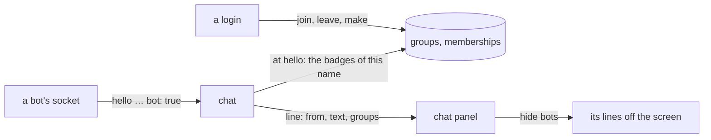

# groups

a login joins a group, and its chat lines wear the group's badge: a small box in the group's colour with a word in capitals, next to the name, the way discord tags a bot. one group is built in and automatic, `bot`, and the chat panel can hide its lines.



## what for

- the fake streams (`DUMMY_STREAMS`) have pretend chatters so the panel has something to show. they are there to prove the chat works, not to be read. with a badge on them they can be told apart, and with the switch they can be put away. when real people are the chat, the switch is the thing to drop, not the badge.
- a few people who want to be seen together: a group with a badge, a picture and a banner. anyone with an account can make one and anyone can join. the maker is the owner.

## the rules

- a group: the words they type (`title`, the name rule, `a-z 0-9 _ -`, 1 to 32) and four random digits (`tag`, `0000` to `9999`). two groups can share the words. the address (`name`, the url, the chat room) is the words, cut at 27 so `-` and the digits fit, then `-` and the digits (`gaming-0042`). a group made before this has no title and no tag, and the name is the words. a `badge` (1 to 12 characters, cleaned like a chat line, shown in capitals), a `color` (`#rrggbb`), a line `about` it (up to 200). made by a login, who is in it from the start.
- a login makes up to 10 groups and is in up to 8: every badge goes on every line it says.
- joining and leaving are a login's own choice. no invitations, no approval. a ban stops a join until it is lifted.
- the maker is an owner, and starts with every power. an owner can name another owner, and take it back. nobody else can, not a site admin. a group keeps one owner while anyone else is in it: the last owner cannot leave or be removed until they name another. the last person out deletes the group.
- a custom role is a name (1 to 32, cleaned like a chat line, not the word `owner`), a colour and any of five powers: appearance (the about line, public or private, the member order), roles (make and hand out roles, never owner), channels, kick, ban. twenty roles at most. a role cannot touch an owner: only an owner gives one a role or takes one back. a role reaches only the powers its holder has: whoever makes, changes, deletes, gives or takes a role must hold every power on it (an owner and a site admin hold every one), so the roles power alone cannot write itself a ban.
- the picture and the banner are the owner's alone (and a site admin's). no role carries them, and there is no remove: a group with a picture keeps one, or changes it for another.
- an owner, the one who made a group, or an admin from `ADMIN_NAMES` deletes it. its members are out with it.
- `bot` is built in: `BOT`, discord's blurple. nobody joins it (403) and nobody deletes it. a chat socket whose `hello` says `"bot": true` wears it, whoever it is. anyone may say so; it only ever costs the speaker, since the panel can hide the line, so there is nothing to check. the dummy's chatters say it, the pretend viewer and the pretend streamer both.
- a socket's badges are read once, at the hello: the account's groups when the line is really the account's (`verified`: the login behind the socket is the name on the line, so a streamer who went live under a free name while logged in as somebody else wears nothing), plus `bot` when asked for. a group joined mid-chat shows after a reconnect; the pages reconnect the open chat on their own after every join, leave, make and delete.
- the badges travel on the line (`groups: [{ name, badge, color }]`), kept in the redis stream with the line (the `g` field, json; absent when there are none). a room is drawn from its lines alone, no lookup. a line keeps the badges as they were when it was said.
- a group is public unless the maker says private, on the create form or later. a public one is on the lists. a private one is on the lists only for someone in it: home, `/groups`, and `GET /api/groups`. the page is still there for anyone who has the name, and a login can still join it. the owner (appearance) switches it on the group, in the header, and the maker can from the groups tab.
- which groups a stranger may see, who made them and how many are in each is public. the roster is for members (and a site admin), on the right of the room: each name, whether they are an owner, and which roles they hold. owners come first, then name, newest, or oldest, which appearance sets. a guest does not get that list. a member who is live is also named on the group's page and in `live` on the explorer, because that face is the room.
- a room is loaded once and then pushed to. arriving on `/groups/<name>` asks the api twice, in parallel: the room (`GET /api/groups/:group`, which carries the channels, who is live, and the roster and the bans this login may see) and the last 100 lines of every channel (`GET .../messages`). from then on the events socket (`status.md`) is the only source: the page watches `group:<name>` and every change to the group arrives as a `group` fact (someone joined or left, was kicked or banned, a channel was added or deleted, the about, the pictures, public or private, the member order, a role made, changed, deleted, given or taken, an owner named or unnamed, a member live or ended, the group deleted) and lands in place. changing channels asks nothing of anyone: the chat is one socket for the whole server (`chat.md`, `/chat/<server>/*`), every channel's lines on it, and the channel list only changes what is shown. the two pulls behind the push: a change about the login itself (its own membership, powers or roles) asks the room again, since what it may see depends on them; and the socket coming back after a gap asks again, since the facts of the gap are gone.

## api

|        | route                      | does                                                                                                                                                                                                                                                                     |
| ------ | -------------------------- | ------------------------------------------------------------------------------------------------------------------------------------------------------------------------------------------------------------------------------------------------------------------------ |
| GET    | `/api/groups`              | `[{ name, badge, color, about, made_by, members, mine, public, title, tag, automatic }]`, `bot` first, then oldest first. a private group is listed only for someone in it. `mine` is for the login cookie, always false for nobody. `made_by` is the maker's name as it is now (by id, `ids.md`: a renamed maker reads right), null for `bot`. `title` is the words, `tag` the four digits; both null for `bot` and for a group made before the digits. `name` is the address |
| POST   | `/api/groups`              | `{ name, badge, color, about?, public? }` → 201 with the group as the list shows it; the maker is in it. `name` in the body is the title. `name` in the answer is the address (`title` plus `-` and `tag`). the same title again is another group. `public` defaults to true. 401 nobody, 400 `bad name…` / `badge: 1 to 12 characters` / `color: #rrggbb`, 403 past 10 made or 8 joined, 409 `name taken` (`bot`, or eight draws of the digits all taken) |
| POST   | `/api/groups/:group/join`  | 204, also when already in it. 401 nobody, 404 `no such group`, 403 for `bot`, for `you are banned`, and past 8 groups                                                                                                                                                    |
| POST   | `/api/groups/:group/leave` | 204, also when not in it. 401 nobody. 403 `name another owner first` when this login is the only owner and someone else is still in it. the last person out deletes the group |
| DELETE | `/api/groups/:group`       | 204 for an owner, the maker, or an admin. 401 nobody, 403 `not your group` and for `bot`, 404                                                                                                                                                                            |

chat (`chat.md`): the `hello` takes `"bot": true`; every `history` and `message` line carries `groups`, an array, empty for most lines.

### the facts

every change to a group is one `group` entry on the `events` stream (`presence::publish_group`), written after the row is, with `name` the group, `what` the kind, and `data` the change as json. the gateway forwards it whole, as `{"type":"group","group":"<name>","what":"<what>", …data}`, to the sockets watching `group:<name>`, and knows nothing more about it: a new kind of change is the api's alone. `live` and `ended` for a member are the gateway's own: on a `live` or `ended` fact it looks up the name's groups (only when some socket watches some group) and tells each room's watchers `{"type":"group","group":…,"what":"live","who":"<name>"}`.

| `what` | data | from |
| --- | --- | --- |
| `joined` | `who`, `avatar`, `joined` (unix seconds), `members` (the count after) | `POST .../join` |
| `left` | `who`, `by` (`leave` or `kick`), `members` | `POST .../leave`, `POST .../kick` |
| `banned` | `who`, `reason`, `members` | `POST .../ban` |
| `unbanned` | `who` | `DELETE .../bans/:name` |
| `channel` | `channel: { name, about, made_by }` | `POST .../channels` |
| `unchannel` | `channel` (the name) | `DELETE .../channels/:channel` |
| `about` | `about` | `PUT .../about` |
| `access` | `public` | `PUT .../access` |
| `order` | `order` | `PUT .../order` |
| `icon`, `banner` | `icon` / `banner`: unix seconds, the new version | `PUT .../icon`, `.../banner` |
| `role` | `role: { id, name, color, perms }`, made or changed | `POST .../roles`, `PUT .../roles/:id` |
| `unrole` | `id` | `DELETE .../roles/:id` |
| `held`, `unheld` | `who`, and `role: { id, name, color }` or `id` | `POST .../roles/:id/members`, `DELETE .../members/:name` |
| `owner` | `who`, `owner` (true or false) | `POST .../owners`, `DELETE .../owners/:name` |
| `live`, `ended` | `who` | the gateway, from the stream's own facts |
| `deleted` | nothing | `DELETE /api/groups/:group`, and the last person out |

`members` rides on every fact that changes it, so a room never counts on its own. the page patches what it holds from these; the roster, the bans and its own powers are the one thing a frame cannot carry per viewer, so a fact about the login itself (`joined`, `left`, `banned`, `held`, `unheld`, `owner` with `who` the login; `role` and `unrole` for a role it holds) makes the page ask `GET /api/groups/:group` again.

## database

```sql
CREATE TABLE IF NOT EXISTS groups (
  name text PRIMARY KEY,
  badge text NOT NULL,
  color text NOT NULL,
  about text NOT NULL DEFAULT '',
  created_by text REFERENCES streamers(name) ON DELETE SET NULL,   -- null: built in. since ids.md: created_by_id uuid, the key; this column one release more
  created_at timestamptz NOT NULL DEFAULT now()
);
CREATE TABLE IF NOT EXISTS memberships (
  name text NOT NULL REFERENCES streamers(name) ON DELETE CASCADE,  -- since ids.md: user_id uuid is the key; this column one release more
  group_name text NOT NULL REFERENCES groups(name) ON DELETE CASCADE,
  joined_at timestamptz NOT NULL DEFAULT now(),
  PRIMARY KEY (name, group_name)
);
INSERT INTO groups (name, badge, color, about) VALUES ('bot', 'BOT', '#5865f2', '…') ON CONFLICT DO NOTHING;
```

## pages

- chat: every line wears its speaker's badges after the name (and the `✓`), before the `streamer` mark. the header has a robot button, `hide bots`: on, the bots' lines are off the screen and it reads `N hidden`; a room with nothing but bots says so instead of `nothing yet`. a setting of this browser (`settings.hideBots`, localstorage), so it holds from room to room and across reloads; the settings tab has the same switch as two cards, `bots in chat`.
- the user modal, `groups` tab (between profile and security): `your badges` (the name and what it wears), the list (badge, name, members, who made it, about; `join` or `leave`, `automatic` on `bot`, `delete` asks in a dialog (`#group-delete-<name>-confirm`, yes or no) for the maker), and `make a group` (name, badge, a colour from eight swatches or the colour box, about; a live preview of the badge as it will look in chat). without a login the list shows and the rest points to the security tab.
- the profile tab's card wears the badges too, each a way to the groups tab.

## tests

`test/groups.js` (`./scripts/test.sh`, anywhere): the list has `bot` built in and nobody can make or join; a login makes a group (bad badge, colour and name 400, `bot` 409, the badge trimmed and the colour lowercased, the same title again is another address), another login joins (204, twice 204, `bot` 403, no such group 404), the maker is the owner and can make a role the member cannot, the pictures are the owner's (a member with every power is 403, the owner 200, there is no DELETE) and a role reaches only the powers its holder has (a roles-only holder cannot make, give, change or delete a role carrying ban, and cannot touch an owner), the room carries the channels, who is live, the roster for a member and null for a guest, and `GET .../messages` has every channel; a member's chat line wears the badge in the group's colour, a raw socket with `bot: true` wears `BOT`, the robot hides it, counts it, keeps the choice over a reload and shows it again; a raw `wss /events` socket watching `group:<name>` hears `channel` and `unchannel` as the maker adds and deletes one, and the `*` chat socket carries a line with its channel and fills from `since`; the room page lists the channels with their count of 20, switches channels without a reload, a refetch or a new socket, and a line said over the api lands on the page; the only owner cannot leave while someone else is in, leave (204, twice 204), delete is 403 for a member, 401 for nobody and 403 for `bot`, the last member leaving deletes the group and a delete after is 404, and the groups tab makes a group, lists it with `leave`, wears it on the card and deletes it. explore lists a group the login is in under `yours`, with `general` and a `live` list, and home's groups list opens `/groups`.

## servers

a group other than `bot` is a server. it starts with one channel, `general`. adding another (20 at most) takes the channels power: an owner has it, a role can, a site admin can once they have joined. home shows them under recently offline (`#home-groups`) as squares, yours and the public ones, and a square opens that group. the heading opens `/groups`: a search, create to its right, then squares of the groups this login is in, then squares of the public ones it is not. the search waits 200ms after the last letter, then filters those squares and asks `GET /api/search` for people (`#people`). a private group is in yours only.

that page is a server, not a stream. a banner (the picture, or a bar of the group's colour) and the group's picture (or the first letter) sit over a channel list and the chat. for an owner the two are the way to change them: the pointer over the banner or the picture greys it and puts a camera in the middle, the whole picture is the click, and the crop dialog takes it from there (the input is named `change banner` / `change picture`, `add a …` while there is none). a screen with no hover shows a small camera in the corner all the time instead, and no grey. nothing on the right for this, and no remove. the chat there is blocks: a larger face, the name on its own row, the text under it, the channel's name in the header (`#channel`). a stream's chat stays one line. whoever in the group is live shows as a tile of the stream they already have, at most four playing. a night with every camera off is still the page. anyone can read, and speaking takes a login that has joined. `general` cannot be deleted. the words `before`, `search`, `by` and `around` are not channel names, because those are the history routes.

`/groups/<name>` and `/groups/<name>/<channel>` are one page, keyed on the server (`router.tsx`), so a channel is never a different page: the room is asked once (`room-atoms.ts`), with the last 100 lines of every channel, and the chat is one socket for the whole server (`/chat/<name>/*`, `chat.md`) that carries every channel's lines, each with its channel. clicking a channel swaps what the panel shows and asks nothing of anyone; what landed in another channel meanwhile is already there. the channel list says `N of 20` and the add form goes at 20 (`CHANNEL_CAP`, the api's `CHANNELS_PER_SERVER`). every change arrives on the events socket as a `group` fact (above) and lands in place, for this page and every other one with the room open; a group deleted under the page says so, with a way back to `/groups`.

the picture and the banner are jpegs in the bucket, `groups/<name>/icon.jpg` (256kb) and `groups/<name>/banner.jpg` (512kb), versioned by `icon_at` and `banner_at` so a page asks `?v=<unix seconds>`. an owner (or a site admin) changes them, and nobody removes one. appearance is the power that changes the about line, whether the group is public, and the member order (`name`, `newest`, `oldest`). public and private sit in the header of the group. the room (`GET /api/groups/:group`) answers for anyone who has the name: name, badge, colour, about, member count, `mine`, `owner`, `admin`, `public`, `title`, `tag`, `member_order`, the two versions, the login's powers, the roles, the channels, who is live, and the roster and the bans the login may see (null otherwise). the page draws everything from it, once; the explorer is the list page's and home's.

members (`GET .../members`) are for a member or a site admin, owners first and then the group's order. bans are for the ban power. kick removes a member who is not an owner, unless the kicker is an owner; the last owner stays while anyone else is in. ban does the same and writes a row, and the join refuses until `DELETE .../bans/:name`. leaving, kicking and banning drop that person's roles in the group. a group with nobody left is deleted, pictures included. `bot` stays. only an owner grants or revokes owner. a group holds twenty roles.

|        | route                                  | does                                                                                                                                                                                                                                                                                                                   |
| ------ | -------------------------------------- | ---------------------------------------------------------------------------------------------------------------------------------------------------------------------------------------------------------------------------------------------------------------------------------------------------------------------- |
| GET    | `/api/explore`                         | `{ yours, discover }`, each a list of `{ name, badge, color, about, members, mine, public, title, tag, icon, banner, can_channels, live, channels: [{ name, about, can_delete }] }`. not `bot`. yours is the login's, including a private one. discover is the public ones they are not in. inside each, a server with someone in `live` comes first, then oldest. `title` and `tag` are the words and the four digits, null when the group was made before them. `icon` and `banner` are unix seconds or null. `can_channels` is an owner, the channels power, or a site admin. channels oldest first. `can_delete` is who made the channel, or someone with that power, and never for `general` |
| PUT    | `/api/groups/:group/access`            | `{ public }` → `{ public }`. appearance. a private group leaves the public list |
| PUT    | `/api/groups/:group/order`             | `{ order }` → `{ order }`. appearance. `name`, `newest`, or `oldest`. 400 anything else. owners stay first |
| GET    | `/api/groups/:group`                   | the room, whole: `{ name, badge, color, about, members, mine, owner, admin, public, title, tag, member_order, icon, banner, perms, roles, channels, live, roster, bans }`. `perms` is `{ appearance, roles, channels, kick, ban }`, every one true for an owner and for a site admin (`admin`). `roles` is `[{ id, name, color, perms }]`. `channels` is `[{ name, about, can_delete, made_by }]`, oldest first; `live` the members streaming now; `roster` the members (as `GET .../members` lists them, each with `joined`, unix seconds) for a member or a site admin and null for anyone else; `bans` (as `GET .../bans`) for the ban power and null otherwise. asked once by the page, then kept by the facts. 404 `no such group` and for `bot` |
| GET    | `/api/groups/:group/messages`          | `{ "<channel>": [line, …], … }`: the last 100 lines of every channel, oldest first, each line as the chat sends it (`chat.md`). one answer for the whole server. redis only, like the chat's history. anyone. 404 `no such group` and `bot is not a server` |
| POST   | `/api/groups/:group/channels`          | `{ name, about? }` → 201 `{ name, about, can_delete, made_by }`. the channels power, and a member. 401 nobody, 403 `join the server first`, `you can't add a channel`, and past 20 (`this server has 20 channels already`), 404, 400 `bad name…` / `that name is reserved`, 409 `name taken` |
| DELETE | `/api/groups/:group/channels/:channel` | 204. who made the channel, or the channels power (an owner, that role, a site admin). 401, 403 `general stays` and `not your channel`, 404 `no such channel` |
| PUT    | `/api/groups/:group/about`             | `{ about }` → `{ about }`. appearance. |
| PUT    | `/api/groups/:group/icon`              | a jpeg, 256kb, → `{ icon }` unix seconds. an owner, or a site admin: 403 `only an owner changes the pictures` for anyone else, whatever their roles. 400 `not a jpeg`, 413 `picture too big`. no DELETE: there is no remove. GET is the jpeg, public, 404 `no picture` |
| PUT    | `/api/groups/:group/banner`            | a jpeg, 512kb, → `{ banner }`. the same rules |
| POST   | `/api/groups/:group/roles`             | `{ name, color, perms }` → 201 the role. the roles power. 400 a bad name or colour or the word `owner`, 403 past 20, 403 `that role carries a power you don't hold` (every power on the role must be the shaper's own; an owner and a site admin have them all), 409 `name taken`. PUT `.../roles/:id` replaces it, and DELETE removes it, each under the same reach: the role as it is, and as it would be |
| POST   | `/api/groups/:group/roles/:id/members` | `{ name }` → 204, the member holds the role. DELETE `.../members/:name` takes it back. the same reach as making the role, and 403 `a role can't touch an owner` unless the giver is one |
| POST   | `/api/groups/:group/owners`            | `{ name }` → 204. an owner names a member an owner. 403 `only an owner can name another owner`. DELETE `.../owners/:name` takes it back, and 403 `a group keeps one owner` for the last |
| GET    | `/api/groups/:group/members`           | `[{ name, owner, avatar, joined, roles: [{ id, name, color }] }]`, owners first, then the group's order. a member or a site admin. 403 `join the group first`. the room carries the same list as `roster` |
| POST   | `/api/groups/:group/kick`              | `{ name }` → 204. the kick power. not yourself, not an owner unless you are one, never the last owner |
| POST   | `/api/groups/:group/ban`               | `{ name, reason? }` → 204. the ban power. the same limits, and they cannot join until DELETE `.../bans/:name`. GET `.../bans` is `[{ name, reason }]` |

```sql
CREATE TABLE IF NOT EXISTS channels (
  server text NOT NULL REFERENCES groups(name) ON DELETE CASCADE,
  name text NOT NULL,
  about text NOT NULL DEFAULT '',
  created_by_id uuid REFERENCES streamers(id) ON DELETE SET NULL,
  created_at timestamptz NOT NULL DEFAULT now(),
  PRIMARY KEY (server, name)
);
```

```sql
-- migrate-15. the maker of a group that already exists becomes its owner.
ALTER TABLE groups ADD COLUMN icon_at timestamptz;
ALTER TABLE groups ADD COLUMN banner_at timestamptz;
ALTER TABLE memberships ADD COLUMN owner boolean NOT NULL DEFAULT false;
-- roles (group_name, name unique, color, perms int), role_members (role_id, user_id),
-- bans (group_name, user_id, by_id, reason). powers: appearance 1, roles 2, channels 4, kick 8, ban 16.
-- migrate-17. title text, tag integer. both null on a group that already exists.
-- migrate-19. member_order text, default name. name, newest, or oldest, after the owners.
```

## not here

- invites and approvals. a private group is unlisted, and a login who has the name can still join.
- renaming a group, or changing its badge or its colour. the about line, the picture and the banner are the edit.
- removing the picture or the banner. an owner changes it for another.
- a rank among roles. powers are a flat set, and reach is by what the shaper holds, not by a ladder.
- deleting one chat line.
- a group's badge on home and on the watch page. those show the `✓`. home's groups list shows the picture.
