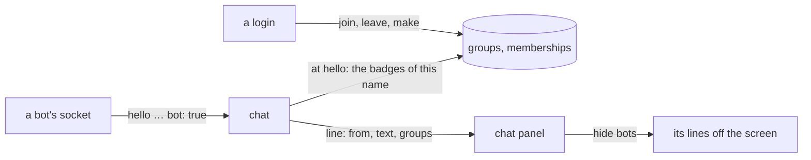

# groups

a login joins a group, and its chat lines wear the group's badge: a small box in the group's colour with a word in capitals, next to the name, the way discord tags a bot. one group is built in and automatic, `bot`, and the chat panel can hide its lines.



## what for

- the fake streams (`DUMMY_STREAMS`) have pretend chatters so the panel has something to show. they are there to prove the chat works, not to be read. with a badge on them they can be told apart, and with the switch they can be put away. when real people are the chat, the switch is the thing to drop, not the badge.
- a few people who want to be seen together: a group with a badge. anyone with an account can make one and anyone can join; there is no owner beyond the one who may delete it.

## the rules

- a group: a `name` (the name rule, `a-z 0-9 _ -`, 1 to 32), a `badge` (1 to 12 characters, cleaned like a chat line, shown in capitals), a `color` (`#rrggbb`), a line `about` it (up to 200). made by a login, who is in it from the start.
- a login makes up to 10 groups and is in up to 8: every badge goes on every line it says.
- joining and leaving are a login's own choice. no invitations, no approval, no roles.
- the one who made a group deletes it (an admin from `ADMIN_NAMES` too). its members are out with it.
- `bot` is built in: `BOT`, discord's blurple. nobody joins it (403) and nobody deletes it. a chat socket whose `hello` says `"bot": true` wears it, whoever it is. anyone may say so; it only ever costs the speaker, since the panel can hide the line, so there is nothing to check. the dummy's chatters say it, the pretend viewer and the pretend streamer both.
- a socket's badges are read once, at the hello: the account's groups when the line is really the account's (`verified`: the login behind the socket is the name on the line, so a streamer who went live under a free name while logged in as somebody else wears nothing), plus `bot` when asked for. a group joined mid-chat shows after a reconnect; the pages reconnect the open chat on their own after every join, leave, make and delete.
- the badges travel on the line (`groups: [{ name, badge, color }]`), kept in the redis stream with the line (the `g` field, json; absent when there are none). a room is drawn from its lines alone, no lookup. a line keeps the badges as they were when it was said.
- which groups exist, who made them and how many are in each is public. who exactly is in one is not listed anywhere, only `mine` for the asking login.

## api

| | route | does |
|---|---|---|
| GET | `/api/groups` | `[{ name, badge, color, about, made_by, members, mine, automatic }]`, `bot` first, then oldest first. `mine` is for the login cookie, always false for nobody. `made_by` is the maker's name as it is now (by id, `ids.md`: a renamed maker reads right), null for `bot` |
| POST | `/api/groups` | `{ name, badge, color, about? }` → 201 with the group as the list shows it; the maker is in it. 401 nobody, 400 `bad name…` / `badge: 1 to 12 characters` / `color: #rrggbb`, 403 past 10 made or 8 joined, 409 `name taken` (`bot` too) |
| POST | `/api/groups/:group/join` | 204, also when already in it. 401 nobody, 404 `no such group`, 403 for `bot` and past 8 groups |
| POST | `/api/groups/:group/leave` | 204, also when not in it. 401 nobody |
| DELETE | `/api/groups/:group` | 204 for the maker or an admin. 401 nobody, 403 `not your group` and for `bot`, 404 |

chat (`chat.md`): the `hello` takes `"bot": true`; every `history` and `message` line carries `groups`, an array, empty for most lines.

## database

```sql
CREATE TABLE IF NOT EXISTS groups (
  name text PRIMARY KEY,
  badge text NOT NULL,
  color text NOT NULL,
  about text NOT NULL DEFAULT '',
  created_by text REFERENCES streamers(name) ON DELETE SET NULL,   -- null: built in. since ids.md: created_by_id uuid, the key; this column one release more
  created_at timestamptz NOT NULL DEFAULT now()
);
CREATE TABLE IF NOT EXISTS memberships (
  name text NOT NULL REFERENCES streamers(name) ON DELETE CASCADE,  -- since ids.md: user_id uuid is the key; this column one release more
  group_name text NOT NULL REFERENCES groups(name) ON DELETE CASCADE,
  joined_at timestamptz NOT NULL DEFAULT now(),
  PRIMARY KEY (name, group_name)
);
INSERT INTO groups (name, badge, color, about) VALUES ('bot', 'BOT', '#5865f2', '…') ON CONFLICT DO NOTHING;
```

## pages

- chat: every line wears its speaker's badges after the name (and the `✓`), before the `streamer` mark. the header has a robot button, `hide bots`: on, the bots' lines are off the screen and it reads `N hidden`; a room with nothing but bots says so instead of `nothing yet`. a setting of this browser (`settings.hideBots`, localstorage), so it holds from room to room and across reloads; the settings tab has the same switch as two cards, `bots in chat`.
- the user modal, `groups` tab (between profile and security): `your badges` (the name and what it wears), the list (badge, name, members, who made it, about; `join` or `leave`, `automatic` on `bot`, `delete` with a `sure?` for the maker), and `make a group` (name, badge, a colour from eight swatches or the colour box, about; a live preview of the badge as it will look in chat). without a login the list shows and the rest points to the security tab.
- the profile tab's card wears the badges too, each a way to the groups tab.

## tests

`test/groups.js` (`./test.sh`, anywhere): the list has `bot` built in and nobody can make or join; a login makes a group (bad badge, colour and name 400, `bot` 409, the badge trimmed and the colour lowercased), another login joins (204, twice 204, `bot` 403, no such group 404), a member's chat line wears the badge in the group's colour, a raw socket with `bot: true` wears `BOT`, the robot hides it, counts it, keeps the choice over a reload and shows it again, leave (204, twice 204), delete is 403 for a member, 401 for nobody, 403 for `bot`, 204 for the maker and 404 after, and the groups tab makes a group, lists it with `leave`, wears it on the card and deletes it.

## servers

a group other than `bot` is a server. it starts with one channel, `general`, and a member can add more (20 at most). the explorer (`/explore`) lists the servers this login is in, then the rest. a channel is a chat room at `/chat/<server>/<channel>` (`chat.md`): anyone can read it, and speaking takes a login that has joined the server. `general` cannot be deleted. the words `before`, `search`, `by` and `around` are not channel names, because those are the history routes.

| | route | does |
|---|---|---|
| GET | `/api/explore` | `{ yours, discover }`, each a list of `{ name, badge, color, about, members, mine, channels: [{ name, about, can_delete }] }`. not `bot`. yours first is the login's, oldest servers first, channels oldest first. `can_delete` is for who made the channel, who made the server, or an admin, and never for `general` |
| POST | `/api/groups/:group/channels` | `{ name, about? }` → 201 `{ name, about, can_delete }`. a member. 401 nobody, 403 `join the server first` and past 20, 404 `no such group`, 400 `bad name…` / `that name is reserved`, 409 `name taken` |
| DELETE | `/api/groups/:group/channels/:channel` | 204. who made the channel, who made the server, or an admin. 401, 403 `general stays` and `not your channel`, 404 `no such channel` |

```sql
CREATE TABLE IF NOT EXISTS channels (
  server text NOT NULL REFERENCES groups(name) ON DELETE CASCADE,
  name text NOT NULL,
  about text NOT NULL DEFAULT '',
  created_by_id uuid REFERENCES streamers(id) ON DELETE SET NULL,
  created_at timestamptz NOT NULL DEFAULT now(),
  PRIMARY KEY (server, name)
);
```

## not here

- roles, permissions, moderators: a badge means nothing to the server.
- private or invite-only groups, approvals, kicking.
- editing a group. delete and make it again.
- badges on chat lines, in the user modal, and on the explorer. home and the watch page show the `✓` only.
- a list of who is in a group.
