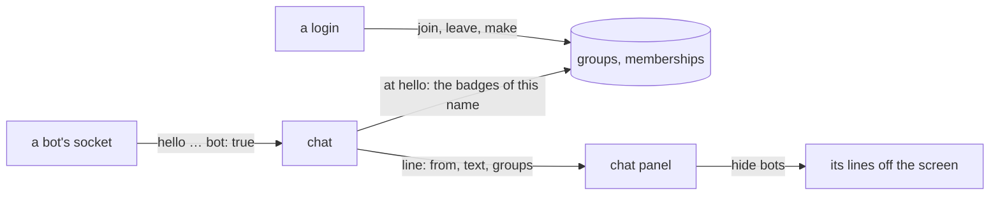

# groups

a login joins a group, and its chat lines wear the group's badge: a small box in the group's colour with a word in capitals, next to the name, the way discord tags a bot. one group is built in and automatic, `bot`, and the chat panel can hide its lines.



## what for

- the fake streams (`DUMMY_STREAMS`) have pretend chatters so the panel has something to show. they are there to prove the chat works, not to be read. with a badge on them they can be told apart, and with the switch they can be put away. when real people are the chat, the switch is the thing to drop, not the badge.
- a few people who want to be seen together: a group with a badge, a picture and a banner. anyone with an account can make one and anyone can join. the maker is the owner, and a login owns a couple at most: `GROUPS_PER_OWNER` in `.env`, 2 unless set.

## the rules

- a group: the words they type (`title`, the name rule, `a-z 0-9 _ -`, 1 to 32) and four random digits (`tag`, `0000` to `9999`). two groups can share the words. the address (`name`, the url, the chat room) is the words, cut at 27 so `-` and the digits fit, then `-` and the digits (`gaming-0042`). a group made before this has no title and no tag, and the name is the words. a `badge` (1 to 12 characters, cleaned like a chat line, shown in capitals), a `color` (`#rrggbb`), a line `about` it (up to 200). made by a login, who is in it from the start.
- a login owns at most `GROUPS_PER_OWNER` groups (`.env`, read by the api at boot; empty is 2, anything under 1 is said in the log and 2 is used), the ones it made and the ones it was named owner of, and is in up to 8: every badge goes on every line it says. one more past the cap needs one deleted, or handed to another owner and stepped down from; the pages offer `create` only under the cap, which `GET /api/explore` says (`groups_per_owner`) beside the servers it counts (`owner` in `yours`).
- joining and leaving are a login's own choice. no invitations, no approval. a ban stops a join until it is lifted.
- the maker is an owner, and starts with every power. an owner can name another owner, and take it back. nobody else can, not a site admin. a member who owns as many groups as the cap allows cannot be named. a group keeps one owner while anyone else is in it: the last owner cannot leave or be removed until they name another. the last person out deletes the group.
- a custom role is a name (1 to 32, cleaned like a chat line, not the word `owner`), a colour and any of five powers: appearance (the about line, public or private, the member order), roles (make and hand out roles, never owner), channels, kick, ban. twenty roles at most. a role is known by a uuid postgres made (`ids.md`; migrate-23), not by its name: renaming one is a save of the same role, whoever holds it keeps it, and a page with the role open keeps it open under a change that arrives meanwhile. a role cannot touch an owner: only an owner gives one a role or takes one back. a role reaches only the powers its holder has: whoever makes, changes, deletes, gives or takes a role must hold every power on it (an owner and a site admin hold every one), so the roles power alone cannot write itself a ban.
- the owner role is not a row of `roles`: owning is `memberships.owner`, and the role is a word on the group, `owner_role` (migrate-27), `owner` until an owner renames it (`PUT .../owner-role`). the roles tab lists it first, a crown and the name, every power, seeing every channel, with nothing to change but the name; a crown stands for an owner on the roster, the members tab and the header, the name its tooltip. a custom role cannot take the owner role's name (400 `that name is reserved`), nor the owner role a custom role's (409).
- a role has a cooldown (`roles.cooldown`, seconds, migrate-28), off (0) unless the roles tab says otherwise, up to an hour: its holders wait that long between lines in the group's channels, whichever channel. a member with several roles waits the longest of them; the owners and a site admin wait for nobody. the chat keeps the wait as a key in redis (`cd:<server>:<account>`, alive the cooldown long, set as a line goes in) and refuses a line inside it with `cooldown` and `wait`, the ms left, the `slow down` frame's shape, so the send button counts it down (`chat.md`).
- a member can be timed out (`timeouts (group_name, user_id, until, by_id)`, migrate-28): no line of theirs in the group's channels until `until`; the chat refuses one with `timed out` and `wait`, the ms left. the kick power (`POST .../timeout`, `{ name, seconds }`, ten seconds to a week; an owner only by an owner, as a kick; not yourself), lifted early by the same (`DELETE .../timeout/:name`). a row of its own, not a column of memberships, so leaving and joining again does not end it; an expired row is nothing. the roster carries `timeout` (unix seconds, while it runs); the `timeout` fact moves it (`until`, or null when lifted).
- a channel can be kept to roles (`channel_roles`, migrate-26): a role carries the channels kept to it (`channels`, by name), and a channel kept to one or more roles is seen by the holders of those roles, the owners, the channels power and a site admin, and by nobody else: not in the room's list, the explorer, `GET .../messages`, the chat sockets (the server's socket does not follow it, and a say in it is `say which channel`), the history routes (`no such channel`, like one that is not there) or the inbox (no `chat` row for a member who does not see it). a channel no role keeps is everyone's. `general` is never kept (400). the roles power sets a role's channels from the ones it sees itself (a hidden one is `no such channel` to it, so it cannot unlock for itself what it cannot see; one already on the role that it cannot see stays), and the chat reads what a login sees as its socket opens: a role given or taken reaches a socket that is up on its next connect, which the page does on its own.
- the picture and the banner are the owner's alone (and a site admin's). no role carries them, and there is no remove: a group with a picture keeps one, or changes it for another.
- an owner, the one who made a group, or an admin from `ADMIN_NAMES` deletes it. its members are out with it.
- `bot` is built in: `BOT`, discord's blurple. nobody joins it (403) and nobody deletes it. a chat socket whose `hello` says `"bot": true` wears it, whoever it is. anyone may say so; it only ever costs the speaker, since the panel can hide the line, so there is nothing to check. the dummy's chatters say it, the pretend viewer and the pretend streamer both.
- a socket's badges are read once, at the hello: the account's groups when the line is really the account's (`verified`: the login behind the socket is the name on the line, so a streamer who went live under a free name while logged in as somebody else wears nothing), plus `bot` when asked for. a group joined mid-chat shows after a reconnect; the pages reconnect the open chat on their own after every join, leave, make and delete.
- the badges travel on the line (`groups: [{ name, badge, color }]`), kept in the redis stream with the line (the `g` field, json; absent when there are none). a room is drawn from its lines alone, no lookup. a line keeps the badges as they were when it was said.
- a group is public unless the maker says private, on the create form or later. a public one is on the lists. a private one is on the lists only for someone in it: home, `/groups`, and `GET /api/groups`. the page is still there for anyone who has the name, and a login can still join it. the owner (appearance) switches it under `manage` on the group (`listing`), and the maker can from the groups tab.
- which groups a stranger may see, who made them and how many are in each is public. the roster is for members (and a site admin), on the right of the room: each name, whether they are an owner, which roles they hold, and whether they are live. owners come first, then name, newest, or oldest, which appearance sets. a guest does not get that list. a member who is live is also named on the group's page and in `live` on the explorer, because that face is the room.
- a room is loaded once and then pushed to. arriving on `/groups/<name>` asks the api twice, in parallel: the room (`GET /api/groups/:group`, which carries the channels, who is live, and the roster and the bans this login may see) and the last 100 lines of every channel (`GET .../messages`). from then on the events socket (`status.md`) is the only source: the page watches `group:<name>` and every change to the group arrives as a `group` fact (someone joined or left, was kicked or banned, a channel was added or deleted, the about, the pictures, public or private, the member order, a role made, changed, deleted, given or taken, an owner named or unnamed, a member live or ended, the group deleted) and lands in place. changing channels asks nothing of anyone: the chat is one socket for the whole server (`chat.md`, `/chat/<server>/*`), every channel's lines on it, and the channel list only changes what is shown. the two pulls behind the push: a change about the login itself (its own membership, powers or roles) asks the room again, since what it may see depends on them, as does a role's channels changing or a role that kept channels going (a channel may have come into view or gone out of it: one that came is followed on the chat socket and `GET .../messages` is asked again for its lines, one that went takes its lines with it and the chat socket is opened again, since the chat joins what the login sees as the socket opens; `reconcileChannels` in `room-atoms.ts`); and the socket coming back after a gap asks again, since the facts of the gap are gone.

## api

|        | route                      | does                                                                                                                                                                                                                                                                     |
| ------ | -------------------------- | ------------------------------------------------------------------------------------------------------------------------------------------------------------------------------------------------------------------------------------------------------------------------ |
| GET    | `/api/groups`              | `[{ name, badge, color, about, made_by, members, mine, public, title, tag, automatic }]`, `bot` first, then oldest first. a private group is listed only for someone in it. `mine` is for the login cookie, always false for nobody. `made_by` is the maker's name as it is now (by id, `ids.md`: a renamed maker reads right), null for `bot`. `title` is the words, `tag` the four digits; both null for `bot` and for a group made before the digits. `name` is the address |
| POST   | `/api/groups`              | `{ name, badge, color, about?, public? }` → 201 with the group as the list shows it; the maker is in it, as its owner. `name` in the body is the title. `name` in the answer is the address (`title` plus `-` and `tag`). the same title again is another group. `public` defaults to true. 401 nobody, 400 `bad name…` / `badge: 1 to 12 characters` / `color: #rrggbb`, 403 `you own 2 groups already. that is the cap…` at `GROUPS_PER_OWNER` (`you own a group already. one each…` when it is 1) or past 8 joined, 409 `name taken` (`bot`, or eight draws of the digits all taken) |
| POST   | `/api/groups/:group/join`  | 204, also when already in it. 401 nobody, 404 `no such group`, 403 for `bot`, for `you are banned`, and past 8 groups                                                                                                                                                    |
| POST   | `/api/groups/:group/leave` | 204, also when not in it. 401 nobody. 403 `name another owner first` when this login is the only owner and someone else is still in it. the last person out deletes the group |
| DELETE | `/api/groups/:group`       | 204 for an owner, the maker, or an admin. 401 nobody, 403 `not your group` and for `bot`, 404                                                                                                                                                                            |

chat (`chat.md`): the `hello` takes `"bot": true`; every `history` and `message` line carries `groups`, an array, empty for most lines.

### the facts

every change to a group is one `group` entry on the `events` stream (`presence::publish_group`), written after the row is, with `name` the group, `what` the kind, and `data` the change as json. the gateway forwards it whole, as `{"type":"group","group":"<name>","what":"<what>", …data}`, to the sockets watching `group:<name>`, and knows nothing more about it: a new kind of change is the api's alone. `live` and `ended` for a member are the gateway's own: on a `live` or `ended` fact it looks up the name's groups (only when some socket watches some group) and tells each room's watchers `{"type":"group","group":…,"what":"live","who":"<name>"}`.

| `what` | data | from |
| --- | --- | --- |
| `joined` | `who`, `avatar`, `joined` (unix seconds), `members` (the count after) | `POST .../join` |
| `left` | `who`, `by` (`leave` or `kick`), `members` | `POST .../leave`, `POST .../kick` |
| `banned` | `who`, `reason`, `members` | `POST .../ban` |
| `unbanned` | `who` | `DELETE .../bans/:name` |
| `channel` | `channel: { name, about, made_by }` | `POST .../channels` |
| `unchannel` | `channel` (the name) | `DELETE .../channels/:channel` |
| `channel_renamed` | `channel` (the old name), `name` (the new) | `PUT .../channels/:channel` |
| `channel_order` | `order`: every channel's name, top to bottom | `PUT .../channels` |
| `about` | `about` | `PUT .../about` |
| `access` | `public` | `PUT .../access` |
| `order` | `order` | `PUT .../order` |
| `owner_role` | `name`: what the owner role is called now | `PUT .../owner-role` |
| `icon`, `banner` | `icon` / `banner`: unix seconds, the new version | `PUT .../icon`, `.../banner` |
| `role` | `role: { id, name, color, perms, channels, cooldown }`, made or changed (`id` a uuid; a rename is this, with the id as it was; `channels` the ones kept to it; `cooldown` seconds, 0 none) | `POST .../roles`, `PUT .../roles/:id` |
| `timeout` | `who`, `until` (unix seconds; null when lifted) | `POST .../timeout`, `DELETE .../timeout/:name` |
| `unrole` | `id` | `DELETE .../roles/:id` |
| `held`, `unheld` | `who`, and `role: { id, name, color }` or `id` | `POST .../roles/:id/members`, `DELETE .../members/:name` |
| `owner` | `who`, `owner` (true or false) | `POST .../owners`, `DELETE .../owners/:name`, `POST .../transfer` (two: the new owner's, then the old one's) |
| `live`, `ended` | `who` | the gateway, from the stream's own facts |
| `deleted` | nothing | `DELETE /api/groups/:group`, and the last person out |

`members` rides on every fact that changes it, so a room never counts on its own. the page patches what it holds from these; the roster, the bans and its own powers are the one thing a frame cannot carry per viewer, so a fact about the login itself (`joined`, `left`, `banned`, `held`, `unheld`, `owner` with `who` the login; `role` and `unrole` for a role it holds) makes the page ask `GET /api/groups/:group` again.

## database

```sql
CREATE TABLE IF NOT EXISTS groups (
  name text PRIMARY KEY,
  badge text NOT NULL,
  color text NOT NULL,
  about text NOT NULL DEFAULT '',
  created_by text REFERENCES streamers(name) ON DELETE SET NULL,   -- null: built in. since ids.md: created_by_id uuid, the key; this column one release more
  created_at timestamptz NOT NULL DEFAULT now()
);
CREATE TABLE IF NOT EXISTS memberships (
  name text NOT NULL REFERENCES streamers(name) ON DELETE CASCADE,  -- since ids.md: user_id uuid is the key; this column one release more
  group_name text NOT NULL REFERENCES groups(name) ON DELETE CASCADE,
  joined_at timestamptz NOT NULL DEFAULT now(),
  PRIMARY KEY (name, group_name)
);
INSERT INTO groups (name, badge, color, about) VALUES ('bot', 'BOT', '#5865f2', '…') ON CONFLICT DO NOTHING;
```

## pages

- chat: every line wears its speaker's badges after the name, before the `streamer` mark. the header has a robot button, `hide bots`: on, the bots' lines are off the screen and it reads `N hidden`; a room with nothing but bots says so instead of `nothing yet`. a setting of this browser (`settings.hideBots`, localstorage), so it holds from room to room and across reloads; the chat tab of the user modal has the same switch as two cards, `bots`.
- the user modal, `groups` tab (between profile and security): `your badges` (the name and what it wears), and the list (badge, name, members, who made it, about; `join` or `leave`, `automatic` on `bot`, `make public` / `make private` and `delete`, which asks in a dialog (`#group-delete-<name>-confirm`, yes or no), for the maker). making one is not here: the tab points to `/groups` (`#group-make-there`, which closes the modal), where the dialog below takes the banner and the picture too. without a login the list shows and the rest points to the security tab.
- the profile tab's card wears the badges too, each a way to the groups tab.
- the sidebar (`follows.md`) lists the groups you are in under the group icon, each as its square with the number of members live on its corner, the row a way to the group's page; the sidebar tab of the user modal says where in the column the list goes, and whether it shows at all. its search box finds groups too, above the people: the ones you are in, then the public ones, by this page's rule for the letters (`groupMatches`), each as the same row (`#result-group-<name>`).

## tests

`test/groups.js` (`./scripts/test.sh`, anywhere): the list has `bot` built in and nobody can make or join; a login makes a group (bad badge, colour and name 400, `bot` 409, the badge trimmed and the colour lowercased, then up to the cap explore says (`groups_per_owner`) 201 and one more 403), explore has it in yours with `owner`, another login makes the same title (another address) and joins (204, twice 204, `bot` 403, no such group 404) and, owning as many as the cap allows, cannot be named an owner here (403), the maker is the owner and can make a role the member cannot (its id a uuid, and a PUT renames it under the same id), the pictures are the owner's (a member with every power is 403, the owner 200, there is no DELETE) and a role reaches only the powers its holder has (a roles-only holder cannot make, give, change or delete a role carrying ban, and cannot touch an owner), the room carries the channels, who is live, the roster for a member and null for a guest, and `GET .../messages` has every channel; a member's chat line wears the badge in the group's colour, a raw socket with `bot: true` wears `BOT`, the robot hides it, counts it, keeps the choice over a reload and shows it again; a raw `wss /events` socket watching `group:<name>` hears `channel`, `channel_order`, `channel_renamed` and `unchannel` as the maker adds one, puts the channels in order (`PUT .../channels`: a member without the power 403, nobody 401, a name that is not a channel or named twice 400; a channel not named keeps its place after the named ones, and the room and explore list the new order), renames it (`PUT .../channels/:channel`: nobody 401, a member without the power 403, `general` 403, a history word 400, a name the server has 409; then 200 with the new name, its place in the order kept, the member's mute on it and the lines said in it read under the new name, the old name 404) and deletes it; a channel kept to a role (`channels` on `POST .../roles`: `general` 400, a missing name 404) is out of a member's room, explore and messages and nobody's room, in the owner's, `no such channel` to the member's single socket and history and `say which channel` on their server socket, and no inbox row for the owner's line in it; given the role they have it everywhere, the earlier line included, and the next line is a row; the role taken back, a roles-power role of theirs cannot name the channel (404) and saving the keeping role leaves the hidden channel on it; the owner letting it go, and the role deleted, make it everyone's, and a rename of the channel moves the keep with it; a timeout (`POST .../timeout`: a member 403, yourself 400, five seconds 400, a stranger 404, the member for a minute 204 and the roster says until when; the member's line is refused with `timed out` and the ms left, the owner's goes; lifted, the member's line goes) and a cooldown (a role with 30 seconds given to the member: their first line goes and the next is refused with `cooldown` and the ms left; the owner holding the same role says two in a row); the owner role (`owner_role` on the room, `owner`): a custom role called owner is 400 `reserved`, `PUT .../owner-role` is 401 for nobody, 403 for a member, 400 for a blank name, 409 for a custom role's name and 200 for `Boss`, which the room then says, after which a role called owner is 201 and one called boss 400; the transfer (`POST .../transfer`: nobody 401, a member 403, yourself 400, a stranger 404; on the maker's members tab there is no box to name an owner and no transfer on their own row, the member's `transfer ownership` asks, `no` leaves the group the maker's and the dialog up, `yes` is 204 and the crown moves to the member on the tab, the member owns and the maker is in but does not, the maker can no longer hand it on, and the member hands it back), and the `*` chat socket carries a line with its channel and fills from `since`; the room page lists the channels with their count of 20, switches channels without a reload, a refetch or a new socket, and a line said over the api lands on the page; the sidebar's search box finds the group by the run's letters, its row first with the people under it, and the row goes to its page; the only owner cannot leave while someone else is in, leave (204, twice 204), delete is 403 for a member, 401 for nobody and 403 for `bot`, the last member leaving deletes the group and a delete after is 404, and home and `/groups` offer `create` to a login under the cap, the dialog makes one and lands on its room, public or private is under `manage`'s about tab and not in the header (`private` lands through the socket and the room says so), the owner role is the roles tab's first row (a crown, `owner`, every power) and opens as its name alone, every power pressed and locked and no delete; renamed `boss`, the row, the roster's crown and the header's follow and the api says so; a role is added under the roles tab (`new role`, open with its name selected; the owner row closes), renamed with a power (the icons on the colour row, pressed when on) and a cooldown of 30s (the pressed word; the row says so, and the api) and saved, opened again from its row and deleted, a channel is added from the row under the list (the dialog types the name to the rule and takes the about line, and the page is the new channel) and, on the channels tab, moved to the top with the arrow key on its handle (the api told, the list on the left following), renamed from the pencil by its name (the box in its place, enter; the api told, the page's address and the list following), kept to a role from the roles tab (a box per channel but `general` in the role's editor, who sees it beside; saved, the row says what it keeps and the channel wears the lock on both lists, until the role goes) and deleted (asked first; the channel on screen going moves the page to `general`), home offers nothing once the cap's worth is owned, and the groups tab (no form of its own) lists it with `leave`, wears it on the card and deletes it. explore lists a group the login is in under `yours`, with `general` and a `live` list, and home's groups list opens `/groups`.

## servers

a group other than `bot` is a server. it starts with one channel, `general`. adding another (20 at most) takes the channels power: an owner has it, a role can, a site admin can once they have joined. the same power puts the channels in order and renames them, under `manage`; a new one goes under the last, everyone's until a role keeps it (the roles tab: a role's channels). home shows them under recently offline (`#home-groups`) as squares, yours and the public ones, and a square opens that group. the heading opens `/groups`: a search, `create` to its right, then squares of the groups this login is in, then squares of the public ones it is not. the search waits 200ms after the last letter, then filters those squares and asks `GET /api/search` for people (`#people`). a private group is in yours only.

making one is a dialog (`#groups-make`, `MakeGroupDialog.tsx`), opened by `create` on `/groups` (`#groups-create`) and by `create group` beside home's groups heading (`#home-groups-create`). both show only for a login under the cap on owning (the `owner` servers in `yours` counted against `groups_per_owner`, both from `GET /api/explore`; `mayMakeGroup` in `api.ts`). the dialog is the banner and the picture as they will sit on the group (each the whole picture as the click, `#groups-make-banner-pick` and `#groups-make-icon-pick`, through the crop dialog, and shown in place from then on; the group's colour where there is none yet), the name (`#groups-make-name`) and the badge (`#groups-make-badge`), the about line, eight swatches and the colour box with the badge as chat will show it, public or private, and `make it` (`#groups-make-submit`). that posts the group, then puts the pictures on it (`PUT .../icon`, `.../banner`), and the page is the new room. a picture that did not go up is not a failure: the group is made, and the room offers the pictures again. a refusal from the api (the cap, a taken name) is said in the dialog (`#groups-make-status`).

that page is a server, not a stream. a banner (the picture, or a bar of the group's colour) and the group's picture (or the first letter) sit over a channel list and the chat. for an owner the two are the way to change them: the pointer over the banner or the picture greys it and puts a camera in the middle, the whole picture is the click, and the crop dialog takes it from there (the input is named `change banner` / `change picture`, `add a …` while there is none). a screen with no hover shows a small camera in the corner all the time instead, and no grey. the same two are under `manage` as well, at the top of `about`, for an owner: one row, `group image` over the square on the left and `group banner` over the strip on the right (`#manage-icon-pick`, `#manage-banner-pick`), each the click the same way. nothing on the right for this, and no remove. the chat there is blocks: a larger face, the name on its own row, the text under it, the channel's name in the header (`#channel`). a stream's chat stays one line. whoever in the group is live shows as a tile of the stream they already have, under the channel list on the left (`#group-live`, each tile `#group-live-<name>`), at most four playing. a night with every camera off is still the page: the column is the channels alone, and nothing says the cameras are off. anyone can read, and speaking takes a login that has joined. `general` cannot be deleted. the words `before`, `search`, `by` and `around` are not channel names, because those are the history routes.

the page is two views, and snaps between them (`scroll-snap-type` on `<html>` while the page is up, each view a `snap-start` area): the room, which is where the page opens, the channels, the chat and the roster the height of the window under the title row, a 7px breath between the row and the chat and another under it (`ROOM_HEIGHT`: the window less the row's 4rem and the two 7px; the grid folds the page's foot under itself, so the room's breath ends where the window does), the channels and the roster 7px further in than the chat at the top and the foot, and the top, the banner, the picture, the name and the line about it, a scroll up away. a scroll back down snaps to the room. the landing is on the room's place from the first frame, the skeleton's grid while the room is asked for; the chat's own scroll and the roster's are contained, so the top of a long history does not move the page.

`/groups/<name>` and `/groups/<name>/<channel>` are one page, keyed on the server (`router.tsx`), so a channel is never a different page: the room is asked once (`room-atoms.ts`), with the last 100 lines of every channel, and the chat is one socket for the whole server (`/chat/<name>/*`, `chat.md`) that carries every channel's lines, each with its channel. clicking a channel swaps what the panel shows and asks nothing of anyone; what landed in another channel meanwhile is already there. the list is in the order `manage` put it (`position`; by age until then, `general` first). for the channels power, `add channel` is a row under the last channel (`#group-channel-add`) and opens a dialog (`#channel-make`, `AddChannelDialog` in `ServerRoom.tsx`): the name (`#channel-make-name`, typed to the name rule, with the fault under it when the word is a history route or a channel already) and an optional line about it (`#channel-make-about`), `add it` (`#channel-make-submit`) posts the channel and the page is the new channel; a refusal from the api is said in the dialog (`#channel-make-status`). the row goes at 20 channels, with a line saying so (`#group-channels-full`; `CHANNEL_CAP`, the api's `CHANNELS_PER_SERVER`). a channel kept to roles wears a lock at the right of its row (`KeptMark`; the roles' names its tooltip), here and on the manage dialog's channels tab, for whoever sees it. a member has a bell at the right of each channel's row (`#channel-mute-<name>`, icon only, the word a tooltip), up while the pointer is on the row: a line said in a channel is a row under the other members' bells (`notifications.md`), and a muted one writes none for this login; once muted the bell is the crossed one and stays up until a click unmutes it. showing a channel reads its rows under the bell. the list deletes nothing: that is `manage`. every change arrives on the events socket as a `group` fact (above) and lands in place, for this page and every other one with the room open; a group deleted under the page says so, with a way back to `/groups`. the channel on screen deleted under the page, or kept to a role this login does not hold, reads `no such channel` with a way back to `#general`; one that comes back into view (the role given, or let go of) puts the room back on it by itself, its last lines asked for again (`reloadLines`), since the chat went down with the room.

the picture and the banner are jpegs in the bucket, `groups/<name>/icon.jpg` (256x256, 256kb) and `groups/<name>/banner.jpg` (2560x640, 1mb), versioned by `icon_at` and `banner_at` so a page asks `?v=<unix seconds>`. an owner (or a site admin) changes them, and nobody removes one. appearance is the power that changes the about line, whether the group is public, and the member order (`name`, `newest`, `oldest`). public and private are under `manage` (`listing`); the header wears `private` when it is. the room (`GET /api/groups/:group`) answers for anyone who has the name: name, badge, colour, about, member count, `mine`, `owner`, `admin`, `public`, `title`, `tag`, `member_order`, the two versions, the login's powers, the roles, the channels, who is live, and the roster and the bans the login may see (null otherwise). the page draws everything from it, once; the explorer is the list page's and home's.

on the page, the right of the room is the roster alone (`#group-roster`, the list `#group-members`): the heading with a search icon at its right (`#group-members-search-open`), which slides a bar in over the heading, a search over the names and the roles (`#group-members-search`; `#group-members-nobody` when nothing matches); focus leaving the row, escape or the icon again slides it back and clears it. then each member's face with the presence square on its corner (`status.md`; each row's `data-presence`) and name, a crown on an owner (`OwnerMark`, `[data-owner-mark]`; the owner role's name its tooltip and its `aria-label`; the same crown by the group's name in the header for an owner, and on the members tab), a clock on one who is timed out (`[data-timed-out]`, until when its tooltip), the roles they hold in their colours, and `live` while their camera is up. the words come over the events socket: the room holds every name on the roster (`holdPresence` in `events.ts`, counted beside the pages' own `watchPresence`), so a join is watched and a leave let go. nothing there acts. the right end of the header is the gear (`#group-manage-open`, `manage` as a tooltip, for an owner or anyone holding a power), then the room's search box (`#room-search`: enter or the glass, `#room-search-go`, asks the channel on screen, `chat.md`; the filter words, `#room-search-filters`, stand under the box while it has the focus; the hits are the chat panel's `#chat-results`, and on this page the panel has no box of its own), then for a member `leave` (`#room-leave`, a red icon, the word a tooltip). what a power does is in `manage`, a dialog over the room (`#group-manage`) laid out like the user modal: a rail of tabs down the left (`#manage-tabs`, a strip along the top on a phone; arrows, home and end walk it), the group's picture and name at its head, and the open tab's pane on the right (`#manage-panel-<tab>`, headed by the tab's name). the tabs come in groups and each shows for the power behind it: *the group* — `about` (for an owner the pictures first, `#manage-icon-pick` and `#manage-banner-pick`, the square then the banner in one row; then the about line, and public or private: `listing`, `#room-public`, `#room-private`; appearance), `channels` (channels; and for a login without the power who made a channel, since the api lets a maker delete their own) and `roles` (roles); *people* — `members` (for anyone who manages at all: the member order for appearance, then every member (`#manage-members`, `li[data-member=<name>]`) with the roles they hold after the name, the owner role first as the crown and its name and each custom role a word in its colour (`[data-held=<role>]`) with its take, `×`, then a `+` (`give <name> a role`) for the roles this login may give them, as a menu (`HoverMenu`: `role=menu`, up while the pointer rests on the plus or the menu, or on a click, which puts the focus on the first role; a click on one, `[data-pick=<role id>]`, gives it; drawn into the dialog, fixed, since the pane scrolls), under them kick, `time out` (the kick power, on whoever they may kick: a `HoverMenu` of `1 minute`, `10 minutes`, `an hour`, `a day`, `POST .../timeout`; while one runs the row reads `timed out until <time>` (`[data-timed-out]`) with `lift`, `#timeout-lift-<name>`, `DELETE .../timeout/:name`), ban, remove owner and, for an owner on a member who is not one, `transfer ownership` (`#transfer-owner-<name>`), which asks first in a dialog of its own (`#transfer-owner-<name>-confirm`, `yes, transfer`) and then puts `POST .../transfer`: the crowns move with the facts, and this login's room is asked again, since what it may do changed. there is no box to name a second owner) and `bans` (the bans and unban; ban); *owner* — `delete`, which asks first (`#room-delete`). the first tab this login may see opens (`#manage-tab-<tab>`); a power lost while the dialog is open moves the pane to the first that is left, and with none left the pane says so. the roles are rows (`#group-roles`, each `li[data-role=<name>]`, `data-reach` on one this login may change) and are changed in place. the first row is the owner role (`li[data-owner]`, `data-role` its name): the crown and the name in blue, `every power · sees every channel`; for an owner it is the click, and opens as the name alone (`#owner-role-name`, the five powers pressed and greyed as an owner's, `#owner-role-save`, `#owner-role-cancel`; `PUT .../owner-role`), nothing to delete; for anyone else it is read. the custom roles follow: a row within reach is the click, and it opens as the name (`#role-name`), then one row of the eight swatches, a rule, and the five powers as icons (`#role-perm-<key>`, the manage tabs' icons where a tab is that power's, kick a user with a minus; pressed and blue when on, the word a tooltip; one the login lacks is greyed, `aria-disabled`, and its tooltip says `not yours to give`), the cooldown (`#role-cooldown-<seconds>`: `off`, `5s`, `15s`, `30s`, `1m`, `5m` as pressed words, the pressed one blue; a value the api holds that is none of these stands beside them), the channels (`#role-channel-<name>`, a box for every channel this login sees but `general`: ticked, the channel is kept to this role; beside each, `#role-channel-<name>-who`, who sees it as the draft stands: `everyone`, or `only this role, vip`), `save` (`#role-save`, the whole role put by its id: a rename is this), `cancel` and `delete` (`#role-delete`); one row is open at a time (`data-open`). a closed row reads the role's powers and, when it keeps any, `keeps #mods, #staff`. `add role` (`#role-add`) makes a role right away, called `new role` (`new role 2`, … when that is taken), and opens it with the name selected, so what is typed next is its name. the open row follows the role by its id: a change from elsewhere does not close it, a delete from elsewhere does. the channels are rows too (`#manage-channels`, each `li[data-channel=<name>]`), top to bottom as the list on the left shows them: a handle to drag a row by (`#channel-drag-<name>`; the arrow keys on it move the row a step), the name with a pencil beside it (`#channel-rename-<name>`, up while the pointer or the focus is on the name, always on a screen with no hover; the word a tooltip), its line, and `delete` (`#channel-remove-<name>`, which asks first; never on `general`). a press on the handle moves the row at once and puts the order (`setChannelOrder` in `room-atoms.ts`: the list on the left moves under the backdrop, `PUT .../channels` with every name, and a refusal puts it back); a drag moves it as the pointer goes and puts the order once, on the drop. the pencil opens the name as a box in its own place (`#channel-name-<name>`, `ChannelName` in `ServerRoom.tsx`), typed to the name rule like the add dialog's, the row keeping its shape: enter puts the new name, escape leaves the old one, and the box losing focus puts a name that passes and leaves one that does not; a name that cannot be (a history word, a channel the server has) keeps the box, with the fault where the about line was. a rename asks the api first (`renameChannel` in `room-atoms.ts`, `PUT .../channels/:channel`) and on its yes lands at once, as the `channel_renamed` fact does on every other room open: the name in the list and the mutes, the chat's shelf (`moveChannelLines` in `chat-atoms.ts`), the socket following the new name, and a page on the channel moved to its new address (`channelRenamedAtom`, before paint). `add channel` (`#manage-channel-add`) opens the same dialog the list's row does; deleting the channel on screen moves the page to `general`. without the channels power (a maker whose power has gone) the rows are the names alone, no handle or `add channel`, and the pencil and `delete` on the login's own. a refusal is said in the pane (`#group-manage-error`), since the page is under the dialog; a change of tab clears it. the pictures are on themselves too.

members (`GET .../members`) are for a member or a site admin, owners first and then the group's order. bans are for the ban power. kick removes a member who is not an owner, unless the kicker is an owner; the last owner stays while anyone else is in. ban does the same and writes a row, and the join refuses until `DELETE .../bans/:name`. leaving, kicking and banning drop that person's roles in the group. a group with nobody left is deleted, pictures included. `bot` stays. only an owner grants or revokes owner. a group holds twenty roles.

|        | route                                  | does                                                                                                                                                                                                                                                                                                                   |
| ------ | -------------------------------------- | ---------------------------------------------------------------------------------------------------------------------------------------------------------------------------------------------------------------------------------------------------------------------------------------------------------------------- |
| GET    | `/api/explore`                         | `{ yours, discover, groups_per_owner }`, the first two each a list of `{ name, badge, color, about, members, mine, owner, public, title, tag, icon, banner, can_channels, live, channels: [{ name, about, can_delete }] }`. not `bot`. yours is the login's, including a private one. discover is the public ones they are not in. inside each, a server with someone in `live` comes first, then oldest. `owner` is whether this login owns it, and `groups_per_owner` how many it may (`GROUPS_PER_OWNER`): a page offers `create` only while the owned servers in `yours` are fewer. `title` and `tag` are the words and the four digits, null when the group was made before them. `icon` and `banner` are unix seconds or null. `can_channels` is an owner, the channels power, or a site admin. channels in their order (`position`, as the room lists them), the ones this login sees (the room's rule). `can_delete` is who made the channel, or someone with that power, and never for `general` |
| PUT    | `/api/groups/:group/access`            | `{ public }` → `{ public }`. appearance. a private group leaves the public list |
| PUT    | `/api/groups/:group/order`             | `{ order }` → `{ order }`. appearance. `name`, `newest`, or `oldest`. 400 anything else. owners stay first |
| GET    | `/api/groups/:group`                   | the room, whole: `{ name, badge, color, about, members, mine, owner, owner_role, admin, public, title, tag, member_order, icon, banner, perms, roles, channels, muted, live, roster, bans }`. `owner_role` is what the owner role is called (`owner` until renamed). `perms` is `{ appearance, roles, channels, kick, ban }`, every one true for an owner and for a site admin (`admin`). `roles` is `[{ id, name, color, perms, channels }]`, `channels` the ones kept to the role. `channels` is `[{ name, about, can_delete, made_by }]`, the ones this login sees (a channel kept to roles it does not hold is not here, unless it owns, manages channels or is a site admin), in their order (`position`: as the channels power last put them, by age until then with `general` first); `muted` the names of the channels this login has muted (`notifications.md`), empty for nobody; `live` the members streaming now; `roster` the members (as `GET .../members` lists them, each with `joined`, unix seconds, and `timeout`, unix seconds while a timeout runs, else null) for a member or a site admin and null for anyone else; `bans` (as `GET .../bans`) for the ban power and null otherwise. asked once by the page, then kept by the facts. 404 `no such group` and for `bot` |
| GET    | `/api/groups/:group/messages`          | `{ "<channel>": [line, …], … }`: the last 100 lines of every channel this login sees (the room's rule), oldest first, each line as the chat sends it (`chat.md`). one answer for the whole server. redis only, like the chat's history. anyone. 404 `no such group` and `bot is not a server` |
| POST   | `/api/groups/:group/channels`          | `{ name, about? }` → 201 `{ name, about, can_delete, made_by }`, the new channel last in the order. the channels power, and a member. 401 nobody, 403 `join the server first`, `you can't add a channel`, and past 20 (`this server has 20 channels already`), 404, 400 `bad name…` / `that name is reserved`, 409 `name taken` |
| PUT    | `/api/groups/:group/channels`          | `{ order: [name, …] }` → `{ order }`: the channels in this order from the top, every one of them as it now stands, which the `channel_order` fact carries too. a channel not named (added since the list was read) keeps its place after the named ones. the channels power, and a member. 401 nobody, 403 `join the server first` / `you can't move the channels`, 404, 400 `no such channel: <name>` / `<name> is named twice` |
| PUT    | `/api/groups/:group/channels/:channel` | `{ name }` → 200 `{ name, about, can_delete, made_by }`: the channel is called `name` from now on. its place in the order, its lines (the chat's stream in redis and the rows kept for search), the mutes on it (migrate-25: the foreign key follows the name) and the inbox rows for it go with it, in one transaction; a page on the channel moves to the new address. the name goes through the door a new channel's does. who made the channel, or the channels power. the same name again is 200 and nothing. 401, 403 `general stays` and `not your channel`, 404 `no such channel`, 400 `bad name…` / `that name is reserved`, 409 `name taken` |
| DELETE | `/api/groups/:group/channels/:channel` | 204. who made the channel, or the channels power (an owner, that role, a site admin). 401, 403 `general stays` and `not your channel`, 404 `no such channel` |
| PUT    | `/api/groups/:group/channels/:channel/mute` | 204: this login hears nothing from the channel under the bell from now on (`notifications.md`); also when it already was. DELETE the same → 204, it reaches the bell again. a login's own, not a member's power: it outlives a leave, and goes with the channel. 401 nobody, 404 `no such channel` |
| PUT    | `/api/groups/:group/channels/:channel/read` | 204: the login has the channel on screen; its inbox rows for it are read, and a `chat_read` fact tells its other devices. the room page sends it as it shows a channel and as lines land in the one shown. 401 nobody |
| PUT    | `/api/groups/:group/about`             | `{ about }` → `{ about }`. appearance. |
| PUT    | `/api/groups/:group/icon`              | a jpeg, 256kb, → `{ icon }` unix seconds. an owner, or a site admin: 403 `only an owner changes the pictures` for anyone else, whatever their roles. 400 `not a jpeg`, 413 `picture too big`. no DELETE: there is no remove. GET is the jpeg, public, 404 `no picture` |
| PUT    | `/api/groups/:group/banner`            | a jpeg, 1mb, → `{ banner }`. the same rules |
| POST   | `/api/groups/:group/roles`             | `{ name, color, perms, channels?, cooldown? }` → 201 the role, `{ id, name, color, perms, channels, cooldown }` with `id` a uuid the api made. the roles power. `channels` is the ones kept to the role, by name: each a channel of the server the shaper sees (a hidden one, like a missing one, is 404 `no such channel: <name>`), never `general` (400 `general is everyone's`). `cooldown` is seconds between its holders' lines, 0 (none) to 3600 (400 `cooldown: 0 to 3600 seconds`). 400 a bad name or colour or the owner role's name (`that name is reserved`), 403 past 20, 403 `that role carries a power you don't hold` (every power on the role must be the shaper's own; an owner and a site admin have them all), 409 `name taken`. PUT `.../roles/:id` replaces it whole, name included (a rename is this; the id stays) and channels included as far as the shaper sees them (a channel kept to the role that the shaper cannot see stays), and DELETE removes it (its channels are everyone's again, unless another role keeps them), each under the same reach: the role as it is, and as it would be. GET `.../roles` lists them, oldest first. an `:id` that is not a uuid is 400 |
| POST   | `/api/groups/:group/roles/:id/members` | `{ name }` → 204, the member holds the role. DELETE `.../members/:name` takes it back. the same reach as making the role, and 403 `a role can't touch an owner` unless the giver is one |
| POST   | `/api/groups/:group/owners`            | `{ name }` → 204. an owner names a member an owner. 403 `only an owner can name another owner`, and 403 `<name> owns 2 groups already. that is the cap` (`GROUPS_PER_OWNER`; `owns a group already. one each` when it is 1) for a member who owns as many elsewhere. DELETE `.../owners/:name` takes it back, and 403 `a group keeps one owner` for the last. the api's; the page hands a group on whole with `.../transfer` |
| POST   | `/api/groups/:group/transfer`          | `{ name }` → 204: the group is `name`'s and not the caller's. in one transaction `name` is made an owner and the caller stops being one, so the group has an owner throughout; two `owner` facts, theirs then the caller's. an owner (403 `only an owner hands the group on`), for a member (404) who is not an owner (409 `<name> is an owner already`), not themselves (400 `that is you`); the cap on owning counts for `name` as on a naming (403). the caller keeps their roles and stays in |
| GET    | `/api/groups/:group/members`           | `[{ name, owner, avatar, joined, roles: [{ id, name, color }] }]`, owners first, then the group's order. a member or a site admin. 403 `join the group first`. the room carries the same list as `roster` |
| PUT    | `/api/groups/:group/owner-role`        | `{ name }` → `{ name }`: what the owner role is called from now on, the word on the roster's crown and the roles tab's first row; who owns the group is untouched. an owner, or a site admin (403 `only an owner names the owner role`). a role's name rule (400), not a custom role's name (409 `name taken`). the `owner_role` fact carries it |
| POST   | `/api/groups/:group/timeout`           | `{ name, seconds }` → 204: no line of `name`'s in the group's channels for that long. the kick power (403); a member (404 `they are not in the group`), not yourself (400 `you can't time yourself out`), an owner only by an owner (403 `an owner is not timed out by a role`); 10 seconds to a week (400 `time out: 10 seconds to a week`). set again, the new end stands. DELETE `.../timeout/:name` lifts it (the kick power; 204, also when there was none; the name needs an account, not a membership, since a timeout outlives a leave). a `timeout` fact either way |
| POST   | `/api/groups/:group/kick`              | `{ name }` → 204. the kick power. not yourself, not an owner unless you are one, never the last owner |
| POST   | `/api/groups/:group/ban`               | `{ name, reason? }` → 204. the ban power. the same limits, and they cannot join until DELETE `.../bans/:name`. GET `.../bans` is `[{ name, reason }]` |

```sql
CREATE TABLE IF NOT EXISTS channels (
  server text NOT NULL REFERENCES groups(name) ON DELETE CASCADE,
  name text NOT NULL,
  about text NOT NULL DEFAULT '',
  created_by_id uuid REFERENCES streamers(id) ON DELETE SET NULL,
  created_at timestamptz NOT NULL DEFAULT now(),
  position integer NOT NULL DEFAULT 0,   -- the order on the page (migrate-24); created_at, then name, break a tie
  PRIMARY KEY (server, name)
);
```

```sql
-- migrate-15. the maker of a group that already exists becomes its owner.
ALTER TABLE groups ADD COLUMN icon_at timestamptz;
ALTER TABLE groups ADD COLUMN banner_at timestamptz;
ALTER TABLE memberships ADD COLUMN owner boolean NOT NULL DEFAULT false;
-- roles (group_name, name unique, color, perms int), role_members (role_id, user_id),
-- bans (group_name, user_id, by_id, reason). powers: appearance 1, roles 2, channels 4, kick 8, ban 16.
-- migrate-17. title text, tag integer. both null on a group that already exists.
-- migrate-19. member_order text, default name. name, newest, or oldest, after the owners.
-- migrate-23. roles.id is a uuid (gen_random_uuid), role_members.role_id with it; the counter and
-- its sequence are gone. every role that existed kept its members. the lists order by created_at.
-- migrate-24. channels.position: the order the channels power put the channels in. every channel
-- that existed was numbered as it was listed, by age with general first; a new one goes after the last.
-- migrate-25. channel_mutes follows a channel's name (the foreign key cascades on update), for the rename.
-- migrate-26. channel_roles (server, channel, role_id): a row for each role a channel is kept to. a channel with
-- none is everyone's. gone with the role and with the channel, and follows the channel's name.
-- migrate-27. groups.owner_role text, default owner: what the owner role is called. owning stays memberships.owner.
-- migrate-28. roles.cooldown integer, default 0: seconds its holders wait between lines. timeouts (group_name, user_id,
-- until, by_id): a member timed out until `until`; a row of its own, so it outlives a leave; expired rows are nothing.
```

## not here

- invites and approvals. a private group is unlisted, and a login who has the name can still join.
- renaming a group, or changing its badge or its colour. the about line, the picture and the banner are the edit.
- removing the picture or the banner. an owner changes it for another.
- a rank among roles. powers are a flat set, and reach is by what the shaper holds, not by a ladder.
- deleting one chat line.
- a group's badge on home and on the watch page. those show the `✓`. home's groups list shows the picture.
