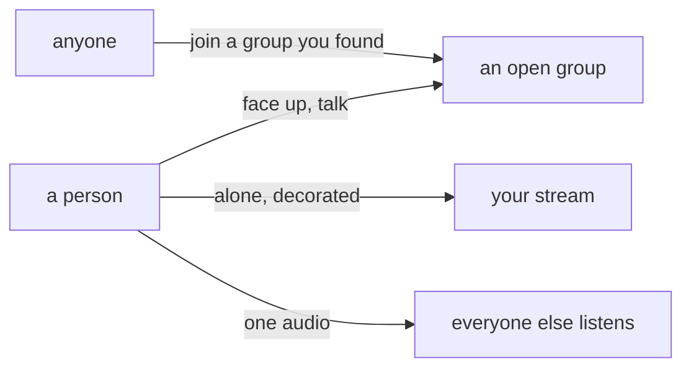

# the idea

ordinary people show their face to their friends, and to whoever else walked into the room. groups are open, so a stranger can join one and talk. a person who wants to stream alone has their own stream and can decorate it. one person can share audio, and everyone else listens.

the idea, not a build. `overview.md` is what the box does today. where they disagree, this file is where it is going and that file is what runs.

## what for

- a few friends on at once, each with a camera, talking. the face is the point. these are regular people, in a room with people they know.
- a group that is open. anyone makes one, anyone joins one they found, and the people in it talk. wandering into a room of strangers is part of it.
- streaming alone, as yourself. the stream is yours to decorate, so a watcher can tell whose it is. the group is a place. the stream is a person.
- one person sharing audio. a song, a game, the sound of their screen. the others hear that and only that.

## a group

the page is the group. whoever in it has a camera up shows as a tile, one of them big. the chat is the group's chat, the same one on a night when every camera is off. a face is a choice. most people in the room are just there.

open, the way groups already are (`groups.md`): a login makes one, a login joins, no invite, no approval, no roles. the list of groups is how you find a room. the people in a group can see who else is in it, because those are the faces and the names in the chat.

a group with nobody live is still the group. the chat stays. so does presence (`status.md`): green while they have the site open, blue while they are live.

home leads with your groups, the ones with someone live first. under that, groups you are not in, so joining a random one is a click. the global wall of every stream on the server is the solo streams, below.

## your stream

`/watch/<name>`, one person, their camera, their chat. this is streaming alone. it does not need a group.

it is theirs to decorate. the pictures, the bio, the colours of the page, what sits around the video. saved on the account, so every watcher gets the same room, and a stranger can tell whose stream it is before they read the name. the theme in the appearance tab is a different thing: that one is this browser's, and it stays the viewer's.

going live in a group does not replace this page. your face can be up in the group and on your own stream from the one upload. friends come for the face. anyone else comes because the page is public and it looks like you.

## audio, one person

the small one. one person shares audio and the room listens: music, a game, their desktop. no second mic in it.

a group is the place where people talk over each other, faces up. shared audio is the other shape, a single source. on a solo stream that source is the stream. in a group it is one member, played to the rest, while the talking stays on the faces that are up.

## what already fits

the box copies packets, and a room of faces fits on the one machine (`architecture.md`'s call: everyone uploads once, the server copies, it does not decode). picture in picture while you are live is how you watch a friend with your own camera still up. accounts stay optional for watching and for a solo stream under a free name. joining a group still wants a login.

the group's page runs, as far as those streams go. `/groups/<name>` shows whoever in the group is live, one of them big, and `general` beside them, including when every camera is off (`groups.md`). each tile is that person's own stream, the one on `/watch/<name>`, played muted. home still leads with every stream. a face that is up only in the group, and not also their own stream, is not this.

one publisher per name is what runs today (`spec.md`), and the group page is several of those streams in one room. shared audio is the same path with a mic or a desktop and no camera, and that part is still this file.

## not this

- a closed room, an invite link, a door you open for the public. groups are open. a private room would be a different product.
- roles, moderators, a server full of channels. one group is one room and one chat. a second room is a second group.
- follows as the way home works (`follows.md`). you find people by joining a group and by opening a stream. a follow can come later. it is not the spine.
- a call where everyone sends audio and everyone receives everyone, as the main thing. faces in a group, and one shared audio. sixteen mics at once is a different product.

## not here

- how decoration is stored, and the list of what a streamer can change. the rule is only that the stream's look belongs to that person and every watcher sees it.
- listeners hearing the same moment of a song. one source is the idea. keeping their clocks together is a build.
- one group streaming into another group.
