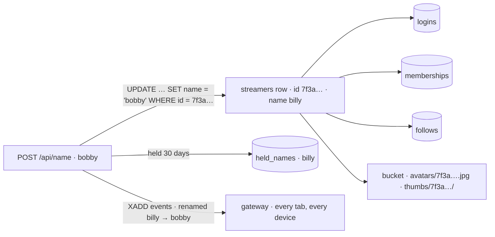

# ids

built. every `streamers` row has a uuid that never changes, and everything that is *about the account* (logins, memberships, groups made, pictures; follows when `follows.md` is built) points at the id instead of the name. the name is a column: a login changes it (`POST /api/name`, the profile tab), once a month, and keeps its logins, its groups and its pictures. the old name is held for it for 30 days, and shared links to the old name land on the new one for as long. the migration ran at boot on an existing database (58 rows, every one got an id, nothing dropped); the rest of this file is the design and what the build settled, marked where it differs.



## the short answer

- **a uuid, from postgres.** `gen_random_uuid()` is built into postgres 13+, v4, random: no counter to leak how many accounts there are, nothing to coordinate, and the api only ever carries it, never makes it. `sqlx`'s `uuid` feature and the `uuid` crate on the api; nothing on the pages.
- **on the `streamers` row, not in a `users` table.** today one row is both the name's profile (bio, picture, status) and the account (`password_hash`), and signup claims a free name's row *in place*: the bio stays, the row becomes yours (`accounts.md`). the id goes on that row, so what signup claims is what the id names, and a free name's row has an id too because the same tables point at rows whether or not anyone owns them (a follow of a free name, a free name's picture). a separate `users` table would split one thing into two, make every read a join, and leave free names with no id for `follows` to point at. for an account the row's id *is* the user id; for a free name it is the row's, and nobody's.
- **the name stays the url, the chat nick, the redis key and the stream's name.** `/watch/billy`, `live:billy`, `seen:billy`, `chat:billy`, the lines in a room: all words people read and type, none of them an id. a uuid is for the database and the bucket; it is never in a url and no page shows one. `GET /api/me` carries it, and nothing on the pages reads it today.
- **what the id buys.** a rename is one `UPDATE` of one column; nothing else moves. that is the whole point: `logins`, `memberships`, `groups.created_by`, `follows` and the bucket keys stop saying the name, so the name is free to change.

## what for

- a name picked at signup is not the name wanted a month later. today it cannot change at all ("it is yours alone, and it does not change", the profile tab).
- `follows.md` wants edges that survive a rename, and pictures that do not have to be copied when a name does.
- a row that can be named by something other than its name is also what account deletion, a merge or an admin's "who is this" would want. none of those are here; the id makes them possible without another migration.

## the rules

- **the id never changes.** not at a rename, not at a password reset, not when a free name is claimed (the row was there; the claim fills in the hash).
- **a rename is the login's, with its password**, like a password change: a stolen cookie must not walk off with the name. the same login limiter counts the guess (`auth.rs:296`, the `old` of `/api/password`).
- **the new name** follows the name rule, is not reserved (`dummy-`), is not yours already (400 `that is your name`), is not another account's and not held by another account (409 `name taken`, the same words for both: a hold is a claim in waiting).
- **once every 30 days**: 403 `you changed your name on <date>. again from <date>`. the first rename is always allowed.
- **not while live**: 409 `stop the stream first`. a stream's url is its name, the `live:` key and video's room are the name, and the watchers' chat room is the name. the stream ends, then the name changes.
- **the old name is held for you for 30 days.** nobody else can sign up as it or rename onto it; you can rename back (which is a rename, and waits its 30 days like any other). after the hold it is a free name like any other.
- **a free name's row under the new name goes.** its bio and picture were anyone's and yours arrive with you; its followers become yours, exactly as signup claiming a free name keeps that name's followers (`follows.md`): they followed the word, and the word is now you.
- **links follow for the hold's length.** `GET /watch/<old>` is a 302 to `/watch/<new>` (the preview bots follow redirects). `POST /api/streams/<old>/watch` answers with the *new* name's grant outright, and the grant now carries `name`: a page that asked for one name and was granted another moves to it (`replace`, so back does not bounce). no 308: the page learns the name from the body, which it needs anyway.
- **what does not follow**: chat lines already said (a line keeps the name it was said under, as it keeps its badges; its face does follow, since a login's line carries `uid` and the picture is looked up when the line is read, `chat.md`), past sessions (`sessions.name` was the url that night; the row gains `user_id`, backfilled for the sessions the account started, so its history is still one list), and the `verified` of a running stream (there is none: not while live). `stream_thumbs` *does* follow: it has no key to cascade, so the rename updates its `name` in the same transaction.
- **`ADMIN_NAMES`** is still names in `.env` (it is how a person writes it), resolved to accounts at boot and compared by id. a renamed admin stays admin until the next restart, when the boot log says the name matches no account, as it does today for a name without one.
- **`api passwd <old>`** refuses a held name like signup does: a reset on it would make a stranger's account on a name that is somebody's for 30 more days.

## database

```sql
-- 1. the id. a volatile default fills every existing row with its own; the unique index is what a foreign key needs
ALTER TABLE streamers ADD COLUMN IF NOT EXISTS id uuid NOT NULL DEFAULT gen_random_uuid();
CREATE UNIQUE INDEX IF NOT EXISTS streamers_id_idx ON streamers (id);
ALTER TABLE streamers ADD COLUMN IF NOT EXISTS renamed_at timestamptz;

-- 2. the pointers: a column, a backfill from the name, an index. the name columns stay one release (below)
ALTER TABLE logins ADD COLUMN IF NOT EXISTS user_id uuid REFERENCES streamers(id) ON DELETE CASCADE;
UPDATE logins l SET user_id = s.id FROM streamers s WHERE s.name = l.name AND l.user_id IS NULL;
CREATE INDEX IF NOT EXISTS logins_user_idx ON logins (user_id);

ALTER TABLE memberships ADD COLUMN IF NOT EXISTS user_id uuid REFERENCES streamers(id) ON DELETE CASCADE;
UPDATE memberships m SET user_id = s.id FROM streamers s WHERE s.name = m.name AND m.user_id IS NULL;
CREATE UNIQUE INDEX IF NOT EXISTS memberships_user_group_idx ON memberships (user_id, group_name);

ALTER TABLE groups ADD COLUMN IF NOT EXISTS created_by_id uuid REFERENCES streamers(id) ON DELETE SET NULL;
UPDATE groups g SET created_by_id = s.id FROM streamers s WHERE s.name = g.created_by AND g.created_by_id IS NULL;

ALTER TABLE sessions ADD COLUMN IF NOT EXISTS user_id uuid;   -- set at go-live when the session is the account's. history, no key
UPDATE sessions se SET user_id = s.id FROM streamers s WHERE s.name = se.name AND se.verified AND se.user_id IS NULL;

-- the old name columns must not veto a rename, and must stay right for the way back: they follow the name.
-- once: a DO block checks pg_constraint first, so a boot that finds them cascading already does nothing
DO $$ BEGIN
  IF EXISTS (SELECT 1 FROM pg_constraint WHERE conname = 'logins_name_fkey' AND confupdtype <> 'c') THEN
    ALTER TABLE logins DROP CONSTRAINT logins_name_fkey;
    ALTER TABLE logins ADD CONSTRAINT logins_name_fkey FOREIGN KEY (name) REFERENCES streamers(name) ON UPDATE CASCADE ON DELETE CASCADE;
  END IF;
  -- the same for memberships_name_fkey, and groups_created_by_fkey (ON DELETE SET NULL)
END $$;

-- 3. the hold
CREATE TABLE IF NOT EXISTS held_names (
  name text PRIMARY KEY,
  user_id uuid NOT NULL REFERENCES streamers(id) ON DELETE CASCADE,
  until timestamptz NOT NULL
);
```

in `SCHEMA` (`main.rs`), run by the api at boot like everything else; the gateway reads what the api made. `name` stays the primary key of `streamers`: a primary key column can be updated, and once nothing points at it by name the update is one row. proven before it shipped, on a throwaway postgres 17 with the old schema and seed rows: the block applies twice without an error, two copies at once serialise on the first `ALTER`, `alice → alicia` cascades into all three name columns, a rename onto another account's name is the primary key saying no, and a foreign key to `streamers(id)` is enforced with the unique index alone (postgres wants a unique index, not a constraint row; `\d streamers` lists no UNIQUE constraint on `id`, and that is fine). the default constraint names were the ones the block names.

**the release after**, once the way back is not wanted: `ALTER TABLE logins DROP COLUMN name`, `memberships DROP COLUMN name` (its primary key moves to `(user_id, group_name)`, the index above), `groups DROP COLUMN created_by`. `streamers.password_hash` stays: it is still what makes a name claimed. until then the three columns are dead weight that the previous image can still read.

## the rename

`POST /api/name` `{ name, password }` → 200 `{ id, name, renamed_at }`. the order:

1. a login (401), a valid new name (400), not reserved (403), not yours (400), the password (`check_password`: the login counter first, then `verify_blocking`; 403 `wrong password`; the same helper `/api/password` uses), the 30 days (403, with both dates).
2. live? video's `GET /live`, else the `live:` key (`is_live`): 409 `stop the stream first`. not inside the transaction, like every other call to video.
3. the pictures saved before ids (bytes still at `avatars/<name>.jpg`, `thumbs/<name>/…`): lifted to the id's keys now (`profile::lift_pictures`: a get and a put, the bucket has no copy), the way `lift_legacy` lifts postgres bytes to the bucket. after this nothing in the bucket says the name.
4. one transaction: `DELETE FROM held_names WHERE until < now()`; the new name is another account's or another's hold → 409; a free row under the new name: its thumbnail rows go, then `DELETE FROM streamers WHERE id = <free>` (its hold rows cascade; its follows will, once `follows.md` adds them, after re-pointing them to the renamer); `UPDATE streamers SET name = $new, renamed_at = now() WHERE id = $me` (the three name columns cascade with it; a unique violation here is a signup or another rename that won the name between the check and now, and is the same 409); `UPDATE stream_thumbs SET name = $new WHERE name = $old`; my own hold on the new name, if I am going back, goes; `INSERT INTO held_names (name, user_id, until) VALUES ($old, $me, now() + 30 days)`.
5. the free row's pictures in the bucket, best effort, after the commit: `avatars/<free id>.jpg` and its thumbs, from the rows read before the delete (`profile::drop_pictures`). a miss leaves orphans nobody can reach.
6. `XADD events type renamed name <old> to <new>` (`presence::publish_renamed`). the log line. the response.

the login that asked stays logged in, and so does every other device: `logins` points at the id. that sentence is the feature.

## everywhere the name was the account

| where | before | now |
|---|---|---|
| `auth::whoami` | `SELECT name FROM logins WHERE token_hash` | `SELECT s.id, s.name FROM logins l JOIN streamers s ON s.id = l.user_id WHERE …`. `Me` is `Me(Option<Account>)`, `Account { id: Uuid, name: String }`, with `me.name()` for the handlers that only compare a name |
| `open_login` | `(token_hash, name, expires_at)` | `+ user_id`. `name` is still written while the column lives |
| signup | fills the hash on the row | the same, `RETURNING id`; refuses a held name with `name taken` |
| `is_claimed`, `may_act_as` | by name | unchanged: a name is claimed when its row has a hash. the one rule does not move |
| `passwd` | by name | by name, `RETURNING id`; refuses a held name |
| chat `identify` | `me` a name | `me.name` for `streamer` and `verified`; `badges_of(db, Some(me.id), bot)`, `None` for an anonymous bot |
| `badges_of` | `memberships.name` | `memberships.user_id`, an `Option<Uuid>` (the empty-string sentinel went: `NULL` matches no row). a chat line still carries the badges as text |
| groups `create`, `join`, `leave`, `remove`, `list` | `created_by`, `memberships.name`, `mine` by name | `created_by_id`, `user_id`, `mine` by id. `made_by` in the json is the *current* name, by join, so a renamed maker reads right everywhere |
| the gateway `identify` | a name | `me.name` names the socket. the socket's name lives in the registry, not in its task: the ping and the close read `name_of(id)`, so a `renamed` fact can change it under a socket |
| `debug::admins_with_accounts`, `is_admin` | names | `Vec<Account>` resolved at boot (`AppState.admins`), compared by id |
| `go_live` | `verified = me == name` | the same, and `sessions.user_id = me.id` when it is |
| `profile.rs` keys | `avatars/<name>.jpg`, `thumbs/<name>/<id>.jpg` | `avatars/<id>.jpg`, `thumbs/<id>/<n>.jpg`. a read that misses the id's key tries the name's and moves it up (`lift_object`), the `lift_legacy` shape; the rename lifts first, above. a put makes the bare row first, so there is an id to key by. the urls (`/api/streamers/<name>/avatar?v=`) do not change |
| `GET /api/me` | `{ name }` | `{ id, name, renamed_at }` |
| `/watch/<name>` document, `POST /api/streams/<name>/watch` | by name | by name, and a held name: the document 302s, the grant answers for the new name and says so (`name`) |

## redis

| key | change |
|---|---|
| `events` | one more fact: `XADD events MAXLEN ~ 1000 * type renamed name billy to bobby`. the gateway re-keys its registry (`own`: the sockets that said `billy` now say `bobby`; `watchers` of `billy` stay, those pages are leaving) and pushes `{"type":"renamed","name":"billy","to":"bobby"}` to billy's own sockets and to `billy`'s watchers. each moved socket leaves `seen:billy` and enters `seen:bobby` at once (the two EVALs, not the 90s lapse): `billy` reads `offline` the moment it is nobody's, `bobby` `online`. then a `me` with the new name |
| `live:`, `seen:`, `chat:` | names, as today. the keys carry no id; a login's line in a `chat:` stream carries its account as `uid` (since faces are looked up at read: `chat.md`), the one id in redis |

## api

| | route | does |
|---|---|---|
| POST | `/api/name` | `{ name, password }` → 200 `{ id, name, renamed_at }`. 401 nobody, 400 `bad name…` / `that is your name`, 403 `reserved name` / `wrong password` / `you changed your name on <date>. again from <date>`, 409 `name taken` / `stop the stream first`, 429 the login counter |
| GET | `/api/me` | `{ id, name, renamed_at }`; every field null for nobody |

changed: `POST /api/signup` 409 for a held name; `POST /api/streams/:name/watch` carries `name`, and for a held name it is the new name's grant; `GET /watch/<held>` 302; `GET /api/groups` `made_by` is the current name; ws `/events` gains the server → client frame `renamed`; `/api/signup` and `/api/login` answer `{ id, name }`.

## pages

- **the profile tab's `username` section** (`ProfileTab.tsx`, `Rename`): for a login, the name with its `✓` as before, then `#profile-new-name` with the rule as its hint, `#profile-rename-password` (the security tab's `PasswordInput`, now in `parts.tsx`, `autocomplete="current-password"`), and `#profile-rename`: `change name`, which turns into `sure? /watch/<old> becomes /watch/<new>` (with `keep <old>` beside it) before it posts. while `renamed_at` is under 30 days old the two fields are disabled and `#profile-rename-status` reads `you can change it again on <date>`. after a 200 `renameMe` has already set `meAtom` to the new name, and the tab calls `identityChanged('login')` (`profile-atoms.ts`), which reloads the profile, reconnects the events socket and makes the live page's name box follow. the description reads "it can change once every 30 days, and the old one is kept for you as long".
- **`meAtom`** stays the name: it is what every page shows and sends. `myIdAtom` and `renamedAtAtom` ride along in `auth-atoms.ts` (`loadMe` fills them; `reloadMe` asks again), and `renameAgainAtom` derives the date.
- **the other tabs and devices**: the `renamed` frame, for a name that is `meAtom`, makes `profile-atoms.ts` `reloadMe()` and then `identityChanged('login')`. the tab that did the rename ignores it: its `meAtom` is already the new name, and the frame names the old one. the shared worker drops the old name's cached `me` and word.
- **the watch page**: a grant whose `name` is not the route's name, or a `renamed` frame for the name on screen, sets `watchRenamedToAtom`; the page navigates there (`replace`), and the route being keyed on the name remounts it under the new one. so a shared `/watch/billy` opens on `bobby` with no "not live", and a page already open when the rename happens moves on its own.
- **chat**: a `renamed` frame in a room is nothing; the room is the stream. the chat panel reconnects on its own when `meAtom` changes, and the next line is under the new name.
- **the user panel, the modal header, the live page's locked name box**: all read `meAtom`, so they follow.

## tests

`test/auth.js`, four steps after `log out from the user panel`, and one more inside the local block (they run against the built stack: all pass):

1. rename: nobody 401; wrong password 403; the own name 400; a reserved name 403; another account's name 409 (a fresh `other<run>` signup).
2. live: go live, rename → 409 `stop the stream first`; stop; a second device logs in; a stranger's browser opens `/watch/<old>`; the rename is 200 with the same `id` and a `renamed_at`; `/api/me` on both devices says the new name with the same id; the stranger's page is on `/watch/<new>` within 10s (the `renamed` frame, no reload).
3. the hold: a signup as the old name is 409; `GET /watch/<old>` is a 302 to `/watch/<new>` (`maxRedirects: 0`); `POST /api/streams/<old>/watch` grants `name: <new>`; a second rename is 403 `again from`; the old name is not `verified`, the new one is.
4. the pages: logging in as the new name shows it in `#me`; the profile tab has `#profile-new-name`, and its status says when the name may change again.
5. locally: `api passwd <new>` still works (the account is the id), and `api passwd <old>` refuses: the name is held.

`test/follows.js`, when it exists: a followed name renames and the follower's `GET /api/following` lists the new name, with the same `followers` count on it.

## how it shipped

the three phases below went out as one deploy, since the build was proven against a copy of the schema first; they are still the order the code is in, and the way back is as described:

1. **the id.** the column, the index, nothing reads it.
2. **the pointers.** the four `user_id` columns and their backfills (`sessions.user_id` for the sessions the account started), the `ON UPDATE CASCADE` constraints behind a `DO` guard, `Account` in `Me`, every read by id, the bucket keys by id with the lift on read, `id` in `/api/me`. the way back is the previous image, which reads the name columns that are still there and still right.
3. **the rename.** the route, `held_names`, the `renamed` fact and the gateway's re-key, the 302 and the grant's `name`, the profile tab, the tests. a way back after renames: the name columns cascaded, so the previous image sees the new names and nothing is lost; only `held_names` and the 302s stop meaning anything until the next deploy. pictures lifted to id keys are not read by the previous image (it looks under the name): a way back after a rename or after a picture was read once under the new api shows no picture until the next deploy. accepted.
4. **the release after**, not yet: the name columns and the old keys dropped.

## not this

- **a `users` table.** the short answer: one row is already the thing signup claims; two tables make every read a join and leave free names with nothing for `follows` to point at.
- **a serial integer.** `/api/me` would say how many accounts there are, and a guessable id invites routes that take one. a uuid is nobody's business and nothing takes one.
- **the id in urls.** `/watch/7f3a…` is not a thing anyone types or reads out on a stream. names are the urls; the hold and the redirects are what make that safe to change.
- **renaming by cascading everything.** `ON UPDATE CASCADE` on every name column, no id. it works for postgres and fails for the bucket (keys copied per rename), redis (keys moved while sockets hold them) and every chat line and session row. the id is what makes the rename one `UPDATE`; the cascades here are only for the dead columns' one release.
- **no hold.** a renamed-away name free at once: the old `/watch/` links go to a stranger, and a name can be squatted the second it is dropped. 30 days is the shortest hold that makes a rename reversible.
- **a rename over the socket, or without the password.** `status.md`'s rule and `/api/password`'s: http writes, the sensitive one proves it is you.

## not here

- display names (capitals, spaces) beside the name. the name is still the one word; this only lets it change.
- account deletion, merging two accounts, an admin renaming someone. the id makes each a small feature later; none is asked for.
- a page of past names, or showing "formerly billy" anywhere.
- a longer hold, a shorter wait, a count of renames. numbers to move when someone asks.

## when it ships, these docs move

- `accounts.md`: the database block (`id`, `user_id`, `held_names`), the api table (`/api/name`, `/api/me`), the pages paragraph ("the name is yours" stays; "does not change" goes), the breach table (a stolen database now also has ids, which are nothing).
- `groups.md`: the database block (`user_id`, `created_by_id`), `made_by` is the current name.
- `status.md`: the hello (the socket is named by `me.name`), the `renamed` fact and frame.
- `follows.md`: already keyed on ids.
- `spec.md`: the api table, the tests table, the repo shape. `overview.md`: the accounts paragraph. `README.md`: this file's line.

## open questions

1. **30 and 30.** one rename a month, the old name held a month. twitch is 60 days and 6 months; this site is smaller and its names are shorter-lived. (recommendation: 30 and 30, move when asked.)
2. **the password on a rename.** the same bar as a password change, or just the cookie, like a bio. (recommendation: the password. a name is the one thing a stolen cookie could take that a logout does not give back.)
3. **free names with a row under the new name.** take the row (above), or refuse with `that name has a bio. pick another`. refusing lets anyone block a rename with one anonymous bio; taking it is what signup already does. (recommendation: take it.)
4. **the id in `/api/me` at all.** nothing on the pages needs it. (recommendation: yes; it is the one place a person can read their own id, and the tests want it.)
