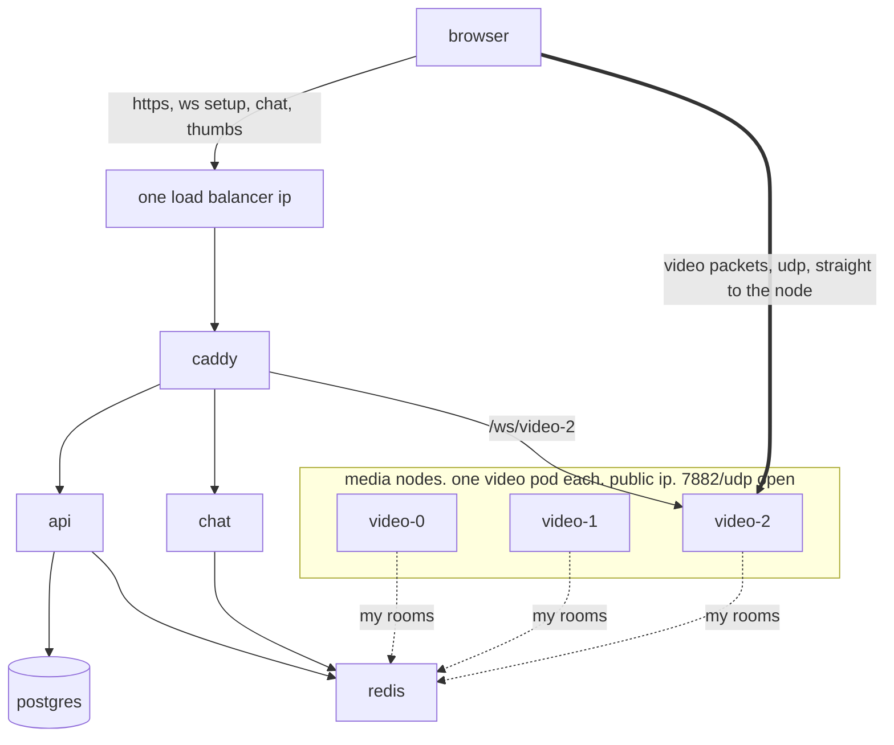
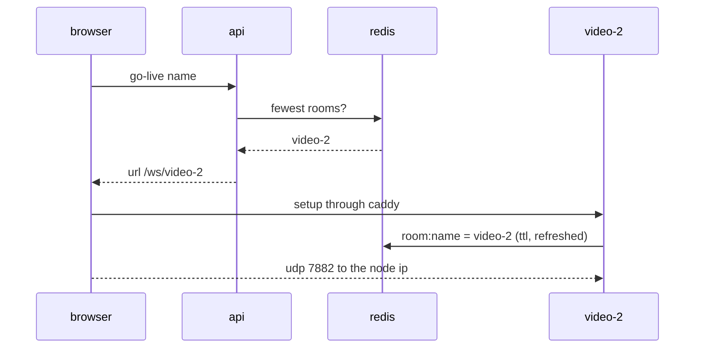
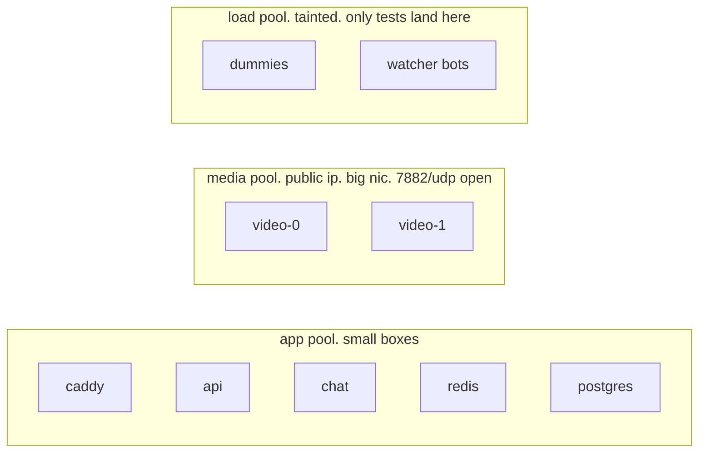
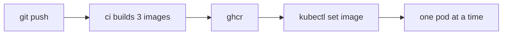
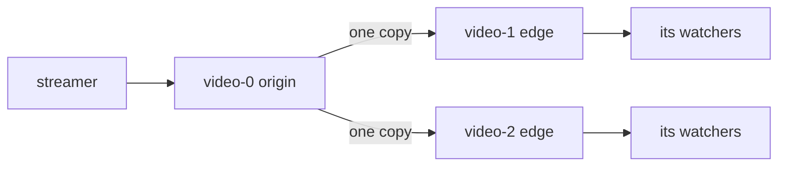

# kubernetes

a plan, not a build. nothing here is in the repo yet.

k8s is a scheduler for many computers. it replaces `deploy.sh` + compose once there is more than one box.

## should you

- one vm: no. compose is faster to run and read. k8s makes nothing faster on one box.
- it pays the day you want a second video box, or a deploy that does not kill streams.
- what it buys: more video boxes, rolling deploys, scale by load, numbers per box, load tests on demand.

## the shape



everything but the video packets goes through one ip and one cert. the packets go straight to the node that holds the room.

## the one hard part: video

webrtc wants a public ip per box, udp straight in, and the watcher on the same box as the streamer.
a load balancer cannot sit in front of that. so:

- **one video pod per media node.** `hostNetwork: true`. the pod owns the node's `7882/udp`. the node's public ip is its `PUBLIC_IP`.
- **rooms are pinned.** a room lives on the pod the streamer landed on. redis says which: `room:<name> = video-2`.
- **the setup socket carries the pod.** go-live and watch return `/ws/video-2`. caddy sends `video-{n}` to `video-{n}.video:7880` (a statefulset gives stable names). if caddy will not fill an upstream from the path, a 20-line router pod does it.
- **thumbnails the same way.** `/thumb/video-2/<name>.jpg`. the jpeg stays in that pod's `/tmp`, like now.
- **only caddy needs the https cert.** media is encrypted on its own (dtls). the self-signed-ip story stays exactly as it is, on the one load balancer ip.



## what each box becomes

| compose | k8s | copies | note |
|---|---|---|---|
| frontend | Deployment + LoadBalancer Service 80/443 | 2 | Caddyfile is a ConfigMap. the pages are baked into the image by ci. `pages` and its volume go away |
| api | Deployment, HPA on cpu | 2+ | stateless already |
| chat | Deployment, HPA on cpu | 2+ | redis streams already make the pods agree. viewer count needs to move to redis |
| video | StatefulSet, hostNetwork, one per media node | = media nodes | no HPA. scale = add a node |
| dummy | Deployment on the load pool | = fake streams | one stream per pod. `kubectl scale deploy dummy --replicas=20` |
| database | managed postgres, or StatefulSet ×1 with a disk | 1 | do not run ha postgres yourself |
| redis | Deployment ×1, no disk | 1 | same as now. who-is-live may vanish on restart, same as now |
| certs | cert-manager self-signed issuer, or the same openssl Job | — | one cert, on caddy |

## node pools



- dummies burn cpu (ffmpeg). never on the same box as video.
- media boxes want network, not cpu. a video pod is a few percent of a core and all of the nic.
- the pools scale on their own. the load pool can be zero when nobody is testing.

## deploys that keep streams up

today `./deploy.sh video` ends every stream.

- api, chat, caddy: rolling update. zero downtime. nothing to do.
- video: rolling, one pod at a time, with a **drain**. on sigterm: refuse new rooms, wait for the ones it has to end, up to `terminationGracePeriodSeconds` (say 10 min), then exit. new streamers land on the other pods.
- rooms that outlive the window still drop. the fix is reconnect in the pages: the streamer re-goes-live and lands on a new pod, the watchers follow.
- images come from ci (github actions → ghcr), tagged by commit. the server never compiles rust again. deploy is a tag change. rollback is `kubectl rollout undo`.



## scale by load

- chat and api: HPA on cpu. done.
- video: capacity = media nodes. the cluster autoscaler adds a node when `rooms per pod` or `egress mbit/s` crosses a line (keda or the prometheus adapter). a new node is a new public ip; the pool's firewall rule must allow 7882/udp.
- numbers per video pod: rooms, watchers, out mbit/s, pli per minute, nack per minute, ffmpeg taps, cpu. you cannot tune what you cannot see. `kube-prometheus-stack` gives grafana for free.

## load test on demand

```
kubectl scale deploy dummy --replicas=50
kubectl create job bots --from=cronjob/watch-bots   # 20 watchers per dummy
```

then read watchers-per-node off grafana. size the media pool with a number instead of a guess.
needs a watcher bot: a headless webrtc client that subscribes and counts frames. small, in rust, same crate.

## big rooms, later

one room = one pod = one nic. a thousand watchers on one streamer is still one box's upload.
the fix is the fanout from `architecture.md`: edge pods subscribe to the origin pod once, over the pod network, and fan out to their own watchers. `video` gets a `relay` role. k8s makes placing relays easy. it does not write them.



## code changes first

small, and all of them help on compose too.

1. video: find `PUBLIC_IP` on its own when unset. same trick as `deploy.sh`.
2. video: write `room:<name> = <pod>` to redis when a room opens, refresh it, delete it on close. api reads that instead of asking one `VIDEO_URL`.
3. api: go-live picks the pod with the fewest rooms, returns `/ws/video-N`. watch and the thumbnail url carry the same pod.
4. video: drain on sigterm instead of end-everything.
5. video and chat: `/metrics` in prometheus text.
6. chat: viewer count in redis, not per pod.
7. dummy: names offset by pod name, so 20 pods do not fight over `dummy-mango`. follow the url the api returns instead of `VIDEO_WS_URL`.
8. pages: on `ended` with reason `draining`, go live again / watch again.
9. ci: build and push the three images. `deploy.sh --pull` can pull them instead of building, today, before any k8s.

## layout

```
k8s/
  base/             every object. no ips, no counts
  overlays/vm/      k3s on the one vm. one of everything. caddy on hostPort 80/443
  overlays/cloud/   doks. load balancer. three pools. managed postgres
```

`kubectl apply -k k8s/overlays/vm`. `deploy.sh` shrinks to twenty lines.

## steps

0. the code changes above, still on compose. `./test.sh --all` keeps passing.
1. k3s on the vm you have. same one box, everything as pods. learn kubectl. nothing new to pay for. (k3s is one binary. turn its traefik off; caddy stays the edge.)
2. a second media node. room routing gets its first real test. this is where k8s starts paying.
3. doks, or more vms as k3s agents. pools, autoscaler, grafana.
4. the relay role for big rooms.

## cost, rough, digitalocean

- today: one vm.
- step 1: the same vm.
- step 3: control plane free. three small nodes from ~$36/mo. load balancer $12/mo. managed postgres from $15/mo. ghcr free.

## what it will not do

- make one stream cheaper. same packets, same copies.
- fix one giant room. see big rooms.
- nat traversal. there is still no turn. strict wifi still cannot watch. unrelated to k8s.
- the https warning. a $10 domain + cert-manager + let's encrypt removes it, on compose or on k8s.

## without k8s

the first scale step does not need any of this: put video on its own vm. `PUBLIC_IP` of that box, `VIDEO_URL` in the api, `/ws` in the Caddyfile. one env file. it buys one more box. k8s buys the rest.
