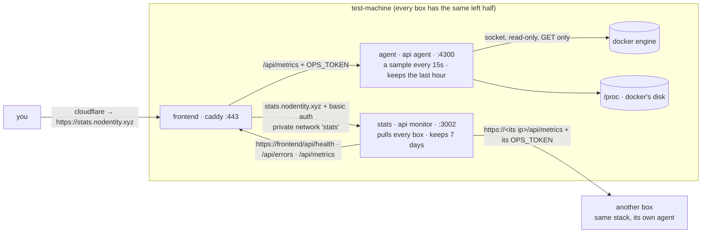

# metrics

cpu, memory, disk and network for every container and every box, in our own code, on a page at https://stats.nodentity.xyz behind a password. built: the agent, the monitor's history, the page, the stats site, the deploy target. not built yet: alerts on the numbers, `/admin`'s "this box now" panel, video's own per-stream numbers (end of this page).

## the shape



three pieces, all the api binary, all the api image, nothing new to build or pull:

- **`agent`** (`api agent`, `api/src/agent.rs`) on every box, in the main `docker-compose.yml`, no profile. reads its own box and nothing else.
- **`stats`** (`api monitor`, `api/src/monitor.rs`) on test-machine only, under the compose profile `stats`. the same monitor as `monitor/` (`docs/debugging.md`), started beside the stack and reached through caddy instead of `ssh -L`.
- **the page** (`api/src/monitor.html`, built into the binary): plain html and js, canvas for the lines, no library, no build step.

## the agent

every 15 s (`SAMPLE_EVERY_SECS`) one sample, two samples make the rates, the last 240 (`KEEP_SAMPLES`, an hour) stay in memory.

per box, from `/proc` (the host's, bind-mounted read-only at `/host/proc`):

| number | from |
|---|---|
| cpu %, steal %, iowait % of all cores | `/proc/stat`, the change between two samples. steal is the time an e2 shared-core vm loses to its neighbours |
| load 1/5/15, core count | `/proc/loadavg`, `/proc/stat` |
| memory used and total, swap used and total | `/proc/meminfo`: used is total minus `MemAvailable` |
| disk used, free and total | `statvfs` on docker's own filesystem (the named volume `agent-disk` mounted at `/disk`; on the gcp box that is `/`). shown as docker's root dir |
| network in and out, bits per second | `/proc/1/net/dev`, the host's namespace, on the interface of the default route (`/proc/1/net/route`), or `NET_IFACE` |
| pressure cpu / memory / io | `/proc/pressure/*`, the `some` line: % of the last 15 s something waited for that resource. the best single sign of a box that is too small |
| uptime, hostname | `/proc/uptime`, docker's `/info` |

per container, from the docker engine (`/var/run/docker.sock`, mounted read-only):

| number | from |
|---|---|
| name, compose service and project, image, state, health | `GET /containers/json?all=1` |
| restarts, up since | `GET /containers/<id>/json`: `RestartCount`, `State.StartedAt` |
| cpu % of one core, memory in use (minus page cache, like `docker stats`) and the limit if any, network in/out, disk read/write, pids | `GET /containers/<id>/stats?stream=false&one-shot=true`, running containers only |

the agent's docker client is a few lines of http over the unix socket that can only send `GET` (`docker_get` in `agent.rs` writes the method as a constant): there is no code path that creates, starts, stops or execs anything.

`GET /api/metrics` (caddy routes it on the main site to `agent:4300`), with `Authorization: Bearer <OPS_TOKEN>`:

- no `OPS_TOKEN` on the box (16 characters at least): 404, the route is off. a wrong token: 401. both `Cache-Control: private, no-store`.
- `?since=2026-11-24T08:00:00Z`: every sample after that. without it: the newest one.

```json
{ "agent": { "build": "a0f1c24", "up_secs": 113, "every_secs": 15, "keep": 240 },
  "samples": [ {
    "at": "2026-11-24T08:18:37Z",
    "host": { "hostname": "test-machine", "cpus": 2, "up_secs": 1476, "cpu_pct": 14.2, "steal_pct": 0.8, "iowait_pct": 0.1,
              "load1": 1.25, "load5": 1.16, "load15": 0.72, "mem_used": 3371506483, "mem_total": 4100000000,
              "swap_used": 0, "swap_total": 2147479552,
              "disk": [{ "mount": "/var/lib/docker", "used": 14403047424, "total": 21966183424, "avail": 7546358784 }],
              "net": { "iface": "ens4", "rx_bps": 5344, "tx_bps": 2600000 },
              "pressure": { "cpu": 0.09, "memory": 0.0, "io": 0.0 } },
    "containers": [ { "name": "video", "service": "video", "project": "stream", "image": "ghcr.io/you/stream-video:834450b",
                      "state": "running", "health": "healthy", "up_since": "…", "restarts": 0,
                      "cpu_pct": 22.5, "mem_bytes": 61000000, "mem_limit": null, "rx_bps": 310000, "tx_bps": 2500000,
                      "read_bps": 0, "write_bps": 40000, "pids": 19 } ],
    "problems": [] } ] }
```

`problems` names what could not be read in that sample (no socket, no pressure files on an old kernel) instead of failing the whole sample.

the container: `user: "0:0"` (the socket and `/proc` are root's), `read_only`, every capability dropped, `no-new-privileges`, 64 pids, no port published. `GET /health` on `:4300` is for its healthcheck. `/proc` is bind-mounted instead of `pid: host`, so the agent sees the host's numbers but cannot signal a host process.

## the monitor's history

the monitor pulls `/api/metrics` from every box in its `TARGETS` every 15 s (`METRICS_EVERY_SECS`) with that box's token, the same token it already uses for `/api/errors`, and folds each sample into three rings per box:

| range | one point per | points |
|---|---|---|
| 1h | 15 s | 240 |
| 24h | 2 min | 720 |
| 7d | 15 min | 672 |

12 host numbers and 7 per container, averaged into each point. that is a few hundred kilobytes a box, kept in `/data/metrics.json` beside `monitor.json`, written every 5 minutes and when the monitor stops. after a restart it asks each agent for everything since its last point, so the last hour comes back whole even after a crash; the 24h and 7d rings lose at most the 5 minutes since the last write.

- `GET /api/monitor` (what the page polls) carries each box's newest sample as `metrics`, or `metrics.status` saying why there is none: `no OPS_TOKEN for this box`, `401: ...` (the token is wrong), `404: that box has no OPS_TOKEN for its agent, or its Caddyfile predates /api/metrics`, `no answer in 5s`.
- `GET /api/monitor/metrics?target=<name>&range=1h|24h|7d`: one range of one box as columns, `{ "t": [...], "host": { "cpu_pct": [...], ... }, "containers": { "api": { "cpu_pct": [...], ... } }, "latest": {...} }`.

## the page

- one tab per box, with its up/down dot and cpu, memory and disk right now. with more than one box an "all boxes" tab first, the status cards side by side. with one box it opens that box. the box and the range are in the url (`#box=test-machine&range=24h`), so a link opens the same view.
- a box: the host graphs (cpu with steal and iowait, load, memory, swap, disk, network in and out, pressure), hover for the value at a time; then a table of containers (state, up since, restarts, cpu, memory, network, disk io, pids, each with a sparkline), a click opens that container's graphs; then the status card the monitor always had (up/down, the 24-hour bar, the health grid, events, error reports).
- 1h, 24h, 7d. the status polls every 5 s, the graphs every 15 s, 60 s and 5 min.
- every string through `textContent`: container names, images and error reports are not trusted.

## stats.nodentity.xyz

dns: a proxied cloudflare cname to `nodentity.xyz`, ssl mode full. the request reaches test-machine's caddy like every other, and caddy's `https://stats.nodentity.xyz` block (`frontend/Caddyfile`) takes it:

- **always behind a password.** `basic_auth` with the user and bcrypt hash from `.env` (`STATS_BASIC_AUTH_USER`, `STATS_BASIC_AUTH_HASH`), passed to caddy by compose. never in the repo.
- **fails closed.** either one empty or missing: every request is a 503 "stats is off", nothing is proxied, and caddy and the main site still start. compose hands caddy `statsoff` for a blank value (caddy's `{$VAR:default}` only covers an unset variable, and an empty user or hash would stop caddy parsing the whole file), and the block's `@off` matcher treats empty and `statsoff` alike.
- **`Cache-Control: private, no-store` on every answer**, the 401s and 503s included; the monitor's own header is dropped so there is one. cloudflare's cache rules respect the origin's header (`docs/cloudflare-cache-rules.md`), so nothing behind the password is kept at the edge. also `X-Robots-Tag: noindex`, `X-Frame-Options: DENY`, `nosniff`, `no-referrer`.
- **the cert** is the one every other route uses, `/certs/cert.pem` from the `certs` container: self-signed, `CN=stream <PUBLIC_IP>`. the `*.nodentity.xyz` let's encrypt cert a browser sees is cloudflare's edge cert, not the origin's; there is no acme on the box (`auto_https off`), and none is needed: "full" accepts a self-signed origin. to make it strict later, put a cloudflare origin ca cert for `nodentity.xyz, *.nodentity.xyz` in the certs volume and switch the zone to full (strict); that covers the stats host with no change here.

### who can reach what

| | how | without the password or token |
|---|---|---|
| the page and `/api/monitor*` | `https://stats.nodentity.xyz` only. the `stats` container publishes no port and sits on its own compose network, `stats`, with caddy and nothing else: not the api, not the database, not a host port | 401 (or 503 while off) |
| the agent's numbers | `https://<any host>/api/metrics` on the main site. the agent publishes no port | 404 with no `OPS_TOKEN` on the box, 401 with a wrong one |
| the agent and the monitor's `/health` | inside docker only | — |

on another box the `https://stats.nodentity.xyz` block exists too but dns does not point there; with no `STATS_BASIC_AUTH_*` in its `.env` it answers 503 anyway.

a wrong password costs caddy one bcrypt check (cost 14, most of a second of cpu); a right one is cached. if anyone hammers the login, a cloudflare rate-limiting rule on `http.host eq "stats.nodentity.xyz"` (say 30 requests per 10 s per ip) stops it at the edge. the page itself makes about one request every 5 s.

### set the password

on test-machine, in the repo:

```
docker compose exec frontend caddy hash-password
```

it asks for the password twice and prints a bcrypt hash, `$2a$14$...`. in `.env`, the hash **in single quotes** (compose would read every `$` in it as a variable otherwise; `deploy.sh` refuses a hash without them, so it cannot be half-read):

```
STATS_BASIC_AUTH_USER=billy
STATS_BASIC_AUTH_HASH='$2a$14$...'
```

then:

```
./scripts/deploy.sh stats
```

caddy is recreated with the new values (a second or two where the main site does not answer either; open websockets reconnect, live video keeps flowing), the agent too, and the `stats` container is started. a new password is the same three steps. to turn the site off: empty both values, `./scripts/deploy.sh stats` (it answers 503), and `docker compose --profile stats stop stats`.

### add a vm

a config change on two boxes, no code:

1. on the new box: the stack as usual (`git clone`, `./scripts/deploy.sh`), with an `OPS_TOKEN` in its `.env` (`openssl rand -hex 32`, 16 characters at least). its `agent` comes up with everything else and answers at `https://<its ip>/api/metrics` with that token. leave its `STATS_BASIC_AUTH_*` empty.
2. on test-machine, in `.env`, list every box, this one included, and the new box's token:

   ```
   STATS_TARGETS=test-machine=https://frontend,vm2=https://10.128.0.7
   STATS_TOKENS=vm2=<vm2's OPS_TOKEN>
   ```

   `https://frontend` is this box's own caddy over the docker network. the other box's internal ip is better than its public one when both are in the same vpc: the monitor does not check the self-signed cert (an ip has no name to check), so the private network is what keeps the token off the internet. a box without its own entry in `STATS_TOKENS` is asked with test-machine's `OPS_TOKEN`.
3. `./scripts/deploy.sh stats`. a tab for `vm2` shows up, and the "all boxes" tab with it.

removing a box is the same edit the other way; its history is forgotten.

the stats site lives on test-machine, so it cannot tell you test-machine is dead: the page simply does not load, and the webhook (`STATS_ALERT_WEBHOOK`) cannot fire. for that, `monitor/` on a box of its own still watches every box from outside (`docs/debugging.md`, "the monitor box"); its page shows the same graphs.

### env

in the root `.env` (`.env.example` has them all, empty):

| variable | what it is |
|---|---|
| `STATS_BASIC_AUTH_USER` | the stats site's user: letters, digits, `. _ @ -`. empty: the site is off |
| `STATS_BASIC_AUTH_HASH` | the bcrypt hash of its password, from `caddy hash-password`, in single quotes. empty: off |
| `STATS_TARGETS` | the boxes to watch, `name=url` comma separated. empty: this box alone, `<ENV_NAME>=https://frontend` |
| `STATS_TOKENS` | `name=token` for boxes whose `OPS_TOKEN` is not this box's |
| `STATS_ALERT_WEBHOOK` | where the monitor posts down and up (discord or slack style). empty: the page and the log only |
| `OPS_TOKEN` | already there for `/api/errors`; now also the key to this box's `/api/metrics`. empty: the agent's numbers are off, and the page says so |

compose sets the rest on the services: `SAMPLE_EVERY_SECS` 15 and `KEEP_SAMPLES` 240 on the agent, `METRICS_EVERY_SECS` 15 on the monitor (and in `monitor/.env.example` for the standalone one).

## deploy

`./scripts/deploy.sh` knows both services: a full deploy and `--pull` bring up `agent` with the stack, and `stats` when both `STATS_BASIC_AUTH_*` are set, and swap both with the api image (`./scripts/deploy.sh api`). `./scripts/deploy.sh stats` checks the two values, recreates caddy and the agent, and starts or updates `stats`. the summary at the end prints a `Stats:` line, on with the user name or off and why.

## cost

the agent: a few megabytes of memory, one docker round per container every 15 s, milliseconds of cpu. the monitor: a few hundred kilobytes of history a box, on disk and in memory. the page: static, in the binary.

## not yet

- **alerts on the numbers**, through the monitor's webhook and its "n in a row" rule: disk under 15% or 1 GB, memory over 90% for 5 min, cpu over 90% for 10 min, swap growing, more than 3 restarts in an hour, network out over a line you set (the bill: on gcp at $0.12/GiB, 10 mbit/s sustained is about $390 a month).
- **`/admin` "this box now"** from the box's own agent, for a box with no monitor.
- **video's own numbers**: rooms, watchers, bytes out per room, pli and nack, ffmpegs. that is mbit/s per stream, what a viewer costs (`kubernetes.md`, item 5).
- **without the socket**: the cgroup files (`/sys/fs/cgroup/.../docker-<id>.scope/`) give the same numbers with no docker api, for more code and more mounts. the socket is root on the host whatever the `:ro` says (it is a file mode, not an api filter); the agent only ever sends `GET`, but a bug in it is a root bug. this is the trade if that ever stops being acceptable.
- **prometheus, cadvisor, node-exporter, grafana**: the usual answer when there are many boxes or someone knows grafana. four pieces of other people's code and 400–500 MB on the box. the agent's json would be easy to also serve in prometheus text format then.
