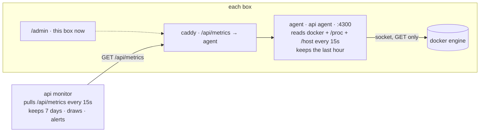

# metrics

a plan, not a build. cpu, memory, disk and network for every container and every box, in our own code, in steps. nothing here is in the repo yet.

## what is there today

- **`api monitor`** (`docs/debugging.md`) — is each box up, its build, its uptimes, the pages' error reports, down/up alerts. it knows nothing about resources: a box at 100% cpu with 200 MB of disk left looks "up".
- **`/api/health`** — ok, postgres, redis, video, live, uptimes. same blind spot.
- **the cloud console** — gcp's Observability tab (cpu and network out of the box; memory and disk only with their agent installed), linode's graphs. per vm, not per container, no idea which container is eating what, and a different page per provider.
- **`docker stats` on the box** — the truth, right now, gone when you close the terminal.

what happened twice already and would have been one glance: the linode box pegged at 100% (21 dummies, ~11% of a core each), the gcp disk at 1.6 GB free (the build cache). both were invisible until someone looked.

## what to measure

per container (`api chat video dummy database redis frontend`), every 15 s:

- cpu, percent of one core; memory in use and the limit if any; network in and out, bytes per second; disk read and write, bytes per second; pids; restarts since start; up since.

per box:

- cpu percent and **steal** (an e2 shared-core vm loses time to its neighbours; steal is the number that says so), load, memory used and total, swap used, disk used and free for `/` (docker lives there), network in and out on the public interface, which is the egress bill, and pressure (`/proc/pressure/cpu|memory|io`: "something waited for this resource N% of the time", the best single sign of a box that is too small).

later, from `video` itself: rooms, watchers per room, bytes out per room, pli and nack per minute, thumbnail ffmpegs. that is "mbit/s per stream", which is what viewers cost. `kubernetes.md` lists it as item 5.

## where the numbers come from

two ways to read a container's numbers from inside a container. pick one in phase 0.

**the docker engine, over its socket.** `GET /containers/json`, then `GET /containers/<id>/stats?stream=false` per container: cpu, memory, network and block io in one answer, container names and compose labels included, same numbers `docker stats` prints, any cgroup version. one request per container per sample. the price: the socket is root on the host. mounting it read-only (`/var/run/docker.sock:ro`) changes nothing, the api is the same; whoever can talk to it can start a privileged container. our agent only ever `GET`s, and it is our code, but a bug in it is a root bug. simple, honest about the trade.

**the cgroup files, no socket.** `/sys/fs/cgroup/system.slice/docker-<id>.scope/` has `cpu.stat`, `memory.current`, `memory.max`, `io.stat`, `pids.current` on cgroup v2 (the gcp box is v2; so is anything from the last few years). names come from `/var/lib/docker/containers/<id>/config.v2.json` (root-only), network from `/proc/<pid>/net/dev` in the container's network namespace, which needs the host pid namespace and a pid from `cgroup.procs`. no socket, but root anyway, three mounts, and a layout that moves with the cgroup driver. more code, more ways to be wrong.

for the box itself, both ways read the same files: `/proc/stat` (cpu, steal), `/proc/meminfo`, `/proc/loadavg`, `/proc/pressure/*`, `/proc/net/dev`, and `statvfs` on `/` through a `/:/host:ro` bind mount.

recommendation: the socket for containers, the files for the host. phase 5 is the socket-free agent if the trade ever stops being acceptable.

## the shape



- **`api agent`** — a fourth subcommand of the api binary, like `chat` and `monitor`: same image, no new build, a compose service `agent` on every box. every 15 s it takes one sample of everything above, turns two samples into rates, and keeps the last hour in memory (240 points × ~10 containers × 8 numbers: a few hundred kilobytes). `GET /metrics` answers the newest sample and `GET /metrics?since=` the buffer. caddy routes `/api/metrics` to it. read gated like `/api/errors`: an admin login or the ops token. the numbers are not secrets, but "how many watchers at 3 am" is nobody's business.
- **the monitor** pulls `/api/metrics` from every box on its existing schedule with the token it already has, and keeps history in `monitor.json` beside what it has: 15 s points for an hour, 1 min for a day, 10 min for a week, folded on insert. about 2 MB a box.
- **the page** gets, per box, a host line (cpu · steal · mem · disk free · net out · pressure) and a container table (cpu · mem · net ↓↑ · disk r/w · pids · restarts), each cell with a one-hour sparkline, a click opening the day and the week. same plain html and js as the rest of the monitor page, canvas for the lines, no library.
- **`/admin`** on each box shows "this box now" from its own agent: the one-box lab, no monitor box, still sees itself.
- **alerts** ride the monitor's existing webhook and its "N in a row" rule: disk under 15% or 1 GB, memory over 90% for 5 min, cpu over 90% for 10 min, swap in use and growing, more than 3 restarts of one container in an hour, network out over a line you set (the bill). one message on crossing, one on coming back, like down and up.

the json one sample is:

```json
{ "at": "2026-10-24T01:00:00Z",
  "host": { "cpu_pct": 38.2, "steal_pct": 4.1, "load1": 0.9, "mem_used": 812000000, "mem_total": 4100000000,
            "swap_used": 0, "disk": [{ "mount": "/", "used": 4900000000, "total": 10400000000 }],
            "net": { "iface": "ens4", "rx_bps": 120000, "tx_bps": 2600000 },
            "pressure": { "cpu": 2.1, "memory": 0.0, "io": 0.3 } },
  "containers": [
    { "name": "video", "image": "ghcr.io/you/stream-video:834450b", "up_since": "…", "restarts": 0,
      "cpu_pct": 22.5, "mem_bytes": 61000000, "mem_limit": null, "rx_bps": 310000, "tx_bps": 2500000,
      "read_bps": 0, "write_bps": 40000, "pids": 19 } ] }
```

## phases

0. **decide** — the questions at the end. no code.
1. **the agent** — `api/src/agent.rs`, the `agent` service in `docker-compose.yml` (socket, `/host`, `/proc` read-only; `pid: host` only if the cgroup way is chosen), the caddy route, the gate. `test/metrics.js`: the shape is right, host numbers are sane (`mem_used < mem_total`, disk adds up), and with one dummy publishing and one watcher on it, `video`'s `tx_bps` is above zero and climbs with a second watcher. about 300 lines of rust.
2. **the monitor keeps and shows it** — the pull, the folding ring buffers, the host line and the table with sparklines. `test/monitor.js` grows a step: the local box's metrics show up on the page within two intervals. about 200 lines of rust and 150 of js.
3. **`/admin` on each box** — the "this box now" panel from the local agent. small.
4. **alerts** — thresholds in `monitor/.env` with the defaults above, the state machine reused, a `metrics` event kind in the event list.
5. **video's own numbers** — `GET /metrics` on `video` (rooms, watchers, bytes out per room, pli/nack, ffmpegs), picked up by the agent, a per-stream mbit/s line on the page. this is the number that explains the egress bill.
6. **maybe** — the socket-free agent, if the socket bothers you; or alerting on pressure rather than percentages once there is a week of data to see what normal looks like.

each phase is a deploy on its own and useful alone. 1 without 2 is already `docker stats` with history and a url.

## cost

the agent: 5–10 MB of memory, one docker api round per container every 15 s, milliseconds of cpu. the monitor's store grows by about 2 MB a box and stops. the page is static. nothing is paid for.

## not this

- **prometheus + cadvisor + node-exporter + grafana** — the usual answer, and a good one when there are many boxes or someone already knows grafana. it is four pieces of other people's code, 400–500 MB of memory on the box, and dashboards to build. it does more than this plan, and it is what to reach for if this plan ever is not enough; the agent's json is easy to also expose in prometheus text format then.
- **the provider's agent** (gcp ops agent, linode longview) — free, host-level, no per container, one page per provider, and gone when the provider changes. fine to install today for memory and disk graphs in the console while this is built: `curl -sSO https://dl.google.com/cloudagents/add-google-cloud-ops-agent-repo.sh && sudo bash add-google-cloud-ops-agent-repo.sh --also-install` on the gcp box.
- **logs** — "what did it say" is a different system (loki and friends). the `--prune-deploy` disk story was logs with no cap on another project; `docker-compose.yml` caps ours. not in this plan.

## open questions

1. **the socket, or the files?** the socket is 300 lines and the plain truth about what it grants; the files are more code and no socket. (recommendation: socket now, files as phase 6 if wanted.)
2. **how long to keep?** an hour on the box, a week on the monitor, as above? longer costs disk on the monitor box only.
3. **who may read `/api/metrics`?** the admin login and ops token like `/api/errors` (recommendation), or public like `/api/health`.
4. **the alert lines.** the defaults above, and the net-out line in mbit/s that matches the budget: on gcp at $0.12/GiB, 10 mbit/s sustained is about $390 a month; on linode's 4 TB plan, 12 mbit/s uses the whole allowance.
5. **the one-box case.** is `/admin` showing the local agent (phase 3) wanted, or is the monitor box always there?
