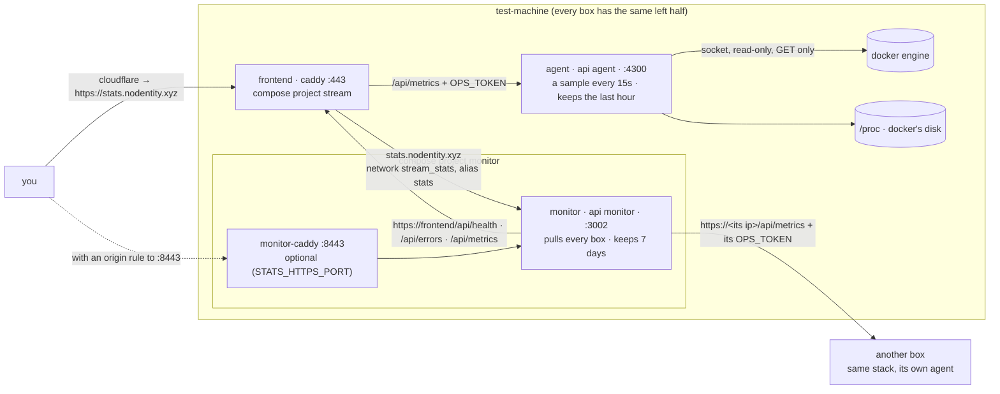

# metrics

cpu, memory, disk and network for every container and every box, and the latency and error count of every api route, sql statement, redis command and s3, video and voice call, in our own code, on a page at https://stats.nodentity.xyz, behind a password or, with an explicit `STATS_PUBLIC=true`, open to anyone. built: the agent, the endpoint timings, the monitor's history, the page, the stats site, the deploy target. not built yet: alerts on the numbers, `/admin`'s "this box now" panel, video's per-room numbers (end of this page).

## the shape



three pieces, all the api binary, all the api image, nothing new to build or pull:

- **`agent`** (`api agent`, `api/src/agent.rs`) on every box, in the main `docker-compose.yml`, no profile. reads its own box and nothing else.
- **`monitor`** (`api monitor`, `api/src/monitor.rs`) on test-machine only, in a compose project of its own, `monitor` (`monitor/docker-compose.yml`, plus `monitor/beside-app.yml` on a box that also runs the app). app deploys never touch it (below). the same compose file runs it on a box of its own.
- **the page** (`api/src/monitor.html`, built into the binary): plain html and js, canvas for the lines, no library, no build step.

## the agent

every 15 s (`SAMPLE_EVERY_SECS`) one sample, two samples make the rates, the last 240 (`KEEP_SAMPLES`, an hour) stay in memory.

per box, from `/proc` (the host's, bind-mounted read-only at `/host/proc`):

| number | from |
|---|---|
| cpu %, steal %, iowait % of all cores | `/proc/stat`, the change between two samples. steal is the time an e2 shared-core vm loses to its neighbours |
| load 1/5/15, core count | `/proc/loadavg`, `/proc/stat` |
| memory used and total, swap used and total | `/proc/meminfo`: used is total minus `MemAvailable` |
| disk used, free and total | `statvfs` on docker's own filesystem (the named volume `agent-disk` mounted at `/disk`; on the gcp box that is `/`). shown as docker's root dir |
| network in and out, bits per second | `/proc/1/net/dev`, the host's namespace, on the interface of the default route (`/proc/1/net/route`), or `NET_IFACE` |
| pressure cpu / memory / io | `/proc/pressure/*`, the `some` line: % of the last 15 s something waited for that resource. the best single sign of a box that is too small |
| uptime, hostname | `/proc/uptime`, docker's `/info` |

per container, from the docker engine (`/var/run/docker.sock`, mounted read-only):

| number | from |
|---|---|
| name, compose service and project, image, state, health | `GET /containers/json?all=1` |
| restarts, up since | `GET /containers/<id>/json`: `RestartCount`, `State.StartedAt` |
| cpu % of one core, memory in use (minus page cache, like `docker stats`) and the limit if any, network in/out, disk read/write, pids | `GET /containers/<id>/stats?stream=false&one-shot=true`, running containers only |

the agent's docker client is a few lines of http over the unix socket that can only send `GET` (`docker_get` in `agent.rs` writes the method as a constant): there is no code path that creates, starts, stops or execs anything.

`GET /api/metrics` (caddy routes it on the main site to `agent:4300`), with `Authorization: Bearer <OPS_TOKEN>`:

- no `OPS_TOKEN` on the box (16 characters at least): 404, the route is off. a wrong token: 401. both `Cache-Control: private, no-store`.
- `?since=2026-11-24T08:00:00Z`: every sample after that. without it: the newest one.

```json
{ "agent": { "build": "a0f1c24", "up_secs": 113, "every_secs": 15, "keep": 240 },
  "samples": [ {
    "at": "2026-11-24T08:18:37Z",
    "host": { "hostname": "test-machine", "cpus": 2, "up_secs": 1476, "cpu_pct": 14.2, "steal_pct": 0.8, "iowait_pct": 0.1,
              "load1": 1.25, "load5": 1.16, "load15": 0.72, "mem_used": 3371506483, "mem_total": 4100000000,
              "swap_used": 0, "swap_total": 2147479552,
              "disk": [{ "mount": "/var/lib/docker", "used": 14403047424, "total": 21966183424, "avail": 7546358784 }],
              "net": { "iface": "ens4", "rx_bps": 5344, "tx_bps": 2600000 },
              "pressure": { "cpu": 0.09, "memory": 0.0, "io": 0.0 } },
    "containers": [ { "name": "video", "service": "video", "project": "stream", "image": "ghcr.io/you/stream-video:834450b",
                      "state": "running", "health": "healthy", "up_since": "…", "restarts": 0,
                      "cpu_pct": 22.5, "mem_bytes": 61000000, "mem_limit": null, "rx_bps": 310000, "tx_bps": 2500000,
                      "read_bps": 0, "write_bps": 40000, "pids": 19,
                      "networks": ["stream_default"], "ports": [{ "port": 7880, "proto": "tcp", "published": 7880, "loopback": false }],
                      "depends_on": ["api"] } ],
    "problems": [] } ] }
```

`networks`, `ports` and `depends_on` come from the same `GET /containers/json` the agent already sends, no new request: the names of the docker networks the container is on (never its addresses), each exposed port with the host port it is published on and whether only on loopback (never the host ip), and the services in compose's `com.docker.compose.depends_on` label. a stopped container also carries `exit_code`, from the inspect it already does. each is left out when empty.

`problems` names what could not be read in that sample (no socket, no pressure files on an old kernel) instead of failing the whole sample.

the container: `user: "0:0"` (the socket and `/proc` are root's), `read_only`, every capability dropped, `no-new-privileges`, 64 pids, no port published. `GET /health` on `:4300` is for its healthcheck. `/proc` is bind-mounted instead of `pid: host`, so the agent sees the host's numbers but cannot signal a host process.

## the monitor's history

the monitor pulls `/api/metrics` from every box in its `TARGETS` every 15 s (`METRICS_EVERY_SECS`) with that box's token, the same token it already uses for `/api/errors`, and folds each sample into three rings per box:

| range | one point per | points |
|---|---|---|
| 1h | 15 s | 240 |
| 24h | 2 min | 720 |
| 7d | 15 min | 672 |

12 host numbers and 7 per container, averaged into each point. that is a few hundred kilobytes a box, kept in `/data/metrics.json` beside `monitor.json`, written every 5 minutes and when the monitor stops. after a restart it asks each agent for everything since its last point, so the last hour comes back whole even after a crash; the 24h and 7d rings lose at most the 5 minutes since the last write.

a box with a token whose agent misses `DOWN_AFTER` pulls in a row (3, 45 s) gets an `agent-down` event, `<name> agent DOWN: <why>`, and an `agent-up` when it answers again; both go to `STATS_ALERT_WEBHOOK` too, unless the box is already down (its own down alert said it).

- `GET /api/monitor` (what the page polls) carries each box's newest sample as `metrics`, or `metrics.status` saying why there is none: `no OPS_TOKEN for this box`, `401: ...` (the token is wrong), `404: that box has no OPS_TOKEN for its agent, or its Caddyfile predates /api/metrics`, `no answer in 5s`.
- `GET /api/monitor/metrics?target=<name>&range=1h|24h|7d`: one range of one box as columns, `{ "t": [...], "host": { "cpu_pct": [...], ... }, "containers": { "api": { "cpu_pct": [...], ... } }, "latest": {...} }`.
- `GET /api/monitor/architecture?target=<name>`: that box's containers as a graph, from its newest sample (below), with the box's `host: { cpus, mem_total }` for the page's percentages.

## the architecture

`api/src/architecture.rs` turns one box's newest sample into `{ nodes, edges, networks }`; the page draws it. no new request to docker and nothing kept: it is worked out on each call.

- a node per container, with its project, service, image, state, health, exit code, networks, ports, cpu, memory and network now, and `description`, what the service does, from the map. two outside nodes, `(internet)` and `(docker)` (the engine's socket).
- the edges, three kinds (`via`):
  - `map`: the connections the code makes, which docker cannot see, from `api/src/architecture.json`: `from`, `to`, `port`, `proto` when not tcp, what it is for and `dir` (`frontend` to `api:4000`, `api` to `database:5432`, the agent to every process's `:9300`, video and voice out to their viewers over udp). a name there is a container name, or a service name when no container has that name. an edge to a container the box does not run is left out. `services` there gives each name its `tier`, the column it stands in (0 internet, 1 the edge, 2 the processes, 3 media, 4 storage; 2 when unnamed), and its `description`, a sentence or two the page shows in the node's panel. edit them there; a test checks every edge names a service and every service has a description.
  - `depends_on`: compose's start order inside one project, when the map has no edge between the two.
  - `published`: a port published on the host, not on loopback only, from `(internet)`.
- `dir` on every edge: `in` carries what browsers send toward the backend (caddy to the processes, the published ports, the fake streamers), `out` what the backend sends to browsers (video and voice copying packets out to every viewer), `inter` one service to another. compose's start order is `inter`.
- `shared` on an edge between two containers says whether they share a docker network (`over` names them). `false` is drawn red: that connection cannot work. with an agent from before this change there are no networks, `shared` is left out and the page says so.
- `networks`: each docker network and the containers on it.

the edges in the map are the ones the code makes today. a new service, or one that starts talking to another, wants a line there; a container nothing names still shows, in column 2, with its compose edges.

## the page

one screen high on every tab: the page itself never scrolls, only a long table or list scrolls in its own pane, with its header row stuck on top. checked at 1280x800, 1440x900 and 1512x982.

- the icon: the site's face on the site's red (`rgb(248 81 73)`, `--decrease`) instead of its teal, the purple and the blue between them kept (the blue as the halfway of red and purple). the monitor serves it itself, so the tab has it without the main site: `api/src/stats-icon-32.png` at `/favicon.ico` and `/icon-32.png` (the tab), `api/src/stats-icon-180.png` at `/icon.png` (the apple touch icon and the header's left end, before "stats"). both are made from `frontend/public/icon-512.png` by swapping the three colours and scaling down; a new site icon wants them made again.
- one slim bar on top: the tabs **Host**, **Containers**, **Endpoints**, **Calls** on the left (arrow keys move between them), and on the right the box, the range (1h, 24h, 7d; not on the architecture, which is live), the search and a status dot.
  - the box: a dropdown drawn by the page (not the browser's), each box with its up/down dot. "all" first where adding up makes sense: the host overview, the container table, endpoints and calls. not on the architecture, which is one box at a time. with one box just its name.
  - the search: on endpoints, calls and the container table, every word must match. `/` focuses it from anywhere, escape clears it.
  - the dot: green while every refresh works, its tooltip the monitor's build, uptime, check interval and webhook. red when a refresh or a part of the page fails, its tooltip says what.
- **Host**: the host graphs (cpu with steal and iowait, load, memory, swap, disk, network in and out, pressure) in a grid that fills the screen, hover for the value at a time, and beside them the status the monitor always had (up/down, the 24-hour bar, the health grid, events, error reports). on "all" the status cards side by side.
- **Containers**: "table and graphs", the containers (state and restarts, up since, cpu, memory, network, pids, each with a sparkline; an exit 0 is grey, not red) and beside it the graphs of the one picked (the busiest at first; a click picks another). or "architecture": the graph fills the screen, a lane per compose project, a column per tier, a node per container coloured by its state, the edges coloured by direction (blue client → backend, violet backend → client, grey between services, red dashed with no shared network). hover a container for a one-line preview and to light its connections; a click pins it in the side panel: its health and uptime, what it does (`description`), cpu as a share of a core and of the box's cores and memory against its limit or the box's memory as bars (green under 60%, yellow to 85%, red past), the last hour of cpu, memory and network in and out as sparklines (from the monitor's history, `range=1h`, every minute), its project, service, image, networks and ports, and its connections out and in, each a button: hover lights that edge, a click keeps it lit. with nothing pinned the panel lists every connection by direction. hover a network to light its members, "all labels" shows every port.
- **Endpoints** and **Calls**: below.
- the box, the tab, the range, the containers view, the search, the picked cards, the sort and the open row are in the url (`#box=test-machine&tab=calls&pick=inter%7Cdb&sort=-p99&range=24h`), so a link opens the same view. an old `#q=` or `#kind=` link opens endpoints or calls.
- the status polls every 5 s, the graphs and the tables every 15 s, 60 s and 5 min. a tab only fetches what it shows.
- every string through `textContent`: container names, images and error reports are not trusted.
- scrollbars: 6 px, no arrows, a clear track and a faint thumb that brightens while the pointer is over its pane and more while it scrolls (a `scrolling` class for 0.7 s after a scroll). `::-webkit-scrollbar` in Safari and Chrome, `scrollbar-width: thin` and `scrollbar-color` in Firefox (only where `::-webkit-scrollbar` is unknown, since a Chrome that sees the standard pair ignores the webkit rules).
- a tab left open across a deploy reloads itself when the monitor's build changes, so an old page never reads a new answer. every answer is checked as it comes in (a missing list is empty, a missing number is `—`), and a part of the page that still cannot draw says so in its own box while the rest keeps refreshing (`test/monitor-page.js`).

## endpoint and call timings

every api process (`api`, `chat`, `events`, `home`) times what it does and keeps a histogram per line, `api/src/timings.rs`, and so do `video` and `voice` (`video/src/timings.rs`, the same buckets and answer; a test in each crate pins the bucket of the same values):

| kind | one line per | timed |
|---|---|---|
| `http` | method and the matched route template, `GET /api/streamers/{name}`, never the raw path. no match: `(no route)`. a method outside the usual seven: `OTHER` | to the response headers, through every layer of that router. 4xx and 5xx counted from the status |
| `ws` | the same, for an answer of 101 (`/chat/{name}`, `/chat/{server}/{channel}`, `/events`) | the upgrade, not the life of the socket |
| `db` | sql statement, values taken out: literals and numbers become `?`, `$1, $2, $3` becomes `$`, whitespace folded, cut at 200 characters | the statement, from sqlx's own statement log (`log_statements(Info)` on the main pool), which the api's logger reads and keeps out of the log. slow-statement warnings still print. a failed statement is not counted as an error: sqlx logs no outcome |
| `redis` | command (`GET`, `ZCOUNT`, `XREAD BLOCK`), a pipeline as `PIPELINE` or `MULTI` and its first four commands | the round trip, through a wrapper round the connection manager (`timings::Redis`). an error answer counts as an error. a blocking `XREAD` is as long as it blocked |
| `s3` | method and `object`, `object range` or `bucket` | the request to seaweedfs (`s3::send_with`). 404 counts as 4xx |
| `video`, `voice` | method and path of the internal call: `/live`, `/viewers`, `/health`, `/thumb/{name}.jpg`, `/internal/voice` | the request. no answer counts as an error |
| `api` | from video and voice: the call to the api, `POST /api/streams/{name}/heartbeat`, `/attached`, `/stop`, `/viewers`, `/api/voice/redeem`, `/api/voice/beat`, `/api/voice/attached` | the request. no answer or a 5xx counts as an error |
| `session` | a live connection: `method` is `ws` or `webrtc`, `name` the route (`/chat/{name}`, `/chat/{server}/{channel}`, `/rt`, `/events`) or the role (`publish`, `watch`, `preview`, `call`, `screen`). two lines, one each way (below) | how long it stayed open, from the upgrade or the first offer to the close. `n` is sessions ended, `err` the ones that ended badly: a socket error, a peer that failed or vanished |
| `setup` | a webrtc connection being set up, by role | from the offer to connected. `err` is one that never connected |

every line also carries:

- **`dir`**, its direction, one of three: `in`, client → backend (what browsers send: requests, websocket messages in, a streamer's packets, a voice mic); `out`, backend → client (websocket pushes, the packets video and voice copy out to every viewer); `inter`, one service to another (the db, redis, s3, video and voice calls, video and voice to the api, the agent's reads). an `http` line is `in` when caddy forwarded it (it has `X-Forwarded-For`) and `inter` when another container called the process straight (the agent, `home` to video's `/live`, video to the api). `http`, `ws`, `session` and `setup` are `in` unless set; everything else `inter`. a line's key only gains `|<dir>` when it is not its kind's own, so the keys from before stay the same lines.
- **`msgs`** and **`bytes`**, counts since the process started, for sessions: the `in` line counts what came in, the `out` line what went out. a websocket counts its frames and their bytes; video and voice count rtp packets and their bytes (payload plus the 12-byte header), out once per viewer, from what webrtc-rs says it wrote to every viewer of a track.
- **`open`**, sessions open now, on the `in` line, a gauge rather than a count.

all of it is a few atomics per line and a fixed set of names, so a busy box cannot make more lines: the names are route templates and roles, never a stream, a user or an address.

the histogram: 240 counters per line, 8 per doubling, so a percentile is within about 6% of the real one, from 1 µs to 71 minutes. recording is a read lock on the map, then atomic adds; the write lock only for a line's first call. 500 lines per process at most, more go to one `(other)` line per kind. about 2 KB a line.

each process serves its lines on `:9300` (`TIMINGS_PORT`), `GET /timings`, inside docker only: no port published, not in the Caddyfile. counts since the process started, plus the slowest call since the last read.

the agent asks each of `TIMINGS_FROM` (set in compose: `api=http://api:9300,chat=http://chat:9300,events=http://events:9300,home=http://home:9300,video=http://video:9300,voice=http://voice:9300`) every sample, keeps the last answer, and puts the difference in the sample as `timings`: only the lines with calls, messages or open sessions since the last sample, buckets sparse, `msgs` and `bytes` as the difference, `open` as it is. a source whose container is not running (voice is a compose profile) is skipped, not reported as a problem. the first answer is a baseline; a process that restarted (its start time changed) gives its whole count. one that does not answer is a `problems` line, `timings from chat: ...`. so `/api/metrics` carries the timings with the host numbers, behind the same `OPS_TOKEN`, and a box needs nothing new.

```json
"timings": [ { "kind": "http", "method": "GET", "name": "/api/streamers/{name}", "src": "api",
               "n": 12, "e4": 0, "e5": 0, "err": 0, "sum_us": 64100, "max_us": 11100, "b": [[170, 3], [171, 6], [172, 3]] },
             { "kind": "session", "method": "webrtc", "name": "watch", "src": "video", "dir": "out",
               "n": 0, "e4": 0, "e5": 0, "err": 0, "sum_us": 0, "max_us": 0, "b": [], "msgs": 138000, "bytes": 151800000 } ]
```

the monitor adds each sample's timings into three rings per line and box, coarser than the host numbers so a week of a few hundred lines stays small:

| range | one point per | points |
|---|---|---|
| 1h | 1 min | 60 |
| 24h | 15 min | 96 |
| 7d | 1 h | 168 |

400 lines a box; a new line past that is dropped and counted (the page says so). a line with no calls for a week goes. kept in `/data/metrics.json` with the rest.

- `GET /api/monitor/timings?range=1h|24h|7d[&target=<name>]`: `rows`, one per line and box over the range: `target, key, kind, dir, method, name, src, n, rate` (per second), `e4, e5, err, mean, p50, p95, p99, max, sum_ms` (ms; `sum_ms` is the time spent in that line), `msgs, bytes, msgs_rate, bytes_rate`, `open` (the newest point's, 0 once it is older than two points) and `open_peak` (the most at once over the range). and `totals`, one per direction, kind and box (`target` null: every box), the lines' histograms added up, so its p95 is the p95 of every call of that kind, not an average of p95s. a blocking redis read (`XREAD BLOCK`) is left out of the totals: it is as long as it waited, and would be most of redis's time.
- `GET /api/monitor/timings/series?target=<name>&key=<key>&range=...`: one line's points, `t, n, e4, e5, err, sum, p50, p95, p99, max, msgs, bytes, open`, and `hist`, the range's calls as `[from_ms, to_ms, count]` per bucket.

the tabs: **Endpoints** has what the processes serve, `http`, `ws` (the upgrade), `session` (the live connections, websocket and webrtc) and `setup`; **Calls** has what they ask of others, `db`, `redis`, `s3`, `video`, `voice` and `api`.

- the cards on top are the filter. one per direction and kind, under its direction (client → backend, backend → client, between services); websocket and webrtc sessions are a card each way. a click shows only that card's rows, a click again or "all" shows every row; shift, cmd or ctrl adds and removes cards; a direction's heading picks all its cards. every card is the same size and the same four lines, so the strip lines up across the groups: the kind and a count, a big number, then two small lines (a line with nothing to say stays blank). a request card: how many; time spent; p99 and max; a second and 4xx and 5xx (http) or errors. the 4xx and 5xx are buttons too, they keep only the rows with that kind of answer. a client → backend session card: sessions ended; open now; messages and bytes a second in; dropped and the longest. a backend → client session card: messages sent; messages a second; bytes a second out; bytes sent. the numbers on a card are rounded to fit (8.7 ms, 54 min); the table and the panel have them in full.
- under the cards, small, how many lines of how many over the range.
- the table: box (on "all"), method, name (with its kind and direction when more than one card shows), where, count, a second, open, msg/s and bytes/s (when sessions show), total time, share (of its kind's time), p99, max, 4xx and 5xx and errors. p99 and max are coloured against the kind's limits: http and ws 100 and 500 ms, webrtc setup 500 ms and 2 s, db 10 and 100 ms, redis 2 and 20 ms, s3, video, voice and api 100 ms and 1 s; green under the first, yellow to the second, red past it. a blocking read and a session have none; a session's p99 and max are how long it lasted. a header click sorts by that column, again the other way; total time first, with the sessions on top by how many are open. 250 rows at most; the search and the cards narrow it.
- a row click opens its panel, which slides in from the right over half the table; the table stays on the left with that row lit, and a click on another row moves the panel to it. the head: the name, its kind, direction, box and process, which row of how many, ↑ and ↓ (or the arrow keys, j and k) for the row above or below, ✕ (or esc) to close. under it the numbers over the range: count, a second, total time, share, avg, p50, p95, p99, max, errors (and 4xx and 5xx for http). then the graphs, each with a crosshair and a box with the time (America/Chicago) and the values on hover: avg, p50, p95, p99 and max over time, ms on a log scale, with how many calls each point holds (avg is the point's time spent over its count); requests a second; errors; time spent. for a session: open now, the most open, ended, dropped, how long they lasted, messages and bytes a second each way, and as graphs the session length, the open connections, ended and dropped, and messages and bytes a second in and out (the line the other way is fetched with it).
- every number in the panel's strip has an `i` beside its name: hover or focus it (tab) for what that number means in plain words, for the row's kind and the range shown (count, a second, total time and how it is timed, share, avg and the percentiles, errors, 4xx, 5xx; for a session open now, most open, ended, dropped, its length and messages and bytes each way). the box is drawn by the page, fixed to the window, so the panel cannot cut it; it flips above the icon near the bottom and stays inside the window at the edges. esc hides it first, a second esc closes the panel. a refresh that redraws the panel keeps it open on the same number.
- the panel's last box is **errors**: the newest kept errors of that line (below), newest first, each with its time (Chicago), its code (a status, `dropped`, `timeout`, `connect`, a redis error code), its message and how long it took; 4xx in yellow, the rest red. its head has the range's counts beside how many are kept. the list scrolls in its own box. fetched with the panel's graphs, so on open and every refresh. a process built before the history says so in the box.
- the panel's left edge is a handle: drag it (or focus it and press ← →) for a wider or narrower panel, from 360 px to 85% of the window; a double-click puts it back to half. the width is kept in the browser (`localStorage`, `stats.drawerWidth`, in px) and fitted to the window when the page loads and when the window changes size; the graphs in it redraw to the new width. the soft edge on its left is a gradient beside it, not a box shadow (the site has none).
- the open row is in the url too (`&rowbox=vm2&row=<its key>`), so a link or a reload opens the same panel.

`err` is every failure: a 5xx, an error from redis, no answer from s3, video or voice. `4xx` is apart, since a 404 on `/api/streamers/{name}` is a normal answer.

### the error history

every line in every process (`api/src/timings.rs`, `video/src/timings.rs`) keeps its last 100 errors and, apart, its last 100 4xx answers, so a flood of 404s cannot push the 5xx out. each is `at` (ms), `code`, `msg` and `ms` (how long it took). nothing happens on a success: the note is made only when the outcome is not ok, so the success path is the atomics it always was. the two rings are empty `VecDeque`s until a line's first error, so a line that never fails holds no memory for it; at most 500 lines × 200 notes × about 400 bytes.

| where | code | msg |
|---|---|---|
| http, ws | the status | the api's own error message when the handler answered with one (`ApiError`, the text the client got: `database error`, `bad name`, never the cause behind it), else the status's reason (`Not Found`) |
| s3, video, voice, api (calls) | the status, or `timeout`, `connect`, `body`, `failed` | the status's reason, or the error's causes without the url (a presigned url never shows) |
| redis | the redis error code (`WRONGTYPE`) or kind (`IoError`) | the error |
| a websocket session | `dropped` | the read error |
| a webrtc session, setup | `dropped`, `failed` | `peer gone`, the voice reason, `peer failed before it connected`, `ended before it connected` |
| db | — | none: sqlx logs no outcome, so a failed statement is not an error here |

every message is cut to 300 characters and scrubbed before it is kept: an email becomes `<email>`, an ip (with or without a port) `<ip>`, a long run of letters and digits that looks like a token `<secret>`, a url's query `?…`.

the path, all on demand (nothing is collected or stored until a panel asks):

- the process: `GET :9300/timings/errors?kind=&method=&name=&dir=` (inside docker only, like `/timings`): `{ started, kept, rows }`, newest first.
- the agent: `GET /api/metrics?errors=<line key>` with the box's `OPS_TOKEN`. the same path caddy already sends to the agent, so no caddy change. the key's first part names the process, which must be one of `TIMINGS_FROM`; the agent asks that process and answers what it says.
- the monitor: `GET /api/monitor/timings/errors?target=<box>&key=<line key>`, the agent's answer plus `target` and `key`, or a 502 with what went wrong (`that box's agent keeps no error history yet`, `api keeps no error history yet`: a build from before it). public with the rest of `/api/monitor*` when `STATS_PUBLIC=true`, which is why the messages are only the ones above, scrubbed.

the history is the process's: a restart starts it empty.

## stats.nodentity.xyz

dns: a proxied cloudflare cname to `nodentity.xyz`, ssl mode full. the request reaches test-machine's caddy like every other, and caddy's `https://stats.nodentity.xyz` block (`frontend/Caddyfile`) takes it:

- **behind a password**, unless `STATS_PUBLIC=true` (below). `basic_auth` with the user and bcrypt hash from `.env` (`STATS_BASIC_AUTH_USER`, `STATS_BASIC_AUTH_HASH`), passed to caddy by compose. never in the repo.
- **fails closed.** `STATS_PUBLIC` anything but `true` and either password value empty or missing: every request is a 503 "stats is off", nothing is proxied, and caddy and the main site still start. compose hands caddy `statsoff` for a blank value (caddy's `{$VAR:default}` only covers an unset variable, and an empty user or hash would stop caddy parsing the whole file), and the block's `@off` matcher treats empty and `statsoff` alike.
- **`Cache-Control: private, no-store` on every answer**, the 401s and 503s included; the monitor's own header is dropped so there is one. cloudflare's cache rules respect the origin's header (`docs/cloudflare-cache-rules.md`), so nothing behind the password is kept at the edge. also `X-Robots-Tag: noindex`, `X-Frame-Options: DENY`, `nosniff`, `no-referrer`.
- **the cert** is the one every other route uses, `/certs/cert.pem` from the `certs` container: self-signed, `CN=stream <PUBLIC_IP>`. the `*.nodentity.xyz` let's encrypt cert a browser sees is cloudflare's edge cert, not the origin's; there is no acme on the box (`auto_https off`), and none is needed: "full" accepts a self-signed origin. to make it strict later, put a cloudflare origin ca cert for `nodentity.xyz, *.nodentity.xyz` in the certs volume and switch the zone to full (strict); that covers the stats host with no change here.

### who can reach what

| | how | without the password or token |
|---|---|---|
| the page and `/api/monitor*` | `https://stats.nodentity.xyz`, and `https://stats.nodentity.xyz:8443` with `STATS_HTTPS_PORT=8443`. the `monitor` container publishes `:3002` on the box's loopback only (`MONITOR_PORT`), and shares one network with the app, `stream_stats`, on which only caddy is: not the api, not the database | 401 (or 503 while off); anyone, with `STATS_PUBLIC=true` |
| the agent's numbers | `https://<any host>/api/metrics` on the main site. the agent publishes no port | 404 with no `OPS_TOKEN` on the box, 401 with a wrong one |
| the agent and the monitor's `/health`, each api process's `:9300/timings` | inside docker only | — |

on another box the `https://stats.nodentity.xyz` block exists too but dns does not point there; with no `STATS_BASIC_AUTH_*` in its `.env` it answers 503 anyway.

a wrong password costs caddy one bcrypt check (cost 14, most of a second of cpu); a right one is cached. if anyone hammers the login, a cloudflare rate-limiting rule on `http.host eq "stats.nodentity.xyz"` (say 30 requests per 10 s per ip) stops it at the edge. the page itself makes about one request every 5 s.

### public, no password (`STATS_PUBLIC=true`)

an explicit opt-in for while the numbers are fine for anyone to see. in `.env` on test-machine:

```
STATS_PUBLIC=true
```

then `./scripts/deploy.sh stats`. caddy is recreated (a second or two), and the monitor is brought up to date.

- exactly `true`, lowercase. anything else (`TRUE`, `yes`, `1`) is not public: the site goes by the password settings as before, and with those blank it is still a 503. `deploy.sh` warns about any other value.
- what goes public: the page, `GET /api/monitor`, `GET /api/monitor/metrics` and `GET /api/monitor/timings*`. they only read; any other method is a 405. the box names, their urls in `STATS_TARGETS`, builds, uptimes, events, the host and container numbers, and every route template and sql statement (values taken out) with its timings are on it.
- what does not: the error reports. a report names the visitor's ip, login and user agent and the page they were on (`docs/debugging.md`), so with `STATS_PUBLIC=true` the monitor (which gets the same value as `PUBLIC`) leaves them out of `/api/monitor` and the page says how many are stored. they show again behind the password.
- unchanged: the agent's `/api/metrics` on every box still wants the box's `OPS_TOKEN`; the docker socket is still read-only and `GET` only; `Cache-Control: private, no-store` is on every answer, so cloudflare keeps nothing; the monitor's own per-ip rate limit counts each visitor by the ip caddy resolved from cloudflare.
- `STATS_BASIC_AUTH_*` are ignored while it is on, and keep working the moment it is off: empty `STATS_PUBLIC` (or set it to `false`) and `./scripts/deploy.sh stats`.

### set the password

on test-machine, in the repo:

```
docker compose exec frontend caddy hash-password
```

it asks for the password twice and prints a bcrypt hash, `$2a$14$...`. in `.env`, the hash **in single quotes** (compose would read every `$` in it as a variable otherwise; `deploy.sh` refuses a hash without them, so it cannot be half-read):

```
STATS_BASIC_AUTH_USER=billy
STATS_BASIC_AUTH_HASH='$2a$14$...'
```

then:

```
./scripts/deploy.sh stats
```

caddy is recreated with the new values (a second or two where the main site does not answer either; open websockets reconnect, live video keeps flowing), the agent too, and the monitor is brought up to date. a new password is the same three steps. to turn the site off: empty both values, `./scripts/deploy.sh stats` (it answers 503), and `docker compose -p monitor stop`.

### add a vm

a config change on two boxes, no code:

1. on the new box: the stack as usual (`git clone`, `./scripts/deploy.sh`), with an `OPS_TOKEN` in its `.env` (`openssl rand -hex 32`, 16 characters at least). its `agent` comes up with everything else and answers at `https://<its ip>/api/metrics` with that token. leave its `STATS_BASIC_AUTH_*` empty.
2. on test-machine, in `.env`, list every box, this one included, and the new box's token:

   ```
   STATS_TARGETS=test-machine=https://frontend,vm2=https://10.128.0.7
   STATS_TOKENS=vm2=<vm2's OPS_TOKEN>
   ```

   `https://frontend` is this box's own caddy over the docker network. the other box's internal ip is better than its public one when both are in the same vpc: the monitor does not check the self-signed cert (an ip has no name to check), so the private network is what keeps the token off the internet. a box without its own entry in `STATS_TOKENS` is asked with test-machine's `OPS_TOKEN`.
3. `./scripts/deploy.sh stats`. a tab for `vm2` shows up, and the "all boxes" tab with it.

removing a box is the same edit the other way; its history is forgotten.

the monitor lives on test-machine, so it cannot tell you test-machine itself is dead: the page does not load, and the webhook (`STATS_ALERT_WEBHOOK`) cannot fire. it does tell you when the app on it is down, caddy, api or database: that is what moving it to a box of its own (below) fixes for the box too.

## the monitor and app deploys

**the rule: app deploys never stop, restart or recreate the monitor.** not a full `./scripts/deploy.sh`, not `--pull`, not `api`, `frontend`, `video`, `dummy`, `voice`, not `--prune-deploy`, not `docker compose down` or `up` of the app. only `./scripts/deploy.sh stats` touches it. a monitor that restarts with what it watches misses the outage it is there to see.

how that holds:

- **its own compose project.** `monitor/docker-compose.yml` is project `monitor`; the app's `docker-compose.yml` is project `stream` and has no monitor in it. `docker compose up`, `down` and `restart` in the repo root only see project `stream`.
- **one shared network, owned by the app.** on test-machine `monitor/beside-app.yml` joins the monitor to `stream_stats` (the app's `stats` network) with the alias `stats`, so the app caddy's `reverse_proxy stats:3002` reaches it and it reaches the app at `https://frontend`. `docker compose down` of the app removes everything else and leaves that network, since the monitor is on it ("Resource is still in use", exit 0); the next `up` uses it as it is.
- **`restart: unless-stopped`**, and its image is never pruned while it runs (the prune only drops images no container has).
- **it reports instead of crashing.** every check has a 5 s timeout and is a result, not a panic: caddy gone is `dns error` or `connection refused`, the api gone is `502: caddy answers, the api behind it does not`, postgres gone is `503: postgres down`, the agent gone is an `agent-down` event. each is a down event and a webhook post, and the up comes after.
- **`deploy.sh` says so.** its first lines carry the rule (`MONITOR_RULE`, printed in `--help`), the summary prints a `Monitor:` line with how long it has run, and `--pull` says when the api or `monitor/` changed and the monitor kept its image: `./scripts/deploy.sh stats` moves it, when you choose.

tested on a copy of the stack: the monitor's start time, restart count and container id were the same after a full deploy with a new api image, `--pull`, `--prune-deploy api`, `api`, `frontend`, `voice`, and `docker compose down` then a full deploy; the page showed the box down, then up after 1m 15s.

### the page while the app's caddy restarts

`https://stats.nodentity.xyz` comes in through the app's caddy, so a caddy recreate (a deploy of `frontend` or `stats`, a full deploy that changed the Caddyfile) or `docker compose down` takes the page away for that long; the monitor keeps watching and keeps its history, the page is just not reachable. to close that gap the monitor has a caddy of its own, `monitor-caddy`, off until you give it a port:

1. in `.env` on test-machine: `STATS_HTTPS_PORT=8443`, then `./scripts/deploy.sh stats`. `https://stats.nodentity.xyz:8443` now answers from the monitor's project, with the same password or `STATS_PUBLIC`, the same headers and `Cache-Control: private, no-store` (`monitor/Caddyfile`), and a cert of its own (`tls internal`, which cloudflare's "full" accepts).
2. gcp: a firewall rule for tcp 8443 to test-machine, from cloudflare's ranges only (https://www.cloudflare.com/ips/) or from anywhere.
3. cloudflare, nodentity.xyz, rules, origin rules: when hostname equals `stats.nodentity.xyz`, destination port 8443. the dns record stays as it is.

after that the app's caddy is out of the path of the page, and a deploy of the app does not blink it. until those three are done, the gap is there: a few seconds per caddy recreate.

## the monitor on a box of its own

it runs on test-machine for now. to move it to a small box that rarely changes (an e2-micro is plenty), the same `monitor/docker-compose.yml`, without `beside-app.yml`, with its own caddy on 443:

1. on the new box: docker, `git clone` this repo, `cd monitor`, `cp .env.example .env`, and in it:

   ```
   STATS_TARGETS=test-machine=https://<test-machine's internal ip>,vm2=https://<vm2's internal ip>
   STATS_TOKENS=test-machine=<its OPS_TOKEN>,vm2=<its OPS_TOKEN>
   STATS_ALERT_WEBHOOK=<the webhook, if any>
   STATS_PUBLIC=true
   MONITOR_IMAGE=ghcr.io/<owner>/stream-api:<tag>
   ```

   or `STATS_BASIC_AUTH_USER` and `STATS_BASIC_AUTH_HASH` (single quotes) instead of `STATS_PUBLIC`. `STATS_HTTPS_PORT` defaults to 443, `STATS_TLS` to `internal` (an email there gets a let's encrypt cert, for a host not behind cloudflare).
2. `docker compose --profile tls pull && docker compose --profile tls up -d --no-build` (or `up -d --build` to compile the image there instead, `CARGO_BUILD_JOBS=1`, slow on a small box). it checks `/api/health` on every target, pulls each agent's `/api/metrics`, `/api/errors` and timings with its token, and keeps the up/down history in its own volume.
3. firewall: tcp 443 in on the new box; each vm's 443 from the new box (internal ips keep the tokens off the internet).
4. history, if wanted: on test-machine `docker compose -p monitor stop`, copy the volume `monitor_monitor-data` across (`docker run --rm -v monitor_monitor-data:/d alpine tar -C /d -c . > history.tar`, the other way on the new box), before step 2.
5. cloudflare: point the `stats` cname at the new box (proxied, ssl full), and drop the origin rule if one was made.
6. on test-machine: `docker compose -p monitor down` (keeps its volume) and empty `STATS_BASIC_AUTH_*` and `STATS_PUBLIC` there, so its `stats.nodentity.xyz` block answers 503.

the box then watches test-machine from outside: a dead test-machine is a down event and a webhook post. to update it: `git pull`, set the new tag in `MONITOR_IMAGE`, the two commands of step 2.

### env

in the root `.env` (`.env.example` has them all, empty):

| variable | what it is |
|---|---|
| `STATS_BASIC_AUTH_USER` | the stats site's user: letters, digits, `. _ @ -`. empty: the site is off |
| `STATS_BASIC_AUTH_HASH` | the bcrypt hash of its password, from `caddy hash-password`, in single quotes. empty: off |
| `STATS_PUBLIC` | `true`: the stats site with no password, error reports left off. anything else: the password settings decide |
| `STATS_TARGETS` | the boxes to watch, `name=url` comma separated. empty: this box alone, `<ENV_NAME>=https://frontend` |
| `STATS_TOKENS` | `name=token` for boxes whose `OPS_TOKEN` is not this box's |
| `STATS_ALERT_WEBHOOK` | where the monitor posts down and up (discord or slack style). empty: the page and the log only |
| `STATS_HTTPS_PORT` | empty: the page only through the app's caddy. a port (8443): the monitor's own caddy on it too, for an origin rule (above) |
| `OPS_TOKEN` | already there for `/api/errors`; now also the key to this box's `/api/metrics`. empty: the agent's numbers are off, and the page says so |

compose sets the rest on the services: `SAMPLE_EVERY_SECS` 15, `KEEP_SAMPLES` 240 and `TIMINGS_FROM` on the agent, `CHECK_EVERY_SECS` 15, `METRICS_EVERY_SECS` 15 and `DOWN_AFTER` 3 on the monitor. `TIMINGS_PORT` (9300; 0 turns it off) is not set anywhere: the default is the one `TIMINGS_FROM` names.

on a box of its own, `monitor/.env` (`monitor/.env.example`) takes the same `STATS_*` names, plus `MONITOR_IMAGE` (the api image to run), `STATS_HOST` (the site's name, `stats.nodentity.xyz`), `STATS_TLS` (`internal` or an acme email), `MONITOR_PORT` (the loopback port, 3002) and the `*_EVERY_SECS` and `DOWN_AFTER` above. the old names (`TARGETS`, `OPS_TOKENS`, `ALERT_WEBHOOK`) still work there.

## deploy

- a full `./scripts/deploy.sh`, `--pull` and `api` bring up and swap `agent` with the stack and the api image. none of them touch the monitor (the rule above).
- `./scripts/deploy.sh stats` checks the `STATS_*` values, recreates caddy and the agent, then brings the monitor (project `monitor`) to the api image and the `.env`, with `monitor-caddy` when `STATS_HTTPS_PORT` is set, and waits for it to be healthy. stats off: the monitor is left as it is.
- the first `./scripts/deploy.sh stats` after this change moves the monitor out of the app's project, once: the old `stats` container stops (writing its history), the history is copied from `stream_stats-data` to `monitor_monitor-data`, the old container goes, the new one starts. `stream_stats-data` is left as it was; `docker volume rm stream_stats-data` once the page looks right. until then the old `stats` container keeps running beside the app, untouched by app deploys too (compose calls it an orphan and leaves it).
- the summary prints a `Stats:` line (public, the user, or off and why) and a `Monitor:` line (running since when, or not here).

## cost

the agent: a few megabytes of memory, one docker round per container every 15 s, milliseconds of cpu. the timings: a hashmap read and a few atomic adds per request, query or command; at most a megabyte per process. the totals, total time and distribution are added up from the histograms the monitor already keeps when the page asks, so nothing more is recorded or kept for them. the architecture is worked out from the newest sample per request. the monitor: a few hundred kilobytes of host history a box, and up to a few megabytes of timings once a week of busy lines is in, on disk and in memory. the page: static, in the binary.

## not yet

- **alerts on the numbers**, through the monitor's webhook and its "n in a row" rule: disk under 15% or 1 GB, memory over 90% for 5 min, cpu over 90% for 10 min, swap growing, more than 3 restarts in an hour, network out over a line you set (the bill: on gcp at $0.12/GiB, 10 mbit/s sustained is about $390 a month).
- **`/admin` "this box now"** from the box's own agent, for a box with no monitor.
- **video's per-room numbers**: bytes out per room, pli and nack, ffmpegs. the sessions above give packets and bytes in and out per role for the whole process; per stream would need the stream name in a line, which the bounded names leave out on purpose.
- **without the socket**: the cgroup files (`/sys/fs/cgroup/.../docker-<id>.scope/`) give the same numbers with no docker api, for more code and more mounts. the socket is root on the host whatever the `:ro` says (it is a file mode, not an api filter); the agent only ever sends `GET`, but a bug in it is a root bug. this is the trade if that ever stops being acceptable.
- **prometheus, cadvisor, node-exporter, grafana**: the usual answer when there are many boxes or someone knows grafana. four pieces of other people's code and 400–500 MB on the box. the agent's json would be easy to also serve in prometheus text format then.
