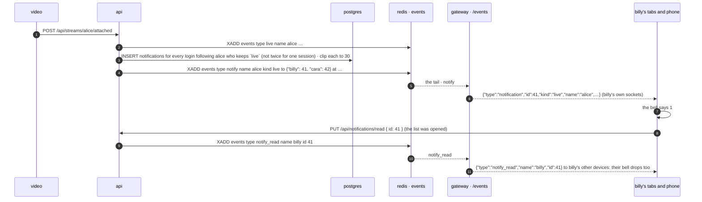

# notifications

built. a login's inbox: the last 30 things that happened to them. someone they follow went live, someone followed them, a friend wrote, someone wrote in a channel of a group they are in. the bell at the right end of every page's title row (before go live, where the gear once sat) wears how many are new and opens the list under it; opening it reads everything on it, here and on every other device of the login. which kinds are kept is the account's, four switches on a `notifications` tab of the user modal (the gear in the list's header is the way there), saved through the api so the phone agrees; and a channel too noisy for the bell is muted one at a time, on the room page. the api keeps a row per thing (the chat process writes the channel kind, from the same binary) and clips each login to the last 30 on every write. nobody (a guest) has none: an inbox needs an id with a person behind it, `follows.md`'s rule for the follower.



## why this shape

**a table, after all.** `follows.md` said no to an inbox: a toast is a frame that was on screen or was not, and the moment there is a list of missed ones there is read state, a cap, a sweep and a page. all true, and all of it is what was asked for: a list you can open later, on another device, that says what you missed. so the read state is a column, the cap is 30, the sweep is one statement on every write, and there is no page: 30 rows is the whole list. the plan's toast is not built; the number on the bell is the sign, the way the sidebar's number is for a chat.

**http writes, the socket tells.** `status.md`'s rule, `follows.md`'s, `dms.md`'s. the api is the one writer of the table: a row, then a `notify` fact on the `events` stream, and the gateway pushes the same row to every socket that *is* the login (`Gateway::tell`, the own-name index a `dm` uses), never to watchers. a stream that is gone from redis loses nothing: the rows are in postgres, and the list is asked again whenever the socket comes back.

**one fact, many names.** a go-live with a hundred followers is one row each and *one* fact, `to` a json object of login name → that login's row id, not a hundred entries on a stream capped at a thousand. the gateway walks the object and tells each name's sockets its own id. a follow and a dm name one login; the shape is the same.

**ids, not names.** `user_id` and `actor_id` are the row ids of `ids.md`, so a rename keeps the inbox and the actor shows under the name they have now (one join at read time). the frames and the routes speak names like everything else.

**settings on the row, as what is off.** `streamers.notify` is a json document of the kinds turned off (`{"follow": false}`); a kind not in it is on, so a row never written reads as all on and a new kind is on for everyone the day it exists (`chat` was, for every account from before it). the fan-out reads it in the same statement as the follows (`COALESCE((u.notify->>'live')::boolean, true)`), and a kind switched off keeps nothing of that kind from then on; what is in the inbox already stays.

**one row a thing, not one a frame.** `live` dedupes on the session: video calls `attached` a few times a second until the api answers, and a heartbeat that takes a lapsed key back is the same stream. `follow` dedupes on the follower among the rows kept: a follow, unfollow, follow loop is one line. `dm` keeps the newest line from a friend as the one unread row from them, deleting the unread one before it: a conversation is one line of the list that says what they said last, not thirty, and a read one stays as history. reading the thread (`PUT /api/dm/:name/read`, and a line of your own) reads the dm rows from that friend: the `dm_read` fact already reaches the reader's devices, and the pages apply the same rule to their list. `chat` is the dm rule per room rather than per writer: the newest line in a channel is the one unread row for that channel, whoever said it, so a busy #general is one line of the list that says who spoke last and what they said. having the channel on screen reads it (`PUT /api/groups/:group/channels/:channel/read`, which the room page sends as it shows a channel and as lines land in the one shown; a `chat_read` fact tells the other devices).

**a channel is muted, not a group.** `channel_mutes (user_id, server, channel)`: a row says this login hears nothing from that channel, and the fan-out skips it in the same statement that finds the members (`NOT EXISTS (… channel_mutes …)`). per channel because that is where the noise is: a #clips that never stops can be put away while #general still reaches the bell; muting every channel of a group is muting each, and switching `chat` off is every group at once. the mute is not a membership: it outlives a leave (joining again finds the channel as it was left) and goes with the channel (the foreign key cascades), and with the group through it. what is in the inbox when a channel is muted stays, the kind switch's rule.

**the chat process writes it.** a line in a channel is accepted by `api chat` (`chat.md`), not the api, so that is where the row is written: `notify::channel_line`, on a task of its own once redis has the line, bounded at 5s like the history insert, so a slow database costs the members a row and never the room its line. the writer locks the channel's row (`SELECT … FOR UPDATE`) before replacing the unread rows, so two lines at once in one channel are still one unread row an inbox, the way the dm writer locks the recipient. one lock a line, however many members. the speaker gets no row: a line of yours is not news to you.

## the table

```sql
CREATE TABLE notifications (
    id bigserial PRIMARY KEY,
    user_id uuid NOT NULL REFERENCES streamers(id) ON DELETE CASCADE,   -- whose inbox
    kind text NOT NULL,                                                  -- live | follow | dm | chat
    actor_id uuid NOT NULL REFERENCES streamers(id) ON DELETE CASCADE,  -- who did it
    session bigint,                                                      -- live: the go-live, the dedupe
    text text NOT NULL DEFAULT '',                                       -- dm, chat: the line, 140 chars at most
    at timestamptz NOT NULL DEFAULT now(),
    read_at timestamptz,                                                 -- when the login saw it
    room text                                                            -- chat: <server>/<channel>, the dedupe and where it leads (migrate-21)
);
CREATE INDEX notifications_user_idx ON notifications (user_id, id DESC);

ALTER TABLE streamers ADD COLUMN notify jsonb NOT NULL DEFAULT '{}'::jsonb;

-- migrate-21: a login's muted channels. no row for their lines
CREATE TABLE channel_mutes (
    user_id uuid NOT NULL REFERENCES streamers(id) ON DELETE CASCADE,
    server text NOT NULL,
    channel text NOT NULL,
    muted_at timestamptz NOT NULL DEFAULT now(),
    PRIMARY KEY (user_id, server, channel),
    FOREIGN KEY (server, channel) REFERENCES channels(server, name) ON DELETE CASCADE
);
```

`api/migrations/migrate-14.sql` and `migrate-21.sql`, run by the api at boot like the rest. the one index is the list (`user_id`, newest first) and the clip; the chat writer's delete of the unread row for a room walks the same index, thirty rows at most a login. the clip, after every write, for every login the write reached:

```sql
DELETE FROM notifications WHERE id IN (
  SELECT id FROM (SELECT id, row_number() OVER (PARTITION BY user_id ORDER BY id DESC) AS n
                  FROM notifications WHERE user_id = ANY($1)) ranked
  WHERE n > 30
)
```

## api

| | route | does |
|---|---|---|
| GET | `/api/notifications` | `{ settings: { live, follow, dm, chat }, items: [{ id, kind, name, verified, avatar, at, read, text, session, room }] }`: the login's rows, newest first, the last 30, each with who did it as they are now (`name`, the ✓, the picture), `at` in unix ms, `read`, a dm's or a channel line's `text`, a go-live's `session`, a channel line's `room` (`<server>/<channel>`, null on the rest); and which kinds are kept. 401 nobody |
| PUT | `/api/notifications/read` | `{ id }` → 204: the login has seen everything up to that row. a `notify_read` fact reaches the login's other sockets when anything was still unread |
| PUT | `/api/notifications/settings` | `{ live, follow, dm, chat }` → 200 the same, as kept: which kinds go in from now on, replaced whole; a key left out is on. 400 for anything that is not a boolean. 401 nobody |
| PUT | `/api/groups/:group/channels/:channel/mute` | 204: no row for this channel's lines, for this login, from now on; also when it already was. what is in the inbox stays. 401 nobody, 404 `no such channel`. DELETE the same → 204, the channel reaches the bell again. the room (`GET /api/groups/:group`, `groups.md`) says which channels the login has muted, `muted: [name, …]` |
| PUT | `/api/groups/:group/channels/:channel/read` | 204: the login has the channel on screen, so its `chat` rows for it are read. a `chat_read` fact reaches the login's other sockets when anything was still unread. the room page sends it as it shows a channel, and as a line lands in the one shown. 401 nobody |

the writers, inside routes that already exist: `POST /api/streams/:name/attached` (main.rs, after the `live` fact: `notify::stream_started`), `POST /api/streamers/:name/follow` (follows.rs, when the edge is new: `notify::followed`), `POST /api/dm/:name` (dms.rs, after the line and the writer's own read mark: `notify::messaged`), `dms::mark_read` (`notify::dm_read`, when the mark moved), and, in the chat process, a `say` into a server's channel (chat.rs `accept`, once redis has the line: `notify::channel_line`, every other member of the server who keeps `chat` and has not muted the channel). none of them can fail the call they ride on: a miss is logged.

## the facts, the frames

| fact on `events` | the gateway | the frame |
|---|---|---|
| `type notify name <actor> kind live\|follow\|dm\|chat to {"<login>": <id>, …} at <ms> text <words> verified 1\|0 [avatar <v>] [session <n>] [room <server>/<channel>]` | for each name in `to`, to every socket that *is* that name (`Gateway::tell`) | `{"type":"notification","id":41,"kind":"live","name":"alice","verified":true,"avatar":1729…,"at":1729…,"text":"","session":12}`; a channel line's has `"kind":"chat"`, its `text` and `"room":"gaming-0042/general"` |
| `type notify_read name <reader> id <n>` | to every socket that is `reader` | `{"type":"notify_read","name":"billy","id":41}` |
| `type chat_read name <reader> room <server>/<channel>` | to every socket that is `reader` | `{"type":"chat_read","name":"billy","room":"gaming-0042/general"}` |

a replayed fact (the ten-second replay of a gateway restart) is the same `id`, and the pages drop a row they have. a socket that is nobody is never a name in `to` and hears nothing. a line in a channel with a hundred members is one fact, like a go-live with a hundred followers.

## the pages

`notification-atoms.ts`: `notificationsAtom` (the rows, newest first, from `GET /api/notifications` when the login is known, `undefined` until then), `unreadNotificationsAtom` (the number on the bell), `notificationsOpenAtom`, `notifySettingsAtom`, `notifySettingsNoteAtom`; `loadNotifications`, `forgetNotifications` (a login change), `closeNotifications` / `toggleNotifications`, `markNotificationsRead` (the rows read here, `PUT read` with the newest id), `setNotifySetting` (the switch moves on the click, `PUT settings` with the whole document, the answer or the one before settles it). the `notification` frame goes to the top of the list (a dm from somebody replaces the unread dm from them; a channel's line replaces the unread row for that channel; a dm whose thread is on screen in the chat window is read at once, and so is a channel's line while the room page shows that channel, which also tells the api, `PUT .../read`; with the list open it is read at once); `notify_read` reads the rows up to the id; `dm_read` reads the dm rows from that peer; `chat_read` reads the chat rows for that room; the socket coming back asks the list again. the channel on screen is the room page's server (`roomAtom`) and the channel the chat shows (`chatChannelAtom`), in a tab that is visible: whenever that changes, when the inbox lands with one on screen, and when the tab is shown again, the unread chat rows for it are read and the api told.

the bell (`Notifications.tsx`, `NotificationsBell`): `#notifications` at the right end of the title row (`PageFrame.tsx`, before `#go-live`; on the go live page it stands alone), flat like go live, `data-unread` and `#notifications-unread` with the number while something is new, `aria-expanded`. the list (`Notifications`, mounted once by the Shell beside the chat window and the user modal): `#notifications-panel`, a `<dialog>` shown, not modal, placed under the bell against its right edge (400px, less on a phone; the top right of the window until the bell is measured), closed by the ×, escape, a press anywhere else, or a page change. its header: the word, `#notifications-settings` (the gear: the user modal on the notifications tab) and `#notifications-close`. then the rows, `#notifications-list` with `#notification-<id>` each (`data-kind`, `data-fresh`, a chat row's `data-room`): the face with the kind in its corner (the live one blue; a `#` for a channel), the name with its ✓, `went live` / `followed you` / the dm's words / `in #general of gaming-0042` and the line's words (`a picture` for a line of pictures alone), `3 min ago` on a 30s clock with the exact time in the `title`, and the blue square at the end of a row that was new when the list opened or came while it was open (the mark stays for as long as the list is open, so what was new can be told apart after the bell's number has gone). a go-live and a follow are links to the person's page; a dm opens the chat with them (`openDm`, with the person as the chat window or the sidebar has them); a channel's line is a link to that channel of the room (`/groups/<server>/<channel>`, the room itself for `general`). `#notifications-empty` for an inbox with nothing in it; `#notifications-nobody` for a guest, with the pointer to an account; a footer line when the list is at 30. opening the list reads everything on it (and asks the api only when this tab has no list yet: the rows come by push, and the socket coming back asks again).

the tab (`user-modal/NotificationsTab.tsx`, `#tab-notifications`, in the `you` group after security: it is the account's): four cards with a checkbox each, `#notify-live`, `#notify-follow`, `#notify-dm`, `#notify-chat`, the chosen ones in the blue stroke with `on`; `#notify-settings-note` says `saving`, `saved` or `not saved: <why>`. the tab shows no rows: the list is the bell's. `#notify-nobody` for a guest.

the mute (`ServerRoom.tsx`, the channel list, `groups.md`): for a member, `mute` after each channel's name (`#channel-mute-<name>`, words only, `aria-pressed`), `unmute` in blue once it is, and the bell-off mark by the name of a muted channel (the `li` says `data-muted`). the room answer carries `muted`; `setChannelMuted` (room-atoms) moves the list on the click, `PUT` or `DELETE .../mute`, and puts it back on a refusal. a channel deleted under the page takes its mute with it, as the table does.

## cost

a row of about a hundred bytes per thing, 30 at most a login: the table is bounded by the number of accounts. a go-live is one insert over the followers index, one delete over the inbox index, one `XADD`; a follow and a dm one of each; a channel line one lock on the channel's row, one delete and one insert over the members (a short transaction in the chat process, off the socket), one `XADD`. a channel's lines are rate-limited per speaker (`chat.md`, three in ten seconds), so a hundred members chatting at once is at most a few hundred row writes a second, each inbox still thirty rows. the gateway does one map lookup per name in `to` and reads nothing from postgres. the list is one query over the one index plus a join on `streamers` for the names.

## tests

`test/notifications.js`, after `dms` in `./scripts/test.sh`. three logins (a streamer, a fan, a friend) and nobody. nobody is 401 on all three routes; the settings read all on and a switch saves and reads back (a bad value 400); the fan follows the streamer and the streamer's inbox has a `follow` row from the fan, pushed into an open tab (the bell says 1, the row is in the list, the api says `read: false`); a second follow after an unfollow adds no row; the streamer goes live over the api (`go-live`, then `attached` as video would) and the fan's inbox has a `live` row with the session, once, however many times `attached` is called; a friend's line is a `dm` row, a second line replaces it (one unread row, the newest words), reading the thread reads it; opening the list in a browser reads everything (the bell's number goes, the api says `read: true`, a second tab's bell drops by push), the rows link where they should; `live` switched off keeps no `live` row for the next go-live while a `follow` still lands; 40 writes leave 30 rows; a group of three: a line in `general` over the server socket is one `chat` row with its `room` and `text` in each other member's inbox and none in the speaker's, a second line replaces it (one unread row, the newest words, whoever spoke), the read route reads it, a channel muted by one member keeps that member's inbox as it was while the other's still gets the row, unmuted it lands again, `chat` switched off keeps none, the mute and read routes are 401 for nobody and 404 for a channel that is not there, the room answer lists the muted channel, and in a browser the row under the bell says the channel and links to it, the room page's `mute` button moves the api and marks the channel, and a line that lands while the channel is on screen is read at once; cleanup.

## not this

- **a toast.** `follows.md`'s plan: a stack of `alice went live` in the top right, gone in 20s. the bell's number is one sign for every kind and does not cover the page; a toast can come later as a view over the same frame.
- **a fact per recipient.** a hundred entries on a stream capped at a thousand for one go-live, and the home service and every gateway read each one. one fact with a `to` map is the same work for the gateway and a thousandth of the stream.
- **fan-out from the gateway.** the gateway could read the followers on a `live` fact and push with no row at all. `follows.md`'s argument: a postgres read on the gateway's hot path for every go-live in every gateway process, and then nothing is kept for the phone that was off. the api already has the follows in hand when it publishes `live`.
- **a counter for unread.** 30 rows at most: `filter(!read).length` on the page, `read_at IS NULL` in the table. a counter is a second thing to keep right.
- **a kind per setting column.** three boolean columns would do today and want a migration for every kind after. one json document of what is off reads the same in the fan-out query and costs nothing to extend.
- **browser `Notification`s, web push, email.** the frame is in the page; a browser that is closed hears nothing, and the list is there when it opens. web push wants a service worker and vapid keys; later, if ever, as a view over the same rows.
- **a row per line in a channel.** thirty rows is three minutes of a busy channel. the newest line is the row, the channel is the unit, and the room itself is the log.
- **muting a whole group in one click.** it is each channel, on the room page, or the `chat` switch for every group. a group's mute is a row per channel, and a list of them is what the room already answers; a button that does all of them is a loop over the same route, later if the groups grow enough channels to want it.
- **a mute that reaches the other devices by push.** a mute is one login's and rides on no fact; another device sees it on its next load of the room. the rows it stops are stopped for every device at once, which is the part that matters.

## later, not now

- the toast, as a view over the `notification` frame, gated by `do not disturb` (`status.md`).
- more kinds, each a line in `Kind` and a key in the document: a reply to a post (`posts.md`), a mention in chat (a `chat` row that names you, kept apart from the channel's one), a stream ending.
- a row dismissed by hand (a × on it), a `clear all`.
- a page past the 30 (the cap is the design; raise it before paging it).
- a `chat` row for a stream's room, not only a server's channel: the room has no members to fan out to; followers of the streamer would be the list, and a go-live already is.
