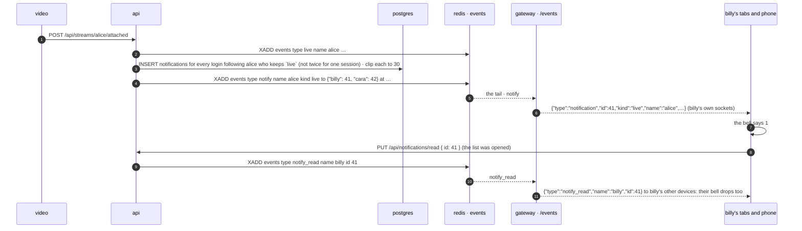

# notifications

built. a login's inbox: the last 30 things that happened to them. someone they follow went live, someone followed them, a friend wrote. the bell at the right end of every page's title row (before go live, where the gear once sat) wears how many are new and opens the list under it; opening it reads everything on it, here and on every other device of the login. which kinds are kept is the account's, three switches on a `notifications` tab of the user modal (the gear in the list's header is the way there), saved through the api so the phone agrees. the api keeps a row per thing and clips each login to the last 30 on every write. nobody (a guest) has none: an inbox needs an id with a person behind it, `follows.md`'s rule for the follower.



## why this shape

**a table, after all.** `follows.md` said no to an inbox: a toast is a frame that was on screen or was not, and the moment there is a list of missed ones there is read state, a cap, a sweep and a page. all true, and all of it is what was asked for: a list you can open later, on another device, that says what you missed. so the read state is a column, the cap is 30, the sweep is one statement on every write, and there is no page: 30 rows is the whole list. the plan's toast is not built; the number on the bell is the sign, the way the sidebar's number is for a chat.

**http writes, the socket tells.** `status.md`'s rule, `follows.md`'s, `dms.md`'s. the api is the one writer of the table: a row, then a `notify` fact on the `events` stream, and the gateway pushes the same row to every socket that *is* the login (`Gateway::tell`, the own-name index a `dm` uses), never to watchers. a stream that is gone from redis loses nothing: the rows are in postgres, and the list is asked again whenever the socket comes back.

**one fact, many names.** a go-live with a hundred followers is one row each and *one* fact, `to` a json object of login name → that login's row id, not a hundred entries on a stream capped at a thousand. the gateway walks the object and tells each name's sockets its own id. a follow and a dm name one login; the shape is the same.

**ids, not names.** `user_id` and `actor_id` are the row ids of `ids.md`, so a rename keeps the inbox and the actor shows under the name they have now (one join at read time). the frames and the routes speak names like everything else.

**settings on the row, as what is off.** `streamers.notify` is a json document of the kinds turned off (`{"follow": false}`); a kind not in it is on, so a row never written reads as all on and a new kind is on for everyone the day it exists. the fan-out reads it in the same statement as the follows (`COALESCE((u.notify->>'live')::boolean, true)`), and a kind switched off keeps nothing of that kind from then on; what is in the inbox already stays.

**one row a thing, not one a frame.** `live` dedupes on the session: video calls `attached` a few times a second until the api answers, and a heartbeat that takes a lapsed key back is the same stream. `follow` dedupes on the follower among the rows kept: a follow, unfollow, follow loop is one line. `dm` keeps the newest line from a friend as the one unread row from them, deleting the unread one before it: a conversation is one line of the list that says what they said last, not thirty, and a read one stays as history. reading the thread (`PUT /api/dm/:name/read`, and a line of your own) reads the dm rows from that friend: the `dm_read` fact already reaches the reader's devices, and the pages apply the same rule to their list.

## the table

```sql
CREATE TABLE notifications (
    id bigserial PRIMARY KEY,
    user_id uuid NOT NULL REFERENCES streamers(id) ON DELETE CASCADE,   -- whose inbox
    kind text NOT NULL,                                                  -- live | follow | dm
    actor_id uuid NOT NULL REFERENCES streamers(id) ON DELETE CASCADE,  -- who did it
    session bigint,                                                      -- live: the go-live, the dedupe
    text text NOT NULL DEFAULT '',                                       -- dm: the line, 140 chars at most
    at timestamptz NOT NULL DEFAULT now(),
    read_at timestamptz                                                  -- when the login saw it
);
CREATE INDEX notifications_user_idx ON notifications (user_id, id DESC);

ALTER TABLE streamers ADD COLUMN notify jsonb NOT NULL DEFAULT '{}'::jsonb;
```

`api/migrations/migrate-14.sql`, run by the api at boot like the rest. the one index is the list (`user_id`, newest first) and the clip. the clip, after every write, for every login the write reached:

```sql
DELETE FROM notifications WHERE id IN (
  SELECT id FROM (SELECT id, row_number() OVER (PARTITION BY user_id ORDER BY id DESC) AS n
                  FROM notifications WHERE user_id = ANY($1)) ranked
  WHERE n > 30
)
```

## api

| | route | does |
|---|---|---|
| GET | `/api/notifications` | `{ settings: { live, follow, dm }, items: [{ id, kind, name, verified, avatar, at, read, text, session }] }`: the login's rows, newest first, the last 30, each with who did it as they are now (`name`, the ✓, the picture), `at` in unix ms, `read`, a dm's `text`, a go-live's `session`; and which kinds are kept. 401 nobody |
| PUT | `/api/notifications/read` | `{ id }` → 204: the login has seen everything up to that row. a `notify_read` fact reaches the login's other sockets when anything was still unread |
| PUT | `/api/notifications/settings` | `{ live, follow, dm }` → 200 the same, as kept: which kinds go in from now on, replaced whole; a key left out is on. 400 for anything that is not a boolean. 401 nobody |

the writers, inside routes that already exist: `POST /api/streams/:name/attached` (main.rs, after the `live` fact: `notify::stream_started`), `POST /api/streamers/:name/follow` (follows.rs, when the edge is new: `notify::followed`), `POST /api/dm/:name` (dms.rs, after the line and the writer's own read mark: `notify::messaged`), and `dms::mark_read` (`notify::dm_read`, when the mark moved). none of them can fail the call they ride on: a miss is logged.

## the facts, the frames

| fact on `events` | the gateway | the frame |
|---|---|---|
| `type notify name <actor> kind live\|follow\|dm to {"<login>": <id>, …} at <ms> text <words> verified 1\|0 [avatar <v>] [session <n>]` | for each name in `to`, to every socket that *is* that name (`Gateway::tell`) | `{"type":"notification","id":41,"kind":"live","name":"alice","verified":true,"avatar":1729…,"at":1729…,"text":"","session":12}` |
| `type notify_read name <reader> id <n>` | to every socket that is `reader` | `{"type":"notify_read","name":"billy","id":41}` |

a replayed fact (the ten-second replay of a gateway restart) is the same `id`, and the pages drop a row they have. a socket that is nobody is never a name in `to` and hears nothing.

## the pages

`notification-atoms.ts`: `notificationsAtom` (the rows, newest first, from `GET /api/notifications` when the login is known, `undefined` until then), `unreadNotificationsAtom` (the number on the bell), `notificationsOpenAtom`, `notifySettingsAtom`, `notifySettingsNoteAtom`; `loadNotifications`, `forgetNotifications` (a login change), `openNotifications` / `closeNotifications` / `toggleNotifications`, `markNotificationsRead` (the rows read here, `PUT read` with the newest id), `setNotifySetting` (the switch moves on the click, `PUT settings` with the whole document, the answer or the one before settles it). the `notification` frame goes to the top of the list (a dm from somebody replaces the unread dm from them; a dm whose thread is on screen in the chat window is read at once; with the list open it is read at once); `notify_read` reads the rows up to the id; `dm_read` reads the dm rows from that peer; the socket coming back asks the list again.

the bell (`Notifications.tsx`, `NotificationsBell`): `#notifications` at the right end of the title row (`PageFrame.tsx`, before `#go-live`; on the go live page it stands alone), flat like go live, `data-unread` and `#notifications-unread` with the number while something is new, `aria-expanded`. the list (`Notifications`, mounted once by the Shell beside the chat window and the user modal): `#notifications-panel`, a `<dialog>` shown, not modal, placed under the bell against its right edge (400px, less on a phone; the top right of the window until the bell is measured), closed by the ×, escape, a press anywhere else, or a page change. its header: the word, `#notifications-settings` (the gear: the user modal on the notifications tab) and `#notifications-close`. then the rows, `#notifications-list` with `#notification-<id>` each (`data-kind`, `data-fresh`): the face with the kind in its corner (the live one blue), the name with its ✓, `went live` / `followed you` / the dm's words, `3 min ago` on a 30s clock with the exact time in the `title`, and the blue square at the end of a row that was new when the list opened or came while it was open (the mark stays for as long as the list is open, so what was new can be told apart after the bell's number has gone). a go-live and a follow are links to the person's page; a dm opens the chat with them (`openDm`, with the person as the chat window or the sidebar has them). `#notifications-empty` for an inbox with nothing in it; `#notifications-nobody` for a guest, with the pointer to an account; a footer line when the list is at 30. opening the list reads everything on it (and asks the api only when this tab has no list yet: the rows come by push, and the socket coming back asks again).

the tab (`user-modal/NotificationsTab.tsx`, `#tab-notifications`, in the `you` group after security: it is the account's): three cards with a checkbox each, `#notify-live`, `#notify-follow`, `#notify-dm`, the chosen ones in the blue stroke with `on`; `#notify-settings-note` says `saving`, `saved` or `not saved: <why>`; under them `#notify-count` (how many are kept and how many new) and `#notify-open`, which closes the modal and opens the list. `#notify-nobody` for a guest.

## cost

a row of about a hundred bytes per thing, 30 at most a login: the table is bounded by the number of accounts. a go-live is one insert over the followers index, one delete over the inbox index, one `XADD`; a follow and a dm one of each. the gateway does one map lookup per name in `to` and reads nothing from postgres. the list is one query over the one index plus a join on `streamers` for the names.

## tests

`test/notifications.js`, after `dms` in `./scripts/test.sh`. three logins (a streamer, a fan, a friend) and nobody. nobody is 401 on all three routes; the settings read all on and a switch saves and reads back (a bad value 400); the fan follows the streamer and the streamer's inbox has a `follow` row from the fan, pushed into an open tab (the bell says 1, the row is in the list, the api says `read: false`); a second follow after an unfollow adds no row; the streamer goes live over the api (`go-live`, then `attached` as video would) and the fan's inbox has a `live` row with the session, once, however many times `attached` is called; a friend's line is a `dm` row, a second line replaces it (one unread row, the newest words), reading the thread reads it; opening the list in a browser reads everything (the bell's number goes, the api says `read: true`, a second tab's bell drops by push), the rows link where they should; `live` switched off keeps no `live` row for the next go-live while a `follow` still lands; 40 writes leave 30 rows; cleanup.

## not this

- **a toast.** `follows.md`'s plan: a stack of `alice went live` in the top right, gone in 20s. the bell's number is one sign for every kind and does not cover the page; a toast can come later as a view over the same frame.
- **a fact per recipient.** a hundred entries on a stream capped at a thousand for one go-live, and the home service and every gateway read each one. one fact with a `to` map is the same work for the gateway and a thousandth of the stream.
- **fan-out from the gateway.** the gateway could read the followers on a `live` fact and push with no row at all. `follows.md`'s argument: a postgres read on the gateway's hot path for every go-live in every gateway process, and then nothing is kept for the phone that was off. the api already has the follows in hand when it publishes `live`.
- **a counter for unread.** 30 rows at most: `filter(!read).length` on the page, `read_at IS NULL` in the table. a counter is a second thing to keep right.
- **a kind per setting column.** three boolean columns would do today and want a migration for every kind after. one json document of what is off reads the same in the fan-out query and costs nothing to extend.
- **browser `Notification`s, web push, email.** the frame is in the page; a browser that is closed hears nothing, and the list is there when it opens. web push wants a service worker and vapid keys; later, if ever, as a view over the same rows.

## later, not now

- the toast, as a view over the `notification` frame, gated by `do not disturb` (`status.md`).
- more kinds, each a line in `Kind` and a key in the document: a reply to a post (`posts.md`), a mention in chat, a stream ending.
- a row dismissed by hand (a × on it), a `clear all`.
- a page past the 30 (the cap is the design; raise it before paging it).
