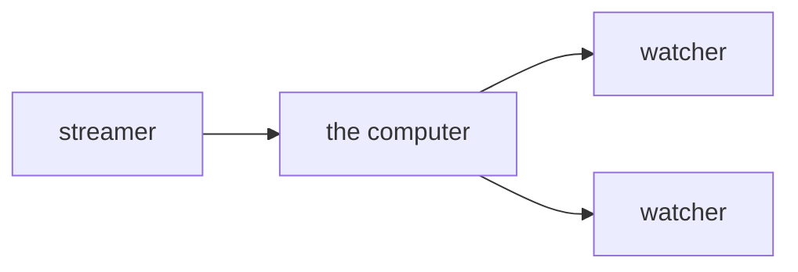
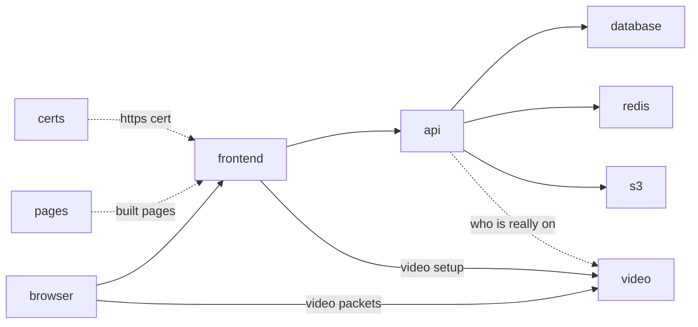

# test stream

one computer. you open its ip. one person goes live. other people watch.



## deploy

on the server:

```
git clone <repo> && cd slop-stream-architecture
./scripts/deploy.sh
```

it prints a url. open it. click through the warning.

nothing is compiled on the server. every push to `main` makes github build the four images (`.github/workflows/images.yml`, free for a public repo) and push them to `ghcr.io/<you>/stream-<x>:<commit>`; `./scripts/deploy.sh` works out the registry from the git remote and pulls the images for the last commit that changed them (a docs-only commit has none of its own and runs the ones before it). a 1 GB box is enough. the action takes a few minutes after a push; a deploy before it finishes says so and does nothing.

## update

- `./scripts/deploy.sh --pull` — pull the repo, then the images for that commit. new settings land in `.env` with defaults
- `./scripts/deploy.sh api` — only the api. streams stay up
- `./scripts/deploy.sh frontend` — only the pages. streams stay up
- `./scripts/deploy.sh video` — ends every stream. it warns first
- `./scripts/deploy.sh` — everything again
- `./scripts/deploy.sh --prune-deploy` — the disk is full of old builds and images: drop them first, then deploy

## building yourself

`./scripts/deploy.sh --build` compiles the images on the machine it runs on instead of pulling them: an hour and 4 GB of ram on a small box, a few minutes on a laptop. for a laptop with changes that are not pushed yet, or a box whose git remote is not on github (then `IMAGES=<registry>/<owner>/` in `.env` is the other way).

to try unpushed changes on the box without compiling there:

```
./scripts/ship.sh --to gcloud:test-machine        # on the laptop: builds for the box, sends the images straight into its docker over ssh, prints a tag
./scripts/deploy.sh --images <that tag>           # on the box: finds them there, starts them, pulls nothing
```

`--to billy@1.2.3.4` for a box that is not on gcloud. an arm laptop builds the box's amd64 images under emulation: minutes, not an hour. `./scripts/ship.sh` with no `--to` pushes to the registry like the action does (needs a `docker login` once).

## screens

- **home** — who is live, with a picture of each stream a few seconds old. the video box makes it from the stream itself. no cdn, no bucket
- **go live** — your camera, a name box, a start button, your bio and your picture. beside the preview, your sources (`screen.md`): the camera, screens or windows and tabs with their sound you add with the `+` while live, pictures and gifs any time. each is a layer over the preview, which is what watchers see: drag it, pull a corner, order them, hide one (a hidden camera or screen is a tile for watchers), pick a preset (`screen + face`, `side by side`, ...) or save your own; under it the sound, a fader and a meter for the mic and each tab and for what everyone hears. you get a watch link to copy. paste it in a chat and it unfurls into a card: your name, live or not, your bio, the picture (or the stream itself while live). once live, leaving the page keeps the stream going in a corner of every other page, your chat with it, while you look around the site or watch someone else (the picture in picture button on the preview is that same home click); × on the corner is stop
- **watch** — their camera and their bio, chat on the side, and whether they are around: `online`, `do not disturb`, `offline`, `streaming`. if they are not on, the page is their profile instead of a player: the picture big, the word, the bio, the chat; a streamer can put an offline picture where the player would be (the profile tab: a wide picture, and a line like `back tuesday at 8` under the word; the picture is the preview of their link too while they are off); the camera appears the moment they start
- **log in / sign up** — a name and a password. optional, see below

## on the computer

`./scripts/deploy.sh` starts these. same names in the compose file.



- **frontend** — the pages. react, same stack as axiom-frontend. passes api and video setup through
- **api** — save a bio and a picture. go live. stop. a log of starts and stops. only you can stop your own stream. also the html of the watch page, so links get previews
- **chat** — the text chat. one line per person per second, 500 letters max, last 500 lines kept. see `chat.md`
- **events** — the data socket, one per browser on every page: who is here, and the pushes (`live` the moment video has the streamer, `ended`, `viewers`, the word next to a name). the api writes facts to one redis stream; this fans them out to the browsers that asked for the name, or for every name (the home page). nothing on a page polls for them. see `status.md`
- **home** — the home list. every live stream and how many are watching it, in memory, from those same facts, checked against video every 30s. the home page asks it once and then listens; the ranking of the page, when there is one, goes here. see `status.md`
- **database** — the bio, the picture, the presence choice and the log. not the video
- **redis** — who is live right now, who is here right now, and the stream of facts the pushes come from. the video box gets the final say on live
- **s3** — a bucket on this computer (seaweedfs). profile pictures and stream thumbnails go here. `S3_ENDPOINT=off` in `.env` uses it. set that to a url, plus a key and a secret, to use a real bucket instead
- **video** — rust. one upload in, copies it out
- **certs** — makes the https cert for your ip, then quits
- **pages** — builds the react pages, hands them to frontend, then quits
- **dummy** — fake streams for styling. gifs bouncing around with names on them. off unless you turn it on, see below

all on one computer for this test.

## accounts

nobody has to. the name box in the panel at the bottom left is you: it is your chat name and your go-live default. it lives in your browser.

sign up and the name is yours: nobody else can go live as it, change its bio, or chat as it. a `✓` next to a name means that. the password is hashed on the server (argon2id) and never stored. see `accounts.md`.

the square in the corner of your picture is your presence: green while a tab of the site is open, blue while you are live, red if you picked `do not disturb`, grey if you picked `appear offline` or closed the last tab. the picker is in the profile tab; the word shows next to your name on your stream's page. see `status.md`.

an account can join groups, and each puts a badge next to your name in chat, the way discord tags a bot. the fake streams' chatters wear `BOT`, and the robot button in the chat hides their lines. see `groups.md`.

no email, so no reset. on the server: `./scripts/deploy.sh passwd <name>` prints a new one.

## this test skips

- email, password reset, 2fa, oauth
- a few video sizes
- a cdn
- more than one streamer in a room

## one browser rule

camera only works on https.
a warning you click through is enough.
`http://` the ip just sends you to `https://`.

## fake streams

for styling and debugging without a camera. in `.env`:

```
DUMMY_STREAMS=3
DUMMY_PASSWORD=anyword
```

then `./scripts/deploy.sh dummy`. home fills with `dummy-mango`, `dummy-pixel`, `dummy-disco`.
each is three gifs from `random-media/gifs` bouncing around like the dvd logo, dealt out at random so no two streams match, with its name on top and a clock. a quiet tone for sound. drop more `.gif` files in that folder and `./scripts/deploy.sh dummy` to use them.
your own names: `DUMMY_NAMES=alice,bob,carol`.
set it back to 0 and run it again to turn them off.
the password is what lets the dummy box use `dummy-` names. nobody else can.
each fake stream costs about a tenth of a core.

## test

by hand: open the url, go live, open the watch link on your phone.

by script, on your mac:

- `./scripts/test.sh` — real chrome with a fake camera. go live, watch, stop, chat, accounts, previews, error reports. a few minutes
- `./scripts/test.sh https://1.2.3.4` — same thing against the server
- chat is in there too: two people talk, a reload keeps the lines, 501 letters is refused
- presence too: a tab open is online, do not disturb reaches a watcher pushed, two tabs share one socket, the last one closing is offline at once
- `./scripts/test.sh --all` — also the redeploys, with a stream running through them, and the fake streams
- the stream names are fixed, so one person at a time per server

## following

a column beside the page (the left side, or the right from settings). closed, it is pictures and how people are, and you at the bottom; the streams use the rest of the page. hover it, or press its `following` word, and it widens over the streams, the page staying where it is: who you follow, friends (they follow you back) separate from the rest, the ones streaming first, each with the word beside their name, unfollow, and a chat window for a friend that sends nothing yet, and the search box, the site's one, to find people and follow them; the pictures stay exactly where they were when it opens, the names and buttons coming out beside them. an icon over each list; when both are longer than the column, the line between them drags to give one list a row and the other one fewer. go live and the settings icon sit at the right end of every page's title row, which stays put while the page scrolls, and under the live streams everyone else: a rectangle each with their picture, name and the word beside it, online first; the fake streams are there too when they are off (`./scripts/seed.sh --dummies` gives them faces). the watch page has the button and `N followers`. `docs/follows.md`.

## look inside

- `./scripts/manage.sh --db` — the database in a terminal: the tables, a table's rows (scroll, page, a where clause), its columns and indexes, a query of your own. `d` hops to the error-report database. read-only
- `./scripts/manage.sh --redis` — every key with its type and ttl; enter shows what is in it (a sorted set with its scores, a stream's last entries)
- `./scripts/manage.sh --to billy@1.2.3.4 --db` — the same against the box, over ssh. the screen is here, the questions go there
- `./scripts/seed.sh 5` — on the box: five accounts that look like people, each with a name, a bio, a picture and a thumbnail cut from `random-media/random-pfps`. names and passwords land in `.seeded-users`. somebody to find and, once follows exist, to follow

## working on the pages

`cd frontend && npm install && npm run dev`.
open `http://localhost:42069`. edits show up live.
the camera works there too.

which backend it talks to:

- `BACKEND=https://192.81.135.162 npm run dev` — the server. no docker needed on your mac
- plain `npm run dev` — the docker stack on your mac (`./scripts/deploy.sh --build` first: your own build, not the registry's images)

put `BACKEND=...` in `frontend/.env` to make it stick.
no password needed. the backend talks to any pages that speak its api.

## ports to open

- 80 and 443, tcp. the site.
- 7882, udp. the video.

## when one computer fills up

add fanout computers.
the streamer still uploads once.
