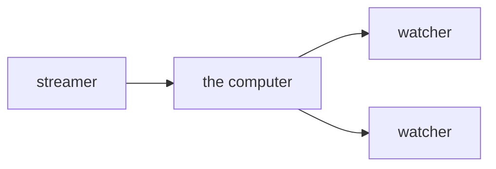
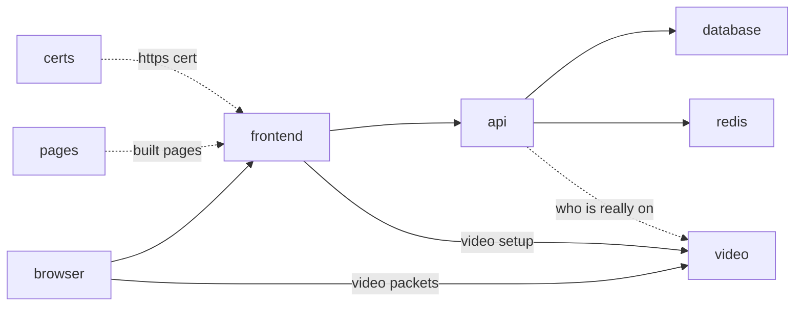

# test stream

one computer. you open its ip. one person goes live. other people watch.



## deploy

on the server:

```
git clone <repo> && cd slop-stream-architecture
./deploy.sh
```

it prints a url. open it. click through the warning.

## update

- `./deploy.sh --pull` — pull, rebuild only what changed. new settings land in `.env` with defaults
- `./deploy.sh api` — only the api. streams stay up
- `./deploy.sh frontend` — only the pages. streams stay up
- `./deploy.sh video` — ends every stream. it warns first
- `./deploy.sh` — everything again
- `./deploy.sh --prune-deploy` — the disk is full of old builds: drop them first, then deploy

## don't build on the box

a small box takes an hour to compile the rust and needs 4 GB of ram and 8 GB of disk to do it. three ways out, cheapest first:

**github builds it, for free.** every push to `main` runs `.github/workflows/images.yml`: the four images, built natively on github's x86 machines, pushed to `ghcr.io/<you>/stream-<x>:<commit>`. a public repo pays nothing for the minutes or the packages. then on the box:

```
./deploy.sh --pull --images        # pulls the repo, then the images for that very commit. builds nothing. a 1 GB box is enough
```

once: `IMAGES=ghcr.io/<you>/` in the box's `.env` (or on that command line the first time), and the four packages made public on github after the first run (your profile › Packages › stream-x › Package settings › Change visibility). the action takes a few minutes after the push; `./deploy.sh --pull --images` before it finishes says so.

**your laptop builds it, ssh carries it.** no registry, no account:

```
./ship.sh --to gcloud:test-machine        # on the laptop: builds for the box, sends the images straight into its docker, prints a tag
./deploy.sh --pull --images <that tag>    # on the box: starts them. builds nothing, pulls nothing
```

`--to billy@1.2.3.4` for a box that is not on gcloud. an arm laptop builds the box's amd64 images under emulation: minutes, not an hour.

**your laptop builds it, a registry carries it.** `./ship.sh` with no `--to` pushes to `ghcr.io/<you>/` like the action does; for several boxes when github is not building. needs a `docker login` once.

## screens

- **home** — who is live, with a picture of each stream a few seconds old. the video box makes it from the stream itself. no cdn, no bucket
- **go live** — your camera, a name box, a start button, your bio and your picture. you get a watch link to copy. paste it in a chat and it unfurls into a card: your name, live or not, your bio, the picture (or the stream itself while live)
- **watch** — their camera and their bio, chat on the side. if they are not on yet, it keeps checking
- **log in / sign up** — a name and a password. optional, see below

## on the computer

`./deploy.sh` starts these. same names in the compose file.



- **frontend** — the pages. react, same stack as axiom-frontend. passes api and video setup through
- **api** — save a bio and a picture. go live. stop. a log of starts and stops. only you can stop your own stream. also the html of the watch page, so links get previews
- **chat** — the text chat. one line per person per second, 500 letters max, last 500 lines kept. see `chat.md`
- **database** — the bio, the picture and the log. not the video
- **redis** — who is live right now. the video box gets the final say
- **video** — rust. one upload in, copies it out
- **certs** — makes the https cert for your ip, then quits
- **pages** — builds the react pages, hands them to frontend, then quits
- **dummy** — fake streams for styling. bouncing boxes with names on them. off unless you turn it on, see below

all on one computer for this test.

## accounts

nobody has to. the name box in the header is you: it is your chat name and your go-live default. it lives in your browser.

sign up and the name is yours: nobody else can go live as it, change its bio, or chat as it. a `✓` next to a name means that. the password is hashed on the server (argon2id) and never stored. see `accounts.md`.

no email, so no reset. on the server: `./deploy.sh passwd <name>` prints a new one.

## this test skips

- email, password reset, 2fa, oauth
- a few video sizes
- a cdn
- more than one streamer in a room

## one browser rule

camera only works on https.
a warning you click through is enough.
`http://` the ip just sends you to `https://`.

## fake streams

for styling and debugging without a camera. in `.env`:

```
DUMMY_STREAMS=3
DUMMY_PASSWORD=anyword
```

then `./deploy.sh dummy`. home fills with `dummy-mango`, `dummy-pixel`, `dummy-disco`.
each is a coloured box bouncing around with its name and a clock. a quiet tone for sound.
your own names: `DUMMY_NAMES=alice,bob,carol`.
set it back to 0 and run it again to turn them off.
the password is what lets the dummy box use `dummy-` names. nobody else can.
each fake stream costs about a tenth of a core.

## test

by hand: open the url, go live, open the watch link on your phone.

by script, on your mac:

- `./test.sh` — real chrome with a fake camera. go live, watch, stop, chat, accounts, previews, error reports. a few minutes
- `./test.sh https://1.2.3.4` — same thing against the server
- chat is in there too: two people talk, a reload keeps the lines, 501 letters is refused
- `./test.sh --all` — also the redeploys, with a stream running through them, and the fake streams
- the stream names are fixed, so one person at a time per server

## working on the pages

`cd frontend && npm install && npm run dev`.
open `http://localhost:42069`. edits show up live.
the camera works there too.

which backend it talks to:

- `BACKEND=https://192.81.135.162 npm run dev` — the server. no docker needed on your mac
- plain `npm run dev` — the docker stack on your mac (`./deploy.sh` first)

put `BACKEND=...` in `frontend/.env` to make it stick.
no password needed. the backend talks to any pages that speak its api.

## ports to open

- 80 and 443, tcp. the site.
- 7882, udp. the video.

## when one computer fills up

add fanout computers.
the streamer still uploads once.
