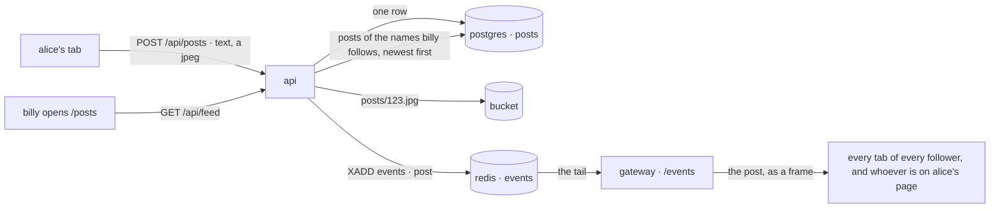
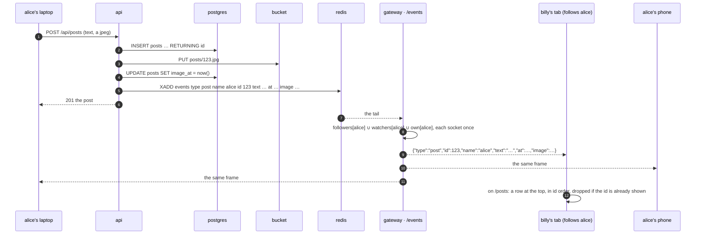

# posts

a plan, not a build. a login writes a short post, with a picture or without, and everyone who follows them has it on screen the moment it lands. a reply is a post pointing at another. the posts are rows in postgres; the moment is one fact on the `events` stream, the way `live` and `status` already travel.



## the short answer

- **postgres, yes.** a post is the record: it has to survive a restart, be paged backwards for years, and be joined to the author's row for the name as it is *now*. that is a table. redis carries the fact that a post happened, never the posts (`status.md`'s rule: redis has no volume).
- **one table, yes.** `posts`. a reply is a row in it with `reply_to` set. a repost or a quote, when wanted, is a row with one more pointer; no table. the one thing that does not fit in it is a **like**: who liked what is an edge, `follows`' shape exactly, and an edge is its own table. so: one table for the posts, and a second the day there are hearts. the ddl below has both, the second marked optional.
- **the websocket, yes, and the shape is already built.** the api writes the row, then puts one fact on the `events` stream (`presence::publish`, `presence.rs:159`); the gateway's tail (`events.rs:590`) routes each entry to the sockets that care (`deliver`, `events.rs:407`). a post is one more `type`. the two choices to make are *what the fact carries* (the whole post, below) and *who gets it* (the author's followers, below), and the second one is the half of `follows.md` not built yet.

## the rules

- a post is a **login's**. `follows.md`'s reason: it needs an id with a person behind it, and a free nick is anyone's. the author is `streamers.id` (`ids.md`), never the name: a rename keeps the posts, and every read joins the name back.
- the text: `clean_text` (`chat.rs:678`, the chat line's cleaning), then 1 to **500** characters, the chat's cap, one number for one kind of thing people type. with a picture the text may be empty.
- the picture: **one** jpeg, the way the profile has one. the page resizes to 1280 on the long side at quality 0.8 and the api takes at most **512 KB** (`MAX_OFFLINE_BYTES`, the offline picture's ceiling; `jpeg_body` checks it the same way). it lives in the bucket at `posts/<id>.jpg`. a post's id is never reused and a post is never edited, so that key is immutable and caches forever.
- a reply points at a **top-level post**. replying to a reply replies to its post (instagram's comments, not twitter's tree): a thread is one range of one index, and a delete is one level deep. the tree is an open question below.
- no edits. delete and post again, the groups' rule.
- the author deletes a post, or an admin (`ADMIN_NAMES`). a deleted post takes its replies and its likes with it (`ON DELETE CASCADE`) and its jpeg out of the bucket.
- **60 posts an hour** per login (`auth::bump`, `auth.rs:245`, the follow churn's shape): a person, not a script. one post is one row, maybe one object, and one `XADD` that wakes every gateway process.
- a reply counts as a post for the hour, and is told to the post's author.
- a free name's page shows no posts and no composer: a free name cannot post.
- **no counter columns.** `replies` and `likes` on a post are `count(*)` over an index, `follows.md`'s argument. the day one post has a million likes and the number is on every page, a counter kept in the same transaction is the fix. not before.
- the fact on the stream is the post itself, not its id (why: below). the frame to a tab is the same shape `GET /api/feed` hands back, minus the author's picture and `✓`, which the page already holds for a name it follows or is looking at.

## the table

```sql
-- migrate-8.sql. a login's posts, and the replies to them. the author is the account id, so a
-- rename keeps them. the picture, when there is one, is posts/<id>.jpg in the bucket and
-- image_at says so (and when). a reply points at a top-level post, one level.

CREATE TABLE posts (
    id bigserial PRIMARY KEY,                                              -- insert order is time order: the cursor
    author_id uuid NOT NULL REFERENCES streamers(id) ON DELETE CASCADE,    -- a login's row
    "text" text NOT NULL DEFAULT '',
    image_at timestamptz,                                                  -- null: no picture
    reply_to bigint REFERENCES posts(id) ON DELETE CASCADE,                -- null: top level
    created_at timestamptz NOT NULL DEFAULT now(),
    CHECK (char_length("text") <= 500),
    CHECK (char_length("text") > 0 OR image_at IS NOT NULL)               -- something to look at
);

CREATE INDEX posts_author_idx ON posts (author_id, id DESC);              -- alice's posts, newest first; the feed, one range per followed name
CREATE INDEX posts_reply_idx ON posts (reply_to, id) WHERE reply_to IS NOT NULL;   -- a thread, oldest first; how many replies
```

optional, the day there are hearts. an edge, `follows`' shape:

```sql
CREATE TABLE likes (
    post_id bigint NOT NULL REFERENCES posts(id) ON DELETE CASCADE,
    user_id uuid NOT NULL REFERENCES streamers(id) ON DELETE CASCADE,     -- a login's row
    liked_at timestamptz NOT NULL DEFAULT now(),
    PRIMARY KEY (post_id, user_id)                                         -- how many liked this; did billy
);
CREATE INDEX likes_user_idx ON likes (user_id, liked_at DESC);            -- what billy liked
```

the file is `api/migrations/migrate-8.sql`, one more entry in `MIGRATIONS` (`migrate.rs:23`) with `present: SELECT to_regclass('public.posts') IS NOT NULL`, run by the api at boot like the rest. the gateway reads a table the api made, as with `follows`.

why these shapes:

- **`bigserial`, not a uuid.** the feed is "newer than what i have" and "older than what i have": a cursor. a bigint sorts by insert and *is* the cursor, `?before=<id>`, one column, 8 bytes, an index that grows to the right. a v4 uuid (`gen_random_uuid()`, what `streamers.id` uses) does not sort, so paging would need `(created_at, id)` and a two-column cursor; a v7 would, and postgres 17 (`docker-compose.yml`) has no `uuidv7()`, that is 18. the id leaks how many posts there are. nobody minds.
- **two indexes, two questions.** a name's posts newest first, and a post's replies oldest first. the feed is the first index run once per followed name and merged (below). nothing else is asked of the table.
- **the picture is a column, not a table.** one per post, one key per post, `image_at` the way `avatar_at` and `offline_at` say "there is one, since then". two pictures would be a `post_images` table; `idea.md` does not want a gallery.
- **a reply is a column, not a table.** a `replies` table would be `posts` again with one more column. the partial index indexes only the rows that are replies, so the top-level majority costs it nothing.
- **a like is a table.** `(post, user)` pairs: an array column on the post is `follows.md`'s rejected shape (a scan for "what did billy like", a race between two likes on one row). the primary key reads one way (the count, the probe), the second index the other (billy's likes).

| question | query | reads |
|---|---|---|
| billy's feed, 50 newest, then the next 50 | `SELECT p.id, s.name, s.password_hash IS NOT NULL, (EXTRACT(EPOCH FROM s.avatar_at))::bigint, p."text", (EXTRACT(EPOCH FROM p.image_at))::bigint, p.created_at, (SELECT count(*) FROM posts r WHERE r.reply_to = p.id) FROM posts p JOIN streamers s ON s.id = p.author_id WHERE p.reply_to IS NULL AND p.author_id IN (SELECT followed_id FROM follows WHERE follower_id = $1 UNION SELECT $1) AND ($2::bigint IS NULL OR p.id < $2) ORDER BY p.id DESC LIMIT 50` | `follows`' primary key, one range (≤ 500 ids), then one of two plans the planner picks from the statistics: the primary key **backwards** from the newest post, each row checked against the followed set, stopped at 50 (when the names you follow post often: at 200k posts and 300 follows it read 149 rows); or `posts_author_idx`, one range per followed id, and a sort of what came back (when they post rarely and the newest posts are mostly strangers'). then 50 index-only counts |
| alice's posts, newest first | `… WHERE p.author_id = $1 AND ($2::bigint IS NULL OR p.id < $2) ORDER BY p.id DESC LIMIT 50` | `posts_author_idx`, one range |
| one post | `… WHERE p.id = $1` | the primary key, one probe |
| its replies, oldest first | `… WHERE p.reply_to = $1 ORDER BY p.id LIMIT 100` | `posts_reply_idx`, one range |
| how many replies | `SELECT count(*) FROM posts WHERE reply_to = $1` | `posts_reply_idx`, index only |
| how many likes; did billy | `SELECT count(*) FROM likes WHERE post_id = $1`, `EXISTS (… WHERE post_id = $1 AND user_id = $2)` | `likes`' primary key, index only |
| everyone's newest (nobody's feed) | `… WHERE p.reply_to IS NULL AND ($1::bigint IS NULL OR p.id < $1) ORDER BY p.id DESC LIMIT 50` | the primary key, backwards from the end |

the feed is **fan-out on read**: nothing is written per follower when alice posts; billy's page asks for the posts of the names he follows and postgres finds the 50 newest of them, by one of the two plans above. with 500 follows and a site where a name posts a few times a day, that is a few hundred to a few thousand index rows looked at per page, a millisecond or two (the ddl and this query were run against a copy of the schema with 200k posts; the plans in the table are what came back). twitter's shape, a timeline written per follower at post time, is the fix for the day a name has a million followers, and the socket below already does the live part of it for free, to memory, to the connected only.

the writes:

```sql
-- the post. a reply checks its parent first (EXISTS, top level), so a gone parent is a clean 404 and not a foreign key error
INSERT INTO posts (author_id, "text", reply_to) VALUES ($1, $2, $3) RETURNING id, created_at;
-- then the jpeg to the bucket, then
UPDATE posts SET image_at = now() WHERE id = $1 RETURNING (EXTRACT(EPOCH FROM image_at))::bigint;
-- a delete: the keys to drop first (one level), then the row, and the cascade takes the rest
SELECT id FROM posts WHERE (id = $1 OR reply_to = $1) AND image_at IS NOT NULL;
DELETE FROM posts WHERE id = $1 AND (author_id = $2 OR $3) RETURNING reply_to;   -- $3: the asking login is an admin
```

a picture that does not reach the bucket deletes the row and answers 500, `put_thumb`'s shape (`profile.rs:465`): the frame has not gone out yet, so nobody saw a post that is not there. the fact goes to redis only after the row and, if any, the object are both down.

## the push



- **the fact is the post.** `XADD events MAXLEN ~ 1000 * type post name alice id 123 text <text> at <ms> image <version> reply_to <id> to <parent's author>` (`image`, `reply_to` and `to` absent when there are none). the alternative, an id alone and the page fetches, is one `GET /api/posts/123` from every connected follower at the same instant: a thundering herd the api made for itself, for a frame that is at most 2 KB. the chat does it this way, the line rides the stream; so does this. the stream keeps the last thousand entries (`EVENTS_KEEP`), two megabytes at the worst; it is a bus, not the store.
- **who gets it.** the union of three sets in the registry (`events.rs:106`), each socket once: `followers[alice]`, `watchers[alice]` (whoever has alice's page open: it already sends `watch alice`), and `own[alice]` (alice's other tabs and her phone, the chat's rule: the sender sees its own post come back through the server like everyone else, so two devices agree with no side channel). a `post` for a name you neither follow, nor watch, nor are, never arrives. for a reply, `own[<to>]` too: the author of the post is told someone answered, on every device.
- **`followers`** is the map `follows.md` plans and has not built: filled at hello from one `SELECT` over `follows` for a login, kept current by the `follow` fact, re-keyed by `renamed`. the live toast and this frame are the two things it is for; whichever ships first builds it, about 90 lines in `events.rs`, and the second gets it free. without it, only `watchers` and `own` get posts, which is alice's page and alice: a fine first step, and the feed still fills by http.
- **delete** is `type unpost name alice id 123` to the same union; a page that shows the id drops it, and a thread page showing its replies drops those too (they are gone with it).
- **replay.** the tail starts ten seconds back after a restart (`REPLAY_MS`), so a frame may come twice; the page keys rows by `id` and a second one is nothing, the toast's `since` rule. a frame can also land before the page's first `GET /api/feed` has answered; the page merges by id, so the order comes out right either way.
- **no http on the gateway's hot path.** the frame is built from the fact's fields; postgres is not asked on delivery. the author's picture and `✓` come from what the page holds for the name (its following list, the profile it is looking at); for the one case neither has it (a stranger's reply to your post), the page asks `GET /api/streamers/:name` once.
- **likes are not pushed.** a count that moves live under every reader is a frame per like to everyone looking at the post; the page shows the count it loaded and the one it just made. a like told to the post's author alone, as a reply is, is the open question below.

## redis

| key | change |
|---|---|
| `events` | two more facts, `post` and `unpost`, written by the api after the row (`publish_post`, `publish_unpost` beside `publish_status`), read by the tail. nothing else: no feed lists, no `posts:` keys. the store is postgres |
| `rl:post:name:<name>` | the hour's counter, `auth::bump` |

## api

| | route | does |
|---|---|---|
| POST | `/api/posts` | multipart: `text`, and `image` (a jpeg) if there is one, `reply_to` if it is one. 201 with the post as the feed lists it. 401 nobody, 400 `say something` / `too long` / `not a jpeg` / `a reply to a reply: reply to the post`, 404 `no such post` (the parent), 413 `picture too big`, 429 `too many posts. wait an hour` |
| GET | `/api/feed?before=<id>` | `[{ id, name, verified, avatar, text, image, at, replies, liked? }]`, 50 newest top-level posts of the names the login follows and its own, `before` for the next 50. for nobody, everyone's newest: the explore shape |
| GET | `/api/streamers/:name/posts?before=` | the same rows for one name, replies included, newest first. for anybody |
| GET | `/api/posts/:id` | the post and `replies: [...]`, oldest first, 100 at most. for anybody |
| GET | `/api/posts/:id/image.jpg` | the jpeg from the bucket, cached for a year: it never changes. 404 `no picture` |
| DELETE | `/api/posts/:id` | 204 for the author or an admin. 401 nobody, 403 `not your post`, 404 |
| POST | `/api/posts/:id/like`, `/unlike` | *with the second table.* 204, also when already. 401, 404 |
| ws | `/events` | the server → client frames `post` and `unpost`, above. no new client → server frame: a post is http, `status.md`'s one-writer rule |

the first multipart route: axum's `Multipart` is a feature the binary does not carry yet (`Cargo.toml:9`, `["ws"]`). the alternative that stays raw bodies, the pictures' way today: `POST /api/posts` as json, then `PUT /api/posts/:id/image` with the jpeg, and the frame held until the second call or a few seconds pass. two requests and a timer for the one case; multipart is one request and the frame goes out finished.

## pages

- **`/posts`**: the feed. a login sees a composer at the top (`#compose`, `#compose-text` with `500` counting down, `#compose-image` the picker, `#compose-send`) and `#feed` under it, a row per post: the face, the name with its marks, the time, the text, the picture (`#post-<id>`, `#post-image-<id>`), `N replies` as a way into the thread, `×` on your own. a pushed `post` is a new row at the top; `unpost` takes one out. `more` at the bottom, `?before=` the last id. nobody sees everyone's newest and the pointer to the security tab where the composer would be.
- **a thread**: `/posts/<id>`, the post big and its replies under it, oldest first, a reply box for a login. pushed `post` frames with this `reply_to` land at the bottom.
- **a profile**: `#user-panel`'s person card and the user modal's profile tab get `N posts` and a way to `/posts?by=<name>` (`/api/streamers/:name/posts` under it). the watch page does not change: it is about the stream.
- **the frames**: `frames.ts`'s `ServerFrame` gains `post` and `unpost`; `events.ts`'s dispatch hands them to `post-atoms.ts` (`feedAtom`, keyed by id, newest first; `post`, `unpost`, `feed(before)`), beside the call into `follow-atoms`. the shared worker (`status.md`) carries them to every tab like the rest.
- a `post` frame for a name you follow while you are not on `/posts`: nothing, for now. the toast is `follows.md`'s, for `live`; a post toast is noise at twenty posts a day. an unread dot on the `/posts` link is the smallest thing worth doing, later.

## cost

a post is a row of about a hundred bytes plus the text, and a jpeg of up to half a megabyte in the bucket. one `XADD` per post, read by every gateway process, routed to the author's connected followers and nobody else; the stream never holds more than a thousand of them. a feed page is one query over two indexes and 50 index-only counts; a thread is one range. nothing new runs, no new process, no new store.

## tests

`test/posts.js`, after `follows` in `./scripts/test.sh`. two logins, `poster<run>` and `reader<run>`, and nobody.

1. nobody: `POST /api/posts` 401; `GET /api/feed` lists everyone's newest; a post's page and `GET /api/posts/:id` answer.
2. poster posts text: 201 with an id; too long 400; empty with no picture 400; a jpeg under the ceiling 201 with `image` set and `GET /api/posts/:id/image.jpg` is `image/jpeg`; a png 400; 600 KB 413.
3. reader follows poster; `GET /api/feed` as reader lists the post; a stranger's post is not in it; `before` pages.
4. the push: reader's browser on `/posts`; poster posts in a second context; `#post-<id>` is on reader's page within 3s with no reload and no fetch of the feed (the network log); poster's own second tab has it too.
5. a reply: `reply_to` the post, 201; the thread page lists it; a reply to the reply 400; `replies` on the post reads 1; the frame reaches poster's tab (the `to`).
6. delete: reader's 403 on poster's post; poster's 204; reader's open page drops the row within 3s (`unpost`); `GET /api/posts/:id` 404; the jpeg 404; the reply is gone too.
7. the hour: locally, 60 rows for a throwaway login straight into the counter (`docker compose exec redis redis-cli`), and the 61st post is 429. off-box `SKIP`, the `errors.js` way.
8. a rename (`ids.md`): poster changes its name; the feed lists the posts under the new name, and the next post's frame says it.
9. cleanup: delete the posts, unfollow.

## code

- needs `ids.md` (built) and, for the push to followers, the `followers` map of `follows.md`'s second half; without it the frame reaches the author's own sockets and the author's page, and the feed is http. ship that way first if the map is not there.
- `api/migrations/migrate-8.sql`, `migrate.rs`: the entry. `api/src/posts.rs`, new: the routes, the multipart read, the two publishes, the delete with its keys. about 300 lines. `Cargo.toml`: axum's `multipart`.
- `api/src/presence.rs`: `publish_post`, `publish_unpost`. `api/src/events.rs`: two arms in `deliver`, a `fan_union` over the three sets, the `Out::Post` and `Out::Unpost` frames. about 40 lines, plus the map if it is not built.
- `frontend/src/infra/frames.ts`, `events.ts`, `atoms/post-atoms.ts`, `api.ts` (`post`, `feed`, `thread`, `unpost`); `pages/PostsPage.tsx`, `ThreadPage.tsx`, `shared-components/PostRow.tsx`, `Composer.tsx`; `router.tsx`. about 500 lines.
- `test/posts.js`. `docs/README.md`'s line. when it ships: `spec.md`'s api and tests tables, `accounts.md`'s `/events` row gains the two frames.

## not this

- **fan-out on write.** a timeline per follower (a redis list, or a `timelines (user_id, post_id)` table) written at post time: twitter's shape, because twitter has names with a hundred million followers and a `WHERE author_id IN (…)` over them cannot answer in time. here it is 500 ids and two indexes. the write side would be 500 rows per post, a sweep, and a list redis loses on restart. the socket is already the fan-out on write that matters, to the people who are looking, and it writes nothing.
- **the id alone on the stream.** above: a fetch per follower per post.
- **posts as a redis stream, the chat's way.** a chat room is one key with an audience that is in the room; a post's audience is a set of followers spread over every page. and the chat keeps 500 lines for seven days; a post is kept for good. the stream is the bus, postgres the store, and the chat's own persistence (`history.rs`) is the same answer.
- **a uuid id, a counter column, an array of likes, the jpeg in the row.** above; `follows.md` for the counter and the array; `profile.rs`'s `lift_legacy` for why bytes left the row once already.
- **a `replies` table, a `reposts` table.** a post with a pointer.
- **a `notifications` table.** `follows.md`'s position: a frame was on screen or it was not. the `to` on a reply's frame is the whole of "someone answered you". an inbox is read state, a cap and a sweep; later, if ever.
- **browser `Notification`s, email.** the frame is in the page.

## not here

- editing. hashtags, mentions, links unfurled. search (`chat_lines`' `tsvector` shape would fit, one generated column and a gin index; a feature of its own).
- reposts and quotes: one more nullable pointer, `repost_of`, in the same table, and a frame to the reposter's followers. left out so the first version has one kind of row.
- a thread deeper than one level. blocks and mutes (`follows.md`'s sibling). reporting, moderation beyond the admin's delete.
- more than one picture, video, gifs, polls, a gallery.
- bookmarks, who-liked lists, counts on home cards, a post toast, an unread dot.
- posts on the watch page, posts of a free name, the dummy box posting.
- ranking. the feed is by id, newest first, and nothing decides what you see.

## open questions

1. **500 or 280?** 500 is the chat's number and one rule for typed text. 280 is what "a post" means to people. (recommendation: 500; the box counts down and nobody is stopped at a number they did not expect.)
2. **multipart, or two requests?** above. (recommendation: multipart; one request, one frame, the finished post.)
3. **replies as a tree?** twitter's. a `root_id` beside `reply_to` makes the thread one range still, and a delete would need a recursive walk for the bucket keys or a tombstone row. (recommendation: one level first, the column added when a tree is wanted.)
4. **likes in the first version?** the table is ten lines and the two routes twenty. the pages are where the cost is. (recommendation: the table in the same migration, the heart on the row, no frame.)
5. **a like told to the author?** a frame to `own[author]` alone, like a reply. a popular post is a frame per like on the author's phone. (recommendation: not until someone asks.)
6. **nobody's feed.** everyone's newest, the explore shape, or nothing and a pointer to log in. (recommendation: everyone's newest; a visitor should see the site is alive, home shows the live cards to nobody too.)
7. **a reply's picture.** the one jpeg rule says yes. instagram says no. (recommendation: yes, the one rule.)
