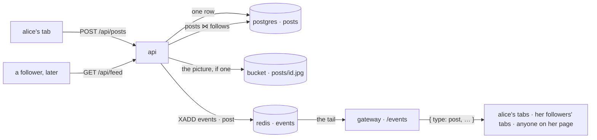
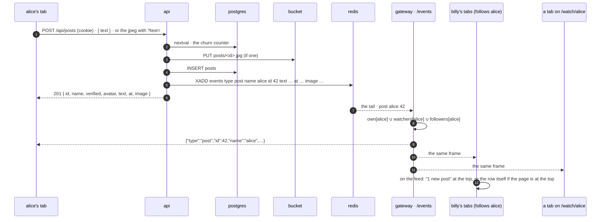

# posts

a plan, not a build. a login writes a short post, with a picture or without, and the people who follow it see the post arrive at the top of their feed the moment it lands, with no reload. twitter's shape, instagram's picture. one table in postgres, one fact on the `events` stream, one frame on the socket that is already open on every page.



## the short answer

**yes, one table.** `posts`: a row per post, keyed on the author's id (`ids.md`), the words in a column, the picture in the bucket with its version on the row the way `avatar_at` and `offline_at` work. that one table gives three things: a person's page of posts, a post of its own at a url, and the home feed. the feed is not a second table, because its other half already exists: `follows`. "posts by everyone i follow, newest first" is one join over the two, from an index, and at 500 follows a login (the cap `follows.md` set) that join is cheap at any number of posts this site reaches.

**yes, realtime, and it is already how the site works.** the api never talks to a socket. it writes the row, then puts one fact on the redis `events` stream (`presence.rs`'s `publish`, the same `XADD` that carries `live`, `ended`, `status`, `renamed`), and the gateway (`events.rs`), which owns the sockets, tails that stream and sends a frame to the sockets that care. so "whenever the api gets something, send it out" is one line in the api and one match arm in the gateway. the api does not need to know which gateway process holds which browser; redis is the one place both look.

the second table comes the day someone wants likes or replies: each of those is one more table of the same shape as `follows` (an edge), or one column (`reply_to`). below, under *later*. not in the first cut.

## what for

- **say something without going live.** today a name is a stream and a bio. a post is the thing between: "back tomorrow at 8", a screenshot, a picture of the setup.
- **the feed.** home is the live grid and the people. a login with follows gets a third thing: what the people it follows said, newest first, arriving as it is said.
- **the page of one person.** under the player on `/watch/alice` while she is not live, or a tab of her own: her posts.

## the rules

- a post is **a login's**. the author is `streamers.id`, a row with a password behind it: a free name is anyone's, and a post needs a person who said it (`follows.md`'s rule for the follower). the post keeps the id, never the name, so a rename (`ids.md`) keeps every post and the pages read the name as it is now.
- **words, a picture, or both.** the words: 1 to 500 characters after `chat.rs`'s `clean_text` (the chat line's cleaner and the chat line's number, one number for a thing a person types; twitter's 280 is an open question below). the picture: one jpeg, up to 1280 on its long side, made by the browser like the offline picture is, under 512 KB (`MAX_OFFLINE_BYTES`). a post with neither is 400.
- **public.** a name's posts are readable by anyone, nobody included, like the bio and the count of followers. the feed is the login's own, because it is a function of who the login follows, and that list is private (`follows.md`: counts public, lists yours).
- **no editing.** delete and post again, `groups.md`'s rule. a frame that went to a thousand tabs is not taken back by an update; it is taken back by `unpost`.
- **deleted is gone.** the row, the object in the bucket, then the fact. no `deleted_at`, no tombstone: a post is not a chat line in a room's history where the gap would show. the author deletes, or an admin (`ADMIN_NAMES`, the groups' delete).
- **churn:** 60 posts per login per hour, `auth::bump` on `rl:post:name:<name>`, the follow's limiter. a post is a row forever, an `XADD` every gateway reads and a frame to every connected follower; a loop on one button must not.
- the post travels in redis **as itself**: the fact carries the id, the author, the words, the time, and the picture's version. the gateway forwards it and reads nothing: at a post, postgres is touched by the api once and by nobody else. five hundred characters a fact, a thousand facts kept (`EVENTS_KEEP`): half a megabyte of redis at the worst, for a stream that is already there.

## the table, in postgres

```sql
-- api/migrations/migrate-8.sql
-- a post. the author is the account id, so a rename keeps every post. the words are in the row;
-- the picture is in the bucket at posts/<id>.jpg, and image_at is its version (the avatar's shape).

CREATE TABLE posts (
    id bigserial PRIMARY KEY,                                              -- time-ordered enough: the feed's cursor
    author_id uuid NOT NULL REFERENCES streamers(id) ON DELETE CASCADE,    -- a login's row
    "text" text NOT NULL DEFAULT '',                                       -- cleaned, 0 to 500 characters
    image_at timestamptz,                                                  -- null: no picture
    created_at timestamptz NOT NULL DEFAULT now(),
    CHECK (char_length("text") <= 500),
    CHECK ("text" <> '' OR image_at IS NOT NULL)                           -- words, a picture, or both
);

CREATE INDEX posts_author_idx ON posts (author_id, id DESC);              -- alice's posts, newest first; the feed, one range per followed name
```

in `migrate.rs`'s list as version 8, `present: SELECT to_regclass('public.posts') IS NOT NULL`, run by the api at boot like the rest; the gateway reads nothing from it. one index beyond the key, and every question is one range on it:

| question | query | reads |
|---|---|---|
| alice's posts, newest first | `SELECT p.id, p.text, p.image_at, p.created_at FROM posts p WHERE p.author_id = $1 AND p.id < $2 ORDER BY p.id DESC LIMIT 50` | `posts_author_idx`, one range, already in order |
| how many has alice posted | `SELECT count(*) FROM posts WHERE author_id = $1` | `posts_author_idx`, index only |
| one post | `SELECT … FROM posts p JOIN streamers s ON s.id = p.author_id WHERE p.id = $1` | the key, one probe |
| billy's feed | below | `follows`' primary key for the 500 ids, then `posts_author_idx` once per id, merged |

the feed, the one query this table is for:

```sql
SELECT p.id, s.name, s.password_hash IS NOT NULL AS verified, (EXTRACT(EPOCH FROM s.avatar_at))::bigint AS avatar,
       p."text", (EXTRACT(EPOCH FROM p.image_at))::bigint AS image, (EXTRACT(EPOCH FROM p.created_at) * 1000)::bigint AS at
FROM posts p
JOIN streamers s ON s.id = p.author_id
WHERE p.author_id IN (SELECT followed_id FROM follows WHERE follower_id = $1 UNION SELECT $1)   -- the people i follow, and me
  AND p.id < $2                                                                                  -- the cursor: the smallest id the page has. the first page passes a huge number
ORDER BY p.id DESC
LIMIT 50;
```

postgres runs it as: the follow ids from `follows`' primary key (at most 501), a nested loop that takes the top of each author's range from `posts_author_idx`, and a top-50 merge. no sort of anything large, no scan. the cursor is the id and not the time because the id is what the index is ordered by and two posts in the same millisecond still have an order. a sequence is not strictly time-ordered across two inserts that overlap, which would matter for "newer than", and nothing asks that: newer posts come down the socket, and a tab that was away reloads its first page, below.

`ON DELETE CASCADE`: no account is deleted today, but a row that goes takes its posts with it. a rename that takes a free name's row away (`ids.md`) moves nothing here, since a free name has no posts.

the picture: `posts/<id>.jpg` in the bucket. the id comes from the sequence *before* the row exists, `SELECT nextval('posts_id_seq')`, so the object can be written first and the row second, the avatar's rule: a cached url never points at a picture that did not land. an insert that fails after the put deletes the object, the mirror of `put_thumb` dropping its row when the put fails. the name key never existed here, so there is nothing to lift (`profile.rs`'s `lift_object` is for things older than ids).

## the push



the gateway routes an `events` entry by `type` and `name` (`events.rs`'s `deliver`). a `post` fact is one more arm, and the frame goes to the union of three sets of sockets, each sent once:

- **`own[alice]`**, the author's own sockets: every tab and device of alice, including the one that posted. the sender sees its own post come back through the server like everyone else (the chat's rule, `follows.md`'s for the `follow` frame), so the phone agrees with the laptop and the composing tab adds the row when the frame says so, not when the 201 does.
- **`watchers[alice]`**, the sockets that sent `watch alice`: the pages on `/watch/alice`, which already watch her for `presence`, `live` and `ended`. a person on her page sees the post land whether they follow her or not. `fan` already does exactly this for `live` and `ended`; nothing new.
- **`followers[alice]`**, the sockets whose login follows alice: the map `follows.md`'s *the push* describes, filled at hello from one `SELECT` and kept by the `follow` fact. **not built yet**, and it is the same map "alice went live" wants; whichever of the two ships first builds it, and the other is one more `fan`. until it exists the first two sets work, so a name's page is live from day one and the feed learns of a post at the next load.

`unpost` is the same union with `{"type":"unpost","id":42,"name":"alice"}`; a tab that has the row takes it out, one that does not drops the frame. a replayed entry (the ten-second replay on a gateway restart, `REPLAY_MS`) is a post the tab already has: the id is the key, so the second one is not added twice.

the frame carries the post because the alternative is worse: an `{id}` alone and a `GET /api/posts/42` from every tab that got it is a thousand requests for one post, at the same instant, which is the one load shape a small box cannot absorb. five hundred characters in a frame is nothing; the chat sends that much on every line.

## redis

| key | change |
|---|---|
| `events` | two more facts. `XADD events MAXLEN ~ 1000 * type post name alice id 42 at <ms> text <words> image <version or absent>`, written by the api after the row, through `presence.rs`'s `publish` as `publish_post`. `type unpost name alice id 42` after a delete. read by the tail. nothing else: no `feed:` lists, no `posts:` sets, nothing redis would have to remember |
| `rl:post:name:<name>` | the churn counter, `auth::bump`, an hour |

## api

| | route | does |
|---|---|---|
| POST | `/api/posts` | a login's. `application/json` `{ text }`, or `image/jpeg` as the whole body with the words in `?text=` (the avatar's shape: the body is the picture, the rest rides the query). → 201 with the post as the lists show it. 401 nobody, 400 `say something, or add a picture` / `too long` / `bad body`, 413 `the picture is too big`, 429 `too many posts. wait an hour` |
| DELETE | `/api/posts/:id` | 204. the author or an admin. 401 nobody, 403 `not your post`, 404 `no such post` |
| GET | `/api/posts/:id` | one post: `{ id, name, verified, avatar, text, at, image }`. for anybody. 404 |
| GET | `/api/posts/:id/picture?v=` | the jpeg from the bucket, `Cache-Control: public, max-age=86400` (`AVATAR_CACHE`; the `?v=` is `image` and the cache key, the avatar's way). 404 `no picture` |
| GET | `/api/streamers/:name/posts?before=` | the name's posts, newest first, 50 at a time; `before` is the smallest id the page has, absent for the first page. for anybody. a name with no row is `[]` |
| GET | `/api/feed?before=` | the login's: posts by the names it follows and its own, the same shape and paging. 401 nobody |

changed:

| | route | now |
|---|---|---|
| GET | `/api/streamers/:name` | + `posts` (the count), beside `followers` |
| ws | `/events` | the server → client frames `post` and `unpost`, above. no new client → server frame: a post is http, `status.md`'s one-writer rule |

every route speaks **names** and **post ids**; the author's uuid stays in the database (`ids.md`). `name` on a post is the author's name now, from the join, so a renamed author's old posts read right. `at` is milliseconds like `live`'s `since`; `image` is the version like `avatar`, null for none.

## pages

- **the composer**: a box at the top of the feed, and the same one on your own page. the words with the count beside them as the box fills, a picture button that opens the file picker, scales the picture to 1280 on its long side in a canvas and steps the quality down until it is under 512 KB (the offline picture's code, `profile-atoms.ts`), a preview, `post`. pressed, the box clears and the row appears when the frame arrives, within the same second; a failed call puts the words back with the api's message. nobody sees the box as a pointer to the security tab, the groups tab's way.
- **the feed**: for a login, on home between the live cards and the people, or its own page, open question 3. the rows: the face, the name with its `✓`, the time (`2m`, `3h`, `oct 12`), the words, the picture below at the column's width, `×` on your own. scrolled to the bottom it asks `?before=<smallest id>` once and appends. a pushed `post` while the page is at the top is inserted at the top; while it is scrolled down it becomes `1 new post` in a pill at the top, twitter's shape, so the page does not jump under the reader; the pill pressed scrolls up and shows them. an `unpost` takes the row out wherever it is. on the socket's reconnect (`link: open` after `closed`, `status.md`) the first page is fetched again and merged by id, so the gap of a deploy is filled without a "since".
- **a name's posts**: on `/watch/<name>`, under the player while the name is not live (the offline picture and the note, then the posts), and under the bio while live. the page already sends `watch <name>`, so the posts land live.
- **`/post/<id>`**: a page of one post, the way `/watch/<name>` is a page of one stream. a link preview for it (the `og:*` tags, `profile.rs`'s `watch_page`) is *later*, below; the first cut is the client-side route.
- **atoms**: `post-atoms.ts`: `feedAtom` (the rows, by id, newest first, with the cursor and `done`), `pendingAtom` (the pill's count), `postsOfAtom(name)`; `post`, `unpost`, `feed`, `postsOf` in `api.ts`; `frames.ts` gains the two frames; `events.ts`'s dispatch calls into `post-atoms`.

## cost

one row per post, about a hundred bytes plus the words, and a jpeg in the bucket when there is one. one `XADD` per post, read by every gateway process, applied to the author's sockets, her watchers and her followers; nothing in postgres on the gateway's path. a feed page is one query of at most 501 index ranges merged to 50 rows, with the names joined. a count on every profile read: one index-only `count(*)`. nothing new runs, nothing new is deployed.

## tests

`test/posts.js`, after `follows` (the feed needs an edge) and before `regress`. two logins, `poet<run>` and `fan<run>`, and nobody.

1. nobody: `POST /api/posts` 401; `GET /api/feed` 401; `GET /api/streamers/poet/posts` is `[]`; `GET /api/streamers/poet` carries `posts: 0`.
2. poet posts words: 201 with `name`, `at`, `image: null`; empty 400; 501 characters 400; the count is 1; the list has it, newest first.
3. a picture: the jpeg body with `?text=`; `image` is set; `GET /api/posts/:id/picture?v=` is a jpeg with the cache header; a body that is not a jpeg 400; past 512 KB 413.
4. fan follows poet: `GET /api/feed` as fan has poet's two posts and nothing of a stranger's; as poet, poet's own. 50 posts straight into postgres for a throwaway login (`docker compose exec database psql`, `follows.md`'s step 8 shape; off-box `SKIP`) and `?before=` walks them in two pages with no repeat and no gap.
5. the push, own and watchers: poet's browser on `/watch/poet` and a second context posting as poet: the row appears within 3s with no reload, and the composing tab shows it once, not twice. a third context on `/watch/poet` as nobody sees it too.
6. the push, followers (`SKIP` until `follows.md`'s map is built): fan's browser on the feed, scrolled to the top: poet's post is the first row within 3s. scrolled down: the pill reads `1 new post`, and pressing it shows the row.
7. delete: fan's `DELETE` is 403; nobody's 401; poet's 204 and the row is gone from fan's open tab within 3s; a second `DELETE` 404; the picture's url is 404.
8. a rename (`ids.md`): poet changes its name; the posts list under the new name is the same list, and `GET /api/posts/:id` says the new `name`.
9. cleanup: delete every post, unfollow.

## code

- `api/migrations/migrate-8.sql`, the table above, and its entry in `migrate.rs`.
- `api/src/posts.rs`, new: the six routes, `count` for `get_streamer`, the churn counter, the two bodies of `POST`. the jpeg check is `profile.rs`'s `jpeg_body`, made `pub(crate)`. about 300 lines.
- `api/src/presence.rs`: `publish_post`, `publish_unpost`. `api/src/events.rs`: two arms in `deliver`, each a `fan` to the union above (a `fan_to(names…)` that takes `own` and `watchers`, and `followers` once it exists); the `Out` variants. about 40 lines.
- `frontend/src/infra/atoms/post-atoms.ts`, `shared-components/Composer.tsx`, `Feed.tsx`, `PostRow.tsx`, `pages/PostPage.tsx`; `WatchPage.tsx`, `HomePage.tsx`, `api.ts`, `frames.ts`, `events.ts`, `router.tsx`. about 500 lines.
- `test/posts.js`. `docs/README.md`'s line. when it ships: `spec.md`'s api and tests tables, `accounts.md`'s `/events` row gains the two frames.

## later

each of these is one more migration and none changes the table above:

```sql
-- likes: an edge, follows' shape. "does billy like 42" is one probe, "how many" is index only.
CREATE TABLE likes (
    user_id uuid NOT NULL REFERENCES streamers(id) ON DELETE CASCADE,
    post_id bigint NOT NULL REFERENCES posts(id) ON DELETE CASCADE,
    liked_at timestamptz NOT NULL DEFAULT now(),
    PRIMARY KEY (user_id, post_id)
);
CREATE INDEX likes_post_idx ON likes (post_id);

-- replies: a column, not a table. a thread is "WHERE reply_to = $1 ORDER BY id".
ALTER TABLE posts ADD COLUMN reply_to bigint REFERENCES posts(id) ON DELETE CASCADE;
CREATE INDEX posts_reply_idx ON posts (reply_to, id) WHERE reply_to IS NOT NULL;

-- reposts: a column too. the row is a post whose words are empty and whose picture is none,
-- pointing at the one it repeats; the feed joins it back out.
ALTER TABLE posts ADD COLUMN repost_of bigint REFERENCES posts(id) ON DELETE CASCADE;
```

a `like` is a fact on `events` like `follow` is, to the post's author's sockets and nobody else's; a count on a row is `count(*)` until the day it is not (`follows.md`'s counter rule). search is `chat_lines`' pattern, a generated `tsvector` and a gin index, one `ALTER` when wanted. a link preview for `/post/<id>` is `watch_page`'s shape with the post's words as `og:description` and its picture as `og:image`.

## not this

- **fan-out on write.** twitter's famous one: at post time, push the id onto a per-follower timeline list in redis, and a feed is one `LRANGE`. right at a hundred million users and a celebrity with ten million followers, where the join above would touch too many ranges. here a login follows 500 names at most, and the join is 501 index probes. and redis forgets on restart (`status.md`'s argument for everything in redis): a timeline that has to be rebuilt from postgres after every restart is the join with extra steps. the push over the socket *is* the write-time fan-out, to the one place it pays: tabs that are open now.
- **posts in a redis stream, like the chat.** chat lines are kept 500 a room for seven days, and the room is the unit; a post is kept forever, and the person is the unit. postgres is the record, redis carries the fact that it happened.
- **a `feed` table, materialized.** a cache of a join, kept right by every post and every follow and unfollow. the join is fast; the cache is a second thing that can be wrong.
- **the post over the socket.** two writers of the table and a write-failure story on the socket. http writes, the socket tells (`status.md`).
- **a counter column.** `posts` on the profile is an index-only `count(*)`.
- **soft delete.** a `deleted_at` is a row that every query has to remember to skip.
- **a second table for the picture.** one picture, one key, one version column, the avatar's shape. four pictures a post is open question 2, and still a column (`images smallint`, the keys `posts/<id>/<n>.jpg`).
- **the fact as an id alone.** a thousand `GET`s at one instant, above.
- **the body as a form.** `jpeg_body`'s rule: the body is the picture, the words ride the query, and the api checks the first bytes and nothing else.

## not here

- likes, replies, reposts, quotes: *later*, above. hashtags, mentions, link cards.
- editing. delete and post again.
- private accounts, followers-only posts, muting, blocking. a post is public; a block is `follows.md`'s sibling table and its own feature.
- an algorithmic feed. newest first, by the people you chose.
- video posts, more than one picture, gifs.
- search of posts. one `ALTER` when wanted.
- browser notifications, an inbox of missed posts. a pushed frame was on screen or was not (`follows.md`'s rule for the toast).
- the dummy box posting. the fake streams are live from boot and say nothing.

## open questions

1. **500 or 280.** the chat line's number, reused, or twitter's. (recommendation: 500; one number for a thing a person types, and the composer's count shows it.)
2. **one picture or four.** instagram is one and a carousel; twitter is four. (recommendation: one. the row stays one column, the composer stays one button.)
3. **where the feed lives.** on home between the live cards and the people, or its own page at `/feed` with a link under your name. (recommendation: home for a login that follows anyone, nothing for one that does not; its own page only when home gets long.)
4. **posts on the watch page while live.** under the bio, or hidden while the player is up. (recommendation: under the bio; the player does not get shorter.)
5. **a free name's posts.** the one rule (`accounts.md`) would say a free name may post the way it may have a bio. (recommendation: no. a bio is a line about a name; a post is a thing somebody said, and it needs the somebody. logins only, the follower's rule.)
6. **followers told by a toast.** the `live` toast's sibling, `alice posted`. (recommendation: no toast; the pill on the feed. a post an hour from 500 names is a toast every seven seconds.)
