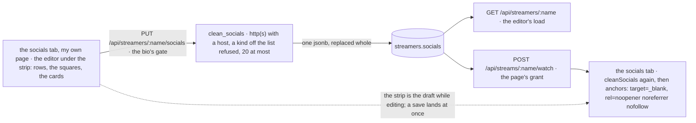

# socials

built. where else to find them: a `socials` tab under the player, after `about` (`about.md`) and `calendar` (`calendar.md`), with their links as icons: tiktok, youtube, twitch, kick, discord, instagram, x, threads, bluesky, facebook, snapchat, reddit, github, spotify, soundcloud, patreon, telegram, steam, and a globe for any other site. the owner picks how they sit (a row that wraps, or a grid of squares) and how big (small, medium, large), and puts words of their own on a link if the platform's name is not what they want. one jsonb column on `streamers`, replaced whole like the status through the bio's gate; the api checks every field at the door, the page checks again before it draws. the editor is on the tab itself: on your own page, `edit the links` opens it under the strip, and the strip follows the draft as you type (it was a section of the profile tab first; the profile tab now points at the page). with it, the corner panel changed: your picture is the way to your own page (where the tab is), the settings gear moved from the title row to the far end of your line in the panel, and the `following` button is gone. `api/migrations/migrate-11.sql`, `api/src/profile.rs`, `main.rs` (the two json literals), `frontend/src/infra/socials.ts`, `atoms/profile-atoms.ts`, `atoms/watch-atoms.ts`, `shared-components/Socials.tsx`, `shared-components/SocialsEditor.tsx`, `WatchPage.tsx`, `UserPanel.tsx`, `PageFrame.tsx`, `test/socials.js`.



## the short answer

**a link list is one document, not a table.** `{ layout, size, links: [{ kind, url, label? }] }` on the row beside `bio` and `offline_note`, written whole and read whole. nothing joins to it, nothing counts it, and a link has no identity anyone needs: the twentieth link is a row in an array, not a row in postgres. the bio's gate (`may_write`: a free name is anyone's, a claimed name its login's, a `dummy-` name the dummy box's) and the bio's upsert, so a name nobody saved anything for gets its row here too, and a rename carries it along for free (`ids.md`: the row keeps its id, only `name` moves).

**the kind is a label the owner picks, never a check on the host.** a `youtube` link may land on `youtu.be`, a redirector, a linktree; a host list would be maintenance with no gain, since what matters about a link does not depend on which host it is. what is checked is the url, the same way for every kind: absolute, `http` or `https`, a host, no credentials (`https://twitch.tv@evil.example/` reads as twitch and lands elsewhere), 500 characters at most, through the whatwg parser (the `url` crate on the api, `new URL` on the page: the same algorithm, so they agree on what parses and how it normalizes). the page then draws the host beside the word, in the title and on a grid square, so a hover says where a `twitch` icon really goes.

**refused, not trimmed.** the bio loses its tail quietly and the offline line folds to one line; a link dropped from the middle of a list would be a save the owner cannot see. so a url that is not a link, a kind off the list, a layout or size off its list, more than twenty: 400, with the word for it, and the row untouched. the editor says it first, naming the row (`not saved: link 3 is not a web address`), so a 400 is the belt and not the first thing anyone reads.

## the rules

- **the kinds are a closed list**, on both sides: `tiktok youtube twitch kick discord instagram x threads bluesky facebook snapchat reddit github spotify soundcloud patreon telegram steam web`. the api refuses a word it does not know (`bad kind`). the page reads a word *it* does not know as `web` (a newer api, a kind added since this build) so the link still shows, with the globe; the api reads a word *it* does not know off the row the same way (a kind taken off the list), so a row never breaks a profile read. `web` is any other site.
- **a url**: `clean_url` on the api (`profile.rs`), `socialHref` on the page (`socials.ts`). trimmed; the page puts `https://` in front of a bare `twitch.tv/you` before asking; then the parser; `http` or `https` and nothing else (`javascript:`, `data:`, `blob:`, a path, `ftp:` are all `bad url`); a host; no username or password; 500 characters at most before and after. kept as the parser writes it back: the scheme and the host lowercased, a control character percent-encoded (nothing a browser would read differently, and nothing postgres refuses in json).
- **a label** goes through the chat line's cleaning (`clean_text`: no control or invisible characters, no zalgo), folds to one line, and is cut at 40 characters: trimmed, not refused, like the offline line. empty is left off the wire, and the page says the kind's word.
- **layout and size** are words from their lists, `row` `grid` and `small` `medium` `large`. left out of the body they are the defaults (`row`, `medium`); given wrong they are refused (`bad layout. one of row, grid`), so a typo in a client is not silently swallowed. the page reads anything off the list as the default.
- **twenty links at most** (`too many links. 20 at most`); `[]` clears, like an empty offline line. duplicates are allowed, of kind and of url: a main and a vod channel are both youtube, and a dedupe would be the one place the api saves fewer links than it was sent.
- **the page checks again, whoever wrote the row**: `cleanSocials` on everything the api sends, so a row written by hand with `./scripts/manage.sh --db` cannot put a `javascript:` href on anyone's page. `about.md`'s stance for its css, the same here.
- **every link leaves safely**: `target="_blank"` with `rel="noopener noreferrer nofollow"` (`about.md`'s link rule). `noreferrer` keeps the viewer's `/watch/<name>` url from the destination without a site-wide header; `nofollow` keeps the site from being a link farm. nothing on the tab is fetched from anywhere but this origin: the icons ship with the page (remixicon), never a favicon from the service.
- **no rate limit**, the same as the bio: it replaces one column of one row the caller already owns, no row growth, nothing another user receives. a 32 kb body limit, since twenty links with the longest url and label each is under 12 kb.

## the document

```ts
type SocialKind = 'tiktok' | 'youtube' | 'twitch' | 'kick' | 'discord' | 'instagram' | 'x' | 'threads' | 'bluesky' | 'facebook' | 'snapchat' | 'reddit' | 'github' | 'spotify' | 'soundcloud' | 'patreon' | 'telegram' | 'steam' | 'web';
interface SocialLink { kind: SocialKind; url: string; label: string }   // '' for the kind's own word; left off the wire then
interface Socials { layout: 'row' | 'grid'; size: 'small' | 'medium' | 'large'; links: SocialLink[] }
```

the empty document, `{ layout: 'row', size: 'medium', links: [] }`, is what a name with no links has, on the read and in the column's default; never `null`, never a missing field, so no page branches on it.

## database

```sql
-- api/migrations/migrate-11.sql
ALTER TABLE streamers ADD COLUMN socials jsonb NOT NULL DEFAULT '{"layout":"row","size":"medium","links":[]}'::jsonb;
```

one column, the first jsonb on `streamers` (`chat_lines.badges` is the precedent). why not a `socials` table: the whole document is read on every profile read and every watch grant, and written whole from an editor that holds the whole thing; a table would be a join on the two hottest profile reads to answer a question nobody asks of a link alone. a rename keeps it (the row keeps its id); a free row taken by a rename goes whole, its links with it (`auth.rs` `take_free_row`: a delete, no merge, as for the bio).

## api

| | route | does |
|---|---|---|
| PUT | `/api/streamers/:name/socials[?password=]` | body `{ layout?, size?, links: [{ kind, url, label? }] }`, replaced whole. the rules above; the first thing wrong is the answer: 400 `bad url. http or https, 500 characters at most`, `bad kind`, `bad layout. one of row, grid`, `bad size. one of small, medium, large`, `too many links. 20 at most`, `bad json body` for a body of another shape. the bio's gate: 403 `that name has an account. log in as it`, 403 `reserved name`. → `{ name, socials }` as kept (the struct, not the row's json: postgres orders keys its own way, and the three readers must agree byte for byte) |
| GET | `/api/streamers/:name` | gains `socials`, the document. the editor's load |
| POST | `/api/streams/:name/watch` | gains `socials`. the tab draws from the grant: no request of its own, and a held name's grant answers for the name it became (`ids.md`), so the tab follows a rename where a `GET` by the old name would not |

the home card, the people, the search, the following list and the chats do not carry it (`home.rs`, `follows.rs`, `dms.rs` run their own selects): a link is a thing on the person's page, not a thing beside their face in a list. the html card for link previews (`profile.rs` `watch_page`) does not either: the bots read title, description and image, and the card has no link validator.

## pages

**the tab.** `#tab-socials` after `#tab-calendar` on the watch page (`WatchPage.tsx`, the `SocialsTab` of `SocialsEditor.tsx`), `#panel-socials` with `#socials` in it (`Socials.tsx`), `data-layout` and `data-size` on the box. a row: a chip per link, the icon and the word side by side, in a line that wraps. a grid: `repeat(auto-fill, minmax(…))` of squares, the icon over the word over the host, as many across as fit. three sizes: the icon at 16, 28 or 40 (16 and 28 are the scale the rest of the page uses; 40 is the one size past it, for a row a thumb can hit), the chip's padding and type with it. the word is the label, else the kind; the title is `word · host`. no links: a line saying so, and on your own page an `add links` button (`#socials-edit`). on your own page with links: `yours. edit the links` under them. either way opens the editor under the strip (`onEdit`), and the link goes while the editor is open. the tab is always there, like the calendar's: a tab that comes and goes is one nobody learns to look for.

**the editor.** on the tab, under the strip (`SocialsEditor.tsx`, `#socials-editor`), one `fieldset` with one `disabled` over all of it and `whyNot` in its status (the presence block's shape; `whyNotEditAtom` has the words). top to bottom: the rows (`#socials-list`, a row `#socials-row-<n>` with `data-kind`: the kind's icon, the url box `#socials-url-<n>`, the words box `#socials-label-<n>`, up `#socials-up-<n>`, down `#socials-down-<n>`, × `#socials-remove-<n>`; the arrows disabled at the ends; a url that is not a link gets a red stroke but stays), the places (`add a link`: a square per kind, `#socials-add-<kind>`; a click adds a row of that kind with its url box focused, so there is no add form: the row is the form), the layout cards (`#socials-layout-row`, `-grid`: the strip in miniature, from the owner's own kinds), the size cards (`#socials-size-small`, `-medium`, `-large`: the first link's icon at the real size), then `save links` (`#socials-save`), `done` (`#socials-done`, outside the `fieldset` so it works with the boxes off) and the status (`#socials-status`). no preview of its own: the strip above is the draft while the editor is open, every url as the save will send it (`draftAsShown`: `https://` in front of a bare host, a row that is not a link yet left out), so what you are editing is what is on the page. a `web` row takes the kind its host says as the url is typed (`kindOfUrl`: `twitch.tv` → twitch; a hint, the way the name box lowercases); a kind the owner picked stands. `Enter` does nothing special: the button saves. opening the editor calls `loadMyProfile` (the draft and the api's rule for the name i am), with the page's own document seeding an untouched draft first so the strip does not blink out while it loads.

**the save model.** one document, one button, like the status: the draft lives in `profile-atoms.ts` (`profileSocialsAtom`), so `done` and `edit the links` again keeps unsaved rows (and the strip is the saved document between the two), and × on a row is reversible until the save (no `sure?`: that is for irreversible server actions). `saveMySocials` runs `socialHref` on every row first and stops at the first that is not a link, naming it; then `PUT`; what comes back (a url the parser's way, a label cut) lands in the boxes unless something was typed meanwhile. the status says `changed. save to keep it.` while the draft differs from what the api has (`profileSocialsDirtyAtom`, a key of the document against the loaded one), `saved` or `cleared` after, `not saved: …` on a refusal (red, by `Status`'s rule). `loadMyProfile`'s draft rule holds: becoming somebody else drops the draft only if it is what the old name's row gave; typed rows survive and can be saved under the new name.

**my own page follows.** while the editor is open the strip is the draft; and `profile-atoms.ts` bridges a save to `watch-atoms`' `socialsAtom` when the page on screen is mine (`alsoOnWatchPage`), so the strip is the saved document the moment the status says `saved`, with or without `done`, no reload. a watcher's page learns on its next grant.

**the corner panel** (`UserPanel.tsx`), changed with this: the picture (`#you`) and a login's name are links to `/watch/<you>`, the way every face above them is a link to theirs; a guest with no valid name yet gets the profile tab instead, where the name box is. the settings gear (`#settings`) left the title row (`PageFrame.tsx`, which keeps go live alone) for the far end of the actions line, after `log out` or `log in`, with the inspector's icon beside it when that setting is on; on the right side the row is mirrored and the gear is at the far left, away from the picture either way. the `following` button (`#friends-open`) is gone: it pinned the box open and carried the streaming count; the box is a hover or a tab away (the search box is focusable closed, and the panel opens on focus), and the count sits on the picture's corner now, open or closed (`#friends-streaming`). `Friends.tsx` lost `focusSearch` with it.

## cost

no new query: the column rides the profile read and the grant that already run, one jsonb a row, a few hundred bytes. the tab is drawn from what the page already holds. one `UPDATE` per save, on the owner's own row. the `url` crate was in the lock already (reqwest, redis, sqlx and tower-http pull it): nothing new compiles.

## tests

`test/socials.js`, after `about` in `./scripts/test.sh`. two signups per run (`soc<run>`, `nos<run>`), a watcher context and an owner context.

1. a name with no links: the empty document on the profile read, not a missing field.
2. the login puts a document: 200, the document as kept (an empty label left off the wire), and the profile read and the watch grant both carry it, byte for byte.
3. bad input, 400 each with its word, the kept document untouched: a `javascript:` url, a `data:` url, no scheme, a path, credentials in the url, a kind off the list, a layout and a size off theirs, 21 links, a body of another shape (links not a list, a link with no url).
4. not yours: nobody 403, another login 403 `has an account`, neither changed it.
5. the watcher on `/watch/<name>`: the tabs read `about calendar socials`; nothing of the links in the page before the tab is opened; then `#socials` with `data-layout` and `data-size`, two anchors with the hrefs, `data-kind`, `target="_blank"`, `rel` with all three words, the unlabelled one wearing `youtube`, the labelled one its words; no `#socials-edit` for a watcher; not one request left this origin.
6. the about tab and back: out of the page, back as it was.
7. the corner panel as the owner: no `header #settings`, no `#friends-open`, `#user-panel #settings` visible on hover, `#you` and the name both `href="/watch/<me>"`, a click lands on the page with the name in `#who`.
8. my own page: `#socials-edit` opens `#socials-editor` under the strip, no modal, the rows holding the document, the row and medium cards on; the strip stays above with its two links and the edit link is gone while the editor is open.
9. the editor: the grid and large cards (the strip above wears them before any save), a github row from its square with focus in its url box, a bare `github.com/you`, words; the strip draws the third link already as `https://github.com/you` while the api still has two; `changed` in the status, save → `saved`, the url box reads `https://github.com/you`, the api says grid/large and three links; `done` folds the editor and the strip is the saved document, three in a grid, with `#socials-edit` back.
10. the editor again: a `web` row typed `https://www.twitch.tv/you` turns twitch (the strip shows four), up trades it with github, the first row's up and the last row's down are disabled, × takes it out; the api still has three, and `done` shows the three.
11. the watcher reloads: three links, grid/large.
12. the owner empties it with `{ links: [] }`: 200, the defaults for layout and size, and the watcher's tab stays, saying there is nothing here.

## not this

- **a table of links.** read and written whole, by one editor, on two reads that already run; a link has no identity anyone needs.
- **a handle instead of a url.** `@you` on youtube, `you` on twitch, a server invite on discord, a profile path on bluesky: every platform's address has a different shape, and the page would be building urls for nineteen services and fixing them when they change. a url is what the owner has in the address bar, and the one thing the api can check the same way for all of them.
- **host checks per kind.** a `youtube` link on `youtu.be` or a linktree is legitimate; a check buys maintenance and no safety. the host beside the word on the page is the honest version.
- **oembed, follower counts, a check that the handle exists.** a request to every service on every page load, from the api or from every viewer. the tab is the owner's word.
- **favicons or uploaded icons.** `about.md`'s media rule: nothing on a person's page loads from another origin, and an uploaded icon is a picture pipeline for a 28px square. the kinds ship with the page; `web` is a globe.
- **saving on every change.** the sources list on the go live page edits at once, but it never reaches the api; twenty rows saved per keystroke would be a `PUT` per arrow press, and the presence revert pattern does not scale to a list. one document, one button, like the status.
- **a form to add a link** (pick a kind, type, press add). the row is the form: a square adds a row with the box focused, and the row's arrows and × are the only other controls. one less thing.
- **the editor in the settings modal.** it was there first, as a section of the profile tab: the links are a thing on the page, and a 640px pane over the page is the wrong place to lay out a strip you cannot see. on the tab, the strip is the preview and the editor is under it. the profile tab keeps a `your page` section that points there, since that is where people looked for it. the status stays in the modal: it is about you, like the presence choice, not about the page.
- **the links in the html card for preview bots.** no og property holds them, the card is replaced the moment react boots, and `escape()` is not a link validator. if a search engine should know them, that is a `schema.org/Person` `sameAs` block in the head: additive, later, not a card placeholder.
- **keeping the gear in the title row too.** two gears is one more than discord has. the panel is where you are, and settings are about you.

## later

- the links on the person card and the sidebar's peek: six more selects and six more json literals (`follows.rs`, `dms.rs`), for a 260px tooltip that is not clickable. when a card wants it.
- a `socials` block inside the about document, once that editor exists (`about.md`), so a page of theirs can place the strip where it likes.
- the row's own icon as a way to change a kind in place. for now: × and a square.

## open questions

1. **a free name's links.** the one rule (`accounts.md`) says a free name's status is anyone's, so its links are too; outbound links are the one profile field where an anonymous writer is a spam vector and not graffiti. (recommendation: as built, the bio's gate; links are the status's sibling, not a page of their own. if it bites, `rel="ugc"` on a free name's links and a login gate are each a line.)
2. **the tab when there are no links.** always there with a line, or only when there is something. (recommendation: always, like the calendar's: a tab that comes and goes is one nobody learns to look for, and the owner's empty tab is where the `add links` button lives.)
3. **how many kinds.** nineteen squares is two rows in the editor. (recommendation: as built; a kind is three lines on each side when one is asked for, and the globe covers the rest meanwhile.)
4. **the picture as a link.** a guest's picture goes to `/watch/<nick>`, a page that is anyone's. (recommendation: yes; it is the page their chat lines and bio already live on, and the profile tab is one gear away.)
