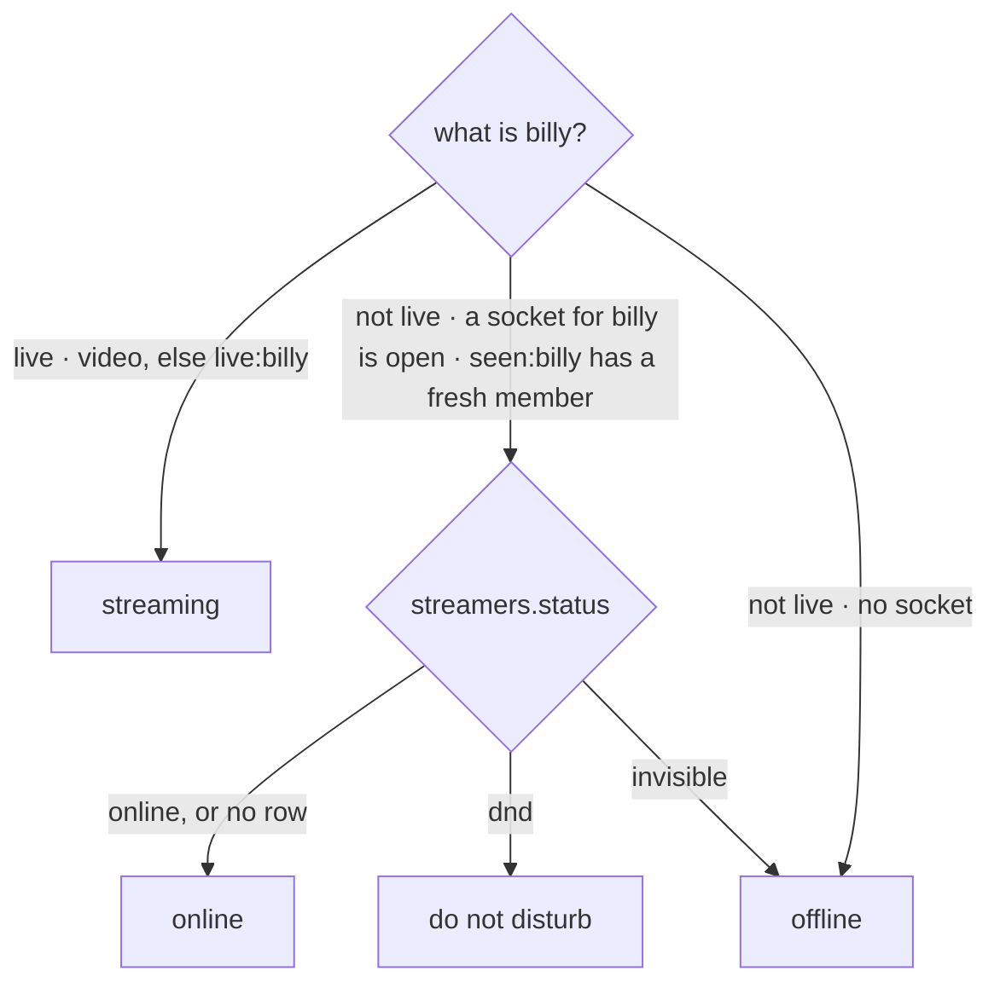
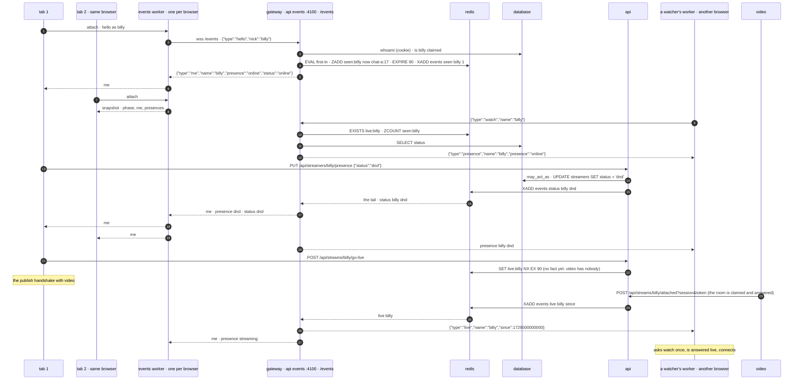
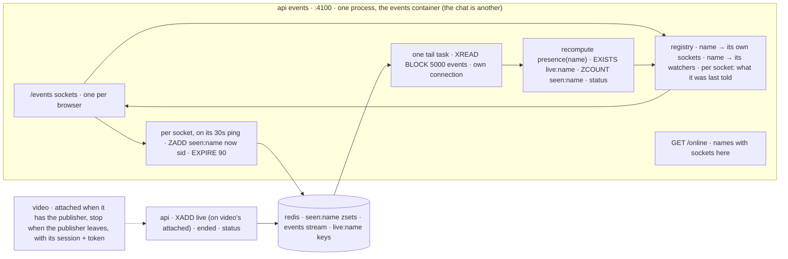
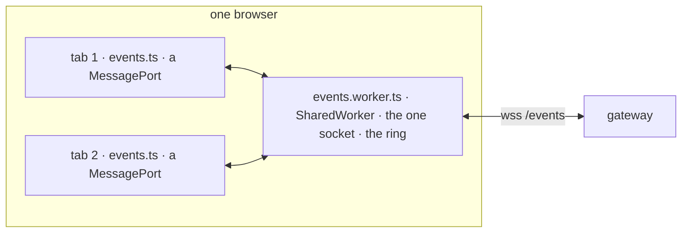

# status

built. one word next to a name that says whether they are around: `offline`, `online`, `do not disturb`, `streaming`. carried by one websocket per browser, open on every page, which is also the first push channel the site has. plus a way to watch that socket from inside the page. this file is the design and what is in the repo; `transition.md` is the deploy order (server first, pages last) and the numbers to check as it goes out. phases 1 to 6 below are in the repo: `api/src/presence.rs`, `socket.rs`, `events.rs`, the pages' `events.ts`, `events.worker.ts`, `frames.ts`, `presence-atoms.ts`, `inspector-atoms.ts`, `Inspector.tsx`, video's `stop` call, `test/presence.js`.

two words, on purpose: **presence** is the word next to a name, `offline` `online` `dnd` `streaming`; read, never chosen. **status** is the one you pick, `online` `dnd` `invisible`; a column and a json field. in the pages and the tests `status` already means the stream's status line (`#status`, `StatusLine`, `#pip-status`, the `*StatusAtom`s), so every id and atom about this says `presence`. a **frame** is one websocket message, in or out; a **message** is a chat line.

## the four

| shown | means | who decides | colour |
|---|---|---|---|
| `streaming` | a stream is up under the name | the api, from what it already knows: `video`'s `GET /live`, else the `live:<name>` key | the accent, `primaryBlue` |
| `online` | a browser is open as that name | the connection: a socket for the name is open on the gateway | `increase`, green |
| `do not disturb` | a browser is open, and they said so | them, a choice | `decrease`, red, a dark line through the square the way discord's has a bar |
| `offline` | no browser open, or they chose to look that way | nobody is connected, or they picked `appear offline` | `textTertiary`, grey |

`streaming` wins over everything: live and `dnd` is `streaming`, live and `invisible` is `streaming`. home lists the stream for everyone; a word that said otherwise would be a lie the home page contradicts. squares, no radius, like everything here.

## what is there today

- the square in the corner of your picture, bottom left (`UserPanel.tsx:84`): green for a login, grey for a guest. a colour that means "logged in", not "here". it becomes presence; the `✓` keeps meaning login.
- `live:<name>` in redis and `video`'s `GET /live`: who is streaming. `is_live` (`api/src/main.rs:267`) is video when it answers, else `EXISTS live:`. that is `streaming`, already computed.
- the chat service, `api chat` on `:4100` (`api/src/chat.rs`): one websocket per viewer per room, hello and identify (cookie, or the go-live grant, or a nick), a 30s ping with a 90s idle drop, 8 sockets per ip per room, redis streams for fan-out, a 2s drain on SIGTERM. that is four fifths of a gateway. the missing fifth is below.
- `logins.last_seen` moves at most once an hour, on purpose. an hour is not presence. guests have no row.
- no ring buffer anywhere in the pages: the chat keeps its last 500 lines by slicing a fresh array per line (`chat-atoms.ts:195`). fine at one line a second, wrong at frame rates.

## the rule



five lines, in two places that must agree: `presence(name)` in the api for http (`GET /api/streamers/:name`, `watch`, the watch document), and the same five lines in the gateway when it decides what to push. the api's copy asks video for `live`; the gateway's reads the `live:` key (it has no `VIDEO_URL`, and one http call per event per watcher would be the wrong price). phase 5 below is what makes the two agree within seconds of a crash.

## why a socket, and why this one

the first draft of this plan was a 30s http heartbeat into a redis key. it was sized for "a word that may lag". what it could not do: reach the other tabs and the phone without a round trip and a wait, tell a watcher on `not live yet. checking` that the stream started without a 5s poll, or carry the notifications `do not disturb` exists to gate. a socket does all four, and presence falls out of it the way `live` falls out of the publish connection to `video`: the connection is the fact. hidden tabs stop mattering too: browsers do not throttle websockets in background tabs, and pong frames are the network stack's, not a js timer's.

not a new binary. `api/src/chat.rs` already had the hello, the identify, the ping and idle drop, the per-ip cap, the redis tail on its own connection, the drain; that plumbing was lifted into `socket.rs` and the gateway built on it. it shipped as a second endpoint on the chat's listener and was then given a process and container of its own, `api events` (`events` in compose, `:4100`), so the chat and the data socket are two things that can be deployed, scaled and read apart: caddy sends `/chat/*` to one and `/events` to the other, and `./scripts/deploy.sh api` swaps `api`, `chat` and `events` together (same image).

## the shape



every socket follows its own name. so the sender sees its own change come back through the server like everyone else, the chat's rule (`chat.md`), and every tab and every device agrees without a side channel.

## the gateway

`/events` on `api events`, a listener and container of its own (`events.rs`'s `run`), the chat's constants from `socket.rs`: hello within 10s, frames 8 KB at most, a ping every 30s, dropped after 90s of silence, every send under a 10s budget, close frame 1001 on SIGTERM with a 2s drain. one socket per browser, open on every page, home included.

### frames

client → server

```json
{"type":"hello","nick":"bob"}
{"type":"hello"}
{"type":"watch","name":"billy"}
{"type":"unwatch","name":"billy"}
{"type":"watch","name":"*"}
```

`watch` with `*` is the home page's: every name's `live`, `ended` and `viewers` from then on, no word (there is none for everyone). the list itself is one `GET /api/streams` from the home service (`api home`, `home.rs`), and these frames keep it current.

the first frame is `hello`. a login sends it bare: the cookie went with the handshake (it does from inside a worker too, same origin) and the server names the socket after the account. a guest sends the nick from the name box; cleaned the chat's way, lowercased to a name, refused if that name is claimed (`that name has an account. log in as it, or pick another`, the chat's words) or reserved (`dummy-`). a hello with no cookie and no nick is allowed: an anonymous socket, which marks nothing and may still watch names. there is no `status` frame: the choice is an http `PUT` (below), and the answer arrives on the socket.

server → client

```json
{"type":"me","name":"billy","presence":"online","status":"online"}
{"type":"presence","name":"alice","presence":"dnd"}
{"type":"live","name":"alice","since":1729000000000,"verified":true,"avatar":1729000000,"bio":"hi","thumbs":[8123]}
{"type":"ended","name":"alice"}
{"type":"viewers","name":"alice","viewers":3}
{"type":"renamed","name":"billy","to":"bobby"}
{"type":"error","error":"that name has an account. log in as it, or pick another"}
```

`me` comes once after hello (`name` null for an anonymous socket) and again whenever my own presence or status changes; it is the only frame that carries `status`, so `appear offline` is a secret kept: watchers only ever get the derived word. `presence` goes to a name's watchers on change, and only on change (the gateway remembers what each socket was last told, per name). `live` and `ended` go to watchers as they happen. `renamed` (`ids.md`) goes to the account's own sockets, which are the new name from then on, and to the old name's watchers. `error` closes the socket, as in the chat.

### inside



- **extract first, add second.** the general plumbing moves out of `chat.rs` into `api/src/socket.rs` with no change of behaviour: `send`/`send_within` made generic over `Serialize` (`chat.rs:614`), the hello-with-timeout (`chat.rs:251`), the ping/idle/shutdown half of the loop as a small helper (`chat.rs:293`), `who_am_i` (the cookie half of `identify`, `chat.rs:199`), `Who`/`Unknown`, the constants, the upgrade wrapper with its size caps (`chat.rs:171`). `run` keeps one listener, one shutdown channel, one drain whose predicate becomes "no rooms and no gateway sockets" (`chat.rs:160`). the chat's own pieces stay where they are.
- **the registry.** chat's rooms are keyed by room and can only count; the gateway's is keyed by name and can address: `name → its own sockets` (for `me`), `name → its watchers` (for `presence`, `live`, `ended`), and per socket the set of names it watches and what it was last told about each. a socket id is `<hostname>:<n>`, so a stale member in redis names the process that left it.
- **here.** on hello, one `EVAL` (the shape of `DEL_IF_HELD_BY`, `main.rs:368`): trim members older than 90s by score, `ZADD seen:<name> <now_ms> <sid>`, `EXPIRE 90`, and if the set went from empty to one, `XADD events … seen <name> 1`. on close, the mirror: `ZREM`, trim, and if the set is now empty, `XADD … seen <name> 0`. atomic, so two processes cannot race a last-out against a first-in. every 30s, on the ping tick the socket already has (`chat.rs:318`), a pipelined `ZADD` + `EXPIRE` keeps the member fresh. a member nobody refreshes lapses by score; a set nobody writes lapses by ttl.
- **the tail.** one task per process, not per name: `XREAD BLOCK 5000 COUNT 100 STREAMS events <last>` on its own connection with the response timeout raised past the block, exactly the room reader's recipe (`chat.rs:463`). on error, reconnect and continue from `last`. on start, begin at `<now_ms − 10000>-0`, not `$`: the last ten seconds replay, so the gap of a deploy costs nothing (deliveries are idempotent, below). subscriptions are an in-process filter over the registry; a blocked `XREAD` cannot change its key list, which is why per-name streams would not do.
- **what the tail does with an entry** for name N: `live`/`ended` go to N's watchers as they are, and N's own sockets get `me` with `streaming` or the recomputed word. `status` and `seen` make the gateway recompute `presence(N)` in one pipelined round trip (`EXISTS live:N`, `ZCOUNT seen:N <now−90000> +inf`) plus N's status from a map seeded by one `SELECT` when N gets its first watcher and kept current by `status` entries; then `presence` to each watcher whose last word differs, `me` to N's own sockets. `seen` is never forwarded raw.
- **the 30s recheck.** for every watched name, the recompute again, pushed on change. one `ZCOUNT` per watched name per 30s. this is what notices a gateway that died without its drain (its members go stale, nobody published `seen 0`) and heals anything the replay missed. the shape of the api's sweeper.
- **`GET /online`** beside `GET /health` (`chat.rs:143`): `{ "<name>": <open sockets in this process> }`, like video's `GET /live`. inside the compose network only, no caddy route; the tests read it locally.
- **SIGTERM.** close frames out, and do **not** `ZREM`: the browsers re-hello within ~3s with new socket ids, the old members are trimmed by score on the next write or lapse with the key. no `offline`/`online` flicker on every `./scripts/deploy.sh api`. a browser that never comes back is offline 90s late, the lateness accepted from the start.
- **a redis restart.** everything in redis is gone (no volume, `docker-compose.yml:207`). the tail's reconnect signals the refresh, so every open socket's name is `ZADD`ed at once rather than at its next tick; the first-in `EVAL` fires `seen 1` per name; the recompute yields the word watchers already have and is suppressed. `live:` comes back within 15s through the page's heartbeat reclaim (`main.rs:619`), which now publishes `live`.

## redis

| key | type | written by | read by | ttl | memory |
|---|---|---|---|---|---|
| `live:<name>` | string = session id | api, as today (`SET NX EX 90`, `EXPIRE`, the guarded `EVAL` del) | api `is_live`; gateway `EXISTS` in the recompute | 90s | ≈80 B |
| `seen:<name>` | zset `socket id → last seen, ms` | gateway: the two `EVAL`s, `ZADD` + `EXPIRE` every 30s per socket | api `ZCOUNT` in `presence()`; gateway `ZCOUNT` in the recompute and the recheck | 90s, re-armed on every write | ≈100 B + ≈40 B per socket |
| `events` | stream, `MAXLEN ~ 1000` | api: `live`, `ended`, `status`; gateway: `seen` (inside the `EVAL`s) | one `XREAD BLOCK` tail per gateway process; `XRANGE events - +` by hand | none; trimmed by length | ≤ ≈150 KB in all |
| `chat:<name>` | stream, `MAXLEN ~ 500` | chat, as today | chat | 7 days | as today |

the stream carries **facts, never the derived word**, and each fact has one writer:

```text
XADD events MAXLEN ~ 1000 * type live   name billy since 1729000000000 session 12
XADD events MAXLEN ~ 1000 * type ended  name billy session 12 by stop        by stop | sweep | video
XADD events MAXLEN ~ 1000 * type status name billy status dnd
XADD events MAXLEN ~ 1000 * type seen   name billy here 1                    1 | 0
```

- api → `live`: after the `SET NX EX` wins in go-live (`main.rs:576`) and in the heartbeat's reclaim branch (`main.rs:621`). `since` is the session's `started_at`.
- api → `ended`: in `stop` when the guarded delete returned 1 (`main.rs:653`; 0 means another session holds the name and it is still live), and from the sweeper, whose `UPDATE` gains `RETURNING name` (`main.rs:348`) so each abandoned stream is one entry.
- api → `status`: after the `PUT` below writes the column. the gateway stays a reader of postgres, as the chat was built ("the database is only asked two questions", `chat.md`); the socket carries no writes; `curl` proves phase 1 alone.
- gateway → `seen`: inside the two `EVAL`s. the only thing the gateway writes.

why one stream and not pub/sub: `chat.md`'s own argument. a stream is history and live tail in one structure with ids, so a reconnect resumes from the last id with no gap; pub/sub is fire-and-forget, loses whatever is published during the 3s of a deploy, and in the `redis` crate (1.7, `api/Cargo.toml:14`) wants either a hand-rolled reconnect on a dedicated RESP2 connection or RESP3 with a push sender. keyspace notifications on `live:*` expiry would be wrong by construction: that key lapses under a stream that is really on (api down past the ttl, a redis restart), which is exactly why the sweeper asks video before ending anything. the 1000 of `MAXLEN` mirrors the pages' ring below, and `XRANGE events - +` is the server-side inspector for free.

why a sorted set and not `SET seen:<name> 1 EX 90`: with two gateway processes, A and B each hold a socket for billy; B's last socket closes; B's `DEL` makes billy offline until A's next refresh. a counter drifts on any crash and cannot be repaired. members with scores are the version that is right with N processes, offline at once on a clean close, and self-healing.

## api

| method | path | behavior |
|---|---|---|
| PUT | `/api/streamers/:name/presence` | body `{ status }`, one of `online` `dnd` `invisible`, else 400 `bad status`. the bio's gate (`may_write`: 403 `that name has an account. log in as it`, 403 `reserved name`). upserts the `streamers` row like the bio's put, then `XADD events status`. → `{ status, presence }` |
| GET | `/api/streamers/:name` | + `presence` (`main.rs:474`) |
| POST | `/api/streams/:name/watch` | + `presence` beside `live` (`main.rs:663`) |
| GET | `/api/health` | maybe + `chat` and `events`: a probe of `http://chat:4100/health` and `http://events:4100/health` under the same 1.5s cap as video's, reported, not part of `ok`. optional |

`presence(name)`: `is_live` as today, then `ZCOUNT seen:<name> <now−90000> +inf`, then the column. `GET /api/streamers/:name` asks video for the first time (the panel calls it once per page load, the profile tab once per open; the 1.5s cap applies when video is down). `GET /api/streams` does not carry it: everything on that list is `streaming`. the dummy box opens no `/events` socket: a fake stream is `streaming` or `offline`, which is the truth about it (it does hold chat sockets as itself, `dummy.rs:238`; the gateway must never infer `online` from a chat socket).

the choice is an http put, not a socket frame, on purpose: one writer of `streamers.status`, the api's one rule in the one place it lives, and no write-failure story on the socket. the socket is how the answer reaches every tab and device.

### database

```sql
ALTER TABLE streamers ADD COLUMN IF NOT EXISTS status text NOT NULL DEFAULT 'online';  -- online | dnd | invisible
```

one line after `main.rs:97`, in `SCHEMA`, which the api runs at boot (`main.rs:749`) and the chat process never does (`main.rs:743` returns first): the gateway reads a column the api made. a name with no row is `online` while a socket for it is open.

### the watch document

`profile.rs` threads a `live: bool` through `watch_page` → `render` → `head_tags`/`card_html`. it becomes the presence word: `{{status}}` and `{{tone}}` (`profile.rs:239`) take the four words and their classes (`text-primaryBlue`, `text-increase`, `text-decrease`, `text-textSecondary`); `og:description` with no bio (`profile.rs:191`) becomes `live now` / `online, not live` / `do not disturb, not live` / `not live right now`. the `<title>` keeps `live|offline` (`profile.rs:189`): it is about the stream, and previews are cached for hours anyway. the two tests that assert the old words (`profile.rs:352`, `:368`) move with it.

## video, one change

video knows a publisher is gone within ~15s (ICE: 5s disconnected, 15s failed, `video/src/main.rs:779`). the api learns it from the page's `stop` (a clean stop, at once) or from the sweeper: key lapses at 90s, row ended at 180s on the next 60s tick, nothing ended at all while video does not answer. a crashed tab is `streaming` for up to four minutes.

video already holds the publisher's `session` and `token` (the publish frame carries them, `video/src/main.rs:450`). at the one place the publish task exits (`video/src/main.rs:623`, after `hub.clear`), it calls the api's existing `POST /api/streams/<name>/stop?session=&token=`. no new route; the api ends the row, deletes the key if that session holds it, publishes `ended … by video`. a page that also sent its own stop gets a 403 for the second, which is nothing. about ten lines in `video`, which means a `./scripts/deploy.sh video` (ends every stream, warns first): bundle it with the next video change. nothing else in video or dummy changes; video still reads no redis and no database.

what still makes `streaming` early or late, and is accepted: `GET /live` lists a name from the moment the room is claimed (`video/src/main.rs:471`), before negotiation and before a packet, so up to ~10s of `streaming` with nothing watchable (a failed negotiation retracts it); nothing checks that packets flow while the socket holds; and when video does not answer, the api falls back to the key, up to 90s stale.

## the pages

### the worker



- **one socket per browser** in a `SharedWorker`, tabs attached by `MessagePort`. the worker owns the socket, the hello, the reconnect (a socket that was open and dropped is back in 3s, the chat's; one that never opened backs off from 3s doubling to 60s with ±25% jitter: `transition.md`'s rule 2, so pages ahead of their gateway are one request a minute per browser, not one every 3s), the last known state (phase, `me`, the presences of every watched name) and the ring; a tab attaching gets the state first, then the tail. frames go through unchanged: a tab posts `{ to: 'ws', frame }`, the worker sends; the worker posts `{ from: 'ws', frame }` to every port, plus `{ link: 'connecting' | 'open' | 'closed' }` on change. one protocol on the wire, a thin envelope on the port.
- **built with vite's `?sharedworker` import** (`import EventsWorker from '@/infra/events.worker?sharedworker'`), `{ name: 'events' }`. under the default `worker.format: 'iife'` the build emits a *classic* worker, the widest support there is (no module-worker requirement), as one hashed file under `/assets/`: covered by the Caddyfile's immutable rule, published by `publish-pages.sh` in the right order, a miss after a deploy is the existing `no-store` 404. an old tab keeps its old worker (already loaded, cached), a new tab starts a new one: two sockets per browser for a moment, harmless. one `/// <reference lib="webworker" />` type-checks under the existing tsconfig; no second config. dev caveat: the dev worker url is unhashed, so a running worker keeps old code until every `localhost:42069` tab is closed (or `chrome://inspect/#workers`).
- **the fallback.** chrome on android, samsung internet and android webview have no `SharedWorker` (safari dropped it in 6.1 and brought it back in 16). where `typeof SharedWorker === 'undefined'`, or the worker errors or does not answer within 2s, `events.ts` opens a plain socket for its own tab, the chat's way (the same backoff), and the ring lives in the tab. same frames, same atoms, one `Link` interface with two implementations; `eventsTransportAtom` says which one a tab got. the server does not care whether a browser is one socket or three.
- **who is the browser.** the cookie goes with the handshake. a guest's nick lives in localstorage, which a worker cannot read, so the first tab to attach hands it over in the attach message and the worker sends the hello; a tab whose identity changes (`identityChanged`, `profile-atoms.ts:135`, gains a fourth line: `reconnectEvents()`, unconditional, since a log in or out changes who the socket is, not just a nick) asks the worker to re-hello. tabs share the nick and the cookie, so they agree.
- **tabs that die.** a `MessagePort` has, historically, no close event when its tab goes (one is newly specified and shipping; treat it as a bonus). a tab says bye on `pagehide` and pings its port every 15s; the worker drops a port silent for 60s and un-watches what only that tab watched. a tab's watches are ref-counted per port; the last `unwatch` goes to the server.
- **lifetime.** the worker dies with the last tab, the socket with it, and the server's close `EVAL` makes the name offline at once. ios suspends a background tab outright: its worker and socket go, it is `offline` after the 90s score lapse, back on the first frame when woken. accepted.
- **where it starts.** `startEvents()` in `main.tsx` right after `installReporting()`: page-lifetime, not a component's, and it survives a crash that unmounts the Shell. `report.ts` already falls back to `fetch` where `sendBeacon` is missing, so the worker reports its own failures with it unchanged, `phase: 'events-worker'`.

### atoms and modules

- `src/infra/events.ts`: the link. `startEvents()`, `reconnectEvents()`, `stopEvents()`, `watchPresence(name)`, `unwatchPresence(name)`, the dispatch of server frames, `eventsPhaseAtom` (`off | connecting | open | closed`). `relayUrl('/events')` for the url (`relay.ts:80`). not `parseRelayMessage`: that is typed to the video socket's shape.
- `src/infra/events.worker.ts`: the worker. the socket, the ports, the snapshot, the ring.
- `src/infra/atoms/presence-atoms.ts`: `Presence = 'offline' | 'online' | 'dnd' | 'streaming'`, `PresenceChoice = 'online' | 'dnd' | 'invisible'`; `myPresenceAtom`, `presenceChoiceAtom`, `setPresenceChoice()` (the `PUT`; the answer arrives as `me`), a private `Map<name, Presence>` atom with a memoised `presenceOfAtom(name)` (not an atom per name: the count is not fixed, unlike the video slots). the user panel's square reads `myPresenceAtom`; `ownerAtom !== null` (`publish-atoms.ts:54`) may turn it blue the instant the go-live grant lands, before the server says so.
- `watch-atoms.ts`: a pushed `live` for the name on screen calls `streamerLive(name)`, which guards name and phase (`waiting` only) and calls the private `start()`. not `watch()`: that one short-circuits while picture in picture is on, which is exactly the corner-player case that should restart. a `presence` frame saying `streaming` goes the same way (a `live` the page missed: the gateway re-derives every watched word every 30s and pushes it on change). a pushed `ended` is not acted on: the video socket already delivers `ended` and is authoritative for the peer. `presenceOfAtom(name)` is seeded from the grant's `presence` and updated by pushes. **nothing polls while idle**: a clean "not live" (`waitForLive`) arms no timer; the api publishes `live` when video has the publisher (the `attached` route), so the grant the push triggers says live and the page connects first time. the pulls behind the push are events: when the link comes back after a gap the page re-fetches `watch` (a `live` published during the gap), and an ask that failed (`retryLater`: the api did not answer, or the video socket closed under the stream with no `ended`) is asked again, 3s doubling to 60s, the count reset once an ask is answered or frames play. the word can run a beat ahead of the fact (the key is set at go-live): that ask is answered not live and the page waits for the `live` that follows.
- `settings-atoms.ts`: `settings.inspector`, the `atomWithStorage` + validating read (`=== true`) + setter shape, no `store.sub` (no side effect).

### where it shows

| where | what |
|---|---|
| the panel, bottom left | the square becomes `#my-presence` inside `#you`: `bg-primaryBlue` / `bg-increase` / `bg-decrease` / `bg-textTertiary` by `myPresenceAtom`, `data-presence` the value, the word folded into `#you`'s `aria-label` and `title`, grey until the first `me`. presence for guests and logins alike |
| the user modal's rail header | `logged in ✓` / `not logged in` (`UserModal.tsx:125`) gains the presence word |
| the profile tab | a `presence` fieldset between the card and `username` (`ProfileTab.tsx:74`, `:118`): three `OptionCard`s in `sm:grid-cols-3`, `name="presence"`, `#presence-online` `#presence-dnd` `#presence-invisible`, the chosen one marked, the page's square following the `me` frame. `OptionCard` has no `disabled`: the fieldset is disabled with the bio's `canEdit`/`whyNot` (`:46`, `:57`). a line under: `streaming while you are live, whatever you pick` |
| the watch page | `#presence` beside `#who` in the title (`WatchPage.tsx:86`): the square and the word, `data-presence`. while not live the page says `not live yet. checking`; `online` beside the name is the reason to wait, `do not disturb` the reason not to; `live` arrives pushed and the page starts, no poll |
| the watch document | the four words in the card and in `og:description`, above |
| home | off its poll: one `GET /api/streams` from the home service, then `watch *` (`home-atoms.ts`): `live` is a card at the end, carrying bio, picture, `✓` and `thumbs`; `ended` takes it out; `viewers` moves `#viewers-<name>`. the snapshot again when the socket opens or comes back under the page, and after an ask that failed. a 1s tick for the chips |
| chat | nothing. lines carry `from`, `streamer`, `verified`; a dot per line is noise |

### the inspector

the messages the browser is getting, in the browser. a `SharedWorker`'s socket does not show in a tab's devtools network panel, phones have no devtools, and it is the thing you can ask a stranger to open and copy.

- **the setting.** a `debugging` fieldset in the settings tab ("this browser", `SettingsTab.tsx:18`): a checkbox `#inspector` (`settings.inspector`) and, while on, an `#inspector-open` button. while on, the same button sits in the user panel's actions line beside the gear; off, nothing is rendered and `record()` is one boolean check.
- **the panel, not a modal.** a `<dialog>` opened with `show()`, not `showModal()`: the frames worth watching are made by using the page, and a modal freezes it (`html:has(dialog:modal){overflow:hidden}`, `globals.css:30`) and traps focus. `#inspector-panel`, `aria-label="messages"`, mounted once by the Shell beside `MiniPlayer`, so it survives navigation; `z-50`, the `FRAME` stroke with no shadow (`CornerPlayer.tsx:30`, the house rule for a floating box), default top right so it does not sit on the corner players, dragged by its header and resized from `#inspector-resize-se` with the players' own pointer and clamping code (`CornerPlayer.tsx:257`, `:95`).
- **rows.** the admin page's row grammar (`AdminPage.tsx:98`): `ul#inspector-frames` with `role="log"`, a `li` per frame that is one `<button>` toggling a pretty-printed `<pre>`; columns time (`tabular-nums`, full timestamp in `title`), a direction chip (`out` blue, `in` grey, `link` green/red for open/close/error), `source` (`/events`, `/chat/<name>`, `/ws`), `type`, the json on one line, `truncate`d. rows carry `data-source`, `data-dir`, `data-type`, no ids. newest at the bottom with the chat panel's stuck-to-bottom layout effect (`ChatPanel.tsx:85`). `content-visibility: auto` on rows, no list library (the frontend has none).
- **controls.** `#inspector-filter` (text, over the precomputed lowercase text of each entry), `#inspector-types` with `#inspector-type-<t>` toggles, `#inspector-pause` (freezes the view, never the recorder; the held count shows), `#inspector-clear`, `#inspector-copy` (the shown entries as json, for a bug report), `#inspector-count` in the admin page's words, `{shown} of the last {total}`, `#inspector-notice`, `#inspector-close`.
- **all three sockets.** `/events` is recorded in the worker, where every frame passes. the chat socket and the video setup socket are the tab's: tapped where frames leave and arrive (`chat-atoms.ts:125`, `:154`, `:158`; `relay.ts:143`, `:147`, `:173`; the slots frame, `publish-atoms.ts:309`) and forwarded to the worker over the port for the one ring. signalling only: media and `getStats` are not frames; this is not webrtc-internals.
- **redaction, at record time, before anything is in any ring.** two out frames carry a credential: the chat hello with `session` + `token` and the video publish frame. `token` becomes `"…"`. bodies are clipped at 2 KB with the true `bytes` kept (the video offer can be 48 KB, a chat history 200 lines). names, presences and chat lines are public already (`verified` is public by design, presence is on `GET /api/streamers/:name` for anyone, chat is what the room sees); your own `invisible` comes back only to you.
- **never to `/api/errors`.** frames are not failures, and the report budget is 60 per ip per 10 minutes (`debug.rs:45`), which a frame stream would spend in seconds. maybe, later: when `report()` fires a `crash` or `soft`, a strip of the last ~20 entries as `{ source, dir, type, bytes, ms }` in `extra`, under its 2 KB cap. types and sizes, never bodies.

### the ring

the last 1000 frames in a ring (the owner's word: an ouroboros, the array that eats its tail), in the worker, so every tab sees the same 1000, a tab opened later gets history, and a reload loses nothing. in the fallback, in the tab.

```ts
const SIZE = 1000;
const buf: (Entry | undefined)[] = new Array(SIZE);
let head = 0; // the next slot to write
let count = 0;
function push(e: Entry) { buf[head] = e; head = (head + 1) % SIZE; count = Math.min(count + 1, SIZE); }
function at(i: number) { return buf[(head - 1 - i + 2 * SIZE) % SIZE]; } // 0 = newest, i < count. no allocation
```

an entry is `{ at, source, dir, type, text, bytes }`, with `text` the clipped json and a lowercase copy for the filter, computed once at push. the ring is a module handle like the socket and the peer (the house rule: atoms for what renders, handles for the rest); never in an atom, or 1000 entries copy on every frame. the atoms are `inspectorOnAtom` (storage), `inspectorOpenAtom`, `inspectorPausedAtom`, `inspectorFilterAtom`, and `framesTickAtom`, a number bumped once per `requestAnimationFrame` after a burst of pushes; the list reads `at(i)` for the rows it shows. the worker sends a tab that opens the inspector a snapshot (one message, ≤ 1000 entries) and then the tail; the tab mirrors into a ring of the same class. `clear` is shared; `pause` is the tab's.

## containers

| container | change |
|---|---|
| events (`api events`) | `/events`, `GET /online`, the tail, the registry, the `EVAL`s. same image as the api and the chat, its own command and container, the chat's env (`DATABASE_URL`, `REDIS_URL`, `PORT`), no new ports. its healthcheck is bash's `/dev/tcp` with a `GET /health` and a `200` check, the api's pattern (a bare tcp connect would call a wedged handler healthy). it shipped on the chat's listener first and was split out once the pages were on it; adding the service is a `compose up -d` that recreates `video` too, so it rides a full deploy |
| api | the column, `presence()`, the `PUT`, `presence` on two reads and the document, the four `XADD`s. optionally `CHAT_URL` for a health arm |
| frontend (caddy) | three lines: `handle /events { reverse_proxy events:4100 }` beside `/chat/*` (`Caddyfile:30`), an exact path like `/ws`. no timeouts to touch: caddy hijacks an upgraded connection and the chat socket already idles for weeks on the 30s ping. one access-log line per socket, at close, so fewer lines than the home poll writes today. a bind mount: a reload in place, no socket dropped, no image moved (`image-paths` excludes it) |
| pages | the worker chunk is one more hashed file under `/assets/` |
| database | one column |
| redis | two new key families and a stream, bounded by ttl and `MAXLEN`. still no volume |
| video | the `stop` call when the publisher leaves. the only video change |
| dummy | nothing |
| vite dev | one proxy line for `/events` with `ws: true` (`vite.config.mts:53`) |

## rules

- a free name's presence is anyone's, like its bio. a claimed name's is its login's. "alice is online" on a free name means a browser with the nick alice is open, which is exactly what "alice's bio" means.
- `appear offline` is kept secret by construction: the derived word is all a watcher is ever sent; the choice travels in `me` alone.
- offline is at once on a clean close (the last tab closed, the worker died, the socket closed), and up to 90s late on an unclean one (a laptop lid, a killed browser, a suspended phone). nothing waits on it.
- the gateway down (`./scripts/deploy.sh api`): sockets reconnect in ~3s, re-hello, the tail replays ten seconds, the page re-fetches `watch`. nothing is lost and nobody flickers. the gateway crashed without its drain: its members go stale and the recheck notices within 30s + 90s.
- redis down: the chat is already read-only then; presence pushes stop, the retry fallback on the watch page still runs, and the http `presence()` says `offline` for everyone until redis is back. honest, not graceful.
- the api down: no go-live, no stop, no status change can happen, so nothing is unpublished; sockets stay up, presence pushes keep coming. the stream heartbeats resume before the 90s ttl, as today.
- never a colour alone: the word on the watch page, the `title` on the square, `data-presence` for the tests.
- the beat is not a rate-limited route and `/events` adds no new one: one socket per browser, eight per ip per the chat's existing cap if wanted. anyone can be online as a free name, like anyone can set its bio: a known limit, not a bug.

## tests

`test/presence.js`, after `auth` (it signs up) and before `regress`. two contexts are two browsers (two workers, two sockets); two pages in one context share one worker. the guest is `r8`; the claimed name is `rp1` (201 or 409 accepted: `regress.js:234` needs `r9` free, a signup is permanent). playwright 1.64 does not expose shared workers (its target handler keeps pages and service workers only), so the proof that two tabs share one socket is three-fold: the server's `GET /online` locally (`r8: 1` with two tabs), `Target.getTargets()` over a raw CDP session counting `shared_worker` targets (two contexts, three pages: exactly two), and the inspector showing one `hello` in two tabs. radios are `sr-only` inputs, so click `label[for="presence-dnd"]` and assert `isChecked`.

1. preflight: `GET /api/streamers/r8` → `presence: offline`; home does not list `r8`.
2. a second context at `/watch/r8`, offline: `#presence[data-presence="offline"]`, `#status` matches `/not live/`; count `POST /api/streams/r8/watch` with `page.on('request')` (`pip.js:78`): exactly 1 in 12s (the old loop would make 3).
3. first context, a tab as `r8` (`#username`, enter): `GET /api/streamers/r8` → `online` within 5s; `#my-presence[data-presence="online"]`; the watcher's `#presence` → `online` with no reload and no new `watch` call.
4. `#you` → `label[for="presence-dnd"]`: `#my-presence` → `dnd`; the api → `dnd`; the watcher → `dnd` within 3s.
5. go live as `r8`: the api → `streaming`; both squares `streaming`; the watcher's `#status` → `watching` and `watch` calls → exactly 2.
6. stop: the watcher's `#status` → `/ended/`, `#presence` → `dnd`; the api → `dnd`.
7. `label[for="presence-invisible"]`: the api → `offline`, the watcher → `offline`, the chooser's own card still `invisible` and its square grey.
8. a second page in the first context: locally `GET /online` → `r8: 1`; CDP: two `shared_worker` targets; the new tab's inspector shows the one `hello`. close one page: still `online` after 3s. close the last: `offline` within 5s (the close `EVAL`, not the ttl).
9. claimed: sign up `rp1`; a guest nick `rp1` in a third context: a raw `wss /events` probe (`chat.js:80`) gets `{"type":"error"}` matching `/account/`; the api says `offline`; locally `EXISTS seen:rp1` → 0.
10. the inspector: `#settings` → `#tab-settings` → `label[for="inspector"]` → `#inspector-open`: `#inspector-frames` has a `me` and a `presence` row; `#inspector-filter` typed `presence` leaves only rows containing it; a chat line said on the watch page shows up with `data-source="/chat/r8"`; `#inspector-count` ≤ 1000.
11. locally: `TTL seen:r8` in (0, 90]; `DEL seen:r8` → `offline` at once, `online` again within 35s (the 30s refresh). off-box these two are `SKIP`, the `errors.js` way.
12. cleanup: `label[for="presence-online"]` for `r8`, stop if live.

## code

- `api/src/socket.rs`: the plumbing lifted out of `chat.rs`, unchanged in behaviour. `api/src/events.rs`: `/events`, the registry, the two `EVAL`s, the tail, the recompute, the recheck, `/online`. `api/src/presence.rs`: `presence(name)`, the `PUT`, the `XADD` helper the four publish points call. `chat.rs` loses ~150 lines, `main.rs` gains the column line, the four publishes, the `RETURNING name`.
- `api/src/profile.rs`: the word and the tone.
- `video/src/main.rs:623`: the `stop` call.
- `frontend/src/infra/events.ts`, `events.worker.ts`, `atoms/presence-atoms.ts`, `atoms/inspector-atoms.ts`; `UserPanel.tsx` (the square, the opener), `user-modal/ProfileTab.tsx` (the cards), `user-modal/SettingsTab.tsx` (the setting), `shared-components/Inspector.tsx`, `WatchPage.tsx` + `watch-atoms.ts`, `api.ts` (`setPresence`, the two fields), `main.tsx` (`startEvents()`), `router.tsx` (the Shell mounts the inspector), `vite.config.mts` (the proxy line). the taps in `chat-atoms.ts`, `relay.ts`, `publish-atoms.ts`.
- `frontend/Caddyfile`: three lines. `test/presence.js`.

## phases

all six are in the repo; the order is still the deploy order (`transition.md`): the api, then the gateway with its caddy handle, then the pages.

1. **the api** — the column, `presence()`, the `PUT`, `presence` on `GET /api/streamers/:name`, `watch` and the document, the four `XADD`s. `curl` and `redis-cli XRANGE events - +` prove it: go live, an entry; stop, an entry; put `dnd`, an entry; the read says the right word. about 200 lines of rust.
2. **the gateway** — `socket.rs` out of `chat.rs` with every chat test still passing, then `events.rs`: hello and identify, the registry, the `EVAL`s, the tail, the recompute, the recheck, `/online`, the drain. the caddy handle, the vite proxy line. a raw `wss` probe from `page.evaluate` proves it before any page knows. about 400 lines of rust.
3. **the pages** — `events.ts`, the worker, the fallback, `presence-atoms.ts`, the square, the three cards, `#presence` on the watch page, `streamerLive`, the slowed retry, `reconnectEvents` in `identityChanged`. about 450 lines of ts.
4. **the inspector** — the ring in the worker, the taps, the redaction, the panel, the setting. about 350 lines of ts.
5. **video** — the `stop` call. ten lines, one `./scripts/deploy.sh video`, bundled with whatever video change comes next.
6. **tests and docs** — `test/presence.js`; the docs below.
7. **later** — home off its 3s poll: a `watch` of `*` (or a `streams` frame) that gets `live`/`ended` for every name plus a full refetch on reconnect; chat rooms over the one socket (a `join` frame), which would also end the "this page has its own chat" limit of the corner player; the first notification reading `dnd`; the viewer count as a `ZCARD` on the same pattern (`kubernetes.md` item 6); `/admin` showing `XRANGE events`; a Web Locks leader as the android fallback if one socket per browser ever matters there.

each phase deploys alone. 1 is already `curl`-able presence; 1 + 2 is a gateway any client can use.

## cost

one socket per browser, idle but for a ping every 30s: tens of kilobytes of memory each on the server, nothing on the wire, fewer access-log lines than today's home poll. one `ZADD` + `EXPIRE` per socket per 30s. one `XADD` per go-live, stop, status change and first-in/last-out. one tail per process. the recheck: one `ZCOUNT` per watched name per 30s. the ring: 1000 entries × ~2 KB at most, a couple of megabytes in the worker, once per browser. nothing new runs.

## not this

- **an http heartbeat into a ttl key.** the first draft. right for a word that may lag, wrong for anything that must reach the other tabs, the phone, or a waiting watcher without a poll. and hidden tabs throttle its timer; a socket's pong is not a timer.
- **pub/sub, keyspace notifications.** fire-and-forget, no replay, and the expiry of `live:` does not mean ended. above.
- **a plain `SET … EX 90` for here, or a counter.** wrong with two processes, or unrepairable. above.
- **the choice over the socket.** two writers of `streamers.status` and a write-failure story on the socket. the put is one writer, one gate, `curl`-able.
- **the ring in an atom, or sliced like the chat lines.** a copy of 1000 entries per frame. a handle and a tick.
- **the inspector as a modal, or as a fifth tab, or on `/admin`.** a modal freezes the page that makes the frames; the modal's pane is 640px and remounts per tab and unmounts on close; `/admin` is admins reading server reports. a floating non-modal dialog, mounted once.
- **frames to `/api/errors`.** not failures; the budget would go in seconds.
- **a Web Locks leader as the fallback, now.** one socket per browser on android, but a frozen leader tab starves the others. per-tab sockets have no new failure mode. later, if it matters.
- **idle / away.** a fifth state and input tracking in every tab. not asked for.
- **`logins.last_seen` as presence.** hourly by design; guests have none.
- **the choice in redis or localstorage.** gone on restart; per browser.
- **a custom status line.** the bio is the sentence about you.

## when it ships, these docs move

- `spec.md`: the watch row and the retry bullet (`:35`, `:266`: presence arrives pushed; the retry is the fallback); the panel, profile and settings tab paragraphs (`:38`–`:42`); the processes diagram and the caddy, chat, database and redis rows (`:76`–`:104`); the redis-restart sentence (`:162`); the api table (`:195`, `:203`, a `PUT` row); the cookie sentence (`:235`: `/events` too); "no websockets required for the stream list" (`:250`: three sockets now, one on every page); the repo shape and frontend trees (`:292`, `:311`, `:319`–`:334`); the tests table and the ids paragraph (`:365`–`:379`); known limits (`:385`).
- `architecture-picture.md`: the one-machine diagram (`/events` from every page, the chat node, the redis node), the url table, "inside chat" (the gateway task and keys), the folder list, the dev proxies.
- `overview.md`: the watch and chat bullets, redis ("who is live" and "who is here"), the accounts paragraph (the square means presence, the `✓` still means login), the tests.
- `chat.md`: the service paragraph (caddy forwards `/events` too; "keeps no state that matters" holds because presence is in redis); "later, not now": the second chat machine's redis move is now real.
- `debugging.md`: a fourth bullet, "what is the browser being told": the inspector, nothing leaves the browser.
- `accounts.md`: the `ws /events` row beside `/chat/:name`: the cookie names the browser, a guest's hello carries the nick.
- `README.md`: this file's line.

## open questions

1. **guests too, or logins only?** the one rule says a free name is anyone's; "alice is online" then means "a browser with that nick is open", as true as "alice's bio". logins only is a smaller claim and a smaller feature. (recommendation: the one rule, as everywhere else.)
2. **the colours.** blue for `streaming` (the accent, the one colour the theme calls ours), green `online`, red `do not disturb`, grey `offline`. the live chip on the cards is green and pulses; it stays, it is about the stream, not the person. the other way: green `streaming` to match the chip, blue `online`.
3. **video calling `stop` when the publisher leaves.** it ends a session the page would otherwise keep alive with heartbeats while its media is gone; today such a page shows a failure and does not reconnect on its own, so nothing is lost, and a crash stops lying within ~15s instead of ~4 minutes. (recommendation: yes, with the next video deploy.)
4. **the inspector: all three sockets from the start, or `/events` first?** the taps are five lines; the redaction is what matters and is the same either way. (recommendation: all three.)
5. **the chat healthcheck.** upgrade to a real `GET /health` probe in the full deploy that ships phase 2, since any compose edit restarts video anyway. (recommendation: yes, then.)
6. **the android fallback.** per-tab sockets (no new failure mode) or a Web Locks leader (one socket, a frozen-leader hazard). (recommendation: per-tab now.)
7. **does `appear offline` hide the stream?** (recommendation: no. home shows it anyway, and the `live:` story stays untouched.)
