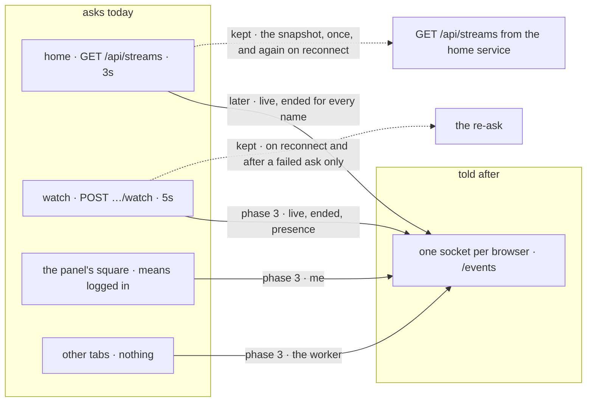
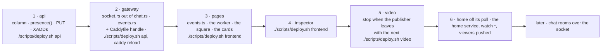

# transition

the move, now that the code is in the repo (`status.md`). the pages ask today; after this they are told. every http loop and timer the site runs, which ones the one socket in `status.md` replaces and in what order, what stays http and why, and how each step goes out with old pages and a new server on the wire at the same time. the socket itself (the gateway, the frames, the worker, the keys) is designed in `status.md`. this is the move.

## why the first draft said no

the first draft of `status.md` was a 30s http heartbeat into a ttl key. its "not this" rejected a socket with one sentence: `offline` the instant the socket drops, "the one thing not asked for". true, and the wrong question. a socket is not for knowing when you leave. it is for being told while you are here, and the beat could not do that: your other tabs needed a `BroadcastChannel`, your phone waited for its next beat, a watcher on `not live yet. checking` kept its 5s poll, and the notifications `do not disturb` exists to gate had nothing to arrive on. the cost argument was wrong too: `api/src/chat.rs` already has the hello, the identify, the 30s ping with the 90s idle drop, the per-ip cap, the redis tail on its own connection and the sigterm drain. the gateway is a second route on that listener, not a service.

| | the beat (first draft) | the socket (`status.md`) |
|---|---|---|
| "here" | `SET seen:<name> 1 EX 90` from a 30s timer in every tab | a socket is open. a zset member per socket, refreshed by the server's own ping |
| offline | 90s late, always | at once on a clean close. 90s late on a lid closed or a killed browser |
| my other tabs | a `BroadcastChannel` | one socket per browser, every tab attached to it |
| my phone | its next beat, up to 30s | a pushed `me` |
| a watcher waiting | the 5s `watch` poll | a pushed `live`, published when video has the publisher. no poll: the page re-asks when its socket comes back or an ask failed, and the gateway re-pushes the word every 30s on change |
| hidden tabs | chrome runs their timers once a minute; the ttl was sized around that | websockets are not throttled; a pong is the network stack's, not a timer's |
| the choice | `PUT` | `PUT`. the answer comes back on the socket |
| `streaming` | the api's `is_live` | the same, plus the `live:` key in the gateway |
| what else rides it | nothing | `live`, `ended`; later the home list, chat rooms, the first notification |
| requests | 2 per tab per minute | none. one idle socket per browser |
| new code | ~250 lines | ~1400 lines, the chat's plumbing lifted rather than written |
| new moving parts | one key | a zset family, a stream, a tail task, a registry, a worker |

the last two rows are the price. the rows above them are why it is paid.

## what asks today

every loop the pages run, and the server's own. the two in bold are the ones that go.

| who | asks | how often | file |
|---|---|---|---|
| **home** | `GET /api/streams` | **every 3s per open tab** (was: now once on arrival, `home-atoms.ts`). the answer was also the page's clock: `since` and the thumbnail bucket moved with it | `HomePage.tsx:14`, `:118` |
| **watch, not live** | `POST /api/streams/:name/watch` | **every 5s** until `live`, after `ended`, after an api error. the corner player waits the same way | `watch-atoms.ts:17`, `:138` |
| home, each card | `GET /thumb/<name>.jpg?t=` | every 5s per card per tab | `HomePage.tsx:16` |
| the publisher | `POST …/heartbeat?session=&token=` | every 15s while live | `publish-atoms.ts:20`, `:216` |
| the panel | `GET /api/me`, then `GET /api/streamers/:name` | once per page load | `UserPanel.tsx:54`, `auth-atoms.ts:24`, `profile-atoms.ts:66` |
| admin | `GET /api/health`, `GET /api/errors` | every 10s, admins only | `AdminPage.tsx:9` |
| the chat | one socket per viewer per room, on `/watch/*` and `/live` only | server ping 30s, idle drop 90s, reconnect 3s flat | `chat.rs:49`, `chat-atoms.ts:29` |
| video setup | `/ws`, one frame each way, then held for the stream | per publish, per watch | `relay.ts` |
| the api | `GET video:7880/live` (`/viewers` for `streams`: the same names with a count each) | on every `streams`, `watch`, `go-live` and sweep | `main.rs:254` |
| the sweeper | ends open rows nobody holds | every 60s | `main.rs:67` |
| the monitor box | `/api/health` of every box | its own interval | `monitor.rs` |

what the two bold loops cost: a home tab is 20 requests a minute, each one a `GET /live` to video and a query; a waiting watcher is 12. caddy writes an access-log line per request, which is why the compose file caps the logs (`docker-compose.yml:33`). a hundred home tabs is 33 requests a second, 33 calls to video a second, for a list that changes a few times an hour.

## the principle

the browser **asks** over http when it wants something: a grant, a write, a page, a read it does once. it is **told** over the socket when something happened that it did not do. requests stay requests. polls become pushes. the socket carries facts about names, mine included, and never a write of mine.

the sorting rule for every call in the table: does the answer change while i do nothing? then it is a push. is it something i do, or ask once? then it stays http.

## what becomes a push

| loop | after | what is kept behind it | phase in `status.md` |
|---|---|---|---|
| watch, not live | `live` arrives pushed and the page starts; the word `streaming` does the same (a `live` the page missed, re-pushed by the gateway's 30s recheck); `ended` is the video socket's to say; `presence` beside the name. `live` is published when video has the publisher (`attached`), not at go-live, so the one ask on the push is answered live | no timer while idle. the page re-asks `watch` on every reconnect, and after an ask that failed (no answer; the video socket dropped with no `ended`) with a backoff from 3s to 60s. the 5s/60s idle retry was kept through the transition and removed once `attached` made the push connectable | 3 |
| the panel's square | `me`: `offline` `online` `dnd` `streaming`, grey until the first frame | nothing to keep: there was nothing before | 3 |
| my other tabs, my phone | the worker's one socket; `me` to every socket of the name | — | 3 |
| home | **done.** a `watch` of `*`: `live` adds a card at the end (the card carried in the frame: bio, picture, `✓`, `thumbs`, `since`), `ended` removes one, `viewers` moves the chip. the snapshot behind it is `GET /api/streams` from the home service (`api home`, `home.rs`): every live stream and its count in memory from the same facts, built from video's word at boot and checked against it every 30s, first on first; the ranking goes there when there is one | no poll. the snapshot again when the socket opens or comes back under the page, and after an ask that failed (3s doubling to 60s). a 1s timer for the clock the poll used to be. frames that land while a snapshot is in flight are held and applied on top of it | 7 |
| the chat's socket per room | `join` / `leave` frames on the one socket. ends the corner player's "this page has its own chat" limit, which exists because the chat atoms hold one room | the `/chat/*` route until the last old page is gone | later |
| the viewer count | **done.** video tells the api when a room's count moves (`POST …/viewers`, at most once a second per stream); the api publishes a `viewers` fact; the gateway pushes it to the name's watchers and to `*`; home's table keeps the latest | the watch page's own count still comes on its video socket, as before | 7 |

## what stays http

- **go-live, attached, heartbeat, stop.** a lease on a name, renewed every 15s, with the session and token video checks through the api (`spec.md`, the publish frame); `attached` is video saying it has the publisher, which is when the api publishes `live`. it changes server state; it is not a poll. a socket close is not a stop either: two tabs, a worker that died, a laptop asleep. the gateway is a reader of postgres and stays one (`status.md`: one writer of every column). `sendBeacon` on `pagehide` has no socket equivalent.
- **the watch grant.** a request for a url and a bio, once per attempt.
- **every write.** the status `PUT`, the bio, the picture, signup, login. they want status codes, the cookie, the api's one rule in the one place it lives, and `curl`.
- **`/api/me` and `GET /api/streamers/:name` on load.** reads, once. the socket then keeps them current.
- **the watch document.** server-rendered html for bots that run no js.
- **the thumbnails.** a picture every 5s per card. pictures are not facts.
- **admin.** a handful of people reading a server table every 10s.
- **the api asking video.** server side, and it shrinks on its own: every poll that goes was a `GET /live`.

## the wire during the move

old pages and a new server will be up together: a tab open for a day keeps its build (`index.html` is `no-cache`, so the next navigation gets the new one; nothing forces a reload). each pair has to be safe.

| pair | what happens | safe? |
|---|---|---|
| old pages, new api | `presence` is one more field on `watch` and `GET /api/streamers/:name`. ignored | yes |
| old pages, new gateway | nobody opens `/events`. the gateway idles | yes |
| new pages, old caddy (no `/events` handle) | the upgrade request falls to the spa catch-all and gets `index.html` with a 200. the browser's `WebSocket` fails, `onclose` fires, and a flat 3s reconnect (the chat's, `chat-atoms.ts:191`) hits caddy every 3s from every browser until the next deploy | **no.** two rules below |
| new pages, new caddy, no `events` container (a compose that predates it, or `api events` not up yet) | caddy forwards to `events:4100`, which is not there: a 502, the same failed handshake | **no.** same rules. a full `compose up` carries the service; `./scripts/deploy.sh api` swaps it with the api |
| old api, new gateway | nothing is `XADD`ed to `events`; the tail reads nothing; presence is `online`/`offline` from the sockets alone, `streaming` from the `live:` key the old api still writes | yes, degraded |
| a `./scripts/deploy.sh api` with sockets open | the events process sends close 1001 and drains 2s (`events.rs`, the chat the same for its rooms); the api, chat and events containers swap together (`deploy.sh`, `redeploy_service`); every browser reconnects, re-hellos, the tail replays ten seconds | yes. a herd of hellos within 3s, see the numbers |
| a Caddyfile change | reloaded in place (`deploy.sh:699`); a reload that fails recreates the container and drops every open websocket, the chat's and video's included, and says so | yes, when the reload works |
| the first draft's `seen:` string, the socket's `seen:` zset | the same key name, two types: `WRONGTYPE` on the first `ZADD`. nothing of the first draft is in the repo, so there is nothing to migrate. a box that ever ran it: `redis-cli --scan --pattern 'seen:*' \| xargs redis-cli DEL` before the gateway starts | n/a |

the two rules the "no" rows need:

1. **server first, pages last.** the api, then the gateway with its caddy handle, then the pages. `status.md`'s phases are already in that order; this is why they cannot be reordered or shipped as one.
2. **back off on a failed handshake.** a socket that never opened retries at 3s, then 6, 12, 24, 48, capped at 60s, with ±25% jitter; a socket that was open and closed retries at 3s like the chat (that is a deploy, and the server is back in seconds). the chat's flat 3s is right for the chat, which is only on two pages; the same loop on every page of the site against a route that is not there is a request storm. so a pages-before-gateway mistake, or a gateway that is down for an hour, costs one request a minute per browser.

## the order

each step, what proves it, and the way back:

| step | proves it | back |
|---|---|---|
| 1 api | `curl` the three reads say the right word; `redis-cli XRANGE events - +` has a `live`, an `ended`, a `status` entry after a go-live, a stop, a put | the previous tag. the column stays (harmless, `DEFAULT 'online'`); the stream stays (`MAXLEN ~ 1000`, trims itself) |
| 2 gateway | a raw `wss /events` probe from `page.evaluate` (`chat.js:80` has the shape) gets `me`; `GET http://events:4100/online` from inside the network; every chat test still passes | the previous tag and the handle removed. nothing connects to it yet |
| 3 pages | `test/presence.js`; the caddy log's count of `POST /api/streams/<name>/watch` lines per waiting watcher falls from 12 a minute to the one on arrival | `./scripts/deploy.sh frontend` at the previous tag. the gateway stays up, idle |
| 4 inspector | `#inspector-frames` has a `me` row in a browser that has done nothing else | the previous pages |
| 5 video | a publisher tab killed → `ended` on the stream within ~15s, not ~4 minutes | the previous video image. ends every stream, like any video deploy |
| 6 home | `test/presence.js`: a home tab makes one `GET /api/streams` and gets the card, its count and its removal by push; the caddy log's `GET /api/streams` lines fall from 20 a minute per tab to one per visit | the previous pages (the poll); the `home` container and the `*` topic stay up, idle |
| later | the chat's rooms | — |

## how to tell it worked

- **the caddy log.** `docker compose logs frontend | grep -c 'streams/r8/watch'` over a minute with a watcher waiting: 12 before, none after the one on arrival. `GET /api/streams` the same way with a home tab open: 20 a minute before, one per visit after.
- **`GET /online`** on the chat container, summed: how many browsers have the site open. the number the site never had.
- **`XRANGE events - +`.** every fact of the last while, by hand.
- **the inspector.** the frames a browser got, in the browser, which is the one a stranger can open and copy.
- **`docker stats chat`** and `ss -s` inside it: sockets and memory per browser. tens of kilobytes each is the expectation; a megabyte each is a leak.
- **`test/presence.js`** step 2 (`status.md`): exactly one `watch` call in 12s with the stream offline.

## the numbers

| | a home tab | a waiting watcher | a browser, any page |
|---|---|---|---|
| today | 20 req/min + 12 thumb req/min per card | 12 req/min | 0 |
| after phase 3 | the same | 1 req/min + one socket | one socket; a ping each 30s, a `ZADD` + `EXPIRE` each 30s |
| after home moves | 1 req/min + the thumbnails | 1 req/min | the same |

what grows: open sockets on the chat process, one per browser plus the chat's own per room. things to check once, before phase 3 ships to anyone but the tests:

- **file descriptors.** `cat /proc/1/limits` inside the chat container. docker's default `nofile` differs by version (recent daemons ship a soft limit of 1024 unless `default-ulimits` says otherwise), and a rust process does not raise its own soft limit the way go does. 1024 is a thousand browsers, then `accept` fails. `ulimits: nofile: { soft: 65536, hard: 65536 }` on the chat service in compose fixes it; a compose edit is a `compose up -d` that recreates video too (`deploy.sh:596`), so bundle it with the healthcheck change `status.md` already wants in the same full deploy.
- **the reconnect herd.** a `./scripts/deploy.sh api` closes every socket at once and every browser is back within 3s: n hellos, n `EVAL`s, n `whoami` queries in three seconds. hundreds is nothing; the jitter in rule 2 spreads thousands. the api's pool is 8 connections (`main.rs:685`); the gateway's `whoami` goes through the same pool size, so a `Busy` on hello must be the chat's answer (admitted, identified later), never a refusal.
- **memory per socket.** tokio task + buffers + the registry's per-socket "what it was last told" map. measure with `docker stats` at 1, 10, 100 tabs before trusting any estimate.
- **the per-ip cap.** the chat's 8 sockets per ip per room (`chat.rs:46`) is right for a room. for `/events` it would lock out the ninth browser of a school or an office behind one address. none, or a high one.

## rules

- server first, pages last. a frame type appears in the pages only after the gateway sends it; a gateway may send frames old pages do not know.
- unknown frame types are dropped by both sides, the way the chat drops anything that is not `say` (`chat.rs:337`). the pages log them to the inspector and nowhere else.
- every push has a pull behind it, and the pull is an event, not a clock. a reconnect re-fetches; an ask that failed is asked again, backing off; the server re-derives every watched word every 30s and pushes it on change, and the home service checks its table against video every 30s. nothing on a page asks on a timer while it is healthy and idle. the socket is the fast lane and http is what makes it true. (the watch page's idle retry and the home poll were kept slowed through the transition, as the next rule says; each was removed once its push was true at the moment it mattered: `live` published when a watcher can connect, the home list held by a service that sees every fact. see `status.md`.)
- a failed handshake backs off to 60s; a dropped socket retries at 3s. rule 2 above.
- no loop is removed in the deploy that adds its push. the push ships with the loop slowed; the loop is removed after the logs say it never fired alone, and the pull behind the push is then the reconnect and the failure retry, not a timer.
- frames carry facts, never derived words (`status.md`). for home that means `live` and `ended` per name, not "the list".
- the Caddyfile is reloaded, never recreated, while sockets are open. `deploy.sh:702` already warns when it must.
- what the site shows a stranger does not change by transport: presence on `GET /api/streamers/:name` is public, `appear offline` comes back only to its owner in `me`, the same as the first draft.

## not this

- **every call over the socket** (rpc over websocket). writes want status codes, the cookie, `sendBeacon` and `curl`; the api's one rule lives in http handlers. the socket stays one-way for state, two-way only for `hello`, `watch` and `unwatch`.
- **removing the pulls outright.** an api that was unreachable for a while is only ever recovered by a pull. the chat keeps a reconnect for the same reason. what went is the *idle* poll, not the pull: a page asks again when its socket comes back and when an ask failed (backing off to 60s), and never on a clock while it has an answer and an open socket.
- **one deploy for all of it.** the "no" rows above are exactly the pairs a big-bang creates on every box that pulls the pages a minute before the images.
- **server-sent events instead of a websocket.** it would work: one-way is all presence needs, `EventSource` reconnects on its own, and `Last-Event-ID` is a redis stream id. but `watch`/`unwatch` would need a side channel keyed by a connection id, and the chat's socket code is already written. a second transport would be the third protocol on the site.
- **a socket per page or per room for presence.** the chat's shape, right for the chat. for presence it is sockets × tabs with no way to know they are one person.
- **forcing a reload of old tabs.** `index.html` is `no-cache`; the next navigation is the new build. an old tab polling against the new api is a tab the api still answers.

## open questions

1. ~~**backoff: `/events` only, or the chat's reconnect too?**~~ settled: `/events` only, in the worker and in the per-tab fallback (3s doubling to 60s with ±25% jitter on a handshake that never opened; 3s flat after an open socket dropped). the chat keeps its flat 3s.
2. **the per-ip cap on `/events`.** none, or 64. (recommendation: none. a flood keeps nothing alive and costs a socket each; the chat's cap exists for the per-socket rate limit, which `/events` has no equivalent of.)
3. ~~**when home moves.**~~ settled: after, and it has. the home list is a service of its own (`api home`) that holds every stream and count from the facts, the page takes one snapshot and then `watch *`, and a 1s tick is the clock the poll used to be. the still picture never moved with the poll (one per visit).
4. **the `nofile` limit and the healthcheck in one full deploy, before phase 3 or with it?** both are in `docker-compose.yml` now (`ulimits: nofile 65536` and a `GET /health` probe on `chat`), so the deploy that carries them is a `compose up -d`, which restarts video. (recommendation: the full deploy that ships phase 2, on a quiet hour.)
5. **does the publish heartbeat ever ride the socket?** 4 requests a minute per live stream, and video's proof of the grant goes through the api's http route either way. (recommendation: no. a lease is a request.)

## when it ships, these docs move

`status.md` lists its own. this file adds:

- `spec.md`: "Home poll interval: 3s. No websockets required for the stream list" (`:250`) when home moves; the watch retry (`:35`, `:266`) in phase 3; the deploy-script section gets the order rule; known limits (`:385`) gets the socket's per-browser line.
- `architecture-picture.md`: the "one stream, start to end" diagram's `loop every 3s, the home page` when home moves; the url table gains `/events`; the partial-deploy diagram gains "pages after the gateway".
- `overview.md`: the watch bullet ("if they are not on yet, it keeps checking" becomes "it is told").
- `chat.md`: "the panel reconnects in 3s" gains the handshake backoff if question 1 goes the other way.
- `README.md`: this file's line.
