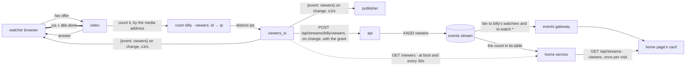

# viewers

built. `N watching` on the home cards, the watch page and the go-live page. no account, no extra request, nothing the browser says about itself: the number comes from the video box, which already holds every watcher's connection.

## what counts

a view is a watcher peer on `video` whose ICE and DTLS are done, so the box is really sending it packets. counted by the address those packets go to (the remote side of the selected candidate pair), not by a header or a cookie, and **one per address**: five tabs on one wifi are one viewer. it leaves the count the moment the peer goes (closed tab: at once; lid shut: the 15s ICE timeout). home's muted camera previews (`preview: true` in the watch frame, `preview.ts`) are not views: video holds them apart from the viewers and their caps, so a few home tabs behind one address never lock it out of watching, and caps them on their own at `MAX_PREVIEWS_PER_IP` = 12 per address across rooms (`{"error":"too many previews from your address"}`, then close).

## why it is hard to spam

the only way to add 1 is to be a real webrtc receiver from a new ip:

- **no write endpoint.** nothing says "i am watching". a `curl` loop does nothing.
- **a full handshake per view.** ICE, DTLS, then STUN keepalives or the peer drops in 15s.
- **an ip per view.** bots on one machine count once. a botnet is the price of a fake 1000.
- **a cap per ip.** `MAX_WATCHERS_PER_IP_ROOM` = 4 peers in one room, `MAX_WATCHERS_PER_IP` = 16 across rooms; past it, `{"error":"too many watchers from your address"}` and the socket closes. this protects egress more than the number: every peer is ~2.5 Mbps out.

what it does not stop: many real ips (a residential proxy pool) each doing a real handshake. that costs the attacker their own bandwidth too, since every peer is sent the stream. if that ever matters, see cloudflare below.

## frames and routes

| where | what |
|---|---|
| `/ws` (watcher, publisher) | `{"event":"viewers","viewers":3}`, at most once a second, only when it moved. a watcher hears it after it is counted itself |
| `/ws` (watcher) | `{"error":"too many watchers from your address"}`, then close |
| `/ws` (preview) | `{"error":"too many previews from your address"}`, then close |
| `video GET /viewers` | `{"billy": 3}` for every live room. inside the compose network |
| `video GET /health` | + `viewers`, the sum |
| `POST /api/streams/:name/viewers?session=&token=&viewers=` | video, when a room's count moved (≤1/s per room, the socket's cadence), with the publisher's grant. the api publishes a `viewers` fact and stores nothing |
| `/events` | `{"type":"viewers","name":"billy","viewers":3}` to the name's watchers and to `watch *` (`status.md`): the home cards move without asking |
| `GET /api/streams` | + `viewers` per stream, the latest the home service's table has; `null` until video has counted (a stream seconds old) |

the home service builds its table from `/viewers` at boot and checks it against `/viewers` every 30s: same names and counts, one call, and a fact that was missed is put right within that.

## cloudflare

it helps the http side, not the video:

- **cloudflare proxies http and websockets only.** the media is udp 7882 straight to the box, and the box's ip is in every ICE answer, so anyone can find it. the free plan cannot proxy udp (that is spectrum, enterprise).
- **it needs a domain.** today the site is a bare ip with a self-signed cert. a domain behind cloudflare also gives a real cert and ends the click-through warning, which is worth it on its own.
- **if it goes in front:** caddy must take the real ip from `CF-Connecting-IP` (`trusted_proxies` with cloudflare's ranges), and 80/443 should only accept cloudflare's ranges, or people skip it. the count does not care: it uses the media address, which cloudflare never sees.
- **turnstile is the real spam gate,** if one is needed: the watch page gets an invisible turnstile token, `POST /api/streams/:name/watch` checks it with cloudflare and hands back a short-lived signed watch ticket, and video refuses a watch offer without one (the same way it checks a publisher's grant today). that stops scripted joins from proxy pools. not built: no domain yet, and the per-ip cap covers the cheap attacks.

## code

- `video/src/main.rs`: `Room.viewers`, `viewers_tx`, `Hub::add_viewer` (the caps), `remove_viewer`, `viewer_counts`, `media_ip`, `tell_viewers`, the `connected` notify in `new_peer`, `GET /viewers`. `X-Forwarded-For` from caddy is the fallback when ICE gives no address. previews: `In.preview`, `Room.previews`, `Hub::add_preview` (its cap), `remove_preview`.
- `api/src/main.rs`: `video_viewers`, `viewers` in `list_streams`.
- `frontend`: `viewersOf` (`relay.ts`), `watchViewersAtom`, `liveViewersAtom`, `ViewerCount.tsx`, the home card chip, `#viewers` on watch and live (`data-viewers` for tests).

## not here

- a test in `test/`. a raw check is one page publishing and five watching from one browser: `/viewers` says 1 and the fifth gets the error.
- views over time, peak viewers. that is a row per join in the database, from the same `add_viewer`.
- the chat panel's own `count` is still chat sockets, not viewers.
