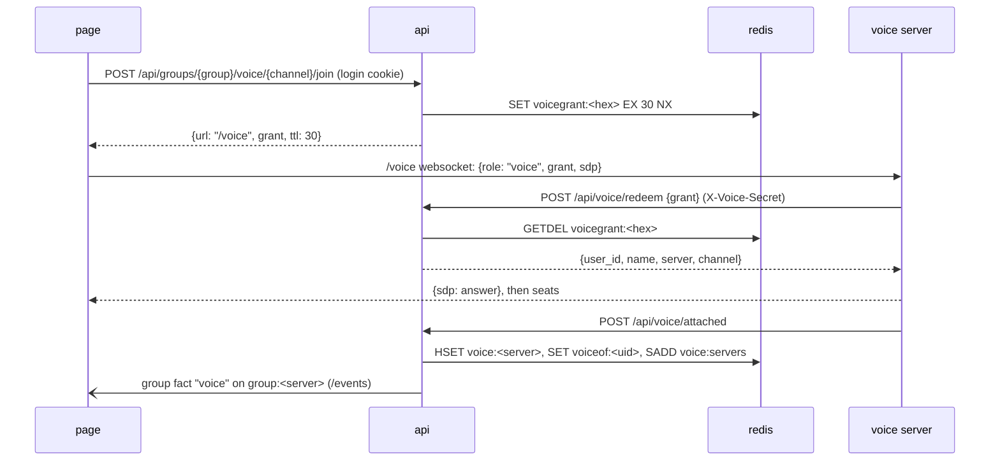

# voice

voice: built, off on the live box. a server (a group) can have voice channels next to its text ones, and people in one talk to each other and show their cameras and screens. the group page's right sidebar lists the voice channels and who is in each ([frontend/src/app/explore/VoicePanel.tsx](../frontend/src/app/explore/VoicePanel.tsx)), and a click puts that channel's call where the chat is ([VoiceRoom.tsx](../frontend/src/app/explore/VoiceRoom.tsx), see [the call view](#the-call-view)). the panel is always there: every group has a voice channel.

the code: [api/src/voice.rs](../api/src/voice.rs) (the join, the grant, who is in voice, the sweep), [video/src/voice.rs](../video/src/voice.rs) (the voice server, `video voice`), [api/migrations/0004-voice-channels.sql](../api/migrations/0004-voice-channels.sql), the room's `voice` in [api/src/group_mod.rs](../api/src/group_mod.rs), the page's call in [voice-atoms.ts](../frontend/src/infra/atoms/voice-atoms.ts) and [voice-video.ts](../frontend/src/infra/atoms/voice-video.ts), and the tests [test/voice.js](../test/voice.js) and [test/voice-video.js](../test/voice-video.js).

## channels

a channel is `kind` text or voice (migration 0004; every older channel is text, and `general` always is). `POST /api/groups/{group}/channels` with `kind: "voice"` makes one; no kind is text, any other is 400 `kind is text or voice`.

every group has a voice channel. a new one is made with `general` and a voice channel called `voice`; migration 0005 gave each older group with none a `voice` (`voice-1`, `voice-2`... when a text channel had the name), and leaves a group that has one alone. the last voice channel of a server cannot be deleted: 403 `the last voice channel stays` (renaming it is fine). on the page, the left list's `add channel` makes text ones only, and the voice panel has an `add voice channel` row under its channels for the channels power, the same dialog with `kind: "voice"`. a server has 4 voice channels at most, counted apart from its 20 text ones: past that the add is 403 `voice channels: 4 at most`, and the panel's `add voice channel` row (`#group-voice-add`) stays, greyed, with the cap as its tooltip. a group that had more before the cap keeps them; it adds none until it is under 4. the manage dialog's channels tab lists the voice ones under the text ones, a list of their own that reorders within itself (groups.md). the room and the `channel` group fact carry `kind` and `user_limit`.

a voice channel has no lines: chat, history, pins, search and notifications answer it `no such channel`, and the server's chat socket does not list it. the room still does.

`user_limit` is how many may be in at once, 0 for no limit set, and 0 is read as 16. nothing sets it yet: every voice channel is 0.

the `voice` power (32, `VOICE` in group_mod.rs) is for server mute, deafen, disconnect and move. it is in roles and reached like any other power, and nothing uses it yet.

## joining: a grant, then a redeem

two steps, so the voice server never sees a cookie.

1. the page asks `POST /api/groups/{group}/voice/{channel}/join` with its login. the api checks, in order:
   - not logged in: 401 `not logged in`
   - not a member of the server: 403 `join the server first`
   - no such channel, or one this login may not see: 404 `no such channel`
   - a text channel: 400 `not a voice channel`
   - already in voice in another channel (`voiceof:<uid>`): 409 `already in voice`. in this same channel is fine. so is another channel when the voice server says it holds no seat of theirs in that server but this tab's (`count`, [the internal routes](#the-internal-routes)): `voiceof` that no `left` cleared (the voice server crashed or restarted, which says no `left`, and the sweep would take a minute), or this tab moving while its old socket's `left` is still on its way. a second tab that really is in a call there counts, and stays `already in voice`; so does a voice server that does not answer, or does not know `count` (an older one).
   - full (the others in it, from `voice:<server>`, at its `user_limit`, 16 when 0): 409 `channel full`. an owner, the channels power and a site admin are never kept out by this.

   - voice off (VOICE_SECRET unset or empty): 503 `voice is off`, since no voice server could redeem a grant.

   then it makes a grant, 32 random bytes as hex (64 characters), keeps `voicegrant:<hex>` = `{user_id, name, server, channel, tab}` for 30s, and answers `{url: "/voice", grant, ttl: 30}`. the body `{"tab": "<id>"}` is optional: the page's id for itself, 1 to 64 of `a-z A-Z 0-9 _ -` (else 400 `bad tab`), a new random one on every load of the page and kept nowhere, so a second tab (or a duplicated one) is a second id. it rides the grant to the voice server ([seats](#seats)).
2. the page opens the websocket at `/voice` (caddy sends it to `voice:7881/ws`) and its first frame, within 10s, is `{"role":"voice","grant":"<64 hex>","sdp":"<offer>"}`. the voice server redeems the grant with the api once (`POST /api/voice/redeem`), and the room and the name come from that reply, never from the page. the api takes the grant out (GETDEL) and asks the same questions as join again, since the grant may be half a minute old. a used grant, one past its 30s, or one no longer the person's to use is `bad grant`; an api that does not answer within 1.5s is `api unreachable`.

the voice server's other refusals: `voice is not open` (no VOICE_SECRET), `bad offer`, `too many voice peers from this address`, `room full` (all 16 seats taken). after the answer, a peer that fails is said as an error frame before the socket closes: one that never connected is `no audio path: nothing reached the voice server over udp 7883, a firewall is closing it` (its ice gives up 20s in: 5s disconnected and 15s failed), one that did is `voice lost its connection`. the offer's audio: m-line 0 is the mic and the other audio ones (15 at most) are where the others are heard; video m-lines come after ([video](#video)). [video/src/voice.rs](../video/src/voice.rs) has the frames, the seats and the m-lines. the page sends its offers (the join's and the later ones) with m-line 0's udp candidates only ([frontend/src/infra/voice-offer.ts](../frontend/src/infra/voice-offer.ts)): before BUNDLE is agreed the browser gathers for every m-line, and a phone with many networks goes past the 128 KB `bad offer` limit with all of them (an iPhone's audio-only offer measured 72 KB, and a call's video lines add up to 32 more m-lines).

with the voice server started with `VOICE_DEV_OPEN=1` it also takes the old `{"role":"voice","room":"<server>/<channel>","user":"<name>","sdp":"<offer>"}` from anyone, for [test/voice-spike.js](../test/voice-spike.js). those joins are never told to the api. never on the live box.

## seats

a room is one voice channel, `<server>/<channel>`, with 16 seats. each person takes the lowest free one. joins and leaves only swap the track behind each m-line (`replace_track`), so nobody renegotiates. a line is one ssrc whoever it carries, so the voice server numbers its packets on from the last (webrtc-rs `enable_seq_transformer`): each browser starts its own numbers anywhere, and one that started behind would be a replay to the listener, dropped for minutes. the voice server sends `{"event":"seats","seats":[{"seat","user","line"}]}` right after the answer and on every join and leave; `line` is the m-line that seat is heard on.

closing the socket, or the peer going failed or closed (the ice timeout), frees the seat. so does a newer join from the same tab (the same account and the grant's `tab`): it takes the old seat's place at once, in whatever room of the voice server that one was, and the old socket ends with `{"error":"replaced"}` (most likely nobody hears it: a network that changed left it dead, and its ice would have kept the seat, a silent ghost of the person, up to 20s). a second tab has its own id and keeps its own seat. dev-open joins carry no tab.

the page ([voice-atoms.ts](../frontend/src/infra/atoms/voice-atoms.ts)) says `connecting to <channel>…` in the bar from the answer until its peer connects, then `in <channel>`. a call that ends shows its reason under the list: the voice server's error word when it sent one, else from what the page saw (`no audio path...` when its own peer failed before connecting, `voice dropped before the audio connected` when only the socket closed before then, `voice dropped: ...` when it had connected, `voice is unreachable` before an answer). a call that was through and dropped (the socket broke, or its ice failed after connecting: a redeploy of the voice server or of caddy, a network that changed) joins again on its own, a fresh run of tries, at most once in 30s; a moderator's `disconnected` and the other words of the voice server end it as before. both sides log what ice did: the voice server its ice states and the pair that won (`ice pair (local) ... <-> (remote) ...`), the page `voice: ice ...` and `voice: peer ...` in the console.

## video

a seat shows at most two pictures, its camera and its screen, VP8 only (the voice server has no other video codec, and the page puts VP8 alone on its video lines so the offer stays small). the voice server keeps two tracks per seat for them, `camera<id>` and `screen<id>`.

- **the page always offers.** after the join's answer it may offer again at any time, `{"sdp":"<offer>","video":{"<mid>":"camera","<mid>":"screen"}}`, and gets `{"sdp":"<answer>"}`; one offer at a time, so the two sides never cross. `video` names the page's own sending video m-lines; a sending one not named, a kind twice, more than two sending, more than 32 video m-lines, or audio m-lines not the first offer's are `bad offer`, and end the call.
- **on and off.** a camera turned on is a sendonly line, made the first time and reused after; off is the same line inactive. what sends is what shows.
- **seeing the others.** each seat in the seats frame has `video: [{"kind","mid"}]`: what it shows, and the mid of the page's recvonly video line that carries it, null while the page has no free one. the page adds recvonly video lines when a frame lists more pictures than it has lines, and offers. a line only swaps tracks (`replace_track`), like the audio ones.
- **keyframes.** a line given a new picture asks that picture's sender for a keyframe (an RTCP PLI), so a new viewer has a picture at once (about 100-250ms locally); a viewer's own PLI or FIR is passed on the same way. at most one per 300ms per track.
- **caps, on the sender.** a camera 640x360 at 24fps and 600 kbps, a screen up to 1920x1080 at 15fps and 1.5 Mbps (`sendEncodings` and the capture constraints, voice-video.ts). the voice server asks for TWCC, so the browser adapts under those.
- **mute and deafen for the tiles.** the page says `{"state":{"mute":bool,"deaf":bool}}` on every change, and each seat in the seats frame has `mute` and `deaf`. they are only the page's word: what is sent is the page's own doing. a moderator's server mute is the voice server dropping the mic's packets, and a disconnect ends the socket, so it ends that seat's pictures too.

the camera is the one picked in the user modal's voice tab (`settings.voiceCamera`); a new pick moves a camera that is on with `replaceTrack`, nothing offered. [test/voice-video.js](../test/voice-video.js) runs three chromes with fake devices against a `video voice` started with VOICE_DEV_OPEN=1: everyone's audio and cameras decode at everyone else, a screen shared mid-call decodes next to the camera, a camera off and on again, mute and deafen in the seats frame, a leave.

## the call view

a click on a voice channel in the panel puts `?voice=<channel>` on the page, and the call takes the chat's place ([VoiceRoom.tsx](../frontend/src/app/explore/VoiceRoom.tsx)); a click on a text channel (or back) gives the chat back, and the call goes on. the panel's row controls (signal, mute, deafen, leave) still work from either.

- **not in it:** a card with the channel's name and about line, who is in it (faces with their presence square), and `join voice`. in another channel already, it says joining moves you.
- **in it:** a tile per person, their camera or their face, a ring while their mic's level says they talk, their mute and deafen (and a server mute, red, once the room says it). a shared screen is a tile of its own. a click on a tile puts it big with the rest in a strip under it; a click on it again puts the grid back.
- **the bar:** mic, deafen, camera, screen (where the browser can share one), the voice tab, leave. a phone's is pinned to the foot over the safe area, with the tiles in one or two columns.

## the mic

the page opens the mic once ([voice-atoms.ts](../frontend/src/infra/atoms/voice-atoms.ts), "the mic"), for the call and for the user modal's voice tab together: whoever holds it shares the one getUserMedia stream and the one AudioContext, and the last to let go stops the tracks and closes the context. raw mic → rnnoise (voice isolation) → the noise gate ([voice-gate-worklet.js](../frontend/src/infra/voice-gate-worklet.js)) → the track m-line 0 sends. the tab's meter reads an analyser before the gate. a new device or a new setting opens a new mic and swaps it onto the call's sender (`replaceTrack`): no new offer, the seat stays.

the voice tab's settings, kept in this browser (`settings.voice*` in localStorage):

- **voice isolation** (on by default): rnnoise in an AudioWorklet (`@sapphi-red/web-noise-suppressor`), its wasm fetched the first time it is on. the browser's `noiseSuppression` is off while it is on, so the voice is not cleaned twice. needs a 48kHz context; where it cannot run (no web audio, firefox at another rate) the tab says so and the browser's suppression is used.
- **echo cancellation** and **auto gain**: getUserMedia constraints, on by default.
- **input mode**: voice activity, where the gate opens over the input sensitivity (dB on the meter's scale, a mark on the meter; all the way left is always open), or push to talk.
- **push to talk**: a key (`KeyboardEvent.code`, default backtick) and a release delay (default 200ms). while in a call the mic's track is enabled only while the key is down, not while typing in a box. the page's own keys only: it does nothing while another window or tab has the focus, and losing the focus lets the key go. mute and deafen are over both modes. the voice panel's mic button goes green while the key has the mic open.

## who is in voice

the voice server tells the api, and the api keeps it in redis:

- `attached` once a person has their answer: the api writes their field in `voice:<server>`, `voiceof:<uid>`, adds the server to `voice:servers`, opens a `voice_sessions` row, and tells the group `voice`.
- `left` when their seat frees: the field and `voiceof` go, the row gets its `left_at`, and the group hears `voice_left`.
- one `beat` every 15s naming everyone it has seated: each one's `beat` is set to now. a beat never brings back someone who left. its answer, `{beat, missing}`, names the peers the api had no field for, and the voice server sends `attached` for each again while their seat is held: an `attached` whose tries all failed, a redis that restarted empty, an api that was out for longer than the sweep.

an `attached` the api does not take (unreachable within 1.5s, or a 5xx) is tried again after 1s, 2s and 4s, then left to the next beat that finds them missing; a 4xx (they may not be there any more) is not tried again. the `attached` calls and the `left` of one seat go one at a time, and a seat let go stops its tries, so neither can bring back someone who left.

the api's sweep looks every 15s and takes out, the same way `left` does, everyone whose beat is more than 45s old: a voice server that dies says nothing, and its people are gone within a minute. the sweep does not run while voice is off. a call from the voice server that fails is a warning in its log; nobody is dropped for it, and someone seated whose `attached` never got through, or whom redis lost, is in the room again within a beat of the api answering (above).

the facts go to `group:<server>` on `/events`, both `{who, uid, channel}`: `voice` and `voice_left`. the room (`GET /api/groups/{group}`) has `voice`, `{"<channel>": [{name, uid, since}]}`, only the channels this login sees; with redis down it is `{}`.

### redis keys

| key | what | lives |
|---|---|---|
| `voicegrant:<hex>` | one grant: `{user_id, name, server, channel, tab}` (`tab` when the join named one) | 30s, or until redeemed (GETDEL) |
| `voice:<server>` | hash, user id to `{name, channel, seat, since, beat, session}` (`since` and `beat` unix ms, `session` the row's id) | while anyone is in voice there |
| `voiceof:<uid>` | `<server>/<channel>` this person is in | until they leave or are swept |
| `voice:servers` | set of servers that have had anyone in voice, for the sweep | a server goes when its hash is empty |
| `voicemuted:<server>` | set of user ids a moderator muted in this server's voice | until a moderator unmutes them |

### voice_sessions

one row per stay: `id`, `server`, `channel`, `user_id`, `joined_at`, `left_at` (null while still in). it goes with its channel (and follows a rename) and with the account. written first, then the fact.

## the internal routes

`POST /api/voice/redeem {grant}`, `POST /api/voice/attached {user_id, server, channel, seat}`, `POST /api/voice/left {user_id, server}`, `POST /api/voice/beat {peers: [{user_id, server}]}` → `{beat, missing: [{user_id, server}]}`. only the voice server calls them, from inside the compose network, and each has the same guard:

- anything caddy passed (it always sets `X-Forwarded-For`) is a 404 `no such route`.
- with VOICE_SECRET unset or empty, voice is off: 503 `voice is off`.
- `X-Voice-Secret` missing or not equal to VOICE_SECRET (compared in constant time): 403 `bad secret`.

neither the secret nor a grant is ever logged.

join looks at VOICE_SECRET too, last: with voice off it hands out no grants and answers 503 `voice is off`, which the page shows as a quiet line. a grant brought to a voice server with no secret is still `voice is not open`.

## moderating voice

a moderator (the kick power, or the voice power; an owner, a site admin) can mute someone's mic or take them out of voice, from the voice row's card or the member's info (`GroupMod.tsx`). never themselves, an owner only by an owner.

- `POST /api/groups/:group/voice-mute {name, muted}` puts their id in `voicemuted:<server>` (or takes it out), tells the voice server, and sends a `voice_mute {who, uid, muted}` fact. the room's `voice` marks the seat `muted: true`, as does the `voice` fact when they come back. the voice server drops every packet from a muted mic, so the page cannot lift it; a redeem says `muted` for someone muted before they came.
- `POST /api/groups/:group/voice-disconnect {name}` ends their socket with `{"error":"disconnected"}` and takes their seat out of the room at once. they may join again.
- a kick, a ban and a timeout drop them out of voice the same way. `may_talk` refuses a timed out member (403 `timed out`) until it ends, and a kicked or banned one is no member.

the api tells the voice server on `POST /internal/voice {action: mute|unmute|disconnect|count, user_id, server, tab?}` at VOICE_URL (`http://voice:7881`), with `X-Voice-Secret`: the guard of the internal routes above, on its side. caddy sends `/voice` alone there, so `/internal/voice` is not reachable from outside. a voice server that does not answer is a warning: the mute stands in redis for the next join, and a disconnect still takes the seat out of the room. `count` touches nothing and answers how many seats the person holds in that server, those of `tab` left out (join's `already in voice`).

## limits

- 16 seats a room (`MAX_SEATS` in video/src/voice.rs), and 16 a channel at join while `user_limit` is 0.
- 4 voice peers per address (`MAX_PEERS_PER_IP`).
- the join route is in the api's write tier, 120 a minute per account (`is_moderation` in [api/src/ratelimit.rs](../api/src/ratelimit.rs) keeps `/voice/` out of the moderate tier).
- `/voice` is the voice server's `/ws`, 60 opens a minute per address ([video/src/limits.rs](../video/src/limits.rs)), like the stream's.
- a grant: 30s, one use.

the rows are in [rate-limits.md](rate-limits.md).

## no TURN

media is udp only, on one port, 7883 (`VOICE_UDP_PORT`; the websocket is 7881, `VOICE_WS_PORT`, inside only), advertised as `PUBLIC_IP`, the same as streams on 7882. there is no TURN server and no tcp fallback: someone whose network blocks udp cannot be in voice, as they cannot watch a stream.

## turning it on

**needs Billy's approval first. nothing here is done on the live box until he says so.** voice is in compose under the `voice` profile, so a plain `up -d` never starts it. deploy.sh starts it only once `VOICE_SECRET` is set in `.env`: then every run that redeploys video (a full deploy, `./scripts/deploy.sh video`, a changed docker-compose.yml) brings voice to the same image, and `./scripts/deploy.sh voice` does just voice. without the secret it says voice is off and skips it.

1. a secret in `.env`: `VOICE_SECRET=` set to the output of `openssl rand -hex 32`. the api and the voice container both read it ([docker-compose.yml](../docker-compose.yml)); never commit or paste it.
2. 7883 is in `UDP_PORTS` in [scripts/deploy.sh](../scripts/deploy.sh) (`"7882 7883"`), so ufw and the firewall reminder have it.
3. open 7883/udp in the VM's firewall (the cloud provider's: security group, VPC rule, cloud firewall), as 7882 is.
4. recreate the api so it reads the secret, and start the voice server: `./scripts/deploy.sh api voice` (or by hand, `docker compose --profile voice up -d voice`).
5. recreate the frontend so caddy has the `/voice` route ([frontend/Caddyfile](../frontend/Caddyfile)). `npm run dev` proxies `/voice` to the backend too ([vite.config.mts](../frontend/vite.config.mts)).

a join that gets its answer and then ends with `no audio path` (before this word: a bare `voice dropped` about 20s in) is udp 7883 not getting from the browser to the voice container: step 3, the provider firewall, is the usual one. video on 7882 working says nothing about 7883.

to check it: the voice container's `/health` on 7881 answers `{ok, rooms, peers}` (its healthcheck), and `VOICE=1 ./scripts/test.sh voice` against a local stack started the same way.

to turn it off again: `docker compose stop voice` and empty VOICE_SECRET (then recreate the api). the internal routes go back to 503 and the sweep stops.
