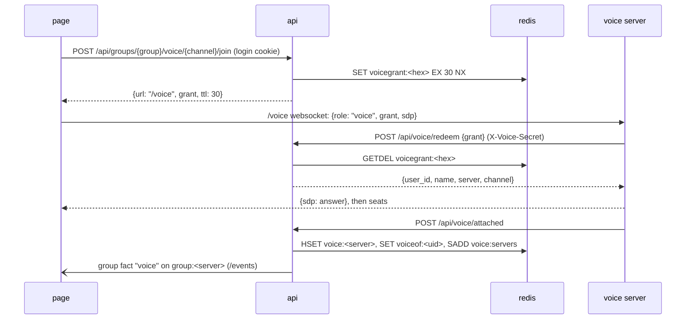

# voice

voice: built, off on the live box. a server (a group) can have voice channels next to its text ones, and people in one talk to each other. the group page's right sidebar lists the voice channels and who is in each, and a click joins ([frontend/src/app/explore/VoicePanel.tsx](../frontend/src/app/explore/VoicePanel.tsx)). the panel is always there: every group has a voice channel.

the code: [api/src/voice.rs](../api/src/voice.rs) (the join, the grant, who is in voice, the sweep), [video/src/voice.rs](../video/src/voice.rs) (the voice server, `video voice`), [api/migrations/0004-voice-channels.sql](../api/migrations/0004-voice-channels.sql), the room's `voice` in [api/src/group_mod.rs](../api/src/group_mod.rs), and the test [test/voice.js](../test/voice.js).

## channels

a channel is `kind` text or voice (migration 0004; every older channel is text, and `general` always is). `POST /api/groups/{group}/channels` with `kind: "voice"` makes one; no kind is text, any other is 400 `kind is text or voice`.

every group has a voice channel. a new one is made with `general` and a voice channel called `voice`; migration 0005 gave each older group with none a `voice` (`voice-1`, `voice-2`... when a text channel had the name), and leaves a group that has one alone. the last voice channel of a server cannot be deleted: 403 `the last voice channel stays` (renaming it is fine). on the page, the left list's `add channel` makes text ones only, and the voice panel's header has `add voice channel` for the channels power, the same dialog with `kind: "voice"`. voice channels count toward the 20 channels a server may have. the room and the `channel` group fact carry `kind` and `user_limit`.

a voice channel has no lines: chat, history, pins, search and notifications answer it `no such channel`, and the server's chat socket does not list it. the room still does.

`user_limit` is how many may be in at once, 0 for no limit set, and 0 is read as 16. nothing sets it yet: every voice channel is 0.

the `voice` power (32, `VOICE` in group_mod.rs) is for server mute, deafen, disconnect and move. it is in roles and reached like any other power, and nothing uses it yet.

## joining: a grant, then a redeem

two steps, so the voice server never sees a cookie.

1. the page asks `POST /api/groups/{group}/voice/{channel}/join` with its login. the api checks, in order:
   - not logged in: 401 `not logged in`
   - not a member of the server: 403 `join the server first`
   - no such channel, or one this login may not see: 404 `no such channel`
   - a text channel: 400 `not a voice channel`
   - already in voice in another channel (`voiceof:<uid>`): 409 `already in voice`. in this same channel is fine.
   - full (the others in it, from `voice:<server>`, at its `user_limit`, 16 when 0): 409 `channel full`. an owner, the channels power and a site admin are never kept out by this.

   - voice off (VOICE_SECRET unset or empty): 503 `voice is off`, since no voice server could redeem a grant.

   then it makes a grant, 32 random bytes as hex (64 characters), keeps `voicegrant:<hex>` = `{user_id, name, server, channel}` for 30s, and answers `{url: "/voice", grant, ttl: 30}`.
2. the page opens the websocket at `/voice` (caddy sends it to `voice:7881/ws`) and its first frame, within 10s, is `{"role":"voice","grant":"<64 hex>","sdp":"<offer>"}`. the voice server redeems the grant with the api once (`POST /api/voice/redeem`), and the room and the name come from that reply, never from the page. the api takes the grant out (GETDEL) and asks the same questions as join again, since the grant may be half a minute old. a used grant, one past its 30s, or one no longer the person's to use is `bad grant`; an api that does not answer within 1.5s is `api unreachable`.

the voice server's other refusals: `voice is not open` (no VOICE_SECRET), `bad offer`, `too many voice peers from this address`, `room full` (all 16 seats taken). after the answer, a peer that fails is said as an error frame before the socket closes: one that never connected is `no audio path: nothing reached the voice server over udp 7883, a firewall is closing it` (its ice gives up 20s in: 5s disconnected and 15s failed), one that did is `voice lost its connection`. the offer is audio only: m-line 0 is the mic and the rest (15 at most) are where the others are heard. [video/src/voice.rs](../video/src/voice.rs) has the frames, the seats and the m-lines. the page sends its offer with m-line 0's udp candidates only ([frontend/src/infra/voice-offer.ts](../frontend/src/infra/voice-offer.ts)): before BUNDLE is agreed the browser gathers for every m-line, and a phone with many networks goes past the 48 KB `bad offer` limit with all of them (an iPhone's measured 72 KB).

with the voice server started with `VOICE_DEV_OPEN=1` it also takes the old `{"role":"voice","room":"<server>/<channel>","user":"<name>","sdp":"<offer>"}` from anyone, for [test/voice-spike.js](../test/voice-spike.js). those joins are never told to the api. never on the live box.

## seats

a room is one voice channel, `<server>/<channel>`, with 16 seats. each person takes the lowest free one. joins and leaves only swap the track behind each m-line (`replace_track`), so nobody renegotiates. the voice server sends `{"event":"seats","seats":[{"seat","user","line"}]}` right after the answer and on every join and leave; `line` is the m-line that seat is heard on.

closing the socket, or the peer going failed or closed (the ice timeout), frees the seat.

the page ([voice-atoms.ts](../frontend/src/infra/atoms/voice-atoms.ts)) says `connecting to <channel>…` in the bar from the answer until its peer connects, then `in <channel>`. a call that ends shows its reason under the list: the voice server's error word when it sent one, else from what the page saw (`no audio path...` when its own peer failed before connecting, `voice dropped before the audio connected` when only the socket closed before then, `voice dropped: ...` when it had connected, `voice is unreachable` before an answer). both sides log what ice did: the voice server its ice states and the pair that won (`ice pair (local) ... <-> (remote) ...`), the page `voice: ice ...` and `voice: peer ...` in the console.

## who is in voice

the voice server tells the api, and the api keeps it in redis:

- `attached` once a person has their answer: the api writes their field in `voice:<server>`, `voiceof:<uid>`, adds the server to `voice:servers`, opens a `voice_sessions` row, and tells the group `voice`.
- `left` when their seat frees: the field and `voiceof` go, the row gets its `left_at`, and the group hears `voice_left`.
- one `beat` every 15s naming everyone it has seated: each one's `beat` is set to now. a beat never brings back someone who left.

the api's sweep looks every 15s and takes out, the same way `left` does, everyone whose beat is more than 45s old: a voice server that dies says nothing, and its people are gone within a minute. the sweep does not run while voice is off. a call from the voice server that fails is a warning in its log; nobody is dropped for it.

the facts go to `group:<server>` on `/events`, both `{who, uid, channel}`: `voice` and `voice_left`. the room (`GET /api/groups/{group}`) has `voice`, `{"<channel>": [{name, uid, since}]}`, only the channels this login sees; with redis down it is `{}`.

### redis keys

| key | what | lives |
|---|---|---|
| `voicegrant:<hex>` | one grant: `{user_id, name, server, channel}` | 30s, or until redeemed (GETDEL) |
| `voice:<server>` | hash, user id to `{name, channel, seat, since, beat, session}` (`since` and `beat` unix ms, `session` the row's id) | while anyone is in voice there |
| `voiceof:<uid>` | `<server>/<channel>` this person is in | until they leave or are swept |
| `voice:servers` | set of servers that have had anyone in voice, for the sweep | a server goes when its hash is empty |
| `voicemuted:<server>` | set of user ids a moderator muted in this server's voice | until a moderator unmutes them |

### voice_sessions

one row per stay: `id`, `server`, `channel`, `user_id`, `joined_at`, `left_at` (null while still in). it goes with its channel (and follows a rename) and with the account. written first, then the fact.

## the internal routes

`POST /api/voice/redeem {grant}`, `POST /api/voice/attached {user_id, server, channel, seat}`, `POST /api/voice/left {user_id, server}`, `POST /api/voice/beat {peers: [{user_id, server}]}`. only the voice server calls them, from inside the compose network, and each has the same guard:

- anything caddy passed (it always sets `X-Forwarded-For`) is a 404 `no such route`.
- with VOICE_SECRET unset or empty, voice is off: 503 `voice is off`.
- `X-Voice-Secret` missing or not equal to VOICE_SECRET (compared in constant time): 403 `bad secret`.

neither the secret nor a grant is ever logged.

join looks at VOICE_SECRET too, last: with voice off it hands out no grants and answers 503 `voice is off`, which the page shows as a quiet line. a grant brought to a voice server with no secret is still `voice is not open`.

## moderating voice

a moderator (the kick power, or the voice power; an owner, a site admin) can mute someone's mic or take them out of voice, from the voice row's card or the member's info (`GroupMod.tsx`). never themselves, an owner only by an owner.

- `POST /api/groups/:group/voice-mute {name, muted}` puts their id in `voicemuted:<server>` (or takes it out), tells the voice server, and sends a `voice_mute {who, uid, muted}` fact. the room's `voice` marks the seat `muted: true`, as does the `voice` fact when they come back. the voice server drops every packet from a muted mic, so the page cannot lift it; a redeem says `muted` for someone muted before they came.
- `POST /api/groups/:group/voice-disconnect {name}` ends their socket with `{"error":"disconnected"}` and takes their seat out of the room at once. they may join again.
- a kick, a ban and a timeout drop them out of voice the same way. `may_talk` refuses a timed out member (403 `timed out`) until it ends, and a kicked or banned one is no member.

the api tells the voice server on `POST /internal/voice {action: mute|unmute|disconnect, user_id, server}` at VOICE_URL (`http://voice:7881`), with `X-Voice-Secret`: the guard of the internal routes above, on its side. caddy sends `/voice` alone there, so `/internal/voice` is not reachable from outside. a voice server that does not answer is a warning: the mute stands in redis for the next join, and a disconnect still takes the seat out of the room.

## limits

- 16 seats a room (`MAX_SEATS` in video/src/voice.rs), and 16 a channel at join while `user_limit` is 0.
- 4 voice peers per address (`MAX_PEERS_PER_IP`).
- the join route is in the api's write tier, 120 a minute per account (`is_moderation` in [api/src/ratelimit.rs](../api/src/ratelimit.rs) keeps `/voice/` out of the moderate tier).
- `/voice` is the voice server's `/ws`, 60 opens a minute per address ([video/src/limits.rs](../video/src/limits.rs)), like the stream's.
- a grant: 30s, one use.

the rows are in [rate-limits.md](rate-limits.md).

## no TURN

media is udp only, on one port, 7883 (`VOICE_UDP_PORT`; the websocket is 7881, `VOICE_WS_PORT`, inside only), advertised as `PUBLIC_IP`, the same as streams on 7882. there is no TURN server and no tcp fallback: someone whose network blocks udp cannot be in voice, as they cannot watch a stream.

## turning it on

**needs Billy's approval first. nothing here is done on the live box until he says so.** voice is in compose under the `voice` profile, so a plain `up -d` never starts it. deploy.sh starts it only once `VOICE_SECRET` is set in `.env`: then every run that redeploys video (a full deploy, `./scripts/deploy.sh video`, a changed docker-compose.yml) brings voice to the same image, and `./scripts/deploy.sh voice` does just voice. without the secret it says voice is off and skips it.

1. a secret in `.env`: `VOICE_SECRET=` set to the output of `openssl rand -hex 32`. the api and the voice container both read it ([docker-compose.yml](../docker-compose.yml)); never commit or paste it.
2. 7883 is in `UDP_PORTS` in [scripts/deploy.sh](../scripts/deploy.sh) (`"7882 7883"`), so ufw and the firewall reminder have it.
3. open 7883/udp in the VM's firewall (the cloud provider's: security group, VPC rule, cloud firewall), as 7882 is.
4. recreate the api so it reads the secret, and start the voice server: `./scripts/deploy.sh api voice` (or by hand, `docker compose --profile voice up -d voice`).
5. recreate the frontend so caddy has the `/voice` route ([frontend/Caddyfile](../frontend/Caddyfile)). `npm run dev` proxies `/voice` to the backend too ([vite.config.mts](../frontend/vite.config.mts)).

a join that gets its answer and then ends with `no audio path` (before this word: a bare `voice dropped` about 20s in) is udp 7883 not getting from the browser to the voice container: step 3, the provider firewall, is the usual one. video on 7882 working says nothing about 7883.

to check it: the voice container's `/health` on 7881 answers `{ok, rooms, peers}` (its healthcheck), and `VOICE=1 ./scripts/test.sh voice` against a local stack started the same way.

to turn it off again: `docker compose stop voice` and empty VOICE_SECRET (then recreate the api). the internal routes go back to 503 and the sweep stops.
