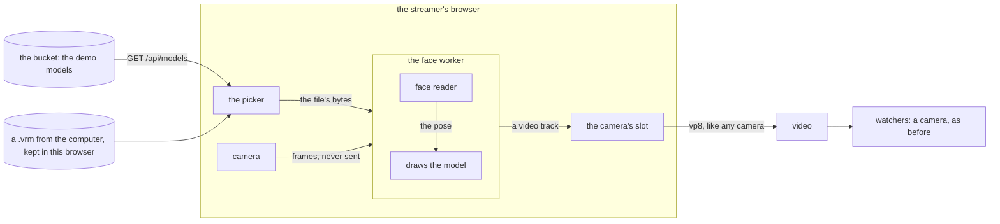

# vtuber

partly built. a streamer picks a 3d model (a `.vrm`): one of the site's demo models, or a file of their own. their browser reads their face from the camera, moves the model with it, draws it, and sends that drawing where the camera's picture would go. to the box and to a watcher it is a camera.

built: the model as the camera, drawn in a worker; the picker with the demo models out of the bucket and the streamer's own files kept in their browser; the script that puts the demo models there. still a plan: [the rest of a face](#still-a-plan-the-rest-of-a-face) and [the model cut out over the screen](#later-cut-out-over-the-screen).

what was run and what was not is [at the end](#what-was-run-and-what-was-not). the short of that: the whole path was run in chrome on a mac against this repo's own api and video, not in docker, not in safari or firefox, and not with the tab hidden.

## the short of it

- **the file is a `.vrm`.** the format every 3d vtuber app reads, and vroid studio writes one for free. `three` 0.180 and `@pixiv/three-vrm` 3.5 (mit) draw it, vrm 0.x and 1.0.
- **the streamer's browser does all of it.** it reads the face (mediapipe, in wasm), moves and draws the model, and makes a video track of the drawing, all in one worker. the track goes where the camera's would.
- **the real camera's picture never leaves.** its track goes to the face reader and to nothing else: no sender, no `<video>` on the page.
- **video and the watchers did not change.** no new frame on the socket, no migration. watchers, the home card, the previews and older pages already know what a camera is.
- **the api got one small part**: it lists the demo models that are in the bucket and hands out their files. a streamer's own file never goes up.
- **two catches.** the model arrives as a rectangle on a flat colour, not cut out over the screen. and on a browser without chrome's way of feeding a worker (safari, firefox) the model stops moving while the tab is hidden, and the page says so.

## trying it

`cd frontend && npm run dev`, open `/live`, the `+` in the sources, `model`. `pick a .vrm file` takes one from the computer: there are four in `random-media/vrms`. allow the camera, and the preview is the model with your head, eyes and mouth.

the shelf of demo models in that dialog is the bucket's, so it is empty until the box has this api and the folder has gone up:

```
./scripts/deploy.sh --pull      # or: ./scripts/deploy.sh api frontend. video is not touched
./scripts/models.sh             # deploy runs this itself when the folder changed
```

## what it is for

a face cam without the face. someone who will not put their face on the internet, or would rather be a character, still wants what a face cam gives: a head that turns, eyes that blink, a mouth that moves when they talk, in the corner over the screen.

the streamer:

1. go live, the `+` in the sources, `model`: a demo model, one of their own that this browser kept, or a `.vrm` from the computer.
2. the preview shows the model, its head, eyes and mouth following theirs.
3. it is the camera's layer: dragged, resized, `screen + face` puts it in the corner over the screen. start.

a watcher sees a camera whose picture is the model.

## the shape



**the one rule.** the camera's track is handed to the face reader and never to `cameraAtom` or a sender. a model that breaks (a file that will not load, a lost webgl context, a dead worker) lands on mic only and the picture avatar, never on the camera. with a model on and the stream up, going back to the real camera asks first.

## the demo models

`random-media/vrms`: four models to try it with, about 50 mb together. each `.vrm` has a 256×256 `.jpg` beside it, its thumbnail in the picker.

| file | what | from | its own meta says |
|---|---|---|---|
| `sendagaya-shino.vrm` | 15.1 mb, vrm 0.x, a vroid studio β sample | `madjin/vrm-samples`, `vroid/beta/Sendagaya_Shino.vrm` | `CC0`, anyone may wear it |
| `hairsample-male.vrm` | 18.5 mb, vrm 0.x, a vroid studio β sample | `madjin/vrm-samples`, `vroid/beta/HairSample_Male.vrm` | `CC0`, anyone may wear it |
| `orion.vrm` | 6.1 mb, vrm 0.x, by polygonal mind. not a face: a low-poly head, no blink and no mouth shapes, so only its head moves | `madjin/vrm-samples`, `Avatar_Orion.vrm` | `CC0`, anyone may wear it |
| `seed-san.vrm` | 10.9 mb, vrm 1.0, by virtualcast, inc.: the vrm consortium's own sample | `vrm-c/vrm-specification`, `samples/Seed-san/vrm/Seed-san.vrm` | vrm public license 1.0: anyone may wear it, it may be passed on, **credit is required** |

the licence was read out of each file before it was taken, and only files that say they may be passed on are here. the picker shows the author and the licence on each card. seed-san's credit is the streamer's to give when they wear it on a stream.

**into the bucket.** `./scripts/models.sh` copies the folder into the api container and runs `api models <dir>` there, which reads each file and puts it in the bucket the api uses:

- a model is `<name>.vrm` and its id is that name (`a-z 0-9 - _`, 48 at most). a picture beside it with the same name (`.jpg`, `.png`, `.webp`, 512 kb at most) is its thumbnail; without one the file's own embedded thumbnail is used when it is that small. the name, the author and the licence come out of the file's meta. 64 mb a model, 24 models.
- the keys are `models/<id>.vrm`, `models/<id>.thumb`, and `models/index.json`, the list, written last. a file that is already there with the same bytes is not sent again; one that left the folder is taken out.
- a file that is no vrm, points outside itself, or is packed in a way the page does not unpack, is skipped and said, and the run exits non-zero; the rest still goes up.
- `--dry-run` prints the list it would write and touches nothing. `--if-changed` does nothing when the folder is as the last run left it (`.models`, gitignored).

`deploy.sh` runs `models.sh --if-changed` after the health check and the migrations, on a full deploy, a partial one, and a `--pull` that brought nothing to redeploy. it never fails a deploy: it warns, and `./scripts/models.sh` by hand tries again. a new demo model is a `.vrm` dropped in the folder and a deploy.

the folder is not in `.dockerignore`: that file is in `image-paths`, and a change to it rebuilds video, which ends every stream. no dockerfile copies the folder, so it is in no image.

**out of the bucket** (`api/src/models.rs`):

| | | |
|---|---|---|
| GET | `/api/models` | `{ models: [{ id, name, author, licence, vrm: "0" or "1", bytes, v, thumb }] }`, `no-cache`. nothing put up yet is `{ models: [] }`. the bucket not answering is 502 `could not load the models` |
| GET | `/api/models/:id` | the file, `model/gltf-binary`, `nosniff`. the page asks with `?v=<v>`, the start of the hash of the file and its thumbnail, so the answer is `immutable` and a model worn before comes off the browser's disk. 404 `no such model` |
| GET | `/api/models/:id/thumb` | the thumbnail, its type by its first bytes (png, jpeg, webp). 404 when it has none |

anyone may read these: they are the site's own files. nothing writes to the bucket but `api models`, which is a command on the box, not a route.

## the file

a `.vrm` is a glb (gltf 2.0 in one binary) with standard bones, standard expression names, and its author and licence written inside. a plain vroid studio export is 12 to 18 mb.

- **read before it is drawn** (`infra/vrm.ts` in the page; `models.rs` asks the same before a demo model goes up): it is a glb, it is a vrm (`extensions.VRMC_vrm`, or `extensions.VRM` for 0.x), and nothing in it points outside the file. gltf lets a buffer or a picture be a `uri` to anywhere, and a model from a random download should not get to call home from the streamer's browser. the loader is also given a manager that refuses any url but the file's own blobs. draco, meshopt and ktx2 are refused, in words: each is one more wasm decoder to carry.
- **their own file is picked, not put up.** a file input. the bytes never leave the browser.
- **kept in indexeddb** (`infra/model-store.ts`): the bytes, the model's own name and author, a small picture. five at most, the oldest goes; the same file picked again replaces itself. the picker's `yours` shelf offers them, each with a `×` to forget it. a browser that cannot keep it still wears it for the visit.
- **two stops for sanity**: 150 mb, and a model that has not drawn in 30 s is given up on.

## the face

the reader is mediapipe's face landmarker (`@mediapipe/tasks-vision`, apache-2.0): 52 scores for the face (`jawOpen`, `eyeBlinkLeft`, ...) and the head's turn and place, from one camera frame, in wasm. its weights are `frontend/src/assets/face_landmarker.task` (3.8 mb, apache-2.0, sha256 `64184e22…0bc9ff`, from `storage.googleapis.com/mediapipe-models/face_landmarker/face_landmarker/float16/1/`), in the repo so a build needs no network. all of it is loaded from this site, and only when a model goes on.

**the version is pinned to `0.10.35`, exactly, on purpose.** from 1.0.0 the package sends usage numbers to `odml.pa.googleapis.com` with no switch to turn that off. 0.10.35 is the last that sends nothing. the worker is the second lock: its `fetch` and its `XMLHttpRequest` refuse any address that is not this site's. do not move the version up without looking at what the new one sends.

its camera: the one that is on when the model is picked (it leaves the stream for the reader, and is not opened twice), else one opened for it, 640×480. `#face-camera` picks another when there is more than one: a vtuber's default camera is often a virtual one. with no camera to have (none, or blocked) the model still goes on, with the mic, and breathes and blinks on its own.

**from the scores to a pose** (`infra/pose.ts`):

- **rest.** the first 20 readings of a face are the resting face: the head's zero, and each score's floor. the floors keep following the face slowly after that, so a start mid-sentence rights itself. `rest face` takes it again.
- **mirror.** the model moves like a mirror by default. `mirror` off: like the person a camera sees.
- **gain.** a real blink or an open jaw does not score all the way to 1. a blink is full at 0.5, the jaw at 0.35, the rest at 0.6, and under 0.02 is nothing. tuned on one clip of one face.
- **smoothing.** a one euro filter a channel: quick for the mouth and the blinks, slow for the head.

**from the pose to the model** (`infra/model-draw.ts`):

- the presets every vrm has: the mouth (`aa` from `jawOpen`, `oh` from `mouthFunnel`, `ou` from `mouthPucker`, `ih` from the upper lip), the blinks, and where the eyes look.
- the head's turn is shared between the head (half), the neck and a little of the chest, and stopped at about 40° to a side and 30° up, down or tipped. the lean moves the spine.
- the brows and the five moods (`happy`, `angry`, ...) are not driven. on a vroid model `happy` shuts the eyes and fights the blink.
- no face in view: the head eases back to rest, and the model breathes and blinks on its own.

## drawing it

`infra/model-draw.ts`: one scene and one `draw(pose, dt)`, on an `OffscreenCanvas` in the worker.

- **1280×720, 30 a second**, the camera's own size.
- **on load**: the loader with `VRMLoaderPlugin`, then `VRMUtils.removeUnnecessaryVertices`, `combineSkeletons`, `combineMorphs`, `rotateVRM0` (a 0.x model faces the other way, and its bones turn the other way: one sign, checked on both kinds). the arms are let down: a vrm stands in a T.
- **the framing** is a bust, worked out from the head's bone and the top of the hair.
- **the background** is a flat colour the streamer picks (`#model-background`), kept. video has no see-through.
- **on the way out**: `VRMUtils.deepDispose`, `renderer.dispose()`, and `forceContextLoss()`, since dispose alone keeps the webgl context.
- **in the worker's file, not the page's.** `three`, three-vrm and the reader are one file of 854 kb (217 kb gzipped) that only a streamer with a model on downloads. the pages' own file grew 25 kb (7 gzipped).

## into the camera's slot

`putModelOn` (`publish-atoms.ts`) is `cameraOn` with a different track: the model's track joins the mic's stream in `cameraAtom` and, live, goes into the camera's section with `replaceTrack`. the camera source is laid out by the rules and the picture avatar goes off the stream, as it does for a camera. before start or live, nothing renegotiated.

- **a pick with nothing open** (the camera was refused, or there is none): the file is looked at first, then the mic and a camera for the reader are asked for together. so a model picked there has a voice, and a file that is no model opens nothing.
- **on arrival with a model kept** (`settings.model`): the mic and the reader's camera are asked for together, and the model's track is what goes into `cameraAtom`. the camera's own picture is never in it, not for one frame. a kept model that is gone leaves the mic alone with the picture avatar, and says so.
- **`×` on its row** is mic only, as the camera's is. **`use the camera`** opens the camera first, so one that says no leaves the model on; live, it asks first (`#real-camera-confirm`).
- **`stop`** leaves the model in the preview, as it leaves the camera. **leaving the page** with nothing on air ends the worker and lets the reader's camera go. with a stream up the model goes on in the corner: the worker is a module's, like the peer connection.

after that nothing knows the difference. the preview shows what watchers get, because it plays the track that is sent. the presets and the rules treat it as the camera. `tuneSenders` sends it small in a corner. the box cuts the thumbnail from it, so the home card is the model.

## the hidden tab

a hidden tab gets no animation frames at all, and its timers run once a second, peer connection or not. a window fully covered by another counts as hidden too (chrome, on windows and mac), which is one screen with a game on top. a worker's timers and a camera's frames are not held back. so the whole loop is in the worker (`infra/face.worker.ts`), and `infra/face.ts` connects it one of two ways:

| path | browser | camera frames in | the drawing out | tab hidden |
|---|---|---|---|---|
| `worker` | chrome, edge | `MediaStreamTrackProcessor` on the page, its `readable` handed to the worker | `MediaStreamTrackGenerator` on the page, its `writable` handed to the worker: it writes `new VideoFrame(canvas)` itself | should go on. **not checked** |
| `page` | the rest | the page posts each frame in, from a `<video>` nobody sees | the worker posts each drawn frame back, the page paints it on a canvas, `captureStream` | stops, and `#face-hidden-note` says so |

chrome's two are its own early api, not the standard, and may change. safari's standard ones (the processor and a `VideoTrackGenerator` made in the worker) are not wired: safari gets `page`. `localStorage['settings.modelPath'] = 'page'` asks for the second path on a browser that has the first, to look at it.

**the model is drawn on a timer, not on the camera's frames**, so a camera with no face, or no camera, still leaves a model that breathes. the reading and the drawing share the worker's one thread, and two things keep the picture even:

- **a frame carries the time it was due**, not the time the thread got to it. a reading can hold a frame up by its own length. stamped with the time they were due, the frames reach a watcher 33 or 34 ms apart however the thread ran; stamped when drawn they came 24 to 44 ms apart.
- **the reader gets a share of the thread.** a frame that comes sooner after the last reading began than 1.6 times what a reading takes is let go unread. a quick reader reads them all. a slow one (no gpu for it, or a game on the gpu) reads every second or third, and the model is still drawn on time, its face a little later: with the reader slowed to 40 ms a reading, the model was still drawn 30 times a second and read 12; without this both fell to 24.

measured side by side, 90 seconds each, twice: without the two a watcher's player dropped about 7 frames in 100 (187 and 207 of 2700). with them, 1 of 2700. a plain camera on the same stack: 8 of 2700.

## what it costs

measured on an apple m4 max in chrome 157, the model as the whole frame, a face in front of the camera, six minutes. an ordinary laptop will do worse: to measure.

| who | what | how much |
|---|---|---|
| the streamer, once | the reader's wasm, its loader, its weights, the worker's file | 11.2 mb (3.3 gzipped), 322 kb (78), 3.8 mb, 854 kb (217). cached, only when a model goes on |
| the streamer, once a model | a demo model's file | 6 to 18 mb, cached for good |
| the streamer, running | the reader | about 10 ms a reading, 30 a second, on the gpu |
| | the drawing | 30 a second, held |
| | the encode | 1280×720 at 30, 1.8 ms a frame, up to the 2.5 Mbps a camera gets |
| | the page itself | its main thread 2 to 4% busy, its memory flat |
| a watcher | nothing new | |
| the box, the disk | nothing new | a camera's bits |
| the bucket | the demo models | about 50 mb |

what it gives up:

- **the cut-out.** the model sits in a box with a background, like a camera. the screen does not show around it.
- **sharpness in a corner.** it is video, sent as small as its box.
- **safari and firefox with the tab hidden.**
- **their own file on another machine.** it is in one browser.

## pages

go live, the `+`: `#add-model`. the picker, `live/ModelDialog.tsx`: `#model-dialog`, `#model-demos` with a card a model (`#model-demo-<id>`: the thumbnail, the name, the author, the licence, the size), `#model-demos-none` when the bucket has none, `#model-kept` (`#model-kept-<id>`, `#model-forget-<id>`), `#model-file` behind `#model-file-pick`, `#model-status` for why not, `#model-dialog-close`. a pick that works closes it.

under the sources while a model is on, `live/ModelControls.tsx`: `#model-controls`, `#model-name`, `#face-status` (`reading your face`, `no face in view`, `camera blocked`, ...; `data-face` is `starting`, `on`, `lost`, `off`, `no-camera` or `camera-blocked`, and `data-yaw`, `-pitch`, `-roll`, `-mouth`, `-blink`, `-fps`, `-reads` are what the reader last said), `#face-hidden-note`, `#face-mirror`, `#face-rest`, `#model-background`, `#face-camera`, `#model-change`, `#source-real-cam` and its `#real-camera-confirm`. the camera's row wears the model's name (`#source-model-name`) and a face for an icon. a model that stopped says why in `#source-status`.

kept in the browser: `settings.model` (which model: a demo by id, or one of their own), `settings.faceCamera`, `settings.faceMirror`, `settings.modelBackground`, and the files in indexeddb (`models`).

the watch page: nothing.

## tests

`test/vtuber.js`, the way `test/screen.js` is built, in `./scripts/test.sh`.

- the api's three routes: the list, a file that is a glb of the size listed, a thumbnail, 404s.
- the picker shows the shelf as the api lists it. a file that is no model, and a model whose buffer is a url, are each refused in words, and nothing is asked of that url.
- **the model is what is sent, not the camera.** the test picks a magenta background, and the preview and the watcher's `#video` have it in their corners: a picture the fake camera cannot make.
- a `.vrm` from the computer is worn, kept on the shelf, and no request but GETs is made.
- **the one rule**, with every track a sender or a `<video>` is given written down from before the page's own code runs: the camera's goes to neither. on a pick, on a reload with a model kept, and when the worker is killed mid-stream (mic only on both sides).
- `use the camera` asks first; `no` leaves the model, `yes` shows the watcher the camera.
- chrome's fake camera has no face in it, which is the `no face in view` path. `FACE_CLIP=<a .mjpeg or .y4m of a face>` feeds it one, and then the head and the mouth it reads must move. no clip of a face is in the repo.
- with no demo models in the bucket it wears `random-media/vrms/orion.vrm` as a file and says the shelf is empty.

`cargo test -p api models::` covers the glb reader, the folder, and the three routes against a stand-in bucket.

## where the code is

| where | what |
|---|---|
| `random-media/vrms/` | the demo models and their thumbnails |
| `scripts/models.sh`, `scripts/deploy.sh` | the folder into the bucket; deploy runs it when the folder changed |
| `api/src/models.rs`, `api/src/main.rs`, `api/src/s3.rs` | the three routes, `api models <dir>`, the glb reader, a longer wait for a big file |
| `frontend/package.json` | `three`, `@pixiv/three-vrm`, `@types/three`, `@mediapipe/tasks-vision` (pinned) |
| `frontend/src/assets/face_landmarker.task` | the reader's weights |
| `src/infra/vrm.ts` | the file read: is it a vrm, nothing outside it, its name, author, licence and thumbnail |
| `src/infra/model-store.ts` | the files this browser keeps |
| `src/infra/pose.ts` | the reader's scores to a pose: rest, mirror, gain, smoothing |
| `src/infra/model-draw.ts` | the scene and `draw(pose, dt)` |
| `src/infra/face.worker.ts`, `face-wire.ts` | the worker: reads, draws, makes the frames; and what it and the page say to each other |
| `src/infra/face-wasm.classic.ts`, `face-wasm.module.ts` | the reader's loader: a build's worker is a classic script and the dev server's a module, and each wants its own |
| `src/infra/face.ts` | starts the worker, picks the path, hands back the track |
| `src/infra/atoms/publish-atoms.ts` | the model's atoms and actions, the arrival with a model kept, the teardown |
| `src/infra/api.ts` | `demoModels`, `demoModelUrl`, `demoModelThumbUrl` |
| `src/shared-components/live/ModelDialog.tsx`, `ModelControls.tsx`, `Sources.tsx` | the picker, the face's controls, `model` in the `+` and the row |
| `test/vtuber.js`, `scripts/test.sh` | the test |

## what was run, and what was not

run, on 2026-11-13 and 14, chrome 157 on a mac:

- `test/vtuber.js`, all 16 steps, against a stack of this repo's own `api` and `video` binaries with a postgres and a redis beside them, a stand-in bucket, and the built pages (`vite build`) behind caddy's routes. with the stock fake camera, with a clip of a face, and with nothing in the bucket. a second browser was the watcher.
- `api models` against that stand-in bucket: put, the same again, taken out; the routes gave back the same bytes.
- six minutes on the air with a watcher: the numbers in `what it costs`.
- the box's thumbnail of a stream with a model on is the model.
- the `page` path, forced in chrome. two cameras and the picker between them. a camera that is blocked, and none at all.
- the pose's signs (which way a head turns, tips and leans, mirrored and not) on a 0.x and a 1.0 model, by eye from screenshots of known poses.
- `test/e2e.js`, `screen.js` and `live-pip.js` on the same stack, since they walk the code this touches. `e2e` passes. the other two pass but for one step each that is a race on a stack this quick, and trips with the pages as they were before this too: `screen.js` counts the flowing videos 4 ms after a screen is stopped, and `live-pip.js` reads `#start` before the route has drawn.

not run:

- **anything in docker.** `scripts/models.sh` and the deploy hook were read through and run against a stand-in `docker` command, never a real container or the real bucket.
- **the hidden tab**, and a window covered by another: the reason the worker exists. two tries at hiding a tab under a script (playwright, then chrome's debugging port by hand) left the page saying it was visible, so neither counts. by hand: go live with a model, switch to another tab for a minute, and look from a second device.
- **safari and firefox.** the `page` path was run in chrome only.
- **a real face in a real camera.** every face here was one clip through chrome's fake camera. the gains are from that one face.
- **a phone**, and a machine without a strong gpu.

## still a plan: the rest of a face

- a model that carries arkit's 52 as its own expressions (perfect sync) taking them one to one.
- keys for the moods. the brows.
- the framing by hand (closer, higher), a picture behind the model.
- a small view of what the reader sees, that only the streamer gets.
- a model with no camera at all moving its mouth from the mic, as the picture avatar nods.
- the same picker for the real camera's device.
- safari's standard way into the worker, so its hidden tab goes on too.
- the reader in a worker of its own, so a slow one costs the drawing nothing.

## later: cut out over the screen

the other way to send a model is as numbers. the page sends the pose 30 times a second on its socket (65 bytes: a version, flags, a time, arkit's 52 scores, the head's turn and lean), the file goes up to the api once, and every watcher's player draws the model itself on a see-through canvas, as `screen.md`'s avatar layer with a model for the picture.

it buys the model cut out over the screen, sharp at any size, for almost no bits, and watchers who keep drawing whatever the streamer's tab does. it costs a change to the api, the box and every watcher's page; every watcher downloads the file, so anyone can save it; and every watcher needs a gpu. it reuses the reader and the drawing code whole.

what was worked out for it, so it is not worked out twice:

- **the layer.** `model` as a field on the `avatar` layer, not a new kind. an older page (`validLayer`) and an older box (serde drops the field) both fall back to the picture avatar. a new kind fails `Scene::well_formed` on an older box and takes the whole slots frame with it.
- **the pose frame.** `{"pose":"<base64>"}`. the box keeps the latest in a `watch` channel beside `slots_tx` and sends it on as `{"event":"pose"}`, so a slow socket skips frames. a cap at the door, one every 25 ms: each one let through is a write to every watcher. the box's answer says `"pose": true`, because an older box logs each as a bad slots frame. none to previews. not in the inspector's ring, which is 33 seconds of pose.
- **the upload.** its own routes beside the assets'. logins only: a free name can be written by anyone (`may_act_as`). 20 mb. streamed out: `s3::get` holds a whole object in memory and its client times out at 10 s. renamed and cleared in `auth.rs` where `stream_assets` is.
- **the file is checked three times**: by the page, at the api's door (the first bytes and the json chunk, nothing decoded), and by every watcher's player before it draws. the list is `the file`'s, above, plus budgets: size, triangles, picture sizes, bones. a `uri` there would make every watcher's browser call a stranger's server. failing any: the picture.
- **the watcher.** the drawing code as a lazy chunk. chrome keeps 16 webgl contexts a page (8 on android) and drops the oldest. the picture avatar is the fallback for everything. home's cards and a group's tiles are camera previews (`preview.ts`) and draw nothing.
- **the mouth** is the face or the voice, whichever is more, so the lips stay on the sound whatever the socket does.
- **the licence.** a vrm says whether its file may be passed on (`allowRedistribution`, no unless it says so). sending it to every watcher is passing it on, and the dialog has to say that.

## to settle

1. **the file lives in one browser. enough?** keeping a streamer's own model with their account is a route only its owner can read, and the first upload of a model that is not ours.
2. **which demo models stay.** these four are for trying it. `orion` has no face to move, and the two vroid β samples are old.
3. **the reader's version.** pinned behind the newest for what the newest sends. worth a look each time it is tempting to move.

## not here

- other 3d files: `.fbx`, `.pmx`, a vrchat avatar, a bare `.glb`. vrm is what a 3d vtuber app writes. a `.glb` with arkit's 52 shapes could come later.
- live2d, the 2d kind vtube studio uses. its licence comes before its code: an app where people load their own models signs a contract with live2d inc. before release, a share of revenue included.
- hands, arms, a body that follows. a second and a third network to run in the reader.
- a phone as the face reader (arkit, ifacialmocap).
- moods read off the face, the tongue, the cheeks. this reader does not give them.
- two models on one stream, or a guest's model (`audio.md`'s spots).
- dressing, editing or converting a model in the page. it draws what it is given.
- `.vrma` animations, emotes, props.
- moderation of what a model looks like. it is a camera's picture, and nobody moderates those here either (`spec.md`'s non-goals).
