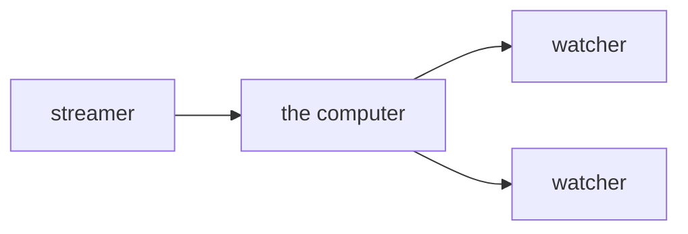
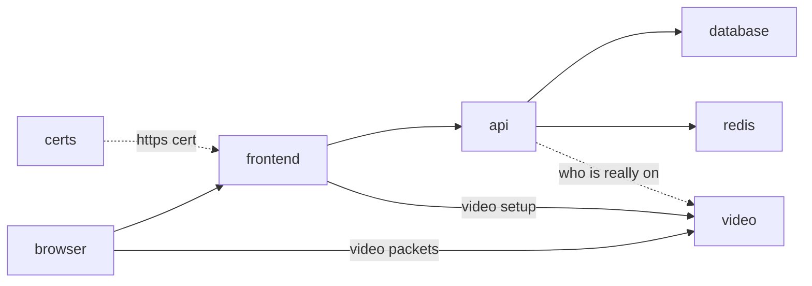

# test stream

one computer. you open its ip. one person goes live. other people watch.

## deploy

put the repo on the computer.
run `./deploy.sh`.
it prints a url. open it.
click through the warning.

## screens

- **home** — who is live
- **go live** — your camera, a name box, a start button, your bio. you get a watch link to copy
- **watch** — their camera and their bio. if they are not on yet, it keeps checking

## on the computer

`./deploy.sh` starts these. same names in the compose file.

- **frontend** — the pages. react, same stack as axiom-frontend. passes api and video setup through
- **api** — save a bio. go live. stop. a log of starts and stops. only you can stop your own stream
- **database** — the bio and the log. not the video
- **redis** — who is live right now. the video box gets the final say
- **video** — rust. one upload in, copies it out
- **certs** — makes the https cert for your ip, then quits

all on one computer for this test.

## this test skips

- accounts
- passwords
- a few video sizes
- a cdn
- more than one streamer in a room

## one browser rule

camera only works on https.
a warning you click through is enough.
`http://` the ip just sends you to `https://`.

## working on the pages

start the stack once with `./deploy.sh`.
then `cd frontend && npm install && npm run dev`.
open `http://localhost:3000`. edits show up live.
the camera works there too.

## ports to open

- 80 and 443, tcp. the site.
- 7882, udp. the video.

## when one computer fills up

add fanout computers.
the streamer still uploads once.
