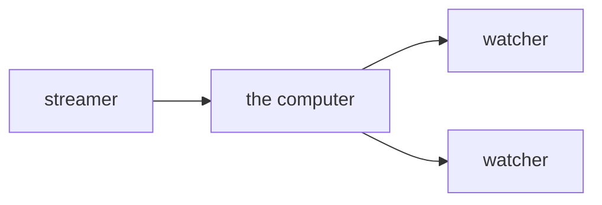
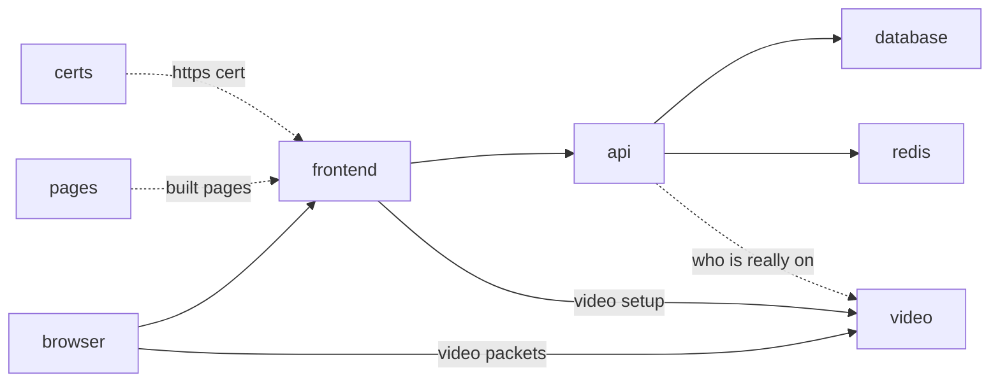

# test stream

one computer. you open its ip. one person goes live. other people watch.



## deploy

on the server:

```
git clone <repo> && cd slop-stream-architecture
./deploy.sh
```

it prints a url. open it. click through the warning.

## update

- `./deploy.sh --pull` — pull, rebuild only what changed
- `./deploy.sh api` — only the api. streams stay up
- `./deploy.sh frontend` — only the pages. streams stay up
- `./deploy.sh video` — ends every stream. it warns first
- `./deploy.sh` — everything again

## screens

- **home** — who is live
- **go live** — your camera, a name box, a start button, your bio. you get a watch link to copy
- **watch** — their camera and their bio. if they are not on yet, it keeps checking

## on the computer

`./deploy.sh` starts these. same names in the compose file.



- **frontend** — the pages. react, same stack as axiom-frontend. passes api and video setup through
- **api** — save a bio. go live. stop. a log of starts and stops. only you can stop your own stream
- **database** — the bio and the log. not the video
- **redis** — who is live right now. the video box gets the final say
- **video** — rust. one upload in, copies it out
- **certs** — makes the https cert for your ip, then quits
- **pages** — builds the react pages, hands them to frontend, then quits
- **dummy** — fake streams for styling. off unless you turn it on
- **dummy** — fake streams for styling. bouncing boxes with names on them. off by default

all on one computer for this test.

## this test skips

- accounts
- passwords
- a few video sizes
- a cdn
- more than one streamer in a room

## one browser rule

camera only works on https.
a warning you click through is enough.
`http://` the ip just sends you to `https://`.

## fake streams

for styling without a camera. in `.env`:

```
DUMMY_STREAMS=3
DUMMY_PASSWORD=anyword
```

then `./deploy.sh dummy`. home fills with `dummy-mango`, `dummy-pixel`, `dummy-disco`.
each is a coloured box bouncing around with its name and a clock. a quiet tone for sound.
your own names: `DUMMY_NAMES=alice,bob,carol`.
the password is what lets the dummy box use `dummy-` names. nobody else can.
each fake stream costs about a tenth of a core.

## test

by hand: open the url, go live, open the watch link on your phone.

by script, on your mac:

- `./test.sh` — real chrome with a fake camera. go live, watch, stop. 10 seconds
- `./test.sh https://1.2.3.4` — same thing against the server
- `./test.sh --all` — also the redeploys, with a stream running through them

## fake streams

for styling and debugging. a coloured box bounces around with the stream's name on it.

in `.env`:

```
DUMMY_STREAMS=3
DUMMY_PASSWORD=anyword
```

then `./deploy.sh dummy`. home shows dummy-mango, dummy-pixel, dummy-disco.
set it back to 0 and run it again to turn them off.
only the dummy box knows the password, so nobody else can post a dummy- name.
each one costs about a tenth of a core.

## working on the pages

`cd frontend && npm install && npm run dev`.
open `http://localhost:42069`. edits show up live.
the camera works there too.

which backend it talks to:

- `BACKEND=https://192.81.135.162 npm run dev` — the server. no docker needed on your mac
- plain `npm run dev` — the docker stack on your mac (`./deploy.sh` first)

put `BACKEND=...` in `frontend/.env` to make it stick.
no password needed. the backend talks to any pages that speak its api.

## ports to open

- 80 and 443, tcp. the site.
- 7882, udp. the video.

## when one computer fills up

add fanout computers.
the streamer still uploads once.
